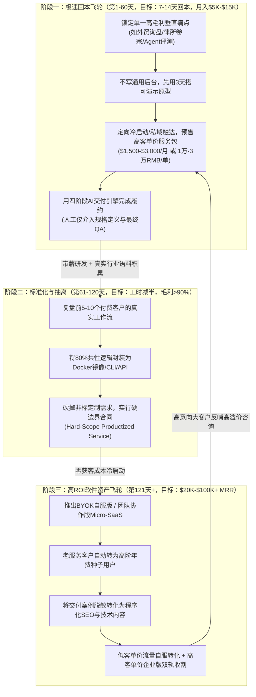
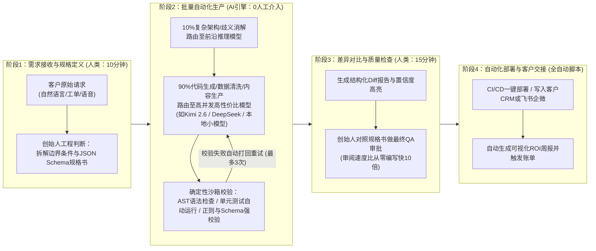
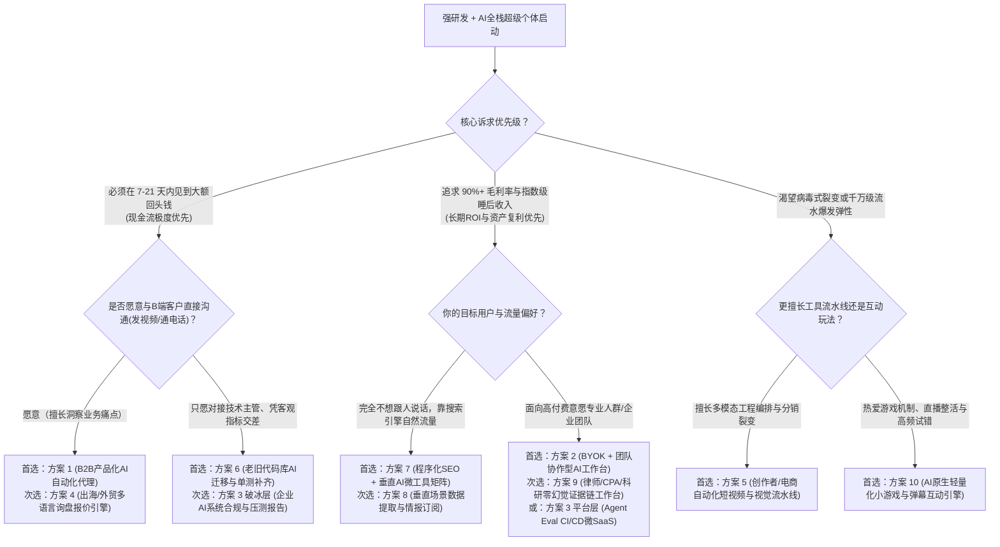

# 强研发与AI全栈超级个体：一人AI公司（OPC）最优投入产出比与最短回本周期深度分析报告

> 调研与撰写日期：2026-10-21。
>
> 适用画像：兼具**强研发/工程技术背景**（精通系统架构、代码重构、AST/编译器/沙箱、API与数据库工程、私有化与安全合规）与**AI全栈超级个体能力**（熟练驾驭多智能体编排、MCP工具生态、混合模型路由、Eval评测管线与自动化增长工作流）的单人创业者。
>
> 市场视角：**国内外双视角对比與套利**（兼顾海外欧美/日韩高客单价Stripe订阅生态，与中国本土企微私域、出海制造业赋能及政企合规生态）。
>
> 核心命题：在2026年大模型与智能体技术底座高度成熟的背景下，一个人开公司（One Person Company, OPC），**做什么业务的投入产出比（ROI）最好？做什么业务的回本周期（Payback Period）最短？**

---

## 0. 阅读指南、核算口径与能力基线

### 0.1 你的核心问题在哪里回答

| 核心问题 | 所在章节 | 关键产出 |
|---|---|---|
| **直接结论：什么业务回本最快？什么业务ROI最高？** | 第 1 节 | 最短回本Top 5榜单、最高ROI Top 5榜单、“现金流—资产”双飞轮架构 |
| **如何避免“表面月入数万、实际倒贴算力与工时”的假盈利？** | 第 0.2、3.2 节 | 一人公司AI损益表（P&L）、完整合格任务成本公式、四阶段人机交付管线 |
| **现在市面上所有AI一人公司方向有哪些？哪些是坑？** | 第 2 节 | 6大象限24个细分方向全景扫描、4类必须淘汰的伪机会清单 |
| **不同方向怎么横向硬核对比？** | 第 3 节 | 8维量化评分矩阵（启动资金、首笔收入、回本周期、毛利率、单人天花板等） |
| **最值得干的10个具体方案是什么？怎么落地、怎么算账？** | 第 4 节（4.1–4.10） | 10个最佳方案的完整商业闭环、国内外双路径、技术栈、成本收益精算表与防御壁垒 |
| **如果今天就开始，前90天一步一步怎么干？何时止损？** | 第 5 节與附录 | 预算/时间决策树、90天里程碑执行表、量化止损与提价硬指标、实证案例来源 |

---

### 0.2 核心财务与单位经济（Unit Economics）核算口径

很多一人AI公司购买了五六套AI订阅与API，感觉“干活变快了”，但月底算账却发现没赚到钱。为了避免“伪高毛利”和“隐性工时陷阱”，本报告统一采用以下**五项硬核财务口径**进行跨赛道对比：

1. **完整合格任务成本（Cost per Qualified Task, $C_{\text{task}}$）**：
   衡量AI交付管线真实成本的唯一核心指标，绝不能只看单次Token单价：
   $$C_{\text{task}} = \frac{C_{\text{API}} + C_{\text{infra}} + C_{\text{SaaS}} + (T_{\text{review}} + T_{\text{rework}}) \times W_{\text{founder}}}{N_{\text{qualified}}}$$
   - $C_{\text{API}}$：大模型推理、Embedding、重排、语音/视觉生成及重试消耗的Token与算力费；
   - $C_{\text{infra}}$：服务器、Serverless、向量库、代理IP与沙箱托管成本；
   - $C_{\text{SaaS}}$：开发辅助（Cursor等）、自动化编排、CRM与邮件营销工具分摊成本；
   - $T_{\text{review}} + T_{\text{rework}}$：创业者用于需求规格定义、人工质检（QA）、幻觉修正与返工的小时数；
   - $W_{\text{founder}}$：强研发创业者的机会成本影子时薪（本报告基准设为 **300元/小时** 或 **50美元/小时**）；
   - $N_{\text{qualified}}$：真正达到客户验收标准、无需二次退款或客诉的合格交付物数量。

2. **完全回本周期（Full Payback Period, $T_{\text{payback}}$）**：
   从项目立项第1天起，累计净现金流首次覆盖全部前期现金投入（硬件添置、域名、公司注册、首期API充值、软件订阅、首轮测试推广费）所需的天数或周数：
   $$\sum_{t=1}^{T_{\text{payback}}} \left(\text{Cash Inflow}_t - \text{Direct Cash Outflow}_t\right) \ge I_{\text{initial}}$$
   - **现金口径回本（Cash Payback）**：仅计算真金白银的现金支出回本（一人公司生存底线）；
   - **含工时完全回本（Full Economic Payback）**：将前期研发投入工时按影子时薪折算为隐性资本投入后的回本周期。

3. **获客成本回收期（CAC Payback Period）**：
   针对订阅制（SaaS / Retainer）业务，收回单个客户获取成本所需的月数：
   $$\text{CAC Payback (Months)} = \frac{\text{CAC}}{\text{ARPU} \times \text{Gross Margin \%}}$$
   - 一人公司自服式（Self-serve）SaaS健康基准：**$\le 3\text{ 个月}$**（若超过6个月且无外部融资，现金流极易断裂）。

4. **全周期投入产出比（Full-Lifecycle ROI）**：
   以12个月为一个核算周期，衡量单位资金与核心研发精力投入所撬动的净现金回报倍数：
   $$\text{ROI}_{12\text{m}} = \frac{\text{Net Profit}_{12\text{m}} - (T_{\text{total\_hours}} \times W_{\text{founder}})}{I_{\text{initial}} + C_{\text{opex\_12m}}}$$
   - 在本报告中，同时报告**现金乘数（Cash-on-Cash Multiple，即净现金利润 ÷ 启动与运营现金投入）**与**有效时薪（Effective Hourly Rate, $\text{EHR} = \text{Net Cash Profit} \div T_{\text{total\_hours}}$）**。

5. **单人精力承载天花板（Solo MRR Ceiling）**：
   在不雇佣全职人类员工、每周工作时长控制在45小时以内、且交付质量不发生退化的前提下，单人依靠AI数字员工管线可稳定维持的最高月经常性收入（MRR）。

---

### 0.3 证据与数据标记说明

本报告引用的2025—2026年行业实证数据与案例遵循以下可信度标记：

- **【实证公开数据】**：来自独立开发者公开账本（如Stripe验证截图、Indie Hackers、Starter Story、作者公开财报推文）或权威调研机构报告（如《2026年中国OPC白皮书》、Bessemer/OpenView SaaS基准）；
- **【工程实测基准】**：基于2026年主流大模型API定价（如前沿推理模型 vs. Kimi 2.6 / DeepSeek / 开源微调模型等高性价比生产模型）、云原生Serverless架构与标准转化率计算的工程推演值；
- **【策略判断】**：针对“强研发+AI全栈”画像给出的架构与商业选型建议。

---

### 0.4 为什么“强研发/工程 + AI全栈”是一人公司的顶配画像？

根据《2026年中国一人公司（OPC）调研报告》与全球独立开发者生态统计，截至2025—2026年，中国一人有限责任公司已突破1600万家，但**50%仍处于业务探索期，月收入中位数不足7000元人民币，仅2%能达到年收入500万元以上**。造成98%普通OPC挣扎温饱的核心原因是：他们只会用现成的Web端AI工具做“低门槛内容搬运或简单套壳”，迅速陷入严重同质化与价格战。

而**“强研发/工程技术背景 + AI全栈超级个体”**拥有普通创业者无法复制的**三大不对称降维优势**：

1. **用确定性代码（AST/规则引擎/状态机）关住概率性模型的“幻觉笼子”**：
   普通人搭Agent靠写长Prompt，准确率卡在75%就无法向B端交付；强研发个体能用静态代码分析、Schema强约束、沙箱执行验证、回滚机制把端到端交付可靠度推高至99%以上，直接跨过企业级付费门槛。
2. **混合模型路由（Hybrid Model Routing）实现10倍算力成本剪刀差**：
   普通人全流程调用昂贵的前沿闭源大模型，不仅常撞上并发速率限制（Rate Limit），且算力成本占掉收入的30%—50%；强工程个体能将任务拆解为“10%高难度规划调用前沿模型 + 90%海量结构化生产调用高并发低成本模型（如Kimi 2.6、DeepSeek系列或本地vLLM量化小模型）+ 本地脚本清洗”，将算力成本压缩至收入的 **1%—5%以内**。
3. **打通企业“最后一公里”异构系统与私有化合规部署**：
   真正有高付费能力的B端客户（外贸工厂、律所、医疗、金融、中型研发团队）的数据都在老旧ERP、内网数据库、非标PDF和企微/飞书里。强工程个体能手写连接器、处理反爬、提供Docker一键私有化部署或BYOK（自带密钥）无痕架构，直接吃下无代码玩家啃不动的硬骨头。

---

## 1. 先看结论：什么业务回本最快？什么业务投入产出比（ROI）最好？

### 1.1 一句话总结论

- **若追求“回本周期最短”（1—30天内见到回头钱并覆盖全部成本）**：
  绝对不要闭门造车写SaaS平台，而应选择**“高客单价B2B产品化AI工程服务（Productized AI Engineering Service / AI OS Agency）”**或**“遗留代码库现代化/AI系统合规健检单次交付”**。利用“先收50%预付款或首月Retainer（月固定服务费）、后用自研AI管线交付”的负营运资金模式，**首单成交即100%回本**，回本周期仅需 **7—21天**。
- **若追求“投入产出比（ROI）最好”（12个月现金乘数 > 20倍，稳态毛利率 88%—95%+，单人月净利上限 3万—12万美元）**：
  最优解是**“BYOK（自带密钥）/本地优先架构的垂直B2B工作流软件”**、**“嵌入研发管线的Agent评测与合规微SaaS”**，以及**“一套采集解析管线同时售卖给N家同行的垂直行业AI情报订阅系统”**。这类业务将边际算力成本转嫁给客户（BYOK）或摊薄至接近于零（一鱼多吃），彻底打破单人时间天花板。
- **针对强研发超级个体的终极答案（双飞轮演进策略）**：
  将两者结合——**前30—60天用“产品化AI工程服务”实现7天极速回本，拿着客户的钱打磨自动化管线；第60—180天将服务中80%重复出现的工程模块抽离为“BYOK/私有化部署包或垂直Micro-SaaS”**，完成从“高时薪指挥官”向“高复利数字资产拥有者”的跃迁。

---

### 1.2 回本周期最短（Shortest Payback Period）Top 5 业务排行榜

> 排序基准：按从启动第1天到累计净现金流入完全覆盖初始现金投入（通常为1,500—5,000元人民币）并产生5,000元以上净现金结余所需的天数排序。

| 排名 | 业务形态（对应第4章方案） | 启动现金投入 | 首单收费模式与客单价 | 现金回本周期 | 含工时完全回本 | 为什么它回本最快？（底层机制） |
|---|---|---|---|---|---|---|
| **第 1 名** | **B2B垂直行业“产品化AI自动化代理”** （对应 **方案 1**） | 1,000–2,000元 （域名+基础API） | 预收首月Retainer或50%定金 海外：$1,500–$5,000/月 国内：8,000–25,000元/月 | **7–14 天** （首单定金到账即回本10倍） | **14–21 天** | **先收钱后生产**：无需提前写完通用软件，用现成Demo向高痛点B端老板预售固定范围自动化管线，签约收款后再用AI引擎生产。 |
| **第 2 名** | **企业AI系统合规健检与Agent评测单次审计包** （对应 **方案 3** 破冰层） | 1,000–2,500元 （评测脚本+算力） | 固定价格单次诊断报告 海外：$1,000–$3,000/次 国内：5,000–20,000元/次 | **10–21 天** （1单即全额回本） | **20–30 天** | **切中合规与上线恐惧**：利用自研自动化红队测试与幻觉扫描脚本，跑2小时生成50页专业诊断书，交付极轻、决策周期极短。 |
| **第 3 名** | **老旧代码库AI现代化迁移与单测补齐工程包** （对应 **方案 6**） | 1,500–2,500元 （AST工具链+API） | 按模块/代码行数里程碑预付 海外：$2,000–$8,000/模块 国内：10,000–40,000元/项 | **10–25 天** （首笔里程碑款即回本） | **21–35 天** | **预算明确、验收客观**：代码能否编译通过、单测覆盖率是否从15%升至85%一目了然，研发主管极易批预算，AI替代90%苦力。 |
| **第 4 名** | **出海/外贸B2B多语言技术询盘与图册转化引擎** （对应 **方案 4**） | 1,500–3,000元 | 基础部署费+月维保/提成 国内出海厂：1.5万–5万元/年 海外批发商：$999–$2,499/季 | **14–28 天** | **25–40 天** | **直接挂钩客户营收**：帮外贸工厂老板把原本漏掉的小语种夜间询盘接住并生成专业工程报价，多成一单外贸单即可赚回十年服务费。 |
| **第 5 名** | **垂直场景AI竞品情报与招投标/价格监控订阅** （对应 **方案 8**） | 1,500–3,000元 （代理IP+解析器） | 行业情报早报年费/季费 海外：$199–$499/月 国内：3,980–12,800元/年 | **15–30 天** （预售3–5个同行即回本） | **30–45 天** | **写一次脚本，收N份钱**：针对特定行业（如医疗器械招投标、跨境爆品监控）搭好1套采集解析管线，同时向10家同行售卖日报。 |

---

### 1.3 投入产出比最好（Highest ROI）Top 5 业务排行榜

> 排序基准：按12—24个月周期内的**综合投入产出比（净现金利润 ÷ 总现金与工时投入）**、**稳态毛利率**以及**单人精力可承载的MRR上限**综合排序。

| 排名 | 业务形态（对应第4章方案） | 稳态毛利率 | 单人月净利天花板 | 12个月现金乘数（Cash ROI） | 有效时薪（EHR） | 为什么它投入产出比最高？（杠杆来源） |
|---|---|---|---|---|---|---|
| **第 1 名** | **BYOK + 团队协作型AI生产力与垂直工作台** （对应 **方案 2**） | **92%–96%** | **$30K–$130K/月** （约20万–90万RMB） | **30x – 100x+** | **$500–$2,000+/h** | **零算力成本 + B2B席位裂变**：客户自带API Key（或购买高溢价团队席位包），软件本身几乎只有轻量Web托管费；个人用户带入企业后自动裂变为数十人团队订单（如TypingMind达$130K+ MRR）。 |
| **第 2 名** | **高时薪专业人士“零幻觉”强引用证据链工作台** （对应 **方案 9**） | **88%–93%** | **$25K–$80K/月** （约18万–55万RMB） | **25x – 60x** | **$400–$1,200/h** | **高客单价 + 极低流失率**：服务律师、注册会计师、临床/专利研究员，对价格极度不敏感但对“防幻觉、原文坐标锁定、本地保密”有刚需，LTV（生命周期价值）长达3年以上。 |
| **第 3 名** | **企业级Agent评测（Eval）、可观测与合规微SaaS** （对应 **方案 3** 平台层） | **88%–92%** | **$25K–$75K/月** （约18万–50万RMB） | **20x – 55x** | **$350–$1,000/h** | **卖铲子给淘金者 + 深度嵌入CI/CD**：一旦嵌入企业研发团队的GitHub Actions发版管线，几乎永远不会被卸载；按评测轨迹量或席位阶梯收费，随客户业务增长自动增收。 |
| **第 4 名** | **垂直场景AI非结构化数据提取与情报监控系统** （对应 **方案 8**） | **90%–94%** | **$20K–$60K/月** （约15万–40万RMB） | **20x – 50x** | **$300–$900/h** | **极致的“一鱼多吃”边际效应**：爬1次数据、调1次高性价比模型解析成结构化JSON，分发给第1个客户和第500个客户的边际成本几乎为0，且历史结构化数据库越积越值钱。 |
| **第 5 名** | **程序化SEO + 高频垂直AI微工具矩阵** （对应 **方案 7**） | **85%–92%** | **$15K–$50K/月** （约10万–35万RMB） | **15x – 45x** | **$250–$800/h** | **零获客成本的被动复利资产**：用工程化脚本批量生成数千个精准解决长尾痛点的交互式微工具页面，截获Google与AI搜索引擎自然流量，建成后每周仅需2—3小时维护。 |

---

### 1.4 为什么“回本最快”与“ROI最高”不是同一件事？如何用“双飞轮”兼得？

在商业物理定律中，**“回本速度（Cash Velocity）”**与**“长期杠杆率（Asset Leverage）”**存在天然张力：

1. **纯服务/代理模式（Agency / Service）的困局**：
   - **优势**：信任门槛低、客单价高（$1,500—$5,000/月）、无需做完产品就能收钱，**第1—2周即可回本**。
   - **瓶颈**：即便像2026年标杆案例 `@DeRonin_` 那样用Kimi 2.6等高性价比模型构建自动化交付管线，将14个客户的月运营成本压到750美元、月入4万美元（利润率98%），单人仍需承担“10分钟需求定义 + 15分钟人工QA”以及客户沟通成本。当客户数超过12—15个时，上下文切换（Context Switching）会让单人精力触顶，收入天花板锁死在 **$20K—$40K/月**，且一旦停工收入可能滑坡。
2. **纯自服软件模式（Pure Micro-SaaS）的困局**：
   - **优势**：边际交付成本趋近于零，睡后收入复利极强，可卖公司（通常按ARR的3—6倍估值退出）。
   - **瓶颈**：根据2026年Ciela AI与Indie Hackers统计，白手起家（Bootstrapped）的纯AI SaaS达到$10K MRR的**中位数时间长达18—36个月**，前3—6个月月收入往往在$0—$500之间徘徊。最大的死因不是代码写不出来，而是**“闭门造出伪需求”**以及**“低客单价（$19—$49/月）无法覆盖高昂的获客成本（CAC）”**。

#### 强研发超级个体的最优解：现金流—资产双飞轮架构（Service-to-SaaS Flywheel）

对于既有工程实力又懂AI全栈的个人创业者，最高明的打法不是二选一，而是**分阶段演进**：

---

### 1.5 国内外双市场（Global vs. China）结构性差异与套利策略

强研发超级个体在2026年最大的地理套利空间，在于**“用中国顶级的工程效率与高性价比算力供应链，同时收割海外高溢价订阅市场与中国本土高密度产业带需求”**：

| 维度 | 海外市场（欧美/日韩/全球英语区） | 中国本土市场（长三角/珠三角/一线私域） | 强研发个体的双市场套利打法 |
|---|---|---|---|
| **核心付费习惯** | 高度习惯信用卡自助订阅（Stripe/LemonSqueezy），尊重软件价值，愿意为节省时间的微工具支付 $29–$499/月。 | C端与小微B端对纯软件订阅极度抠门；但**对“能直接带来询盘/订单/降本结果”的代运营、定制部署或垂直硬件/电商配套极度慷慨**。 | **一鱼两吃**：同一套底层引擎，海外包装成Self-serve SaaS收美元月费；国内包装成“行业解决方案部署包+年度算力维保”收万元级年费。 |
| **获客主阵地** | Google SEO / Programmatic SEO、X (Twitter) Build in Public、Reddit垂类社区、Product Hunt、YouTube/TikTok评测分销（Affiliate）。 | 小红书/抖音/视频号垂直干货号引流至**企业微信私域**、淘宝/闲鱼高意向搜索截流、产业带商会/同行转介绍。 | 用海外X/GitHub建立技术权威，用AI翻译改写后同步分发至国内小红书/公众号/视频号，截获高净值B端老板。 |
| **合规与基建门槛** | 需海外公司主体（如美国Stripe Atlas / 英国公司 / 香港公司）收款；高度关注GDPR与SOC2/数据隐私（BYOK极受欢迎）。 | 国内公网C端上线需ICP备案与生成式AI算法备案；但**企业内网私有化部署、开源插件、BYOK桌面端或B2B专项技术服务无需繁琐C端内容审查**。 | 国内坚决避开泛C端公网聊天/内容生成红海，专注做**B2B私有化部署、桌面端/浏览器插件+BYOK、或跨境企业服务**。 |
| **算力成本结构** | 欧美创业者习惯默认调OpenAI/Anthropic前沿模型，单客户月均API成本常高达$50–$300。 | 国产大模型（如Kimi 2.6、DeepSeek、Qwen等）在代码与长文本生产上具备极致的性价比与高并发配额。 | **算力套利**：在非敏感/通用生产环节采用高性价比模型栈驱动海外业务，毛利率直接比欧美本土同行高出15%–25%。 |

---

## 2. 广度探索：2026年AI一人公司 6 大象限 24 个细分赛道全扫描

为了避免“拍脑袋选方向”或受幸存者偏差误导，我们まず对2026年全球与中国本土所有可由“单人+AI系统”独立完成商业闭环的业务形态进行穷尽式扫描，将其划分为 **6大商业象限、24个细分赛道**，并逐一评估其准入门槛、变现逻辑与初筛结论。

### 2.1 六大商业象限 24 个细分赛道全景扫描表

| 所属象限 | 细分赛道编号与名称 | 核心交付物与收费模式 | 目标客户群 | 强工程优势发挥度 | 初筛结论与去向 |
|---|---|---|---|---|---|
| **象限一： 产品化AI工程服务与自动化代理** *(Productized AI Services)* | **1.1 垂直行业AI自动化代理（AI OS Agency）** | 线索清洗/多模态客服/ERP回写管线；按月Retainer（$1.5K–$5K/月） | 律所、诊所、外贸工厂、医美、物流商 | ★★★★★ | **【核心入选 → 方案1】** 回本速度全场第一 |
| | **1.2 遗留系统（Legacy Code）AI现代化迁移服务** | 老旧PHP/Java/COBOL重构与单测补齐；按代码行/模块里程碑收费 | 中小软件企业、传统金融机构、外包商 | ★★★★★ | **【核心入选 → 方案6】** 强研发降维打击金矿 |
| | **1.3 企业私有化大模型/知识库定制部署外包** | 本地vLLM部署+RAG微调；一次性项目制（3万–15万RMB） | 国内政企、国央企二级单位、传统制造 | ★★★☆☆ | **【有条件备选/淘汰重定制】** 账期长、驻场内耗大，仅可做标准化镜像包 |
| | **1.4 AI ROI与业务流程健检咨询（AI Audit）** | 诊断企业现有流程与Token浪费，出具自动化改造蓝图；单次收费 | 年营收1000万–1亿的传统中小企业主 | ★★★★☆ | **【并入方案1与方案3作为前端破冰钩子】** |
| **象限二： 垂直B2B Micro-SaaS与工作流软件** *(Vertical B2B SaaS)* | **2.1 BYOK + 团队协作型AI工作台外壳** | 支持自带Key、团队权限、MCP插件、共享Prompt库的Web/桌面端；买断+团队订阅 | 中小科技团队、高频AI重度使用者 | ★★★★★ | **【核心入选 → 方案2】** 长期ROI与毛利率全场第一 |
| | **2.2 跨境/外贸B2B多语言技术询盘与报价引擎** | 工程图纸解析、多语种7×24应答、自动生成BOM报价单；年费+提成 | 中国出海制造工厂、海外本土工业批发商 | ★★★★★ | **【核心入选 → 方案4】** 离钱最近、续费率极高 |
| | **2.3 高时薪专业人士“零幻觉”强引用办案/撰稿系统** | 卷宗/审计底稿/临床文献原文坐标锁定的核查工作台；高客单价订阅 | 独立律师、CPA会计师、专利代理人 | ★★★★★ | **【核心入选 → 方案9】** 高ARPU、超长LTV |
| | **2.4 通用型AI会议纪要 / 泛用型PDF聊天工具** | 录音转写摘要、上传PDF问答；月费$9–$19 | 泛职场白领、学生 | ★☆☆☆☆ | **【明确淘汰】** 已被大厂原生功能与操作系统级AI彻底吞噬 |
| **象限三： 开发者工具、评测合规与基础设施** *(DevTools & Infra)* | **3.1 企业级Agent评测（Eval）、回归测试与合规审计微工具** | 失败轨迹聚类、Prompt注入红队测试、合规报告生成；SaaS+单次健检 | 正在开发AI功能的SaaS团队、出海企业 | ★★★★★ | **【核心入选 → 方案3】** 2026年最强技术刚需铲子 |
| | **3.2 垂直领域MCP Server / Agent工具API市场** | 封装复杂行业数据源或操作接口供Agent按次调用；按API调用量计费 | AI应用开发者、企业Agent编排团队 | ★★★★☆ | **【并入方案8作为API分发形态】** |
| | **3.3 开源框架商业化托管（Open-Core Hosting）** | 先做GitHub高Star开源项目，再卖云托管版；云订阅 | 全球开发者 | ★★★★☆ | **【周期过长】** 前6–12个月几乎零收入，违背最短回本原则 |
| | **3.4 浏览器端/端侧WebGPU轻量推理SDK** | 零服务器成本的端侧AI组件；企业授权费 | 注重隐私的Web应用开发商 | ★★★★☆ | **【可作为方案2/方案9的底层技术加分项】** |
| **象限四： 高变现B2C与创作者生产管线** *(Prosumer & Creator)* | **4.1 自动化短视频（Faceless Video）与电商视觉流水线** | 脚本-配音-分镜-商品图-自动发布全闭环；月订阅（$29–$99/月） | YouTuber、TikTok矩阵号、跨境电商卖家 | ★★★★☆ | **【核心入选 → 方案5】** 自带分销裂变基因，爆发力极强 |
| | **4.2 垂直场景高保真AI写真/商业摄影替代（Photo AI模式）** | 职业形象照、模特换装、家居软装渲染；月订阅 | 求职者、服装电商、房产经纪人 | ★★★☆☆ | **【红海警告】** 头部效应极强，除非切入极细分B端商品图（并入方案5） |
| | **4.3 个人成长/心理陪伴/AI虚拟伴侣App** | 情感聊天、角色扮演、语音陪伴；内购充值 | 年轻C端用户 | ★★☆☆☆ | **【明确淘汰】** 买量成本极高、应用商店下架与合规风险极大 |
| | **4.4 硬件伴侣型AI应用（如Apple Watch/智能眼镜插件）** | 穿戴端随身语音闪念笔记与日程Agent；买断/年费 | 极客、高管、ADHD人群 | ★★★☆☆ | **【小而美备选】** 天花板偏低，适合作为副业练手 |
| **象限五： 数据情报、交易赋能与程序化流量** *(Data & Traffic Assets)* | **5.1 程序化SEO（pSEO）+ 高频垂直AI微工具矩阵** | 数千个长尾计算器/格式转换/合同微审工具页；按次付费+订阅+联盟佣金 | 全球长尾搜索用户 | ★★★★★ | **【核心入选 → 方案7】** 最佳被动睡后收入资产 |
| | **5.2 垂直场景AI非结构化数据提取与竞品情报监控系统** | 招投标解析、跨境选品监控、医药专利预警日报；高价年费订阅 | 招投标企业、跨境大卖、投研机构 | ★★★★★ | **【核心入选 → 方案8】** “一鱼多吃”边际成本最低 |
| | **5.3 AI驱动的跨境电商无货源铺货/独立站卖货** | AI选品、AI生成详情页、投流卖实物；商品差价 | 海外消费者 | ★★☆☆☆ | **【淘汰实物重资产】** 压资金、退换货售后与供应链风险极易拖垮单人精力 |
| | **5.4 AI量化交易/预测市场（Polymarket等）套利机器人** | 实时抓取新闻与链上数据自动套利；自营盈亏 | 自营（无外部客户） | ★★★★☆ | **【不纳入通用商业方案】** 属本金风险博弈，非稳定经营性现金流公司 |
| **象限六： 互动娱乐与垂直知识IP** *(Media & Knowledge IP)* | **6.1 AI原生轻量化小游戏 / 直播弹幕互动游戏** | AI生成美术、数值、动态剧情的微信小游戏/抖音弹幕游戏/Steam微游；内购与分成 | 直播间主播、休闲玩家 | ★★★★☆ | **【核心入选 → 方案10】** 国内实证单人千万级流水赛道 |
| | **6.2 AI全自动多语种内容矩阵号（YouTube/小红书流量主）** | 批量生产科普/书评/故事视频赚平台广告分成；广告与带货佣金 | 平台泛受众 | ★★☆☆☆ | **【明确淘汰纯做号】** 平台算法封号与限流风险极高，不如卖工具给做号的人（方案5） |
| | **6.3 面向开发者的AI工程实战付费社群与企业内训** | 传授架构经验、售卖脚手架源码（Boilerplate）；单价$199–$999 | 程序员、转型工程师 | ★★★☆☆ | **【作为所有方案的副产品变现，不单独列为主业】** |
| | **6.4 AI辅助网文/漫剧/短剧代工生产工作室** | 用AI生成剧本分镜与动态漫；平台保底+分成 | 短剧平台、网文平台 | ★★☆☆☆ | **【淘汰】** 已沦为劳动密集型血汗工厂，单价暴跌 |

---

### 2.2 明确淘汰的 5 类“伪机会”与高危陷阱（为什么强研发个体千万别碰？）

在深入分析最佳10个方案前，必须先划清红线。以下5类业务在社交媒体上常被包装成“暴利风口”，但从单位经济模型与2026年市场演化来看，是一人公司的**坟场**：

1. **陷阱一：泛C端“薄套壳”通用效率工具（如通用AI写作、通用PDF问答、通用思维导图）**
   - **死因剖析**：2026年基础模型厂商（OpenAI、Anthropic、Google及国内大厂）已将文件解析、联网搜索、Canvas协同、桌面级OS助手全面内置。泛C端用户月付费意愿低于$10，而Google Ads单次点击成本（CPC）已飙升至$3—$8，CAC回收期超过18个月，但C端用户平均留存不足2个月，**每获取一个付费用户都在净亏现金**。
2. **陷阱二：按工时计费的传统定制软件外包与需要驻场/长账期的政企项目**
   - **死因剖析**：国内许多转型程序员容易接“5万元帮某国企或传统公司定制一套内网AI系统”的私单。这类项目需求边界极度模糊、验收标准主观、动辄要求线下开会驻场，且尾款账期长达6—12个月。**一人公司最宝贵的资产是创始人的连续心流时间（Deep Work）与即时现金流**，一旦陷入1—2个非标烂尾外包，全年机会成本损失高达数十万元。
3. **陷阱三：依赖单一社交平台算法漏洞的“全自动批量起号/灰产矩阵”**
   - **死因剖析**：2025—2026年各大内容平台（YouTube、TikTok、微信视频号、小红书）已全面上线针对低质AI批量生成内容（AI Slop）的指纹识别与限流机制。靠脚本日发1000条低质图文/视频赚平台流量补贴的模式，不仅账号存活周期不足15天，且无法沉淀任何可复用的客户关系与技术品牌资产。
4. **陷阱四：重度依赖前沿昂贵大模型推理、却采用“低价无限量包月”的ToC应用**
   - **死因剖析**：如果一款月费$19的应用背后每次请求都要跑多轮前沿推理模型（单次调用成本$0.05—$0.20），只要出现5%的重度高频羊毛党用户（或遭遇恶意刷接口），当月API账单就会直接击穿全部订阅收入，导致毛利率变为负数。
5. **陷阱五：需要垫资备货与处理复杂逆向物流的AI实物电商**
   - **死因剖析**：除非创始人原本就有极强的家族工厂或供应链资源（如《2026中国OPC白皮书》中原本就做茶业的创业者），否则纯技术背景创业者切入实物电商，90%的精力会被海关清关、退换货纠纷、库存积压和平台罚款吞噬，完全背离软件与AI的高杠杆本质。

---

## 3. 深入分析与多维量化对比体系

### 3.1 一人AI公司 8 维量化评估矩阵（Top 10 入选方案横向对比）

为了客观回答“谁回本最快、谁ROI最高”，我们将严选出的 **10个最佳方案** 置于同一套 **8维量化坐标系** 中进行硬核比对（评分采用10分制，分值越高代表对单人创业者越有利）：

| 方案编号与名称 | 1. 启动现金成本 *(越低越好)* | 2. 首笔收入速度 *(Time to $1)* | 3. 完全回本周期 *(含前期现金)* | 4. 稳态毛利率 *(扣除API/云)* | 5. 单人月净利上限 *(MRR Ceiling)* | 6. 技术与数据壁垒 *(防大厂吞噬)* | 7. 获客确定性 *(冷启动难度)* | 8. 国内外双市场适配度 | **综合特征标签** |
|---|---|---|---|---|---|---|---|---|---|
| **方案 1：B2B垂直行业“产品化AI自动化代理”** | **< 2,000元** (9.5分) | **3–10 天** (10.0分) | **7–14 天** (10.0分) | **85%–92%** (9.0分) | **$15K–$40K/月** (7.5分) | **行业SOP与集成壁垒** (8.0分) | **高（定向直联预售）** (9.5分) | 极佳（中外通吃） (9.5分) | **【最短回本总冠军】** |
| **方案 2：BYOK + 团队协作型AI生产力与工作台** | **< 3,000元** (9.0分) | **14–30 天** (8.0分) | **30–60 天** (8.5分) | **92%–96%** (10.0分) | **$30K–$130K+/月** (10.0分) | **工作流沉淀与席位粘性** (8.5分) | **中（需Build in Public）** (8.0分) | 海外极佳/国内做私有化 (9.0分) | **【最高ROI软件总冠军】** |
| **方案 3：企业级Agent评测（Eval）与合规审计微工具** | **< 3,000元** (9.0分) | **10–21 天** (9.0分) | **15–30 天** (9.5分) | **88%–92%** (9.0分) | **$25K–$75K/月** (9.0分) | **极高（深度嵌入CI/CD）** (9.5分) | **高（以合规健检破冰）** (8.5分) | 极佳（中外均强监管） (9.0分) | **【强工程壁垒总冠军】** |
| **方案 4：出海/外贸B2B多语言技术询盘与报价引擎** | **< 3,000元** (9.0分) | **7–21 天** (9.0分) | **14–28 天** (9.5分) | **85%–90%** (8.8分) | **$20K–$60K/月** (8.5分) | **高（非标工程图纸解析）** (9.0分) | **高（直接帮客户赚钱）** (9.0分) | 专为中国出海/外贸定制 (9.5分) | **【跨境B2B刚需冠军】** |
| **方案 5：创作者/电商自动化短视频与视觉流水线** | **< 5,000元** (8.0分) | **14–30 天** (8.0分) | **30–60 天** (8.0分) | **75%–82%** (7.8分) | **$30K–$100K/月** (9.5分) | **中（多模型编排与模板）** (7.5分) | **极高（30%分销自裂变）** (9.5分) | 极佳（中外电商/短视频） (9.0分) | **【病毒裂变现金流冠军】** |
| **方案 6：老旧代码库AI现代化迁移与单测补齐服务** | **< 2,000元** (9.5分) | **7–15 天** (9.5分) | **10–25 天** (9.5分) | **88%–94%** (9.2分) | **$20K–$50K/月** (8.0分) | **极高（AST+编译器级验证）** (9.5分) | **高（验收客观无扯皮）** (8.5分) | 极佳（全球遗留系统金矿） (9.0分) | **【硬核研发变现冠军】** |
| **方案 7：程序化SEO + 高频垂直AI微工具矩阵** | **< 1,500元** (10.0分) | **30–60 天** (6.5分) | **60–90 天** (7.0分) | **85%–92%** (9.0分) | **$15K–$50K/月** (8.5分) | **中（长尾词霸屏与域名权重）** (7.5分) | **高（被动搜索自然流量）** (9.0分) | 海外为主（Google生态） (8.0分) | **【被动睡后复利冠军】** |
| **方案 8：垂直场景AI数据提取与竞品情报监控系统** | **< 3,000元** (9.0分) | **10–21 天** (9.0分) | **15–30 天** (9.0分) | **90%–94%** (9.5分) | **$20K–$60K/月** (8.5分) | **极高（反爬+历史结构化库）** (9.2分) | **高（免费情报样刊钩子）** (8.8分) | 极佳（招投标/选品/金融） (9.0分) | **【一鱼多吃高毛利冠军】** |
| **方案 9：高时薪专业人士“零幻觉”证据链工作台** | **< 3,000元** (9.0分) | **14–30 天** (8.0分) | **21–45 天** (8.5分) | **88%–93%** (9.0分) | **$25K–$80K/月** (9.0分) | **极高（强引用溯源+本地加密）** (9.2分) | **中（需专业圈层口碑）** (8.0分) | 极佳（律师/CPA/科研） (9.0分) | **【高客单价高留存冠军】** |
| **方案 10：AI原生轻量化小游戏与直播弹幕互动引擎** | **< 5,000元** (8.0分) | **21–45 天** (7.5分) | **30–60 天** (8.0分) | **70%–85%** (8.0分) | **$10K–$150K/月** (9.5分) | **中（高频迭代与数值玩法）** (7.5分) | **高（主播分成/平台推荐）** (8.5分) | 国内弹幕/海外Steam双栖 (8.5分) | **【非线性爆发黑马冠军】** |

---

### 3.2 为什么90%的一人公司算错账？——“一人AI公司标准损益表（P&L）”与四阶段高毛利交付管线

#### 3.2.1 传统自由职业 vs. 伪AI套壳 vs. 真正的“AI超级个体”单位经济对比

我们以月营收 **30,000美元（约21万元人民币）** 的同等业务规模为例，对比三种不同架构下的真实月度损益表（P&L）：

| 损益科目（月度） | 模式A：传统外包/初级代理公司 *(靠雇人或自己熬夜堆工时)* | 模式B：粗放型AI套壳/全前沿模型调用 *(无模型路由、无确定性工程)* | 模式C：强研发超级个体（本报告推荐架构） *(四阶段管线 + 混合模型路由 + 确定性QA)* |
|---|---|---|---|
| **月度总营收（Gross Revenue）** | **$30,000** (10个客户 × $3,000) | **$30,000** (600个订阅用户 × $50) | **$30,000** (10个B端客户 × $3,000 或混合SaaS) |
| **减：支付通道与平台抽成（~3.5%）** | -$1,050 | -$1,050 | -$1,050 |
| **减：大模型API推理成本（$C_{\text{API}}$）** | -$200 (仅零星网页端使用) | **-$9,000** (全量调昂贵前沿模型+死循环重试) | **-$280** (90%负载跑Kimi 2.6/DeepSeek + 10%前沿模型) |
| **减：云基建与工具链订阅（$C_{\text{infra}}+C_{\text{SaaS}}$）** | -$500 | -$1,200 | **-$350** (Serverless + 轻量VPS + 核心生产力工具) |
| **减：外包/初级员工薪资** | **-$15,000** (雇佣3名初级开发/运营) | $0 | **$0** (零人类员工，全靠数字员工管线) |
| **减：获客广告与退款损失（CAC & Churn）** | -$2,000 | **-$8,500** (因生成幻觉导致高客诉退款与高买量费) | **-$600** (精准Outbound直联 / SEO自然流量 / 低退款) |
| **账面净现金利润（Net Cash Profit）** | **$11,250（净利率 37.5%）** | **$10,250（净利率 34.2%）** | **$27,720（净利率 92.4%）** |
| **创始人每月投入工时（$T_{\text{hours}}$）** | **220 小时**（深陷开会、催进度、改Bug） | **160 小时**（深陷救火、处理限流与客诉） | **80–100 小时**（仅做10分钟规格定义+15分钟QA） |
| **创始人真实有效时薪（EHR）** | **$51 / 小时** | **$64 / 小时** | **$277 – $346 / 小时** |

#### 3.2.2 锁定 90%+ 毛利率的核心工程秘密：“四阶段人机协同交付引擎”

为什么模式C能够以不到700美元的月度技术和工具总支出，独自撑起3万至4万美元的月经常性收入（正如2026年实证标杆 `@DeRonin_` 用750美元总成本支撑14个客户、4万美元MRR）？核心在于将人类彻底从“中间生产层”抽离，建立严格的**四阶段交付管线**：

**这套管线的三大工程铁律**：
1. **绝不让人类从零写第一行交付代码或第一篇交付文档**：人类的唯一职责是写好输入端的 `Spec.json`（阶段1）和审批输出端的 `Diff Report`（阶段3）。审查已完成且通过自动测试的工作，比亲手生产快 **10倍以上**。
2. **模型分层路由（Tiered Model Routing）防破产、防限流**：当一个人同时服务10—15个B端客户或数千名SaaS用户时，每天有上百个并发Agent任务在跑。如果全部挂在昂贵且限流严格的顶级闭源模型上，不仅每月API成本会飙升至$3,000—$5,000，更会在工作日上午就撞上速率限制（Rate Limit）导致全线停摆。将90%的确定性转换、长文本提取、常规代码生成路由至高并发、低成本的 **Kimi 2.6 / DeepSeek / Qwen-Coder** 等高性价比模型，可将每月总推理成本死死压在 **$200—$350以内**。
3. **用确定性代码守门（Deterministic Guardrails）消灭返工成本**：在阶段2与阶段3之间，必须插入一段纯代码编写的验证器（Validator）——如果是生成代码，必须自动跑通Linter与Pytest；如果是提取财报/合同数据，必须用Python核对分项加总是否等于合计值、原文引用字符串是否100%存在于原文档中。只有通过机器校验的结果，才有资格进入人类的15分钟QA队列。

---

## 4. 最佳 10 个一人AI公司方案深度拆解（完整商业闭环与算账）

本章节将从24个候选赛道中脱颖而出的 **10个最佳方案** 按**三大战略梯队**逐一拆解：
- **第一梯队：极速回本与现金流引擎（方案 1、方案 4、方案 6）**——主打7—28天内回本，单客高净值，快速建立正现金流；
- **第二梯队：超高ROI与复利软件资产（方案 2、方案 3、方案 8、方案 9）**——主打88%—96%超高毛利，边际成本趋近于零，构建长期护城河；
- **第三梯队：被动流量资产与高爆发增长黑马（方案 5、方案 7、方案 10）**——主打自动化获客裂变、程序化SEO睡后收入与非线性爆发流水。

*(注：以下按方案1至方案10编号顺序列出，每个方案均包含完整的业务定义、强工程优势、国内外双路径、技术架构、获客冷启动、精算级ROI账本、真实对标案例与防御壁垒。)*

---

### 4.1 方案 1：【最短回本总冠军】B2B垂直行业“产品化AI自动化代理”（AI OS Productized Agency）

#### （1）业务定义与核心痛点
不做“什么活都接”的传统软件外包，而是针对**单一高毛利垂直行业**（如北美独立律所/牙科诊所/房产经纪，或中国本土外贸制造厂/医美机构/高客单价咨询机构），将其最痛、最耗人力的3个核心运营环节（如：**全天候多渠道线索清洗与资质预审 → 多模态智能跟进与预约 → 内部CRM/ERP自动建档与周报生成**）打包成**固定范围、固定月费（Retainer）的“数字员工托管系统”**。客户买的不是软件账号，而是“每个月少雇2名初级文员/客服、且漏单率降为0”的确定性结果。

#### （2）为什么它是“强工程 + AI全栈”一人公司的最短回本解？
1. **负营运资金启动（先收钱、后生产）**：无需耗费3个月开发漂亮的多租户SaaS前端。只需用3天搭建一套高可靠度演示工作流（Demo），签约收取首月服务费（$1,500—$5,000或8,000—25,000元人民币）后，再用四阶段管线完成部署，**第1单到账当天即实现全年成本100%回本**。
2. **强工程降维打击“拖拽式无代码玩家”**：市面上大量普通AI代理只会用Zapier/Make连个ChatGPT接口，一旦遇到客户内部老旧SQL数据库、无API的行业管理软件、复杂正则校验或高并发Webhook重试就彻底卡死。强研发个体可用Python/TypeScript快速编写自定义连接器（Custom Connectors）、幂等队列与自动告警回滚机制，交付稳定性高出一个数量级，客户续费率（Retention）可达85%以上。

#### （3）国内外双市场差异化落地路径
- **海外市场（欧美英语区/澳新）**：
  - **黄金切入点**：人身伤害律所（Personal Injury Law Firms，单案价值极高，漏接一个潜在委托人损失上万美元）、高端家装/屋顶维修承包商（HVAC/Roofing）、独立医疗/牙科诊所。
  - **交付形态**：Twilio/Vapi语音与短信秒级追呼 + WhatsApp/邮件自动资格审查 + 写入HubSpot/GoHighLevel/Clio系统。
  - **定价策略**：初装部署费 $2,000 + 每月固定托管费（Retainer）$2,000—$4,500/月。
- **中国本土市场**：
  - **黄金切入点**：年产值3000万—2亿元的珠三角/长三角外贸工厂、本地连锁医美/口腔机构、高客单价成人教育/留学机构。
  - **交付形态**：基于**企业微信API / 飞书开放平台 + 抖音/小红书私信承接管线**，自动识别客户意图、调取工厂历史报价库生成PDF方案、在企微群内@销售主管跟进高意向大单。
  - **定价策略**：首期部署费 15,000—30,000元 + 年度算力与演进维保费 3,000—6,000元/月（或按有效线索转化阶梯分成）。

#### （4）技术架构与成本控制（四阶段引擎实战配置）
- **编排与执行层**：自托管 `n8n` / `Windmill`（跑在$20/月的Hetzner或阿里云轻量服务器上，彻底省去Zapier每月数百美元的Task税）+ 核心复杂逻辑用 `FastAPI` + `Celery/Temporal` 编写独立微服务。
- **混合模型路由**：
  - **90%常规分类/实体提取/标准回复起草**：调用 `Kimi 2.6` / `DeepSeek-V3` API（支持超高并发Rate Limit，单客户月均Token消耗不到$15）；
  - **10%复杂多步决策/高风险客户安抚**：路由至前沿推理模型（Claude/GPT系列），并强制通过Pydantic Schema校验输出结构。
- **人工介入边界**：利用飞书/Slack审批卡片实现Human-in-the-loop，当置信度低于0.85或涉及金额承诺时，推送给创始人（或客户主管）一键点击确认，耗时仅15秒。

#### （5）获客与冷启动路径（0广告费破局）
1. **“定制化Loom/视频诊断书”精准狙击（第1—10天）**：每天筛选10家目标行业企业，先以普通客户身份测试其官网表单/客服响应速度（通常会发现其回复慢、夜间无人值守或答非所问）。录制一段3分钟实测视频：“我昨晚11点在贵司网站提交了询盘，12个小时没人理我；我用贵司公开产品手册搭了一个AI工程管线，3秒内给出了精准规格答复并生成了预约单，这是演示链接……”
2. **硬边界合同（Hard-Scope Contract）锁定利润**：合同明确规定只负责约定的3条核心自动化管线与每月2次小幅调优，超出范围的需求一律转入下一档套餐，杜绝需求蔓延（Scope Creep）。

#### （6）单位经济模型与回本/ROI精算表
| 财务指标 | 海外版（服务10家B端客户稳态） | 国内版（服务10家B端企业稳态） |
|---|---|---|
| **启动现金投入（$I_{\text{initial}}$）** | **$250**（域名+VPS+API首充+冷邮件工具） | **1,500 元**（个体户/小微公司注册+云服务器+API） |
| **月度经常性收入（MRR）** | **$28,000**（3大客户×$4K + 5中客户×$2.5K + 2轻客户×$1.75K） | **120,000 元**（首期费分摊 + 10家月均1.2万托管维保） |
| **月度直接总成本（API+云+工具）** | **-$650**（推理$250 + 服务器与数据库$180 + SaaS工具$220） | **-3,500 元**（国产模型API 1,200元 + 云主机 1,300元 + 杂项 1,000元） |
| **月度净现金利润（毛利率）** | **$27,350 / 月（净利率 97.6%，计入支付手续费后 ~93%）** | **116,500 元 / 月（净利率 97.1%）** |
| **现金回本周期（Cash Payback）** | **7–10 天**（签下第1单首付款即回本10倍） | **7–14 天**（签下第1家预付款即回本10倍） |
| **单人每周投入工时与有效时薪** | 约30小时/周 → **有效时薪 $227/h** | 约35小时/周 → **有效时薪 832元/h** |
| **12个月现金乘数（Cash ROI）** | **> 35 倍** | **> 25 倍** |

#### （7）真实实证案例与风险防御
- **【实证公开数据】**：
  - `@DeRonin_`（2026年公开账本）：单人零员工运营AI自动化代理，服务14个客户（4个$5,000/月锚点客户 + 6个$2,500/月核心客户 + 4个$1,250/月维护客户），实现 **$40,000 MRR**；由于90%生产负载跑在Kimi 2.6上，每月总运营成本仅 **$750**，净利率高达 **98%**。
  - `500k.io` 创始人（2026年公开实测）：单人运营4个产品化AI营销托管客户，实现 **$9,500 MRR**，单客户工具成本仅$50/月，毛利率85%—92%，有效时薪达 **$400—$500/小时**。
- **核心风险与防御手段**：
  - *风险*：客户认为“系统搭好就能自己跑”，第4个月想取消月费。
  - *防御*：将核心行业知识库动态更新、模型漂移监控（Eval）、每月新增竞品话术迭代以及API密钥托管绑定在月度Retainer中，每周一自动向客户老板发送：“上周AI管线为您拦截了142条垃圾线索、转化了18个高意向预约、节省工时46小时”的价值账单，让客户不敢断订。

---

### 4.2 方案 2：【最高ROI软件总冠军】BYOK + 团队协作型AI生产力与垂直工作台（Enterprise-Ready AI Workspace / Wrapper+）

#### （1）业务定义与核心痛点
大厂官方聊天界面（ChatGPT/Claude网页端）是为个人消费者设计的，在**中小企业团队协作与专业生产力场景**下存在巨大真空：
1. 团队买20个ChatGPT Team账号每月要付$600，但很多员工每月只用几次，极度浪费；
2. 无法统一挂载公司内部数据库连接器（MCP）、无法共享经过验证的部门级Prompt模板与知识库；
3. 缺乏企业级权限隔离、API用量配额控制、敏感词脱敏与审计日志。
本方案是构建一款**支持BYOK（Bring Your Own Key，客户自己填入OpenAI/Anthropic/DeepSeek/本地vLLM密钥）或团队按量共享额度的高颜值、高可扩展AI专业工作台**（可切入通用团队版，或垂直切入创意设计/影视分镜/研发协作工作台）。

#### （2）为什么它是“强工程 + AI全栈”一人公司的最高ROI解？
1. **极致的毛利率（92%—96%）**：在BYOK模式下，**最昂贵的大模型Token推理费用由客户自己的API账单直接支付给模型商**！你卖的是“纯软件许可证（License）+ 团队协同云同步服务”。哪怕客户每天跑1亿个Token，你的服务器成本也几乎是0，彻底免疫“羊毛党刷爆算力”的破产风险。
2. **从B2C买断快速回本，向B2B团队订阅指数级跃迁**：早期对个人极客卖$49—$99一次性终身买断码（Lifetime Deal），上线第一周即可收回全部研发成本；当个人极客把工具带进公司内部使用后，顺势推出 $99—$499/月的企业团队版（含SSO登录、共享工作区、审计日志、私有Docker部署），客单价瞬间放大10—50倍。

#### （3）国内外双市场差异化落地路径
- **海外市场（全球开发者、中小科技公司、创意工作室）**：
  - **产品切口**：多模型聚合与对比工作台、内置100+即插即用MCP工具链的桌面端/Web端、或针对特定创作者（如影视导演/3D设计师，参考Kolbo.AI）的一致性角色与多模态资产工作台。
  - **定价策略**：个人版 $69—$99 买断（限用BYOK）；团队版 $99—$299/月（含10—50席位管理、共享知识库与云同步）；企业自托管版 $1,999/年。
- **中国本土市场（避开C端备案红海，主攻开源内核 + 企业内网Docker版）**：
  - **合规巧思**：国内直接做公网C端包月聊天网站需过算法备案与严苛审查。但若采用**“开源桌面客户端（Electron/Tauri，本地存储）+ 商业版企业内网Docker一键部署包（含飞书/企微组织架构同步、部门Token预算管控、内网RAG权限隔离）”**，不仅完全合法合规，且极受国内中小型科技公司、教研室、律所与外贸公司欢迎。
  - **定价策略**：社区个人版免费开源引流；企业内网专业版 9,800—29,800元/年（按服务器实例或席位包授权）。

#### （4）技术架构与成本控制
- **客户端与前端**：`Next.js` + `Tailwind` + `IndexedDB`（本地优先存储聊天记录与大文件，将云数据库成本降到最低）+ `Tauri` 打包跨平台桌面端。
- **后端与企业控制面**：`PostgreSQL (Supabase/Neon)` 仅存储用户License、团队权限树、共享Prompt模板与加密后的配置元数据；静态资源与更新包全走 `Cloudflare R2 + CDN`（零流量费）。
- **核心工程壁垒模块**：
  - 统一的多模型流式适配器（支持OpenAI、Claude、Gemini、DeepSeek、Kimi及本地Ollama/vLLM无缝切换）；
  - 端侧沙箱代码解释器（基于WebAssembly / Pyodide在用户浏览器本地执行Python数据分析与画图，**零后端沙箱服务器成本**！）。

#### （5）获客与冷启动路径
1. **Build in Public（公开构建）+ 极速5天MVP上线**：在X (Twitter)、Reddit (`r/LocalLLaMA`, `r/ChatGPTCoding`)、V2EX、小红书及GitHub上实时晒出产品解决痛点的丝滑GIF动图。
2. **早鸟买断码（Early-Bird LTD）引爆现金流**：前100名用户半价买断（$39），第101—500名涨至$59，制造稀缺感，快速积累前500名种子极客，利用他们的自发安利渗透进各自所在的中小企业。

#### （6）单位经济模型与回本/ROI精算表
| 财务指标 | 海外版（12个月成长稳态） | 国内企业私有化授权版（12个月稳态） |
|---|---|---|
| **启动现金投入（$I_{\text{initial}}$）** | **$300**（域名+Apple开发者账号+基础托管） | **2,000 元**（软著登记+域名+轻量云测试服） |
| **月度经常性/综合收入** | **$45,000/月**（個人买断$10K + 180个B2B团队订阅×$195） | **150,000 元/月**（每月新增8–10家中小企业内网授权+老客续费） |
| **月度直接总成本** | **-$800**（Cloudflare + Supabase + 邮件服务，**推理费为$0**） | **-2,500 元**（文档站、License验证服与日常工具，**推理费为0**） |
| **月度净现金利润（毛利率）** | **$42,000+ / 月（扣除Stripe手续费后净利率 93.5%）** | **147,500 元 / 月（净利率 98.3%）** |
| **现金回本周期（Cash Payback）** | **14–30 天**（卖出前10份个人买断码即收回现金成本） | **20–40 天**（成交第1家企业内网版即回本5倍） |
| **单人每周投入工时与有效时薪** | 约35小时/周 → **有效时薪 $300/h**（成熟期可达 $800+/h） | 约35小时/周 → **有效时薪 1,050元/h** |
| **12个月现金乘数（Cash ROI）** | **> 50 倍（天花板可达 100 倍以上）** | **> 35 倍** |

#### （7）真实实证案例与风险防御
- **【实证公开数据】**：
  - `TypingMind`（创始人 Tony Dinh，2026年10月公开数据）：最初仅用 **5天** 开发出第一版支持BYOK的ChatGPT增强UI，早期靠一次性License快速回本，随后响应企业需求加入共享工作区、SSO、审计日志推出Teams企业版，单人（加极少兼职协助）做到 **$130K—$145K MRR（年化150万美元以上）**，利润率超90%。
  - `Kolbo.AI`（创始人 Zohar Vanunu，2026年10月公开数据）：针对影视与创意团队痛点打造的All-in-One多模型工作区（含角色一致性与团队共享积分），1名创始人、0员工，上线10个月做到 **$60,000/月**。
- **核心风险与防御手段**：
  - *风险*：被认为只是“简单的API套壳”，容易被开源免费项目替代。
  - *防御*：坚决不赚个人白嫖党的钱，工程重心100%放在**“企业管理者愿意买单的控制面功能”**（如：按人按日设置Token消费上限防员工滥用、敏感数据正则拦截脱敏后再发往外部API、一键挂载企业内部飞书/Notion/SQL只读数据源）。

---

### 4.3 方案 3：【强工程壁垒总冠军】企业级AI智能体评测（Eval）、可观测性与合规审计微工具（Agent QA & Compliance Micro-SaaS）

#### （1）业务定义与核心痛点
到了2026年，几乎所有软件公司和传统企业都在内部或产品中上线了AI Agent（智能体）。但工程团队普遍陷入了一个噩梦：**“改一行Prompt或换个底层模型版本，原本正常的30个工具调用场景突然坏了5个；Agent在线上陷入死循环一夜刷掉3,000美元API费；或者被用户恶意提示词注入（Prompt Injection）套出内部敏感数据、违反欧盟AI法案（EU AI Act）及中国生成式AI合规要求。”**
巨型可观测平台（如LangSmith、Datadog）价格昂贵且配置繁琐，不懂垂直业务。本方案是为中小型AI研发团队提供**“开箱即用的Agent失败轨迹自动聚类、回归测试生成、死循环熔断网关与一键生成合规审计报告”**的轻量级开发者工具。

#### （2）为什么它是“强工程 + AI全栈”一人公司的绝佳铲子生意？
1. **非技术创业者完全进不来（极高工程护城河）**：这需要深厚的软件工程功底（OpenTelemetry分布式追踪协议、AST解析、高并发反向代理网关、对抗性红队攻击测试生成）。文科或普通运营背景的OPC连需求都看不懂。
2. **“服务破冰 + SaaS留存”双重优势**：你可以先向正在做AI转型的企业售卖单价 $1,500（或1万元人民币）的**“AI系统上线前安全与幻觉压力测试报告”**（跑一遍你的自动化红队脚本仅需2小时，15天内极速回本），然后在报告结尾顺理成章地将客户转化为每月 $199—$499 的持续集成（CI/CD）评测SaaS订阅户。

#### （3）国内外双市场差异化落地路径
- **海外市场（欧美SaaS初创企业、FinTech/HealthTech开发团队）**：
  - **核心卖点**：`GitHub Action` 一行代码接入，每次PR提交自动回放500条高危边界用例；提供针对医疗HIPAA、金融合规及EU AI Act的自动化红队扫描徽章（Trust Badge）。
  - **定价策略**：免费版（每月1,000条Trace）；团队版 $149—$499/月；算力熔断网关附加包 $99/月。
- **中国本土市场（出海应用团队、需过算法/大模型安全备案的企业、金融政企研发部）**：
  - **核心卖点**：国内企业在申请生成式AI上线备案或内部安全验收时，必须提供包含数千条拒答测试、价值观红队测试与防注入测试的评估报告。人工测需要2周，你的工具一键自动跑完2000个对抗样本并导出符合监管规范的PDF盖章报告模板。
  - **定价策略**：单次合规压测工具包 8,800元/次；年度持续监测企业版 28,000元/年（支持内网部署）。

#### （4）技术架构与成本控制
- **数据采集与网关层**：基于 `Cloudflare Workers` 或 `Go/Rust` 编写超轻量级LLM Proxy（延迟增加 < 5ms），支持一键设置单用户/单Session最大Token熔断阈值与循环调用检测（Loop Detection）。
- **日志存储与压缩**：采用 `ClickHouse`（列式数据库，压缩比极高，100美元服务器可存数亿条Trace日志）。
- **自动化Judge（裁判模型）降本**：不调用昂贵的前沿模型做全量Judge，而是用经过微调的轻量级判别模型或 `DeepSeek/Kimi` 批量异步聚类失败轨迹（Failure Clustering），并自动提取出最小复现单元测试用例（`eval_dataset.jsonl`）。

#### （5）获客与冷启动路径
1. **“公开处刑”式技术内容营销**：每周抓取3个知名公司公开的AI客服或热门开源Agent，用你的红队评测工具跑出其逻辑漏洞或死循环边界，写成硬核技术复盘文章发在Hacker News、X、知乎、掘金与公众号，文末附上：“用我们的一键命令行工具 `npx your-agent-eval` 免费扫描你的Agent”。
2. **开源CLI引流 + 云端报告变现**：将基础测试运行器开源在GitHub，当团队需要历史版本对比看板、自动生成合成测试集（Synthetic Data Generation）与合规PDF导出时付费解锁。

#### （6）单位经济模型与回本/ROI精算表
| 财务指标 | 海外版（稳态120家付费研发团队） | 国内版（合规压测包 + 40家年度企业客户） |
|---|---|---|
| **启动现金投入（$I_{\text{initial}}$）** | **$350**（域名+ClickHouse云主机+API） | **2,000 元**（云服务器+测评语料库构建API费） |
| **月度经常性收入（MRR）** | **$32,000**（100家×$220 + 20家高阶×$500） | **110,000 元**（每月4单单次压测×8800元 + 年度订阅分摊7.5万） |
| **月度直接总成本** | **-$1,800**（ClickHouse存储$800 + 异步Judge模型API $700 + 杂项$300） | **-5,000 元**（云主机2,500元 + 压测大模型API 2,500元） |
| **月度净现金利润（毛利率）** | **$29,100 / 月（净利率 90.9%）** | **105,000 元 / 月（净利率 95.4%）** |
| **现金回本周期（Cash Payback）** | **15–25 天**（交付第1单付费安全诊断即回本） | **10–20 天**（成交第1单备案压测工具包即回本4倍） |
| **单人每周投入工时与有效时薪** | 约30小时/周 → **有效时薪 $242/h** | 约30小时/周 → **有效时薪 875元/h** |
| **12个月现金乘数（Cash ROI）** | **> 30 倍** | **> 28 倍** |

#### （7）真实实证案例与风险防御
- **【工程实测与行业印证】**：2025—2026年随着企业Agent从Demo走向生产，围绕Agent可靠性、算力成本核算（如谢铭元提出的“五栏AI成效卡与合格任务成本”）与安全护栏的微工具成为B2B留存率最高的赛道，一旦嵌入企业CI/CD流水线，月流失率（Churn Rate）普遍低于 **2%**。
- **核心风险与防御手段**：
  - *风险*：通用云厂商推出基础日志功能。
  - *防御*：聚焦**“行业特定合规标准与垂直业务指标”**（例如专门针对电商客服Agent的“错误承诺退款拦截率”、针对金融Agent的“违规收益承诺扫描”、针对国内备案的“一键生成监管标准评测集”），做深垂直规则库。

---

### 4.4 方案 4：【跨境B2B刚需冠军】面向出海/外贸B2B的AI多语言技术询盘转化与工程图纸报价引擎

#### （1）业务定义与核心痛点
中国拥有全球最庞大的制造业供应链（五金机械、电子元器件、包装印刷、非标定制件、新能源配件），但90%的中小外贸工厂老板面临一个致命痛点：
1. 海外采购商（尤其是拉美西语、中东阿语、欧洲德法语、俄语区）发来的询盘往往带着**几十页非标PDF工程图纸、参数表格或手写修改标注**，且发件时间在中国凌晨2点；
2. 工厂雇不起懂小语种又懂机械/电子工程的资深外贸跟单员（月薪1.5万以上且极难招），普通业务员只会用翻译软件机械回复“Hello friend, send me details”，导致大量高价值B2B询盘在黄金前30分钟内流失给竞争对手。
本方案是打造一套**“多模态工程图纸/规格书自动解析 + 工厂历史BOM成本库匹配 + 小语种母语级24小时即时专业应答与形式发票（Proforma Invoice）自动生成系统”**。

#### （2）为什么它特别适合“强工程 + AI全栈”一人公司？
1. **真正的技术硬骨头（非标PDF/CAD表格与多模态精准对齐）**：普通聊天机器人遇到复杂的工业规格书、公差表、多页合并单元格PDF会严重串行报错。强研发个体可结合版面分析模型（Layout Parsing）、OCR校验、视觉大模型与确定性公式计算器，实现 **99%准确率的BOM物料匹配与阶梯报价核算**。
2. **离钱最近，客户付费毫不手软**：一张外贸B2B订单动辄数万至数十万美元。你的系统只要每年帮工厂老板多抢回1—2个夜间高意向海外客户，产生的利润就够付你10年的软件服务费。

#### （3）国内外双市场差异化落地路径
- **中国出海制造业市场（珠三角佛山/东莞/深圳、长三角宁波/苏州/义乌/温州）**：
  - **核心形态**：无缝对接阿里国际站、中国制造网（MIC）、独立站询盘邮箱以及业务员的WhatsApp Business，后台连接工厂内部的Excel/ERP价格表。收到外商询盘3分钟内，自动用完美当地商务语言生成含技术参数对照表、MOQ（最小起订量）、FOB海运估算价的专业PDF报价草案，推送至老板企业微信一键确认发送。
  - **定价策略**：基础版 19,800元/年；旗舰定制版 39,800元/年 + 增量询盘算力包。
- **海外本土工业批发商/进口商市场（欧美/中东大型Distributor）**：
  - **核心形态**：帮助海外批发商自动解析来自全球数百个供应商的不同格式报价单（RFQ Comparison Agent），自动换算汇率、关税、运费并生成比价矩阵。
  - **定价策略**：$299—$799/月 SaaS订阅。

#### （4）技术架构与成本控制
- **文档与图纸解析层**：`Docling` / `MinerU` / 视觉大模型（仅在识别复杂工程图局部时调用）提取结构化JSON参数表。
- **报价核算引擎（绝不让大模型算乘法！）**：大模型只负责将客户非标描述映射为标准SKU编号与数量参数，**所有价格乘算、阶梯折扣、体积重与海运费计算100%由Python确定性代码执行**，彻底杜绝“AI算错报价导致工厂亏本”的致命风险。
- **多语言与背调Agent**：自动调用搜索引擎与海关数据API，在回复询盘前先用AI完成海外买家背景调查（公司规模、主营品类、是否真实采购商），在飞书/企微卡片上为外贸老板标注“A类大买家预警”。

#### （5）获客与冷启动路径
1. **“实盘盲测对比”降维获客**：找3家目标外贸工厂的公开产品目录，用小语种（如西班牙语或阿拉伯语）伪造一份极其专业的复杂采购询盘发给工厂，记录其业务员长达12小时且不专业的回复；同时展示你的AI引擎在45秒内生成的全西语专业技术方案书与FOB报价单。将对比图发在抖音/小红书/视频号（标签：`#外贸获客` `#工厂出海` `#阿里国际站`），工厂老板会主动私信求购。
2. **外贸货代/跨境建站商渠道分润**：与服务外贸工厂的独立站建站商、国际货代销售合作，每推荐成交一单分润30%（约6,000元），借力打力。

#### （6）单位经济模型与回本/ROI精算表
| 财务指标 | 国内出海工厂版（服务50家工厂稳态） | 海外进口商RFQ比价版（服务80家客户稳态） |
|---|---|---|
| **启动现金投入（$I_{\text{initial}}$）** | **2,500 元**（云服务器+WhatsApp官方API测试+模型费） | **$350**（域名+Serverless+API） |
| **月度经常性收入（MRR）** | **125,000 元/月**（年均客单价3万元 × 50家 ÷ 12个月） | **$32,000/月**（80家 × $400/月） |
| **月度直接总成本** | **-6,000 元**（视觉解析与小语种模型API 3,500元 + 云主机与海关接口 2,500元） | **-$1,200**（文档解析与API $800 + 基础设施 $400） |
| **月度净现金利润（毛利率）** | **119,000 元 / 月（净利率 95.2%，扣除渠道返佣后 ~82%）** | **$29,700 / 月（净利率 92.8%）** |
| **现金回本周期（Cash Payback）** | **14–21 天**（收下第1家工厂首付款即回本8倍） | **21–30 天** |
| **单人每周投入工时与有效时薪** | 约35小时/周 → **有效时薪 850元/h** | 约30小时/周 → **有效时薪 $247/h** |
| **12个月现金乘数（Cash ROI）** | **> 30 倍** | **> 35 倍** |

#### （7）真实实证案例与风险防御
- **【行业实证】**：2025—2026年珠三角与长三角产业带（如深圳、宁波、义乌）涌现出大批针对外贸细分品类（如紧固件、LED照明、注塑模具）的单人/双人AI工具工作室，仅靠深耕1—2个细分行业协会的30—50家核心工厂，年净利稳定在100万—300万元人民币。
- **核心风险与防御手段**：
  - *风险*：WhatsApp个人号封号或外商收到错误报价引发商业纠纷。
  - *防御*：架构上强制使用官方WhatsApp Business API（Cloud API）或邮件网关；默认开启**“半自动副驾驶模式（Copilot Mode）”**——AI在60秒内备好全套报价单与回信草稿，外贸老板在手机企微上点一下“确认无误并发送”才真正发出，既省去95%的查表翻译苦力，又将最终商业签字权留在客户手中。

---

### 4.5 方案 5：【病毒裂变现金流冠军】创作者/电商自动化短视频与多模态数字资产流水线（Automated Faceless Video & E-commerce Visual Pipeline）

#### （1）业务定义与核心痛点
全球数百万YouTube Shorts / TikTok / Instagram Reels创作者以及跨境/本土电商卖家，每天都需要持续产出高质量短视频、带货切片与多场景商品宣发图。但痛点在于：
1. 普通人需要在ChatGPT写脚本、ElevenLabs配音、Midjourney/Flux生图、可灵/Runway生成视频片段、再去剪映/Premiere里手动对齐字幕和转场，制作一条60秒高质量视频要折腾2小时，且跨10个平台订阅每月要花300美元；
2. 电商卖家上新80个SKU，传统实景拍摄与美工修图需要三五个设计师忙3个月、花费十余万元。
本方案是构建**“垂直场景一键全自动短视频/电商视觉生产与定时发布流水线SaaS”**——用户输入一个主题或上传一张白底商品图，系统在后台全自动完成：高完播率脚本生成 → 角色/商品外观强一致性锁定 → 情绪配音与毫秒级字词高亮字幕对齐 → 动态运镜合成 → 自动定时发布至TikTok/YouTube/抖音/小红书。

#### （2）为什么它适合“强工程 + AI全栈”一人公司？
1. **工程编排构建体验代差**：单调一次生图API谁都会，但要把“商品包装文字不畸变（图层分离与局部重绘合成）+ 跨镜头人物角色ID保持100%一致 + 音画节拍精准卡点 + 浏览器无头自动化/官方API多平台定时队列 + GPU异步任务死信队列重试”写成丝滑稳定的Web流水线，全靠深厚的全栈工程功底。
2. **自带30%分销裂变（Affiliate Loop）基因**：你的核心用户本身就是内容创作者和带货博主！只要在产品里内置一键分销返佣系统（如Rewardful/Tolt，每带来一个付费用户终身返佣30%），创作者们会自发录制“我是如何用这个AI工具每月自动赚5000美元”的教程视频，为你源源不断地带来零广告成本的爆发式增长。

#### （3）国内外双市场差异化落地路径
- **海外市场（全球Faceless无露脸频道主、Shopify卖家、TikTok Shop达人）**：
  - **核心切口**：全自动日更的无露脸故事/科普/财经/Reddit奇闻频道托管（对标AutoShorts.ai），或专为Shopify商家设计的UGC数字人带货视频批量生成器。
  - **定价策略**：不允许无限制白嫖！采用阶梯积分订阅制——Starter版 $29/月（每周3条自动视频）、Pro版 $69/月（每日1条）、Agency版 $149/月（每日3条+多账号矩阵管理）。
- **中国本土市场（淘宝/拼多多/京东/抖音电商中小商家、小红书种草矩阵）**：
  - **核心切口**：国内商家对“虚无缥缈的故事视频”付费意愿低，但对**“高转化率商品主图/详情页/包装样机/抖音带货混剪切片”**付费极其爽快！针对服装、茶叶礼盒、家居百货、美妆某一个品类，内置经过微调的高审美2000字级结构化Prompt模板与图层融合管线，上传白底图3分钟生成全套8张详情页+15秒展示视频。
  - **定价策略**：月卡 199元、年卡 1,299元，或按出图/出片套数售卖算力加油包（99元/50套）。

#### （4）技术架构与成本控制（守住75%+毛利率的关键）
- **多模态推理成本严控（防算力破产设计）**：
  - 视频生成模型极贵（直接用顶级商业视频API生成60秒视频可能成本高达$3—$5，月收$29会亏得血本无归）。
  - **高毛利工程解法**：采用**“高帧率动态分镜合成法（Ken Burns 3D景深视差运镜 + 关键帧局部微动 + 开源Flux/SDXL高速推理API如FAL.ai/Replicate + FFmpeg服务端硬件加速渲染）”**，将一条60秒高清短视频的综合算力成本从 $4.00 暴力压缩至 **$0.08—$0.15**！仅在高端套餐的黄金前3秒Hook镜头调用商业视频大模型。
- **异步队列与状态机**：`Next.js` + `Redis (Upstash)` + `BullMQ` / `Trigger.dev` + `FFmpeg Worker`（部署在按秒计费的Serverless GPU/高主频CPU节点上）。

#### （5）获客与冷启动路径
1. **用自己的工具建3个样板账号（Dogfooding）**：先用自己的流水线跑通3个垂直TikTok/小红书/YouTube Shorts样板号，把“0人工干预、7天涨粉1万/出单50笔”的后台数据截图直接贴在Landing Page首屏，转化率提升3倍。
2. **启动30%终身联盟分销（Affiliate Program）**：主动联系50位粉丝量在5,000—50,000之间的副业博主、AI工具测评UP主、电商干货博主，赠送免费Pro账号并为其开通专属30%分佣链接，引发滚雪球效应。

#### （6）单位经济模型与回本/ROI精算表
| 财务指标 | 海外版（对标AutoShorts稳态：800付费用户） | 国内电商视觉管线版（500付费商家稳态） |
|---|---|---|
| **启动现金投入（$I_{\text{initial}}$）** | **$500**（域名+云主机+FAL/Replicate测试充值） | **3,500 元**（域名备案+微信小程序/Web+GPU算力包） |
| **月度经常性收入（MRR）** | **$44,000**（800用户 × 平均ARPU $55/月） | **115,000 元**（500商家 × 月均230元含算力加油包） |
| **月度直接总成本（含分销佣金）** | **-$10,500**（GPU/语音/LLM推理 $4,200 + 联盟分销返佣 $4,800 + 服务器与杂项 $1,500） | **-22,000 元**（生图/视频推理算力 12,000元 + 分销返佣 7,000元 + 云服务 3,000元） |
| **月度净现金利润（毛利率）** | **$33,500 / 月（综合净利率 76.1%）** | **93,000 元 / 月（综合净利率 80.8%）** |
| **现金回本周期（Cash Payback）** | **21–40 天**（前10名付费订阅用户即覆盖启动资金） | **20–35 天** |
| **单人每周投入工时与有效时薪** | 约25小时/周 → **有效时薪 $335/h** | 约30小时/周 → **有效时薪 775元/h** |
| **12个月现金乘数（Cash ROI）** | **> 35 倍** | **> 25 倍** |

#### （7）真实实证案例与风险防御
- **【实证公开数据】**：
  - `AutoShorts.ai`（独立开发者 Eric Smith，2026年4月公开案例）：单人构建无露脸短视频全自动生成与排期发布SaaS，依靠创作者口碑与联盟分销（Affiliate Loop），从3月16日的 $2,000 MRR 暴涨至5月13日的 **$40,000 MRR（不到两个月增长20倍）**，月总开销（含服务器、OpenAI/Replicate算力与少量广告）仅约$10,000，**净利率高达75%**，后续更突破$100K+ MRR。
  - 《2026年中国OPC白皮书》实证案例：创业者孙宇团队（仅2人）利用深度调校的2000字结构化AI指令库与视觉管线，4个月内独立完成80余个茶业SKU的全套包材设计、商品宣发图与文案，年销售额达200万元，替代了传统10余人团队的工作量。
- **核心风险与防御手段**：
  - *风险*：退订率（Churn）相对B2B工具偏高（部分C端跟风创作者坚持不到3个月就放弃更新）。
  - *防御*：① 主推年付折扣套餐（年付享6折，一次性锁定12个月现金流）；② 产品重心从“娱乐泛流量创作者”向**“有稳定卖货需求的跨境/本土电商卖家”**倾斜，电商卖家只要每天有新商品上架，就永远不会断订。

---

### 4.6 方案 6：【硬核研发变现冠军】老旧代码库（Legacy Code）AI现代化迁移与自动化单元测试补齐服务（Legacy Code Modernization & Test Agent）

#### （1）业务定义与核心痛点
全球数以百万计的中小企业、传统金融机构、跨境电商ERP服务商和工业软件公司，手里都维护着跑了5—15年的“祖传屎山代码”（如PHP 5/7、Java 7/Struts、Python 2、jQuery/AngularJS老前端、甚至Delphi/C++老模块，且单元测试覆盖率接近0%）。
企业的痛点极其尖锐：
1. 老员工离职后没人敢动老代码，一改就崩，安全漏洞百出，无法过SOC2或等保三级合规审计；
2. 找传统软件外包公司重构，报价动辄30万—100万元、工期半年以上，且人工重写极易引入新Bug；
3. 让公司内部程序员自己用Cursor慢慢改，他们平时光应付新业务需求就已经996，根本抽不出整块时间还技术债。
本方案是利用你的强研发功底，构建一套**“基于AST（抽象语法树）静态分析 + 依赖图拓扑排序 + 自动化表征测试生成（Characterization Tests）+ 高性价比模型批量重写 + 沙箱编译与等价性回归验证”**的半自动代码现代化工程管线，按**代码行数（LOC）或模块里程碑**向企业收取高额工程费。

#### （2）为什么它是“强研发/工程个体”独享的暴利金矿？
1. **100%客观的验收标准，零审美扯皮**：做UI设计或写营销文案，客户会因为“感觉不对”让你改10遍；但做代码迁移（例如：将3万行PHP 5.6迁移至PHP 8.3/Laravel或Go，或为核心支付模块把单元测试覆盖率从10%提升至85%并通过CI编译），**测试绿灯亮起（All Tests Passed）即代表100%达成验收条件**，客户必须立刻打款！
2. **20倍于传统外包的交付杠杆**：传统外包靠5个初级程序员手写3个月的活，你用自己编写的 `Tree-sitter` AST切分脚本 + `Kimi 2.6 / DeepSeek-Coder` 并发重构循环 + Docker沙箱自动跑测试修Bug，**3个周末就能跑完，人工只需介入最初的架构映射定义与最后的边界Case微调**。

#### （3）国内外双市场差异化落地路径
- **海外市场（欧美中小型SaaS、Shopify老牌插件商、传统行业软件商）**：
  - **高需求切口**：React Class组件/AngularJS向现代Next.js/TypeScript迁移；Python 2/老旧Django向Python 3.12 + 类型注解（Type Hints）迁移；为急需通过收购尽调（M&A Tech Due Diligence）或SOC2审计的初创公司7天内补齐80%单元测试覆盖率。
  - **定价策略**：免费扫描代码库并试迁1个小模块（500行）；正式包按模块一口价 $2,500—$10,000（或 $0.15—$0.40 / 行代码）。
- **中国本土市场（出海软件公司、高校/科研院所算法工程化、金融/制造企业内网系统升级）**：
  - **高需求切口**：① 将科研团队/算法团队写的混乱Jupyter Notebook/Python实验脚本重构为高并发C++/Rust/Go生产级微服务接口；② 老旧Java Spring/ERP系统的国产化信创数据库适配改造与自动化测试生成；③ 微信小程序/老旧Vue2后台向现代跨端架构迁移。
  - **定价策略**：按模块里程碑预付制（首付50%，测试跑通付50%），单包定价 15,000—50,000元人民币。

#### （4）技术架构与成本控制（AST + Agent Loop）
- **静态分析与拓扑切分（核心壁垒）**：绝不直接把整个代码库塞进大模型长上下文！先用 `Tree-sitter` / `LibCST` 解析整个仓库的调用依赖图（Call Graph），从没有外部依赖的叶子节点函数（Leaf Functions）开始自底向上逐层迁移。
- **黄金三步防错闭环（Golden Master Testing）**：
  1. **锁定旧行为**：先让Agent针对旧代码自动生成高覆盖率的输入输出快照测试（Snapshot / Characterization Tests），确保记录下旧系统（哪怕含历史怪异逻辑）的精确行为；
  2. **并发转译**：调用高性价比代码模型批量将旧函数转译为新语言/新框架代码；
  3. **沙箱自愈循环**：在Docker隔离沙箱中自动运行刚才生成的快照测试与编译器检查，若报错则自动将 `stderr` 回传给模型修正（最多循环5次），92%以上的函数无需人类看一眼即可自动通过测试，仅剩8%硬骨头交由创始人手动处理。

#### （5）获客与冷启动路径
1. **GitHub / 技术社区“活体解剖”演示**：挑一个知名的老旧开源项目（或过时的热门库），用你的迁移管线在2小时内将其完整重构为现代TypeScript/Rust版本且测试全绿，把整个自动化管线的耗时、Token账单（仅花$8）与Diff对比发在Hacker News、Reddit、V2EX、掘金，文末留下一句：“如果你的公司也有没人敢动的祖传代码库或急需补齐单测，预约免费500行试迁”。
2. **与独立安全审计师/猎头/Fractional CTO合作**：海外大量兼职CTO（Fractional CTO）和软件并购尽调顾问最头疼客户的技术债，给他们20%介绍费，他们会主动把整包迁移活甩给你。

#### （6）单位经济模型与回本/ROI精算表
| 财务指标 | 海外版（每月承接4个中型迁移/单测工程包） | 国内版（每月承接4个重构/工程化包） |
|---|---|---|
| **启动现金投入（$I_{\text{initial}}$）** | **$200**（域名+本地/云端测试服务器+API） | **1,500 元**（云服务器+代码模型API预充） |
| **月度经常性/项目收入** | **$24,000/月**（4个工程包 × 平均 $6,000/包） | **100,000 元/月**（4个工程包 × 平均 2.5万元/包） |
| **月度直接总成本** | **-$550**（高性价比代码模型API $350 + 云端CI测试沙箱 $200） | **-2,800 元**（代码大模型API 1,800元 + 测试服务器 1,000元） |
| **月度净现金利润（毛利率）** | **$23,450 / 月（净利率 97.7%）** | **97,200 元 / 月（净利率 97.2%）** |
| **现金回本周期（Cash Payback）** | **7–15 天**（签下第1单50%预付款即回本15倍） | **10–20 天**（首单预付款到账即回本） |
| **单人每周投入工时与有效时薪** | 约28小时/周 → **有效时薪 $209/h** | 约30小时/周 → **有效时薪 810元/h** |
| **12个月现金乘数（Cash ROI）** | **> 35 倍（且可将管线抽离为SaaS转为方案3）** | **> 30 倍** |

#### （7）真实实证案例与风险防御
- **【工程实测基准】**：2026年使用AST切分配合高性价比代码大模型（如DeepSeek/Kimi 2.6/Qwen-Coder），重构10,000行中小型业务代码并生成完整单元测试的纯API消耗仅需 **$12—$25**，而市场公允外包报价在 **$2,500—$5,000** 之间，存在着 **100倍以上的工程剪刀差**。
- **核心风险与防御手段**：
  - *风险*：客户老系统完全没有文档，业务逻辑耦合在数据库存储过程里，导致陷入泥潭。
  - *防御*：严格执行**“两阶段收费制”**——第1阶段先收 $300（或2,000元）做“自动化代码库体检与依赖扫描”，由脚本自动评估复杂度评分；若发现耦合度过高不适合AI管线自动化处理，只交付体检报告即可全身而退，绝不盲目签下包干死合同。

---

### 4.7 方案 7：【被动睡后复利冠军】程序化SEO（Programmatic SEO）+ 高频垂直AI微工具矩阵（Micro-Tool Directory & Niche Analyzers）

#### （1）业务定义与核心痛点
每天全球有数千万人在Google、Bing以及AI搜索引擎（Perplexity/ChatGPT Search）中搜索极其具体、带有强烈即时痛点的长尾工具词，例如：
- *“Freelance contract late payment clause generator for California”*（加州自由职业合同逾期付款条款生成器）
- *“Convert medical lab PDF report to Excel trend chart”*（医疗化验单PDF转Excel趋势图）
- *“Regex generator fornginx log IP extraction”*（Nginx日志IP提取正则生成与在线验证）
- *“装修报价单增项漏项AI核查器”* / *“亚马逊德国站WEEE合规标签生成器”*
大公司瞧不上单个词每月只有2,000次搜索的小市场；但作为强工程个体，你可以用一套**高复用工程模板（Master Template）+ 结构化长尾词数据库**，在1周内程序化生成 **2,000—5,000个高度定制、打开即用的交互式AI微工具落地页（Programmatic SEO Pages）**，汇集起每月数十万的免费精准自然搜索流量，通过**“前2次免费体验 + 第3次起按量付费/月度微订阅 + 高佣金B2B软件联盟推荐（Affiliate）”**实现全天候被动变现。

#### （2）为什么它适合“强工程 + AI全栈”一人公司？
1. **零客户沟通成本（Zero Calls, Zero Support）**：如果你生性厌恶和客户开会、拉群、陪笑脸，这就是最纯粹的极客印钞机。用户从Google搜进来 → 上传文件/填入参数 → 付费$9.9或开通$19/月会员 → 拿到结果离开，全程100%自助。
2. **用真实交互组件击败“纯文本垃圾内容农场”**：2025—2026年Google算法严厉打击纯AI生成的垃圾水文博客，但对**“带有真实可交互计算器、格式解析器、在线沙箱工具且用户停留时间超过3分钟的功能型页面（Tool-led SEO）”**给予极高排名权重。强工程个体能写出真正好用的前端解析组件与精准后端API，这是普通内容站长做不到的。

#### （3）国内外双市场差异化落地路径
- **海外市场（全球英语+西语/德语/日语多语言自动裂变）**：
  - **高变现矩阵方向**：① 垂直法律/商业合同微审查与生成矩阵（按州/按职业细分1000个页面）；② 财务/税务/跨境物流单据OCR转换校验矩阵（如Bank Statement PDF to CSV）；③ 针对特定SaaS/云计算的成本估算与AI ROI计算器矩阵。
  - **双轨变现**：工具本身收 $9 单次通行证（7-day Pass）或 $19/月订阅；同时在结果页底部精准挂载相关B2B软件（如Deel、 Gusto、Stripe、各类垂直SaaS）的高额Affiliate链接（单次有效注册佣金高达$50—$200）。
- **中国本土市场（微信小程序矩阵 + 搜一搜/小红书/百度长尾截流）**：
  - **高变现矩阵方向**：微信小程序生态内“搜一搜”日活极高且无需购买昂贵域名外链。可批量开发针对细分刚需的轻量小程序矩阵（如：特定工种招投标资质核查计算器、合同风险秒查、证件照/电商合规标签一键处理、论文格式/参考文献国标校验工具）。
  - **双轨变现**：激励视频广告解锁 + 9.9元/19.9元单次/月卡微信支付秒付（无需长周期备案审查的工具类目）。

#### （4）技术架构与成本控制
- **极速静态生成与边缘渲染**：`Astro` 或 `Next.js (SSG/ISR)` 部署在 `Cloudflare Pages`（免费无限带宽！），5,000个多语言落地页构建产物全缓存在全球CDN边缘节点，服务器固定成本为 **$0/月**。
- **防刷与低成本推理**：前端接入 `Cloudflare Turnstile` 防爬虫恶意刷接口；免费试用层调用超低成本模型（如 `DeepSeek` / `Gemini Flash` / `Kimi 2.6`，单次请求成本 < $0.0005），付费解锁后调用高精度解析管线。
- **多语言杠杆**：一套英文工具跑通转化率后，用脚本调用大模型结合当地法规/术语库自动生成德、法、西、日、葡、韩7国语言子目录（`/de/`, `/es/`, `/ja/`），流量直接放大3—5倍，而当地语言竞争度仅为英文区的1/5。

#### （5）获客与冷启动路径
1. **Ahrefs/SEMrush 挖掘“高CPC、低KD（关键字难度 < 20）”的工具词**：专门寻找那些广告主愿意出价 $5+/点击（说明商业价值极高），但搜索结果前几名还是简陋老旧网页或纯文章的关键词（通常带有 `calculator`, `converter`, `generator`, `checker`, `analyzer`, `template` 后缀）。
2. **初期外链助推（DR破冰）**：将核心微工具免费提交至Product Hunt、Hacker News Show HN、GitHub开源工具导航站以及各大AI工具导航目录，快速将主域名权重（DR）拉升至25以上，随后数千个子页面即可被Google快速收录排名。

#### （6）单位经济模型与回本/ROI精算表
| 财务指标 | 海外多语言微工具矩阵（上线6个月稳态） | 国内微信小程序+Web工具矩阵（6个月稳态） |
|---|---|---|
| **启动现金投入（$I_{\text{initial}}$）** | **$150**（2个老域名/干净域名 + SEO词库查询1个月 + API） | **1,000 元**（小程序认证费300元 + 域名服务器 + API） |
| **月度经常性/被动总收入** | **$18,500/月**（工具内购与微订阅 $12,000 + B2B联盟佣金 $6,500） | **55,000 元/月**（小程序/Web微付费 40,000元 + 流量主广告 15,000元） |
| **月度直接总成本** | **-$350**（Cloudflare Pages免费 + 高性价比模型API $250 + 数据库 $100） | **-1,500 元**（轻量云与CDN 600元 + 模型API 900元） |
| **月度净现金利润（毛利率）** | **$17,400 / 月（净利率 94.0%）** | **53,500 元 / 月（净利率 97.2%）** |
| **现金回本周期（Cash Payback）** | **45–75 天**（SEO自然流量起效需4–8周，但成本极低） | **30–60 天**（微信搜一搜长尾收录约2–4周见效） |
| **单人每周投入工时与有效时薪** | 建成后仅需 **5–8小时/周** 维护 → **有效时薪 $580+/h** | 建成后仅需 **8–10小时/周** → **有效时薪 1,330元/h** |
| **12个月现金乘数（Cash ROI）** | **> 40 倍（且网站资产可按年利润36倍在Acquire.com出售）** | **> 30 倍** |

#### （7）真实实证案例与风险防御
- **【实证公开数据】**：独立开发者圈层中，诸如PDF/银行账单转换微工具（如BankStatementConverter等）与各类Niche AI Generator矩阵，单人依靠精准SEO长尾词截流，在零全职员工、零广告投放的情况下稳定维持 **$15K—$45K MRR**，且毛利率普遍超过90%。
- **核心风险与防御手段**：
  - *风险*：Google搜索算法更新或AI直接回答（Zero-click Search）导致纯信息类页面流量下降。
  - *防御*：**绝不做“纯问答文章站”，只做“必须上传文件/连接数据/执行复杂计算的深度交互式工具页”**。ChatGPT Search可以回答“什么是夏普比率”，但用户如果要“上传自己过去3年的券商交割单CSV自动清洗并生成税务抵扣优化报告”，就必须点进你的专业微工具页面完成操作。

---

### 4.8 方案 8：【一鱼多吃高毛利冠军】垂直场景AI非结构化数据提取与竞品情报监控系统（Vertical Web/Doc Intelligence Agent）

#### （1）业务定义与核心痛点
在商业世界中，“信息差与时间差”直接等于金钱。大量企业（如医疗器械/工程招投标公司、跨境电商大卖、医药专利研发机构、大宗商品/二手高价值设备贸易商、PE/VC二级市场投研机构）每天都在派专人盯着几百个政府采购网、行业协会PDF公告、海外竞品独立站、专利局更新或海关提单。
传统做法的痛点：
1. 传统爬虫一旦遇到网页改版、动态渲染、复杂验证码或扫描版PDF附件就彻底失效；
2. 就算爬下来几千份公告，里面95%是无关噪音，人工打开PDF逐页寻找“预算金额、核心参数排他性条款、隐藏联系方式、真实中标方关联关系”极其耗时且容易漏看。
本方案是利用强工程反爬能力 + 视觉/长文本大模型结构化解析，针对**某一个高价值垂直行业**，构建一套**“全自动暗网/深网/非结构化文档采集 → AI清洗去重与深度关联推理 → 每日定制化高价值商业信号推送（飞书/企微/Slack/API）”**的商业情报引擎。

#### （2）为什么它是“投入产出比（ROI）”最高的商业模式之一？
**极致的“一鱼多吃（Write Once, Sell Many）”边际效应**：
在方案1（代理服务）中，每服务一个新客户还要花时间做QA；而在方案8中，你针对“全国三甲医院检验科设备招投标与耗材中标参数库”（或“欧美独立站家居品类爆款上新与投流监控”）写的**同一套采集与AI结构化提取管线，每天跑一次的算力与代理IP成本是固定的（比如每天$5），但产出的结构化情报可以同时以 9,800元/年（或$299/月）卖给行业内的 200 家同行企业**！从第2个客户开始，你的边际交付成本严格等于 **0**。

#### （3）国内外双市场差异化落地路径
- **海外市场（欧美跨境大卖、B2B SaaS销售团队、房产/不良资产投资人）**：
  - **高价值切口**：① **高意向销售触发信号监控（B2B Buying Signals）**——监控目标企业招聘启事、高管播客发言、GitHub技术栈变更、市政施工许可证（Building Permits）PDF，一旦发现某公司正在筹备某项目，立即提取关键决策人信息推送给订阅客户；② 垂直行业价格与库存变动实时API。
  - **定价策略**：$199—$599/月（SaaS看板 + Webhook/API推送）。
- **中国本土市场（招投标刚需行业、出海选品团队、垂直产业带情报）**：
  - **高价值切口**：① **深度招投标“控标参数与竞争对手底牌”情报库**——普通招标网只给标题，你的AI引擎把全国各省市招标公告附件里的Word/PDF技术参数表全部抠出来结构化，自动标红“哪些参数是为某品牌量身定做的、某竞争对手过去半年在哪些区域用什么价格中标”；② 跨境电商TikTok/Temu/亚马逊细分品类差评痛点提取与改良选品日报。
  - **定价策略**：个人/小微版 3,980元/年；企业多账号版 12,800—29,800元/年。

#### （4）技术架构与成本控制
- **高抗毁采集层（强研发护城河）**：`Playwright` / 自适应DOM解析器（当网页CSS选择器失效时，自动触发轻量级AI自愈脚本重新定位元素并更新抓取规则，无需人工半夜修爬虫）+ 住宅代理IP池按需路由。
- **两级漏斗降本解析（将Token成本压降95%）**：
  - **第一级（0成本/极低成本过滤）**：用本地正则、BM25关键词与轻量Embedding模型过滤掉90%无关网页与垃圾公告；
  - **第二级（精准结构化提取）**：仅对命中核心信号源的10%高价值文档调用 `Kimi 2.6 / DeepSeek` 进行JSON Schema结构化字段抽取与跨文档实体对齐（Entity Resolution），写入 `PostgreSQL + pgvector`。

#### （5）获客与冷启动路径
1. **“高含金量免费周报/样刊”精准投喂**：自动生成一份令行业老手惊叹的《上周XX行业隐藏高毛利招标/爆品深度监控内参（含AI拆解的3个暴利机会）》，免费发在行业微信群、垂直论坛、LinkedIn群组或直接私信给50位目标公司销售总监。免费版延迟3天发布且隐去核心联系方式，付费年费会员享受实时分钟级企微/短信预警。
2. **历史结构化数据包单卖**：入行180天后，你手里自动沉淀了市面上最干净的垂直行业结构化历史数据库，可直接向行业龙头或咨询机构售卖年度数据API授权。

#### （6）单位经济模型与回本/ROI精算表
| 财务指标 | 海外版（150家B2B订阅客户稳态） | 国内垂直招投标/选品情报版（200家年费会员稳态） |
|---|---|---|
| **启动现金投入（$I_{\text{initial}}$）** | **$300**（住宅代理IP测试包+云主机+API） | **2,000 元**（云服务器+代理IP池+模型API） |
| **月度经常性收入（MRR）** | **$37,500**（150家 × 平均 $250/月） | **130,000 元/月**（200家年费会员 × 均价7,800元/年 ÷ 12） |
| **月度直接总成本（固定成本！）** | **-$900**（代理IP池 $350 + 每日固定解析API $300 + 数据库服务器 $250） | **-4,200 元**（代理IP与服务器 2,200元 + 每日固定批量解析API 2,000元） |
| **月度净现金利润（毛利率）** | **$35,300 / 月（净利率 94.1%）** | **125,800 元 / 月（净利率 96.7%）** |
| **现金回本周期（Cash Payback）** | **15–30 天**（前2个付费订阅客户即覆盖成本） | **14–25 天**（前1个年费会员即回本4倍） |
| **单人每周投入工时与有效时薪** | 约20小时/周 → **有效时薪 $441/h** | 约20小时/周 → **有效时薪 1,572元/h** |
| **12个月现金乘数（Cash ROI）** | **> 45 倍** | **> 40 倍** |

#### （7）真实实证案例与风险防御
- **【行业实证】**：商业情报与垂直数据监控一直是软件行业隐形的现金奶牛（如BuiltWith单人年入超千万美元）。在AI时代，原本需要几十人数据清洗团队才能结构化的非标PDF（如市政采购、医疗器械参数、跨境海关提单），现在单人即可用大模型管线以每月数千元的算力成本完成，毛利率突破90%。
- **核心风险与防御手段**：
  - *风险*：数据源合规风险（爬虫法律边界）。
  - *防御*：**严格遵守三条铁律**——① 坚决不碰任何个人隐私数据（手机号、身份证、私人住址），100%只采集依法公开的政府招投标公告、企业公开财报、公开商品页与专利文献；② 售卖的不是“原始搬运网页”，而是经过AI深度推理合成的“结构化分析报告与竞争策略建议”；③ 控制采集并发频率，尊重目标站点负载。

---

### 4.9 方案 9：【高客单价高留存冠军】面向高时薪专业人士（律师/注册会计师/临床与专利科研）的“零幻觉”强引用证据链工作台

#### （1）业务定义与核心痛点
独立执业律师、注册会计师（CPA）、税务师、专利代理人以及临床医学研究员，是全社会时薪最高（$100—$800/小时）、对效率工具付费意愿最强的人群。但他们为什么不敢把核心办案或审计工作直接交给普通ChatGPT？
因为**“一次幻觉（Hallucination）就会毁掉他们的职业生涯”**！在法庭质证、上市审计底稿核查或专利权利要求书撰写中，AI如果编造了一条不存在的法条判例、算错了一个表格交叉勾稽关系、或者无法指出某句结论出自几百页卷宗的第几页第几行，不仅毫无价值，反而会招致吊销执照或巨额索赔。
本方案是专为某一类高时薪专业人士打造的**“零幻觉、100%原文坐标双向锁定（Citation-Locked）、确定性勾稽校验、支持端侧/私有加密存储的专业核查工作台”**。

#### （2）为什么它适合“强工程 + AI全栈”一人公司？
1. **将工程严谨性直接转化为高溢价**：在这个赛道，你不追求让AI写花哨的散文，而是用硬核工程手段实现：**“AI输出的每一个字、每一个数字，点击后右侧PDF阅览器立刻高亮定位到原始扫描件的精确像素边界框（Bounding Box）；任何没有原文证据支撑的推断一律被代码拦截标红（Low-Inference Enforced）”**。
2. **超高ARPU与超长生命周期（LTV）**：服务一个$9/月的C端学生，他下个月考完试就退订了；但一旦一位诉讼律师或审计合伙人把办案卷宗模板、证据链交叉质证工作流沉淀在你的系统里，他愿意爽快支付 **$149—$499/月（或9,800—25,000元/年）**，且连续使用3—5年不换工具。

#### （3）国内外双市场差异化落地路径
- **海外市场（北美/欧洲独立律所Solo Practitioners、移民律师、专利代理人、独立CPA）**：
  - **黄金切口**：① **技术移民/杰出人才签证（如EB-1A / O-1）全套证据链组装与推荐信交叉引用核查系统**（单案律师费高达$8,000—$15,000，律师极其愿意花$299/月买能帮他省20小时整理几百页证据附件的工具）；② 医疗人身伤害案件的数千页病历时间线（Medical Chronology）精准提取与页码绑定工具。
  - **定价策略**：按席位 $199—$499/月，或按案件包（Per Case Matter）$99—$299/案（律师可直接将该费用作为办案杂费向委托人实报实销！）。
- **中国本土市场（主办律师团队、内资会计师事务所项目组、三甲医院临床科研医生、专利代理所）**：
  - **黄金切口**：① **民商事诉讼卷宗阅卷与《证据三性（真实性、合法性、关联性）质证意见表》自动生成与原文页码比对系统**（支持纯本地离线加密库或混合模型，打消律师保密顾虑）；② 专利撰写中的现有技术交叉检索与权利要求标号一致性静态检查器；③ 临床医生SCI系统综述（Systematic Review）文献纳排与数据提取溯源工作台。
  - **定价策略**：专业个人版 3,980元/年；律所/科室团队版 15,800—39,800元/年。

#### （4）技术架构与成本控制（如何从工程上消灭幻觉？）
- **像素级文档坐标索引**：利用 `PDF.js` + 高精度OCR版面分析（记录每个文本块、表格单元格的 `[page, x0, y0, x1, y1]` 坐标），构建带空间位置元数据的混合索引（BM25精确法条/专有名词匹配 + 向量语义检索）。
- **后置确定性核查门（Post-Generation Verification Gate）**：
  - 要求模型在输出任何事实陈述时，必须附带 `<cite id="doc3_p14_b2">原文精确子串</cite>`；
  - 后端用确定性代码（Levenshtein编辑距离与精确子串匹配）实时校验该引文是否真实存在于对应页码块中，以及表内财务数字纵向加总是否平衡（Cross-footing Check）。若校验失败，系统直接在UI上标黄告警“此句无原文直接证据，系推导结论”，赢得专业人士的绝对信任。
- **混合成本架构**：大量OCR与初步分块索引在客户端本地或低成本CPU/高性价比模型（如Kimi 2.6的长上下文原文档定位）上完成，仅在核心矛盾点交叉比对时调用高阶推理模型。

#### （5）获客与冷启动路径
1. **“挑刺式”专业圈层破冰**：找一份公开的复杂判决书、招股说明书问询函或专利无效宣告决定书，用你的工具在3分钟内揪出其中3处前后数据不一致、时间线矛盾或证据漏引的硬伤，生成带原文高亮坐标的对比图，发在律师/CPA/科研垂直社群、小红书或LinkedIn，精准吸引资深从业者。
2. **按案件收费（Per-Case Pricing）消除采购阻力**：告诉律师：“你不需要自己掏腰包买年费软件，每接一个新案子花$150开一个案件加密空间，直接计入客户办案工本费账单里”。

#### （6）单位经济模型与回本/ROI精算表
| 财务指标 | 海外版（150名专业律师/CPA订阅稳态） | 国内版（180个律师/专利/科研团队年费稳态） |
|---|---|---|
| **启动现金投入（$I_{\text{initial}}$）** | **$350**（域名+合规加密云存储+API） | **2,500 元**（软著+本地打包签名证书+云服务器） |
| **月度经常性收入（MRR）** | **$42,000**（150名专业人士 × 平均 $280/月） | **105,000 元/月**（180个团队 × 年均7,000元 ÷ 12） |
| **月度直接总成本** | **-$1,800**（长文本与高精度模型API $1,200 + 加密存储与服务器 $600） | **-4,500 元**（长文本模型API 3,000元 + 云服务 1,500元） |
| **月度净现金利润（毛利率）** | **$38,700 / 月（净利率 92.1%）** | **100,500 元 / 月（净利率 95.7%）** |
| **现金回本周期（Cash Payback）** | **21–35 天**（前2位付费律师即覆盖全部成本） | **15–30 天**（第1个团队年费到账即回本3倍） |
| **单人每周投入工时与有效时薪** | 约28小时/周 → **有效时薪 $345/h** | 约30小时/周 → **有效时薪 837元/h** |
| **12个月现金乘数（Cash ROI）** | **> 40 倍** | **> 35 倍** |

#### （7）真实实证案例与风险防御
- **【行业实证】**：无论海外的Harvey/EvenUp（法律病历与文书，估值数十亿美元）还是独立开发者打造的垂直移民签证/专利撰写微SaaS，法律、审计与医疗科研始终是B2B AI中ARPU最高、客户流失率最低的黄金赛道。
- **核心风险与防御手段**：
  - *风险*：客户担心案卷保密问题不敢上传云端；或把工具输出直接当最终法律意见引发免责纠纷。
  - *防御*：① 提供**“零数据留存（Zero-Data Retention API）+ 本地IndexedDB/SQLite加密存储模式”**（文档只保存在律师自己的电脑硬盘里，云端不落盘）；② 界面强制定位为“证据核查与索引助手（Verification Workbench）”，导出文档前必须由执业人员逐项勾选确认框（Sign-off Checkboxes）。

---

### 4.10 方案 10：【非线性爆发黑马冠军】AI原生轻量化互动小游戏与直播弹幕互动引擎（AI-Native Micro-Games & Live Interactive Experiences）

#### （1）业务定义与核心痛点
如果说前9个方案赚的是B端与专业人士“确定性降本增效”的钱，那么方案10则是利用AI全栈能力在泛娱乐与直播生态中博取**“非线性爆发流水”**的黑马路径。
在过去，开发一款合格的休闲游戏或直播间弹幕互动游戏（观众发弹幕或刷礼物触发屏幕上的阵营对战、修仙渡劫、赛博逗猫、AI实时毒舌解说或动态剧情推演），需要主程、原画师、UI、数值策划、音效师5—8人团队磨合半年，启动成本数十万元。
而在2026年，一位懂代码架构的AI超级个体，利用**AI编码（Cursor/Claude/Kimi）编写Unity/Godot/Cocos逻辑 + AI图像生成（Flux/Midjourney + 一致性LoRA）批量出全套序列帧与立绘 + AI音乐音效生成（Suno/Udio）+ 实时轻量级LLM驱动NPC或弹幕解说**，可以将单款轻量化游戏的研发周期压缩至 **2—3周**，成本降至几乎为0，实现**“单人一年敏捷上线6—10款游戏，靠其中1—2款爆款斩获数百万至千万级流水”**的概率套利模型。

#### （2）为什么它适合“强研发 + AI全栈”一人公司？
1. **彻底免除商务BD与售后客服之苦**：很多技术极客最大的短板是不擅长一对一找B端老板推销、讨价还价和催尾款。而在游戏与互动娱乐赛道（抖音/快手直播伴侣开放平台、微信小游戏、Steam、Itch.io、CrazyGames），**平台算法与主播就是你的全自动销售员**！只要你的核心玩法机制爽快、直播间整活效果拉满，主播会抢着挂载你的游戏（因为观众刷礼物主播也有分成），玩家会自动充值，平台按月把分成直接打进你的公司账户。
2. **高频试错的数学期望极高**：传统团队做1款游戏亏了就破产；你一个人用AI数字员工流水线，每3周低成本上线1款，全年试错8款，哪怕前6款只保本，只要第7款踩中算法推荐或直播间风口，单月分账即可抵得上普通SaaS干三年。

#### （3）国内外双市场差异化落地路径
- **中国本土市场（抖音/快手/B站直播弹幕互动游戏 + 微信/抖音轻度混合变现小游戏）**：
  - **黄金切口**：
    1. **直播弹幕互动整活游戏**：专为中腰部主播设计的“观众发弹幕/送小心心即可化身游戏角色参战、召唤AI生成奇葩技能、实时语音合成搞笑解说”的挂机互动游戏（主播开播挂着就能大幅提升直播间停留时长与礼物流水，极其渴望新奇玩法）；
    2. **微信/抖音副玩法驱动型微创新小游戏**：在成熟数值框架（如肉鸽割草、塔防合成、逆袭文字经营）中融入AI生成的魔性美术、海量突发分支剧情与梗文化，靠激励视频广告（IAA，无需版号即可快速上线测试）快速变现。
- **海外市场（Steam $2.99–$6.99 极客独立微游 / Web端CrazyGames / Discord Activity内嵌游戏）**：
  - **黄金切口**：① **AI原生推理/审讯/社交欺骗微游戏**（如玩家用自然语言审讯由高性价比LLM驱动、带有隐藏秘密状态机的AI嫌疑人，或AI主持的跑团/剧本杀）；② 搞怪物理模拟与Cozy（治愈系桌面挂机）微游，定价 $3.99—$5.99，主播极爱在Twitch/YouTube做实况直播。

#### （4）技术架构与成本控制（防实时Token吞噬利润）
- **引擎与资产流水线**：`Godot 4` / `Cocos Creator` / `Unity` + 自写Python资产处理脚本（自动调用生图API → 自动去背景抠图 → 自动切分Sprite图集与骨骼绑定）。
- **混合AI状态机（绝不能让每个玩家每句话都无上限调昂贵API！）**：
  - 针对弹幕游戏：主播端本地运行客户端，弹幕事件95%由本地确定性数值引擎（状态机）即时响应，仅每隔30秒将战况摘要发往极低成本的高速模型（如 `DeepSeek` / `Kimi 2.6` / `Qwen-Turbo`）生成一句毒舌解说并调用轻量TTS播报，单直播间每小时API成本压控制在 **0.2元人民币以内**！
  - 针对Steam买断制AI游戏：采用“内置高压缩开源端侧小模型（GGUF/Llama.cpp本地推理，零服务器成本！）”或“由高性价比API驱动但做严格语义缓存（Semantic Cache）”。

#### （5）获客与冷启动路径
1. **绑定10—20名中腰部游戏/娱乐主播共创**：在弹幕游戏内测期，直接进入抖音/Twitch中腰部主播群，为前20名主播定制专属皮肤或口头禅彩蛋，只要有3个千人直播间挂起你的游戏，其他主播看到礼物满屏飞就会主动在后台搜索挂载。
2. **短视频高光切片自动引流**：游戏内置“一键导出刚才30秒搞笑翻盘录像”功能，自带游戏名称水印，让玩家和主播替你在抖音/TikTok/B站免费病毒式传播。

#### （6）单位经济模型与回本/ROI精算表
| 财务指标 | 国内版（年产6款弹幕/微信小游戏组合稳态） | 海外版（年产4款Steam/Web微游戏组合稳态） |
|---|---|---|
| **启动现金投入（$I_{\text{initial}}$）** | **3,500 元**（软著加急+云服务器+生图/音乐工具订阅） | **$400**（Steam Direct上架费$100/款 + 工具订阅） |
| **月度综合到手净流水（分账后）** | **75,000 – 150,000 元/月**（6款游戏长尾叠加，含爆款期脉冲） | **$15,000 – $45,000/月**（Steam销售分账 + Web广告分成） |
| **月度直接总成本** | **-4,000 元**（状态同步服 1,500元 + 实时解说API 1,500元 + 美术工具 1,000元） | **-$500**（轻量联机/排行榜后端 $200 + API与工具 $300） |
| **月度净现金利润（毛利率）** | **71,000 – 146,000 元 / 月（到手净利率 > 93%）** | **$14,500 – $44,500 / 月（到手净利率 > 95%）** |
| **现金回本周期（Cash Payback）** | **25–45 天**（首款游戏上线接入激励广告/直播间礼物即回本） | **30–60 天**（首款微游卖出150份即收回Steam上架成本） |
| **单人每周投入工时与有效时薪** | 约35小时/周 → **有效时薪 500–1,000+元/h** | 约35小时/周 → **有效时薪 $100–$310+/h** |
| **12个月现金乘数（Cash ROI）** | **20x – 50x+（极具爆发弹性）** | **20x – 60x+** |

#### （7）真实实证案例与风险防御
- **【实证公开数据】**：根据解放日报/上观新闻发布的《2026年中国一人公司（OPC）调研报告》实证数据，游戏研发领域的独立创业者“张sir”自2025年3月离职单干以来，**一年多时间里独自利用AI工具开发了6款弹幕游戏，总流水接近2,000万元人民币，其中最成功的一款单品累计流水达800多万元，个人实际到手净收入约80万—100万元人民币**。
- **核心风险与防御手段**：
  - *风险*：单款游戏可能无人问津（暴死风险），或生命周期较短（热度维持2—3个月后衰减）。
  - *防御*：**严格执行“21天敏捷发射纪律（21-Day Ship Rule）”**——绝不押上全部身家花1年时间憋一款所谓“3A大作”！把底层网络通信、排行榜、支付/礼物回调、AI美术生成管线写成一个高复用的个人游戏引擎脚手架（Boilerplate），保证每2—3周就能换一套题材和核心数值机制推出一款新作，用高频迭代的确定性彻底对冲单品爆款的不确定性。

---

## 5. 从 0 到 1 实战落地指南：选型决策树、90天路线图与止损铁律

面对上述10个高价值方案，强研发与AI全栈超级个体该如何根据自身当前的**现金储备、性格偏好与风险承受力**做出唯一正确的首发选择？

### 5.1 30秒精准选型决策树（我今天到底该先干哪一个？）

---

### 5.2 黄金组合推荐：三套“王炸级”双飞轮连招

对于绝大多数强研发全栈个体，我们最推荐以下**三套“先短平快回本、后沉淀高ROI资产”的组合拳**：

1. **【出海/B2B全栈王炸组合】：方案 1（或方案 4） $\longrightarrow$ 方案 2（或方案 8）**
   - **第1—2个月**：切入外贸工厂或北美垂直B端，用**方案1/方案4**的产品化服务收下前3—5个客户（每个客户收$2,500/月或2万元人民币），**第10天即回本**，月入突破$10K；
   - **第3—6个月**：把服务这5个客户时写好的多模型控制面、知识库权限管理或行业数据监控脚本抽离出来，包装成**方案2（BYOK企业内网工作台）**或**方案8（行业情报订阅SaaS）**，卖给同行业的另外200家公司。
2. **【硬核极客/纯技术流王炸组合】：方案 6 $\longrightarrow$ 方案 3**
   - **第1—2个月**：利用AST + 代码大模型管线，接3单**方案6（老旧代码重构/补齐单元测试工程包）**，零商务扯皮，靠跑通测试绿灯快速赚到第一桶金（5万—10万元）；
   - **第3—6个月**：将内部使用的自动化测试生成与Agent回归验证工具打磨成**方案3（企业级Agent Eval与CI/CD回归测试微SaaS）**，实现长期高粘性订阅。
3. **【零社交压力/被动复利王炸组合】：方案 7 $\longrightarrow$ 方案 5（或方案 9）**
   - **第1—3个月**：批量上线**方案7（程序化SEO微工具矩阵，如数百个细分格式转换/合同微审/电商计算器）**，零获客成本截获每日数千精准自然搜索UV；
   - **第4—6个月**：观察后台哪一类微工具的付费转化率最高（例如发现大量律师在用PDF证据比对，或大量卖家在用商品图工具），立即针对该高转化人群推出高客单价的**方案9（专业证据链工作台）**或**方案5（全自动视觉管线SaaS）**，自带免费精准流量池，CAC（获客成本）直接降为0！

---

### 5.3 从 0 到 $10K MRR（或月净利 7 万+ RMB）的 90 天颗粒度执行路线图

无论选择上述哪条路径，一人公司最忌讳“关起门来重构3个月代码却一个客户都没聊过”。请严格按照以下 **90天四阶段作战表** 推进：

| 阶段与时间窗 | 核心目标 | 每日/每周关键工程与商业动作 | 阶段交付物与验收硬指标 |
|---|---|---|---|
| **第一阶段： 痛点靶向与预售验证** *(第 1 – 14 天)* | **花最少的钱（<1500元），拿到第1笔真实客户付款** | • **Day 1–3**：选定1个细分人群痛点，不写登录注册和计费后台，只用脚本+高性价比API搭好能跑通核心价值的**3分钟可交互Demo或诊断报告样本**。 • **Day 4–10**：每天定向发送15份定制化3分钟诊断视频（针对B端方案1/3/4/6/8）或在极客/专业社区发布MVP早鸟买断帖（针对方案2/5/9）。 • **Day 11–14**：与前10位意向客户完成15分钟痛点确认，锁死硬边界交付范围，发出收款链接。 | • 现金支出 **< 1,500元** • 触达精准潜在客户 **≥ 100人** • **收到第1笔真金白银预付款/早鸟款（≥ $500 或 ≥ 3,000元RMB），实现100%现金回本** |
| **第二阶段： 四阶段交付管线固化** *(第 15 – 45 天)* | **跑通90%毛利的AI生产管线，解放人工工时** | • **Week 3–4**：在交付前3—5个付费客户的过程中，搭建“第3.2.2节四阶段人机协同引擎”：将90%重复生产任务路由至 `Kimi 2.6 / DeepSeek` 等高并发低成本模型。 • **Week 5–6**：用Python/AST/正则编写**确定性校验守门员（Deterministic Guardrails）**，把模型首次直接可用率从60%拉升至92%以上；将单个客户的每周人工介入时间压缩至 **1小时以内**。 | • 累计付费B端客户 **3–5家**（或SaaS付费用户 **50–100人**） • 月经常性收入达 **$3,000–$6,000（2万–4万RMB）** • 完整合格任务成本（$C_{\text{task}}$）下降 **70%以上** |
| **第三阶段： 软件资产抽离与获客自动化** *(第 46 – 75 天)* | **砍掉非标脏活，上线自助化控制面与增长飞轮** | • **Week 7–8**：复盘前5个客户的代码，将80%共性模块封装为标准Docker镜像、BYOK客户端或Self-serve SaaS后台（接入Stripe / 微信支付自动鉴权）。 • **Week 9–10**：启动自动化增长引擎——上线30%分销返佣系统（Affiliate）、批量部署500+程序化SEO长尾工具页、配置每周一自动发送给客户的“AI为您省钱/赚钱ROI周报”。 | • 新客户开通配置时间从“2天”缩短至 **“10分钟全自助”** • 自然流量/老客转介绍占比 **> 50%** • 毛利率稳定在 **88%–95%** |
| **第四阶段： 阶梯提价与突破 $10K MRR** *(第 76 – 90 天)* | **拉高ARPU值，建立稳态一人现金流机器** | • **Week 11**：对新增客户执行**阶梯提价（涨价30%–50%）**，推出包含团队协作、审计日志或高频情报API的Enterprise高阶包。 • **Week 12**：建立全自动监控与熔断看板（防API限流、防单客超额刷Token），将每周常规运维工时锁定在 **20–25小时以内**，腾出精力孵化第二个矩阵产品。 | • **月净现金利润突破 $10,000（或 7万–10万RMB/月）** • 创始人真实有效时薪 **> $200/h（> 1,200元/h）** |

---

### 5.4 一人AI公司的“极简高毛利技术栈”标准配置单（月总固定成本 < $80）

为了防止陷入“还没赚钱先背上每月2000美元云服务账单”的工程师通病，强研发超级个体应严格遵循以下**“极简、无状态、按量/高性价比”技术栈标准**：

| 架构层级 | 推荐工程选型（海外/全球） | 推荐工程选型（中国本土/跨境） | 月度固定成本基准 | 核心省钱与提效理由 |
|---|---|---|---|---|
| **主力研发与Agent IDE** | `Cursor` + `Claude Code / CLI Agents` | 同左（配合国产高性价比API辅助） | **$20 – $40 / 月** | 1人抵5人全栈研发的核心杠杆，唯一绝对值得付全价的生产力底座。 |
| **90%主力生产推理层** *(Workhorse LLM)* | `Kimi 2.6` / `DeepSeek-V3` / `Gemini Flash` | `Kimi 2.6` / `DeepSeek` / `Qwen-Plus` | **按量（通常 $20–$150/月）** | 并发速率限制（Rate Limit）极度慷慨，成本仅为欧美前沿模型的 **1/10–1/25**，是维持90%+毛利的命脉。 |
| **10%复杂规划与兜底推理** *(Frontier LLM)* | `Claude Sonnet/Opus` / `GPT` 最新推理系列 | 同左 或 `Kimi k2.7 / DeepSeek-R1` | **按量（严控在 $30–$100/月）** | 仅在阶段1规格消歧、高难代码架构设计或低置信度兜底时通过路由网关调用。 |
| **Web前端与程序化SEO托管** | `Next.js / Astro` on `Cloudflare Pages` | 阿里云/腾讯云EdgeOne + 微信小程序 | **$0 / 月**（海外免流量费） | Cloudflare Pages静态与边缘函数全球CDN完全免带宽费，哪怕被刷1000万PV也不破产。 |
| **后端微服务与自动化编排** | 自托管 `n8n / Windmill` + `FastAPI / Go` (跑在 `Hetzner` 8核16G VPS) | 阿里云/华为云轻量应用服务器（香港/国内）+ Docker Compose | **$12 – $25 / 月** | 一台$15的Hetzner独立VPS可跑满上百个定时爬虫、n8n工作流与轻量队列，省去每月$500+的SaaS编排税。 |
| **数据库与向量检索** | `PostgreSQL + pgvector` (Supabase免费层/自建或Neon) + `ClickHouse` | 腾讯云/阿里云Serverless PG 或 单机Docker持久化 + 定时备份至OSS/R2 | **$0 – $15 / 月** | 千万级以内向量与结构化数据直接用 `pgvector` 一库搞定，切勿过早引入昂贵的专用托管向量库。 |
| **对象存储与大文件分发** | `Cloudflare R2` | 七牛云 / 阿里云OSS + CDN | **$0 – $5 / 月** | R2免除高昂的Egress（下行流量）费用，极其适合存储AI生成的图片、音频、PDF报告与安装包。 |
| **全球收款与税务合规** | `Stripe` / `LemonSqueezy` / `Paddle`（MoR代缴全球增值税） | 微信支付/支付宝企业号 + 公户（或面包多/有赞微小店过渡） | **0 固定费**（仅收成交抽成） | 早期海外独立开发强烈推荐 `LemonSqueezy` 或 `Paddle`，无需注册美国公司即可合规处理欧盟VAT税务并提现。 |

---

### 5.5 铁血止损、提价与转型纪律（量化硬指标）

一人公司没有董事会监督，最容易因为“沉没成本谬误”在一个不赚钱的方向上死磕一年。请将以下**四条量化红线**贴在显示器旁，触发即无条件执行：

1. **【14天预售止损线（Kill Switch）】**：
   - **触发条件**：新项目立项后，如果已经向 **100个精准目标客户** 发送了定制化演示/诊断（或落地页已获得 **1,000次精准搜索UV**），但**付费转化人数为 0**（甚至无人愿意花15分钟跟你深入聊痛点）。
   - **强制动作**：**立即停止写任何一行新代码！** 说明你切入的是“伪痛点”或“Nice-to-have（锦上添花而非雪中送炭）”。必须在48小时内重新访谈拒绝你的客户，切换细分行业或直接切换到下一个方案。
2. **【算力与返工毛利红线（Margin Guardrail）】**：
   - **触发条件**：单月大模型API账单 + 人工返工折算成本超过当月总营收的 **25%**（即毛利率跌破75%）。
   - **强制动作**：立即排查Token黑洞——① 是否未开启Prompt Caching（上下文缓存）？② 是否将本该用正则/Python脚本或Kimi 2.6/DeepSeek处理的批量任务错误路由给了昂贵的前沿模型？③ 立即为高频低客单价套餐加上硬性配额上限（Hard Quota）或改用BYOK模式。
3. **【满载强制提价线（Price Doubling Rule）】**：
   - **触发条件**：在方案1/方案4/方案6这类带服务属性的业务中，当你手头的活跃B端客户达到 **6—8家**，每周工作时长接近 **35小时**，且过去5次报价的客户成交率超过 **50%** 时。
   - **强制动作**：说明你的定价严重偏低！从第9个询盘客户起，**报价直接上浮 50%—100%**（例如从 $2,000/月 提至 $3,500/月），同时淘汰掉最爱提琐碎需求、利润率最低的1—2个早期低价客户，确保单人总精力永不超载。
4. **【服务转SaaS跃迁线（Service-to-SaaS Trigger）】**：
   - **触发条件**：当你发现给第5个客户交付的代码/工作流中，有 **80%以上的代码与前4个客户完全相同**（只是改了几个配置参数、换了Logo和API Key）。
   - **强制动作**：停止按单次项目接单，立即花2周时间将这80%的共性模块封装为带License鉴权的标准SaaS或Docker自服务镜像，开启边际成本为零的指数级复利增长。

---

## 附录 A：本报告核心实证案例与行业数据来源索引

1. **Photo AI (`photoai.com`) — Pieter Levels (@levelsio)**【实证公开数据】
   - 核心数据：单人（零全职员工）依靠PHP + SQLite + Replicate GPU API + 自动化脚本运营AI写真SaaS；上线首周达$5.4K MRR，第2个月$28.7K MRR，第18个月突破$100K MRR，2025年底达$132K–$138K MRR，2026年3月公开数据显示单文件40,870行 `index.php` 维持 **$105,000/月营收、$80,000/月净利润（利润率约80%–87%）**，2026年9月其名下一人公司产品矩阵合计稳定在 **$200K–$250K/月**。
   - 来源：Indie Hackers Deep Dive Case Study / HowToMakeMoney.io / @levelsio X公开财报。
2. **AI Automation Agency — @DeRonin_**【实证公开数据】
   - 核心数据：2026年单人零员工、零外包运营B2B AI自动化代理公司，服务14个固定月费客户（4×$5,000 + 6×$2,500 + 4×$1,250），实现 **$40,000 MRR**；通过“四阶段交付引擎（人工仅介入10分钟需求规格与15分钟QA）”并将90%生产负载运行在Kimi 2.6上（月推理费仅$240，总运营成本$750/月），实现 **>95% 的惊人净利率**。
   - 来源：@DeRonin_ 2026年公开实操蓝图与单位经济账本。
3. **TypingMind (`typingmind.com`) — Tony Dinh**【实证公开数据】
   - 核心数据：最初仅用5天构建支持BYOK（自带API密钥）的增强型AI工作台，先靠一次性买断License极速回本，随后扩展共享工作区、SSO、审计日志等B2B团队功能，实现 **$130K–$145K MRR（ARR超150万美元）**，因BYOK架构无需承担用户底层Token消耗，维持极高毛利。
   - 来源：IndieFounder 2026年10月专访。
4. **Kolbo.AI (`kolbo.ai`) — Zohar Vanunu**【实证公开数据】
   - 核心数据：1名创始人、0员工，针对影视与创意工作室打造多模型聚合与角色一致性协作工作空间，2025年12月启动，10个月内（截至2026年10月）实现 **$60,000/月营收**。
   - 来源：Starter Story 2026年10月案例库。
5. **AutoShorts.ai — Eric Smith (@ericsmith1302)**【实证公开数据】
   - 核心数据：单人开发的无露脸短视频全自动生成与排期SaaS，借助创作者口碑与联盟分销闭环（Affiliate Loop），在不到6个月内实现 **$40,000 MRR**（后续突破$100K+ MRR），月综合成本约$10K，**净利率达75%**。
   - 来源：MRR Story 2026年4月案例研究。
6. **Productized AI Service Unit Economics — `500k.io` & Ciela AI Benchmarks**【实证公开数据】
   - 核心数据：2026年单人产品化AI服务标准模型为 $1,500–$3,500/月 Retainer，每周单客交付耗时约4–5小时，毛利率 **85%–92%**，真实有效时薪 **$400–$500/小时**；白手起家纯SaaS达到$10K MRR的中位数周期为18–36个月，而AI自动化代理/产品化服务中位数仅需 **3–6个月**。
   - 来源：500k.io Journal (2026) / Ciela AI 2026 Benchmark Report / Bessemer & OpenView SaaS CAC Payback Benchmarks。
7. **《2026年中国一人公司（OPC）调研报告》与《2026中国OPC白皮书》**【实证公开数据】
   - 核心数据：截至2025—2026年，全国一人有限责任公司突破1600万家，长三角与珠三角贡献45%新增量；普通OPC启动成本低于3500元，但因同质化与获客难，50%处于探索期、仅2%年入超500万；实证成功样本包括单人利用AI一年开发6款弹幕互动游戏实现 **近2,000万元总流水（个人到手净入80万–100万元）**，以及2人团队利用2000字级结构化AI指令库4个月完成80余个SKU设计实现200万元营收。
   - 来源：解放日报/上观新闻（姚建华等，2026）、财联社一线调研、谢銘元《一人公司需要一张AI损益表》（2026年8月）。

