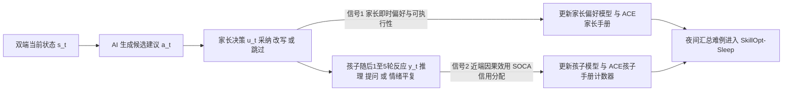
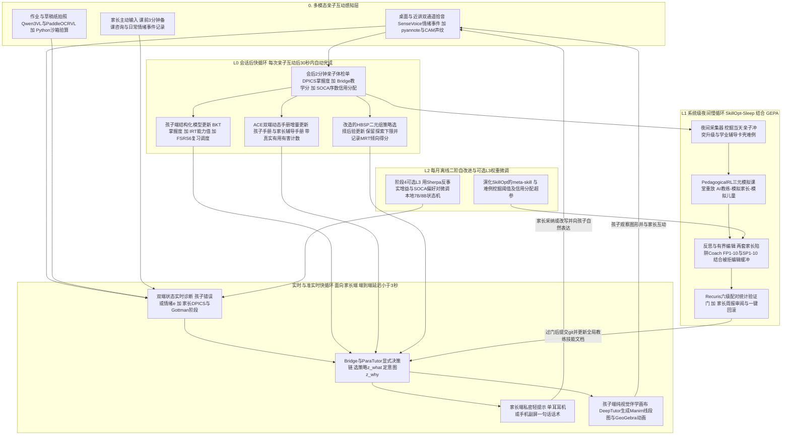
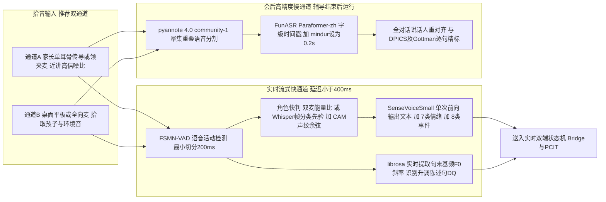
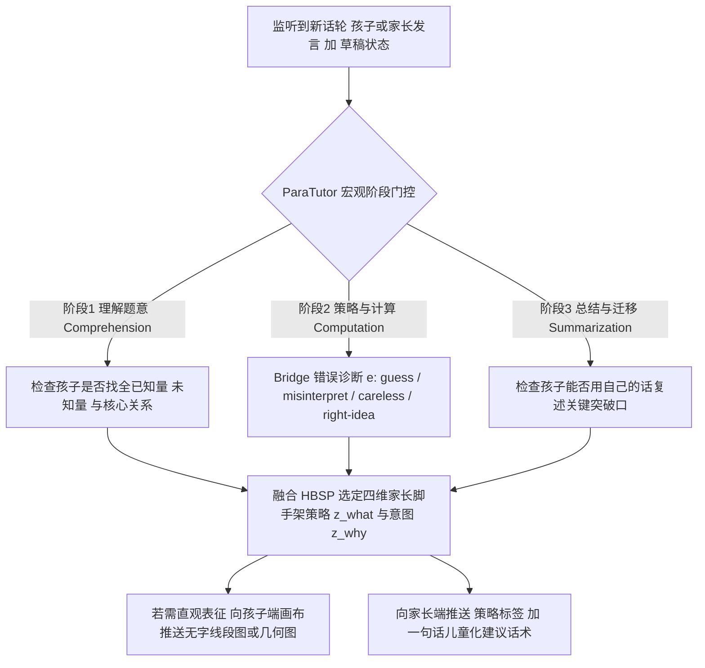
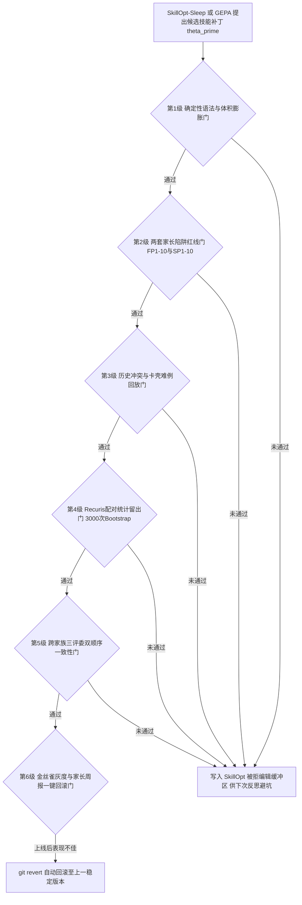

# 面向自家家长的亲子教育与心理发展 RSI Co-Pilot 系统：选型与改造方案

> **撰写日期**：2026-10-15（完整自包含版）  
> **核心定位**：面向自家 1–3 个小学生（6–12 岁，小学 1–6 年级）的**学业教育**与**心理发展**支持系统。**系统不直接与儿童对话**，而是基于**监听到的或主动输入的“大人–小孩”双人对话及其长期历史**，向**家长**提供实时（耳内式/副屏轻提示）、课前（3 分钟备课与突发咨询）及会后（定量体检单与策略复盘）建议，并通过递归自改进（RSI）回路随家庭长期演进。  
> **研究基础**：综合前期通用 RSI 调研（[`rsi_analyz1.markdown`](./rsi_analyz1.markdown)）、儿童教育与心理 RSI 专题（[`rsi_edu_analyz1.markdown`](./rsi_edu_analyz1.markdown)）、前期讨论记录（[`rsi_analyz_log.markdown`](./rsi_analyz_log.markdown)）、家庭儿童直连版方案（[`rsi_edu_solu_op55_1.markdown`](./rsi_edu_solu_op55_1.markdown)），以及本轮针对**成人端教学/沟通 Co-Pilot（Tutor CoPilot、Bridge、ParaTutor、PACEE、CCST、CARE）**、**亲子互动疗法（PCIT）耳内式实时教练与 DPICS 自动编码**、**家庭双人语音分割与副语言感知（SenseVoice、FunASR、pyannote 4.0、USC SAIL 亲子分割）**及**上下文/技能自进化引擎（ACE、SkillOpt、GEPA、PsyEvo、SIC-Agents）**的专项核验结果。

---

## 0. 阅读指南与核心前提

### 0.1 快速导航

| 你关心的问题 | 对应章节 |
|---|---|
| 我应该选哪 1–4 个 RSI 工作作为基础？为什么？ | 第 1 节（结论摘要）、第 4 节（约 40 项候选筛选与 7 种组合对比）、第 5 节（1–4 个基础深度论证与质疑回应） |
| 为什么“系统不面对小孩、只面对家长”会彻底改变技术选型？ | 第 2 节（三代前提对比、五大结构性跃迁、九大功能部件拆解） |
| 去掉合规与直接说错话顾虑后，还有哪些纯粹由“效果证据”决定的底线？ | 第 3 节（十条实证效果底线 C1–C10） |
| 改造后的系统长什么样？平时怎么用（实时监听、课前备课、会后复盘）？ | 第 6 节（总体架构图、三种交互模式、模型分工与对比方案） |
| 选中的 4 个基础工作具体要改哪些代码与模块？还要借用哪些组件？ | 第 7 节（DeepTutor、ACE、SkillOpt、PedagogicalRL/PsyEvo 逐项改造与借用总表） |
| 怎么听清并区分家里大人和小孩的对话、捕捉叹气/哭闹/语气升高？ | 第 8 节（亲子双人多模态感知专章：语音、声纹、副语言情绪、作业视觉） |
| 辅导作业和心理沟通时，系统到底怎么一步步教家长？ | 第 9 节（Bridge + ParaTutor + PCIT/DPICS + Gottman 双域工作流与两套家长陷阱分类） |
| 20 轮亲子对话里怎么知道哪条建议起了作用？怎么在只有 1–3 个孩子时验证效果？ | 第 10 节（复合目标函数与三元序数信用分配）、第 11 节（六级验证门与微随机试验 MRT / N-of-1） |
| 硬件怎么摆、每月花多少钱、先从哪一步做起？ | 第 12 节（硬件形态、成本核算、阶段 0–4 路线图与去留判据） |
| 有哪些踩坑风险、哪些高热度工作明确不选、哪些信息尚未核实？ | 第 13 节（风险与应对）、第 14 节（不选清单）、第 15 节（未核实与待实测清单） |
| 所有引用的论文、官方文档、开源代码链接在哪里汇总？ | 附录 A（完整分类链接索引）、附录 B（三代方案演进与决策过程记录） |

### 0.2 前提设定与边界声明

1. **家庭自用，零外部合规与隐私枷锁**：系统仅供自家 1–3 个孩子（6–12 岁）与家长（父母、祖辈）内部使用。按你的要求，本文**完全不讨论**数据敏感性、法律法规合规、多租户隔离、隐私脱敏与外部访问安全性，唯一评判标准是**真实学习效果与儿童心理发展效果**。
2. **成人端双人对话 Co-Pilot 范式（核心变化）**：
   - 系统**不直接向儿童输出任何文字或语音对话**（唯一例外是在家长授意下，向桌面共享屏幕推送不含文字答案的纯视觉辅助图，如数学线段图、几何动画）。
   - 系统的输入是**实时监听到的或家长输入的“大人–小孩”互动过程**（桌面作业辅导录音、亲子日常/情绪对话录音、作业与试卷照片、家长主动输入的问题或事件描述）及其长期历史档案。
   - 系统的输出完全面向**成年家长**：在互动前提供 3 分钟备课卡，在互动中通过单耳耳机（Bug-in-the-Ear）或家长副屏提供极简实时脚手架，在互动后生成定量体检单与改进建议。
   - 因此，**不存在“AI 直接对小孩说错话、产生幻觉误导小孩、或让小孩对 AI 产生拟社会依恋”的问题**——家长本人就是天然的实时语义防火墙、情感转译者与最终执行人。
3. **保留并强化的身心发展底线**：虽然 AI 不直接对孩子说话，但**家长的言行直接决定孩子的认知与心理发展**。如果 AI 给家长的建议诱导家长施压、代劳泄题、空洞夸聪明、或过度依赖高频提示而破坏自然亲子关系，同样会损害效果。因此，防止家长掉入辅导与沟通陷阱、防止家长端“数字提示过载（Participant Burden）”，作为纯粹的**效果约束**在本文中保留并强化。

### 0.3 术语、证据标注与链接规范

- **三级 RSI 证据标准**（沿用 [`lobehub/awesome-rsi`](https://github.com/lobehub/awesome-rsi) 定义）：
  - **任务增益（Task Gain）**：单次会话内提示或推理变好，但未产生跨会话持久演进；
  - **留存增益（Retention Gain / First-order RSI）**：系统对自身持久状态（技能文档、双端手册、路由策略）的修改，在未参与训练的留出任务或未来新情境中带来可验证的净提升；
  - **改进器增益（Improver Gain / Second-order RSI）**：被修改的是“产生改进的机制/元技能（meta-skill）”本身，且受控实验证明新机制在同等预算下能产出更好的留存增益。
- **三元轨迹（Triadic Trajectory）**：指 `(AI 给家长的建议 a_t) -> (家长的实际采纳/改写/忽略行为 u_t) -> (孩子在随后 1–5 轮中的认知与情绪响应 y_{t+1:t+k})` 构成的闭环单元。
- **双端动态手册（Dual Playbooks）**：系统用增量条目维护的两份档案——《孩子认知与情绪手册（Child Playbook）》与《家长辅导习惯与触发器手册（Parent Coaching Playbook）》，每条均绑定真实效用计数（`helpful / harmful`）。
- **DPICS（Dyadic Parent-Child Interaction Coding System，二元亲子互动编码系统）**：临床心理学中量化编码父母话语行为的黄金标准体系，区分正向 **PRIDE 技能**（具体表扬 `LP`、反射式复述 `RF`、行为描述 `BD` 等）与禁忌 **Don't 行为**（直接/间接指令 `DC/IC`、连续追问 `IQ/DQ`、负面批评 `NTA`）。
- **证据等级标注**：
  - **【论文自报】**：论文作者在自有实验或基准上报告的数据；
  - **【厂商自报】**：企业或机构官方发布但未经独立第三方复核的数据；
  - **【独立/第三方】**：无利益冲突的独立评测、系统综述或元分析结论；
  - **【我的判断】**：基于已有证据的架构推演、参数建议或工程估算。
- **量化口径说明**：文中凡属工程落地的阈值、样本量、预算均标注为**“起步建议”**或**“起步估计”**；无法从公开文献或源码确认的事实一律标注为**“未核实（UNVERIFIED）”**。GitHub 星标（Stars）、分支（Forks）与许可证数据均为 **2026-10-15** 通过 GitHub API 实时核验的快照。

---

## 1. 结论摘要（Executive Summary）

### 1.1 核心选型：1 到 4 个 RSI 基础工作应该选谁？

当系统从“直接面对小孩的 AI 家教”转变为**“监听亲子对话、只面向家长的 Co-Pilot 与家庭教练”**，并允许选择 **1 到 4 个** RSI 相关工作作为基础时，最优的 **4 基础主推荐方案**是：

> **DeepTutor（教育知识库与伴学视觉底座） + ACE（会话级快循环：双端条目化 Playbook 自进化） + SkillOpt 含 SkillOpt-Sleep（系统级慢循环：带留出验证门的全局技能训练与元技能演化） + PedagogicalRL 含 MathTutorBench 并融合 Sherpa 与 PsyEvo（三元模拟评估场、反事实学习增益与多轮序数信用分配）。**

| 基础序号与角色 | 选中的 RSI 相关工作（含论文、文档、代码链接） | 它在新架构中负责什么 | 原作的核心优势 | 原作的缺口（需我们改造之处） |
|---|---|---|---|---|
| **基础一：教育知识、分层记忆与伴学视觉底座** | [**DeepTutor**](https://github.com/HKUDS/DeepTutor)（HKUDS，Apache-2.0，41,324★ / 5,210 forks，[v1.6.14](https://github.com/HKUDS/DeepTutor/releases/tag/v1.6.14)）<br>论文：[arXiv:2604.26962](https://arxiv.org/abs/2604.26962)<br>官方文档：[deeptutor.info](https://deeptutor.info/) | 充当**家长端教研顾问 + 亲子共享纯视觉画布**：锁定当前年级课本教法（防止家长用超纲代数方程教小学算术）、维护 Trace Forest 三层学习者记忆、管理错题与掌握路径、生成给孩子看的 Manim/GeoGebra 直观线段图与动画 | 开源教育 Agent 中功能最完整：含学习者/监护人账户（[v1.6.3](https://github.com/HKUDS/DeepTutor/releases/tag/v1.6.3)）、多引擎教材 RAG、代码沙箱 `exec` 验算、Manim/GeoGebra 可视化、微信等多渠道接入 | 原作默认直接与学生聊天；没有针对“亲子双人对话”的监听接口；自更新无定量验证门；仅在大学教材 TutorBench 上评测过 |
| **基础二：会话级快循环（L0）双端手册自进化** | [**ACE (Agentic Context Engineering)**](https://github.com/ace-agent/ace)（ICLR 2026 主会，Apache-2.0，1,362★ / 169 forks）<br>论文：[arXiv:2510.04618](https://arxiv.org/abs/2510.04618)<br>会议页：[ICLR 2026 Virtual](https://iclr.cc/virtual/2026/10021286) | 每次亲子互动后，利用 `Generator -> Reflector -> Deterministic Curator` 增量更新**《孩子认知与情绪手册》**与**《家长辅导习惯与触发器手册》**，每条策略带 `helpful / harmful` 真实效用计数 | 非 LLM 确定性合并 + 语义去重，彻底消除整段重写导致的“上下文塌缩”；在 [Unggi Lee 等 (2026)](https://arxiv.org/abs/2605.27088) 的数学辅导对比中，**域外基准 MathTutorBench 排第 2、OpenLearnLM 排第 3**【论文自报】 | 原作没有留出验证门，在缺乏可靠执行反馈的任务上会退化（FiNER 无 GT 时 `70.7 -> 67.3`）；需绑定家长采纳与孩子近端响应信号作为真实反馈 |
| **基础三：系统级慢循环（L1/L2）全局技能训练引擎** | [**SkillOpt（含 SkillOpt-Sleep）**](https://github.com/microsoft/SkillOpt)（Microsoft，MIT，18,320★ / 1,736 forks）<br>论文：[arXiv:2605.23904](https://arxiv.org/abs/2605.23904)<br>官方文档：[microsoft.github.io/SkillOpt](https://microsoft.github.io/SkillOpt/)<br>Sleep 文档：[docs/sleep](https://github.com/microsoft/SkillOpt/blob/main/docs/sleep/README.md) | 每晚回看当天亲子冲突与辅导卡壳难例，将全局《家长教练技能文档》当作可训练参数做有界编辑，在三元模拟留出集上过门后更新，并通过 `meta-skill` 在每月演化改进器本身（L2） | 52/52 格评测最佳或并列【论文自报】；自带被拒编辑缓冲、慢更新、`meta-skill`；`SkillOpt-Sleep` 已实现 `run / status / adopt / schedule` 与配对评估工具 `evalkit` | Sleep 采集器仅支持编程助手日志；重放仅支持单轮任务；需接入亲子三元日志、改造成多轮三元模拟重放，并支持插拔 [GEPA](https://github.com/gepa-ai/gepa) 作对比 |
| **基础四：三元模拟评估场、反事实奖励与信用分配** | [**PedagogicalRL**](https://github.com/eth-lre/PedagogicalRL) + [**MathTutorBench**](https://github.com/eth-lre/mathtutorbench)（EMNLP 2025 主会与 Oral）<br>论文：[arXiv:2505.15607](https://arxiv.org/abs/2505.15607)、[arXiv:2502.18940](https://arxiv.org/abs/2502.18940)<br>深度融合 [**Sherpa**](https://github.com/SALT-NLP/Sherpa)（[arXiv:2610.08778](https://arxiv.org/abs/2610.08778)）与 [**PsyEvo**](https://github.com/Lingxi-mental-health/PsyEvo)（[arXiv:2610.02885](https://arxiv.org/abs/2610.02885)） | 定义**“什么样的家长建议才算有效”**，提供离线验证所需的**三元模拟环境（AI 教练 -> 模拟家长 -> 模拟儿童）**、反事实学习增益、以及多轮对话中的策略选择与序数信用分配 | PedagogicalRL 量化了泄题与独立解题的权衡（不惩罚时泄题率 `89.5%`）；Sherpa 提出纯增量反事实奖励；PsyEvo 提供层级贝叶斯策略选择（`HBSP`）与双顺序一致性多轮序数信用分配（`SOCA`）【论文自报】 | PedagogicalRL 原作是二元（AI 导师-学生）且题目偏中学；PsyEvo 原作面向成人模拟咨询且开源代码仅为骨架；需合成为“学业+心理”双域三元评估器 |

> **关于第 4 个名额的等价替代说明（代码完整度优先 vs. 领域对称优先）**：  
> - 上表主方案（**`DeepTutor + ACE + SkillOpt + PedagogicalRL`**）按**“开源代码可直接运行 + 顶会同行评审（ICLR/EMNLP） + 快慢双循环架构正交”**原则选出，并将 `PsyEvo` 的 `HBSP` 与 `SOCA` 算法无缝内嵌进第 4 个基础的策略与奖励层。  
> - 如果你更倾向于**按“学业与心理领域显式一比一对称”**来分配 4 个名额，可以把第 4 个名额直接冠名为 **`PsyEvo`**（即 **`DeepTutor + SkillOpt + PedagogicalRL + PsyEvo`**），同时把 **`ACE`** 作为 L0 双端手册的数据结构模块并入 `DeepTutor`。这两种叫法在最终改造完成的代码架构上**100% 同构**（详见 4.4 与 5.1 节）。

### 1.2 为什么是这 4 个？（五条核心逻辑）

1. **因为面对的是家长，“三元轨迹”解锁了此前不敢用的会话级快循环 RSI（ACE）**：
   - 在直接面对儿童的旧方案中，AI 说出一句话后很难立刻判断孩子是真懂了还是顺从应付，而 [ACE（ICLR 2026）](https://arxiv.org/abs/2510.04618) 在缺乏可靠反馈时会出现性能倒退（FiNER 从 `70.7` 降至 `67.3`）【论文自报】。
   - 但在“AI 建议家长 -> 家长选择/改写并说出 -> 孩子随后几轮反应”的三元闭环中，我们每轮都能同时拿到**家长的显式/隐式采纳信号**（[ParaTutor 2026](https://arxiv.org/abs/2606.18030) 实测：家长 `26.9%` 直接照念、`52.6%` 内化改写、`20.5%` 跳过）和**孩子的近端行为反应**（是否主动说出推理步骤、情绪是否平复）。这给 ACE 的 `helpful / harmful` 计数器提供了高信噪比证据，使其成为维护《孩子手册》与《家长手册》的最佳快循环引擎。
2. **临床与教育实证一致表明，“实时教练家长 + 会后定量复盘”的效应量远超让 AI 直接教小孩**：
   - **心理与行为侧**：亲子互动疗法（PCIT）通过耳内式设备（Bug-in-the-Ear）实时教练父母，元分析效应量高达 **$\text{SMD} = -0.87$**（[Thomas 等 2017, *Pediatrics*](https://doi.org/10.1542/peds.2017-0352)；[Valero-Aguayo 等 2021](https://doi.org/10.7334/psicothema2021.70)），且**强制要求父母达到 DPICS 定量掌握标准时效应量跃升至 $\text{SMD} = -1.09$**（不要求达标仅为 $-0.51, p=0.02$）【独立/第三方】。Mayo Clinic 的 [PISTACHIO 随机对照试验（*JAMA Network Open*, 2025-12）](https://jamanetwork.com/journals/jamanetworkopen/fullarticle/2842819) 进一步证明，AI 实时预警辅助父母（中位响应时间仅 `3.65 秒`）能将儿童发脾气持续时间缩短一半以上（`10.4 分钟` vs `22.1 分钟`, $p<0.001$）【论文自报】。
   - **学业辅导侧**：斯坦福 [Tutor CoPilot（Wang 等, 2024）](https://arxiv.org/abs/2410.03017) 在约 900 名辅导员、1,787 名学生（主要为 3–6 年级）的随机对照试验中证明，用显式认知决策链（[Bridge](https://aclanthology.org/2024.naacl-long.120/)）实时给成人提供策略建议，在会话实际使用时使学生随堂掌握率跃升 **+14 个百分点**（从 `62%` 升至 `76%`，$p<0.01$），低评分辅导员提升 **+9 个百分点**【论文自报】。港科大与清华的 [ParaTutor（2026）](https://arxiv.org/abs/2606.18030) 在 10–12 岁中国小学生亲子数学辅导中证明，后台教练家长能使孩子的主动推理轮次翻倍（`8.61 -> 16.83`）、主动提问翻倍（`1.74 -> 4.09`）【论文自报】。
3. **家庭作业“鸡飞狗跳”的核心矛盾在双端（家长超纲 + 情绪升级），必须靠 `DeepTutor` + `ACE` 双端协同解决**：
   - ParaTutor 揭示了中国家长辅导小学数学的三大冲突源：(C1) 家长造不出直观图形、(C2) 讲两遍不懂就情绪失控批评孩子、(C3) **解法代沟（家长习惯设未知数列方程 $x$，而小学要求算术思维与线段图）**。
   - `DeepTutor` 负责用教材 RAG 锁定当前年级的算术教法，并生成纯视觉线段图/动画推给孩子的伴学画布；`ACE` 则在《家长手册》中记录这位家长在什么题型下容易暴躁或超纲，提前触发预防性脚手架。
4. **快循环（ACE）与慢循环（SkillOpt-Sleep）互补，兼顾“当场敏捷适应”与“系统级防漂移”**：
   - `ACE` 在每次会话后立刻增删改双端条目，响应速度是分钟级；
   - `SkillOpt-Sleep` 在夜间把多天积累的共性失败（如某类情绪冲突话术无效）拿去跑多轮三元模拟，通过留出验证门后修改底层的《全局教练技能文档》，响应速度是天/周级，并用 `meta-skill` 实现月度二阶改进（L2）。
5. **三元模拟与多轮序数信用分配（`PedagogicalRL + Sherpa + PsyEvo SOCA`）解决了“怎么评价给家长的建议好不好”**：
   - 一场 15 分钟的亲子对话有几十轮，家长可能采纳了 3 条建议，最后孩子解出了题或停止了哭泣——到底哪条建议功劳最大？我们结合 `PedagogicalRL / Sherpa` 的反事实解题增益与 `PsyEvo` 的 **SOCA（Sequential Ordinal Credit Assignment，双顺序一致性检验 + 折扣多步序数回报）**，精确将信用分配到具体轮次与具体建议条目上。

### 1.3 如果只选 3 个、2 个或 1 个时的退化路径

| 允许选择的数量 | 推荐组合 | 被裁剪部分的替代实现方式 | 适用情形 |
|---|---|---|---|
| **选 4 个（主推荐）** | **DeepTutor + ACE + SkillOpt + PedagogicalRL（融合 Sherpa/PsyEvo）** | 无需裁剪，快慢双循环与三元评估完整落地 | 追求最高效果上限、希望同时具备分钟级个体适应与夜间系统级进化的完整形态 |
| **只选 3 个** | **DeepTutor + SkillOpt + PedagogicalRL** | 不单独引入 `ACE` 仓库；直接在 `DeepTutor` 的三层文件记忆之上，用约 200 行 Python 编写带 `helpful / harmful` 计数与余弦去重的双端 JSONL 手册 | 希望减少外部框架依赖，自己维护轻量级双端手册 |
| **只选 2 个** | **DeepTutor + SkillOpt** | 不单独部署 `PedagogicalRL` 训练/评测管线；将反事实解题增益公式与 DPICS/Gottman 评分规则直接写进 `SkillOpt-Sleep` 的自定义多轮 `rubric / rule` 评判器中 | 不打算跑本地小模型强化学习（L3），只做纯 API 驱动的文本层自进化 |
| **只选 1 个（路线 A：教育完备型）** | **DeepTutor** | 在 `DeepTutor` 之上自建一个极简夜间脚本：收集当天亲子难例 -> 让大模型提 1–3 条双端手册/技能修改 -> 在 30 个固定亲子场景上跑 Recuris 配对检验 -> 通过则提交 git | 想最快速度跑通“备课 + 伴学画布 + 会后复盘”，自改进回路够用即可 |
| **只选 1 个（路线 B：成人 Agent 极客型）** | [**Hermes Agent**](https://github.com/NousResearch/hermes-agent)（配 [`hermes-agent-self-evolution`](https://github.com/NousResearch/hermes-agent-self-evolution)） | 直接利用 Hermes 原生的微信/语音全双工网关、后台复盘与 `DSPy + GEPA` 技能进化面向家长服务；自行外挂教材 Markdown 库与简单错题表 | 家长本人是重度命令行/Agent 极客，希望随时用微信语音和单耳耳机与个人 Agent 交互，不追求复杂的伴学画布 |

### 1.4 十大核心改造一览（详见第 7–9 节）

1. **角色分离的双面板交互（借鉴 ParaTutor + PCIT Bug-in-the-Ear）**：砍掉 `DeepTutor` 直接面向儿童的聊天框，改为**家长端私密提示流**（手机/手表/单耳耳机，延迟 `< 3 秒`，采用 `[策略标签]: 一句话建议` 格式）+ **儿童端纯视觉伴学画布**（平板展示可交互线段图、Manim 动画、GeoGebra 几何图，绝不出现答案文字）。
2. **显式三步认知与情绪状态机（借鉴 Bridge + PACEE + PCIT）**：严禁端到端直接生成话术。每次生成建议前，强制走完显式决策链：`Step 1 诊断双端状态（孩子错误类型 e / 情绪状态 + 家长当前行为编码） -> Step 2 选择干预策略 z_what（Bridge 10 策 / ParaTutor 四维脚手架 / PCIT PRIDE / Gottman S1-S5） -> Step 3 明确意图 z_why -> Step 4 输出儿童化短句供家长说出`。
3. **亲子双人高可靠语音与副语言感知栈（SenseVoice + pyannote 4.0 + FunASR 短话轮修复 + USC SAIL）**：直接从 [`QwenAudio/SenseVoice`](https://github.com/QwenAudio/SenseVoice) 原始输出提取 `<|ANGRY|> / <|SAD|> / <|FEARFUL|>` 情绪与 `<|Cry|> / <|Breath|>（叹气） / <|Laughter|>` 事件；修改 [`modelscope/FunASR`](https://github.com/modelscope/FunASR) 中 `campplus` 默认合并 `< 0.7 秒` 短话轮的缺陷（防止孩子简短回答被吞并给家长）；结合预注册家庭声纹与 [`usc-sail/child-adult-diarization`](https://github.com/usc-sail/child-adult-diarization) 解决 8–12 岁大童与成年女性（妈妈）的声学混淆。
4. **ACE 亲子双端动态手册（Child Playbook + Parent Coaching Playbook）**：不仅记孩子“分数通分常忘乘分子、被连续追问两次就会沉默”，还记家长“爸爸在孩子卡壳超过 15 秒时习惯直接列方程抢答，推‘请孩子先指一下未知数’的单句提示采纳率最高”。条目计数严格绑定三元轨迹的真实反馈。
5. **会后 2 分钟定量体检单（DPICS-IV + Gottman + Bridge Scorecard）**：每次作业辅导或情绪谈话结束后，自动统计家长的具体表扬（`LP`）、反射式复述（`RF`）、行为描述（`BD`）与禁忌行为（指令 `DC/IC`、追问 `IQ/DQ`、批评 `NTA`）次数、家长说话占比、以及孩子的推理轮次与主动提问数，参照 PCIT 掌握标准给出通关进度。
6. **三元模拟课堂（AI 教练 -> 模拟家长 -> 模拟儿童）**：将 `PedagogicalRL` 的二元模拟扩展为三元交互模拟。模拟家长具备真实的成人弱点（急躁、爱用代数方程、偶尔忽略 AI 建议），用于离线压测候选技能文档能否真正帮到家长并最终让孩子受益。
7. **多轮序数信用分配（PsyEvo SOCA）与层级贝叶斯策略选择（HBSP）**：用 `SOCA` 的双顺序一致性评判与折扣累积回报解决多轮对话中的功劳归属；用改造后的 `HBSP` 为每对“家长×孩子”组合在线学习最合拍的提示策略与提示时机。
8. **两套“家长陷阱”防漂移 Coach（移植 SIC-Agents）**：构建《家长学业辅导陷阱 FP1–FP10》与《家长心理沟通陷阱 SP1–SP10》，在 `SkillOpt-Sleep` 夜间反思与会后复盘中充当课程监督器，防止系统为了迎合家长喜好而退化为“帮家长更快逼孩子写完作业”的工具。
9. **防“数字提示过载”与脚手架渐进消退（Scaffolding Fading）**：针对 Mayo Clinic PISTACHIO 试验发现的“高频实时提示可能推高父母养育压力”风险，设立提示冷却窗（默认每 2–3 分钟最多主动提示 1 次，危机熔断除外）；当某项微技能（如具体表扬 `LP`）连续达标后自动降低提示频率，促进家长内化。
10. **家长端无感微随机试验（MRT）与六级验证门**：由于面对的是成年家长，系统可在日常提供 2–3 条候选策略时，以已知概率轻微随机化主推策略（记录倾向得分），结合孩子的延迟检索测验与每周 Top Problems 评分，在家庭内部严谨评估每类策略的真实因果效应。

### 1.5 现实效应量预期（对齐临床与教育实证基线）

- **心理与行为互动**：PCIT 与父母行为训练的临床元分析效应量为 **儿童外化行为 $\text{SMD} = -0.87$**（达到 DPICS 掌握标准时为 **$-1.09$**），**亲子互动质量 $g = +0.735$**，**养育自我效能感 $g = +0.712$**，**儿童内化问题（焦虑/畏难，配合 Gottman 情绪教练）$\text{SMD} = -0.34$**【独立/第三方】。这是整个方案中证据最硬、回报最高的部分。
- **学业辅导与推理参与**：成人端实时 Co-Pilot 对单次课随堂掌握率的真实提升在 **+4 个百分点（ITT）至 +14 个百分点（实际使用会话 TOT）** 之间（[Tutor CoPilot RCT](https://arxiv.org/abs/2410.03017)），对小学生主动推理轮次与主动提问数的提升可达 **约 1.8–2.3 倍**（[ParaTutor 2026](https://arxiv.org/abs/2606.18030)），折算长期学业成绩的合理目标区间约为 **0.3–0.5 个标准差（SD）**【我的判断】。
- **RSI 自改进层的增量判据**：与上一版一致，系统先上线“静态专家 v0 + L0 双端快循环（ACE + BKT/FSRS + HBSP）”，运行至第 4–6 个月时，通过个体内对照检验夜间慢循环（L1 `SkillOpt-Sleep`）是否带来统计可辨别的额外收益；若无显著增量，则冻结 L1，长期保留低成本、高可靠的 v0 + L0。

---

## 2. 范式跃迁分析：为什么“监听亲子对话、只面向家长”彻底改变了问题空间

### 2.1 三代方案的前提与架构演进对比

为了清楚展现思考过程，下表对比了我们在本系列研究中走过的三代前提及其对技术选型的连锁影响：

| 维度 | 第一代：C 端合规产品版（旧草稿） | 第二代：家庭自用·儿童直连版（[`rsi_edu_solu_op55_1.markdown`](./rsi_edu_solu_op55_1.markdown)） | 第三代：家庭自用·家长端 Co-Pilot 版（**本文 `@rsi_edu_adultsolu_g4_1.markdown`**） | 对选型与改造的决定性影响 |
|---|---|---|---|---|
| **直接交互对象** | 6–12 岁儿童（家长监护） | 6–12 岁自家儿童 | **成年家长**（父母/祖辈）；孩子只与家长互动，仅共享纯视觉伴学画布 | 彻底解除儿童 UI、儿童识字率上限与直接语音对话流畅度对 AI 输出的束缚 |
| **直接对小孩说错话的风险** | 极高（触发法规与安全红线） | 中高（虽无外部追责，但幻觉或不当回应会直接误导或伤害自家孩子） | **零（由家长充当实时语义防火墙与情感转译器）** | 允许向家长输出高密度诊断、多候选话术与不确定性提示；自进化步子可以显著迈大 |
| **儿童对 AI 的拟社会依恋风险** | 极高（法律严禁诱导沉迷依赖） | 中高（需专门设计陪伴边界，防孩子把 AI 当朋友） | **天然消除**（孩子感受到的共情、表扬与引导全部来自亲生父母，反而直接增进亲子依恋） | 心理模块从“防 AI 越界”全面转向“用 PCIT + Gottman 赋能父母” |
| **单轮交互的反馈信号结构** | 二元模糊信号：`(AI -> 儿童)`，且儿童数据极度受限 | 二元信号：`(AI -> 儿童)`，难区分孩子是真懂还是顺从 | **三元高信噪比信号**：`(AI 建议 -> 家长采纳/改写/跳过 -> 孩子随后 1–5 轮反应)` | **解锁会话级快循环 RSI**：[ACE](https://github.com/ace-agent/ace) 与 [PsyEvo](https://github.com/Lingxi-mental-health/PsyEvo) 获得了必需的即时可靠反馈 |
| **被建模与被改进的对象** | 仅系统提示词（脱敏） | 孩子的学习者模型 + 系统技能文档 | **亲子二元组（Dyad）**：同时建模孩子的知识/情绪状态与**家长的辅导习惯/盲区/触发器** | 新增《家长辅导手册》与三元模拟环境（AI 教练 -> 模拟家长 -> 模拟儿童） |
| **音频与多模态感知重心** | 单人儿童 ASR | 单人儿童 ASR + 作业拍照 | **桌面/环境双人对话拾音**：成人-儿童说话人分割、家庭声纹绑定、叹气/哭泣/愤怒语调实时检测 | 引入 `SenseVoice` 副语言标签、`pyannote 4.0`、`FunASR CAM++` 短话轮修复与 `USC SAIL` 亲子分割 |
| **基础工作名额与最终入选** | 1–3 个：`SkillOpt + SIC-Agents + PedagogicalRL` | 1–3 个：`DeepTutor + SkillOpt + PedagogicalRL` | **1–4 个：`DeepTutor + ACE + SkillOpt + PedagogicalRL（融合 Sherpa/PsyEvo）`** | `ACE`（ICLR 2026）与 `PsyEvo`（HBSP/SOCA）正式进入核心底座 |

### 2.2 五大结构性跃迁（为什么面向家长比直接面向孩子更有效）

#### 跃迁一：从“AI 畏手畏脚怕说错话”到“家长在环的高带宽认知协作”
在儿童直连模式下，哪怕是一句稍微超纲的数学术语（如对二年级孩子提到了“设未知数”或“负数”）或一句略显生硬的安慰，都会直接落到孩子耳朵里。为此，系统不得不把每句话限制在几十个字以内、严格过滤生字表，且不敢在会话中尝试新的教学策略。  
而在家长端 Co-Pilot 模式下：
- 系统可以在家长副屏上用 3 行紧凑的成人语言写明：**`[诊断: 概念混淆-退位减法] 他把个位不够减当成大数减小数了。 -> [策略: 实物映射] 别讲竖式规则，让他拿两捆小棒拆开一捆试试。 -> [建议话术]: “个位 3 减 7 不够拿，我们把旁边这捆 10 根拆开好不好？”`**
- 即使 AI 偶尔给出了不够贴切的建议，家长一眼就能看出来并直接忽略或改用自己的话表达（[ParaTutor 2026](https://arxiv.org/abs/2606.18030) 实测表明，家长在 `52.6%` 的情况下会吸收 AI 建议的核心逻辑并用自己的日常口吻改写说出，`20.5%` 的情况下会主动跳过不合适的建议）【论文自报】。**家长的常识过滤网让系统的容错率提升了不止一个数量级。**

#### 跃迁二：心理与行为干预效应量从 $\approx 0.2\text{–}0.3\text{ SD}$ 跃升至 $\text{SMD} = -0.87 \sim -1.09$
在上一版调研中我们发现，目前全球没有任何一项针对 6–12 岁儿童直接与 LLM 聊天机器人做社会情绪学习（SEL）的高质量随机对照试验，而传统校本 SEL 的平均效应量仅约 $g \approx 0.19$。  
相反，如果把技术用成熟临床范式——**通过耳机/屏幕实时观察亲子互动并教练父母（即数字化 PCIT + Gottman 情绪教练）**，实证证据极其深厚：
- **PCIT 权威元分析**（[Thomas 等 2017, *Pediatrics*](https://doi.org/10.1542/peds.2017-0352)，23 项研究、1,144 人；[Valero-Aguayo 等 2021](https://doi.org/10.7334/psicothema2021.70)，100 项研究、覆盖 2–12 岁儿童）一致证实：通过实时教练父母使用 **PRIDE 正向技能**并克制 **Don't 控制/批评行为**，对降低儿童外化行为问题的效应量高达 **$\text{SMD} = -0.87$**；而且**当以会前 5 分钟 DPICS 定量编码达标作为门控时，效应量高达 $\text{SMD} = -1.09$**（无达标门控时仅 $-0.51, p=0.02$）【独立/第三方】。
- **韩国多水平元分析**（[Hong 等 2026](https://doi.org/10.1177/10497315261422605)）显示，PCIT 不仅改善儿童行为（总体 $g = -0.81$，亲子互动质量 $g = +0.735$，儿童语言提升 $g = +0.616$），还能大幅降低**父母自身的养育压力（$g = -0.969$）与父母抑郁（$g = -1.314$）**，提升养育自我效能感（$g = +0.712$）【独立/第三方】。
- **依恋与情绪聚焦父母干预元分析**（[Jugovac 等 2022](https://link.springer.com/article/10.1007/s10567-022-00401-8)，43 项研究、5,542 名儿童、平均年龄 7.14 岁）证明，训练父母做情绪教练对缓解学龄儿童**内化行为问题（焦虑、畏难、退缩）**显著有效（**$\text{SMD} = -0.34$**）【独立/第三方】。
- **AI 增强 PCIT 的最新临床 RCT**（Mayo Clinic [PISTACHIO 试验, *JAMA Network Open* 2025-12](https://jamanetwork.com/journals/jamanetworkopen/fullarticle/2842819) & [*JAACAP* 2025](https://www.jaacap.org/article/S0890-8567(25)01724-1/fulltext)，50 个家庭）：用传感器+AI 在孩子情绪崩溃前向父母手机推送实时 PCIT 提示，父母中位响应时间仅 **3.65 秒**，使孩子发脾气平均时长从 **22.1 分钟腰斩至 10.4 分钟**（$p<0.001$），严重崩溃（$\ge 15$ 分钟）风险比 OR 达 `3.66`，且父母的 DPICS 负面控制行为显著减少（$\beta = 5.7, p=0.04$）【论文自报】。

#### 跃迁三：直击中国小学生家庭作业冲突的三大病根（ParaTutor 2026 实证）
为什么家里有聪明的大人，辅导小学生写作业却依然天天鸡飞狗跳？港科大（广州）与清华大学团队在 [**ParaTutor**（Luo 等, 2026, arXiv:2606.18030）](https://arxiv.org/abs/2606.18030) 中通过对中国 4–6 年级（10–12 岁）小学生家庭的实证研究，精准定位了三大病根【论文自报】：
1. **表征鸿沟（C1）**：小学生处于皮亚杰具体运算阶段，需要靠线段图、面积模型、实物操作来理解数量关系；而家长早已习惯抽象符号推理，徒手画不出规范的直观图。
2. **解法代沟（C3）**：遇到“鸡兔同笼、和差倍、行程追及、分数逆推”等问题时，家长的第一反应是**“设 $x$ 列方程”**，而小学低中年级课本要求用**假设法、画图法或算术逆推**。家长强行教方程，孩子听不懂，老师还不算对。
3. **情绪强制循环（C2, Coercive Cycle）**：家长用成人逻辑讲了两遍，孩子还是一脸茫然，家长就会脱口而出：“这都不会？刚讲过怎么又忘！”（DPICS 中的 `NTA` 负面批评与连续追问 `IQ`），孩子随即陷入防御性沉默或哭闹，学习彻底中断。

当系统面向家长时，这三大病根可以被精准拆解：`DeepTutor` 检索课本同步教法并生成纯视觉线段图解决 C1 与 C3；`SenseVoice` + `Bridge/ParaTutor` 实时捕捉语调升高并推送“情感修复脚手架（Repair Scaffolding）”解决 C2。

#### 跃迁四：阻断成人共情自然退化（Stanford CARE CHI 2026 实证）
一个反直觉但极其重要的科学发现来自斯坦福 SALT 实验室的 [**CARE 系统随机对照试验**（Louie 等, CHI 2026, $N=94$）](http://youralien.github.io/files/louie2026CanLlmUpskillCounselors.pdf)：
- 当成年支持者在面对受挫、抗拒或焦虑的倾诉者时，如果**没有结构化的 AI 反馈、仅靠自己反复实战练习（Group P）**，其共情能力非但没有提升，反而发生了**统计显著的严重退化（Empathy 下降 $d = -0.52, p=0.001$）**！
- 原因在于：成人在面对对方的卡壳或抗拒时，本能地会滑向“急于盘问信息（Closed Questions）”和“强行塞解决方案（Premature Fixing）”。
- 相反，接受**基于动机式访谈（MI）编码的 AI 结构化指导与反馈组（Group P+F）**，反射式倾听（Reflections）与有效提问显著提升（$d = 0.32\text{–}0.39$），后测共情表现高出无反馈组 **$d = 0.72$（$p=0.001$）**【论文自报】。
- 这直接证明：**即使家长原本很有爱心，在长期辅导作业的挫败消耗下也会自然退化为“追问机器”；一个持续观察对话、实时轻推并做会后定量复盘的成人端 RSI 系统，是逆转这种退化的关键外脑。**

#### 跃迁五：三元反馈闭环（Triadic Feedback Loop）使 RSI 演进效率倍增
在传统二元交互 `(AI -> Child)` 中，AI 的探索成本极高（不敢试错）且反馈极度滞后。而在三元交互 `(AI Co-Pilot -> Parent -> Child)` 中，每一次建议都产生两层即时验证信号：



1. **第一层（毫秒至秒级）：家长采纳与改写信号（Action Executability & Preference）**：
   - 如果 AI 推了一条建议，家长直接采用了（或吸收核心意思改写说出），说明该建议在当前语境下**认知负荷适中、符合家长表达习惯**；
   - 如果家长连续 3 次忽略某类建议（例如 CMU [CCST 2025](https://arxiv.org/abs/2412.11995) 发现家长普遍反感空洞的客套鼓励话术），系统立即获知该策略对这位家长无效。
   - 更妙的是，当家长把 AI 略显生硬的建议改写成更接地气的家庭口语说出时，**家长的原话本身就是一条免费的专家级 Demonstration（示范样本）**，可以直接由 `ACE` 提取进该家庭的专属手册！
2. **第二层（1–5 轮对话内）：儿童近端因果响应信号（Proximal Child Outcome）**：
   - 家长说出那句话后，监听流立刻捕获孩子接下来的 1–5 轮表现：孩子是开始说出解题第一步（Reasoning Turn）、主动提问，还是叹气（`<|Breath|>`）、哭泣（`<|Cry|>`）、沉默超过 15 秒？
   - 这让系统能够区分**“家长喜欢用但对孩子有害的习惯”**（如家长喜欢直接报算式，孩子嘴上说“哦”但下一道同构题依然不会）与**“真正有效的黄金脚手架”**（家长按提示问了一句引导问题，孩子自己推出了关系式）。

### 2.3 将成人端亲子 RSI 系统拆解为九大功能部件

为了精准定位 1–4 个基础工作，我们将目标系统拆解为以下九个正交部件（相比儿童直连版的八部件，这里将感知层升级为“双人多模态感知”，并将个体层升级为“亲子双端建模与三元信用分配”）：

| 部件编号与名称 | 核心职责 | 候选技术来源 | 是否自改进（所在层级） |
|---|---|---|---|
| **0. 亲子双人感知与声纹层** | 区分谁在说话（爸/妈 vs 大宝/二宝）、转写文本、捕捉副语言情绪（愤怒/悲伤/哭泣/叹气）与作业视觉内容 | `QwenAudio/SenseVoice`、`pyannote-audio 4.0`、`FunASR CAM++`、`usc-sail/child-adult-diarization`、`Qwen3-VL`、`PaddleOCR-VL` | **部分**（声纹模板与家庭口头禅词表在 L0 增量校准） |
| **1. 双端状态机与实时决策链** | 实时诊断（孩子错误/情绪 $e$ + 家长 DPICS/Gottman 状态），按显式认知链生成 `< 3 秒` 的极简建议与儿童伴学视觉图 | `Bridge`、`Tutor CoPilot`、`ParaTutor`、`PACEE`、`CCST`、`CARE`、`DeepTutor` 可视化 | **是**（决策链调用的策略权重在 L0 更新，技能提示在 L1 进化） |
| **2. 孩子端结构化学习者模型** | 追踪每个孩子的知识点掌握度、能力值、遗忘曲线、错题树与课本同步范围 | `DeepTutor`（Trace Forest + 教材 RAG + 掌握路径）、`pyBKT`、`py-irt`、`py-fsrs`（FSRS-6） | **是**（L0，每次作业/练习后在线更新） |
| **3. 亲子双端动态手册（快循环 RSI）** | 以结构化条目增量维护《孩子手册》与《家长手册》，绑定真实效用计数，防止上下文塌缩 | **ACE (`ace-agent/ace`)**、`Letta MemFS`（git 化版本管理）、`Hermes Curator`（过期归档） | **是（核心 L0 快循环 RSI）** |
| **4. 二元组策略选择器（快循环 Bandit）** | 针对当前“家长×孩子×状态”组合，从循证策略池中采样推荐策略，平衡利用与探索并记录倾向得分 | **PsyEvo (`HBSP`)**、`IntelligentPooling`、微随机试验（MRT）采样器 | **是（核心 L0 快循环自适应）** |
| **5. 会后定量体检与三元信用分配** | 会后自动编码 DPICS（PRIDE vs Don't）、Gottman 阶段与 Bridge 教学分；在多轮对话中将孩子反应归因到具体建议 | `Lin et al. 2023 RoBERTa DPICS`、**PsyEvo (`SOCA`)**、**PedagogicalRL / Sherpa** 反事实增益 | **否**（评估与归因规则固定，仅校准参数由家长确认） |
| **6. 系统级技能提议与夜间数据回路（慢循环 RSI）** | 每晚挖掘当天亲子冲突与辅导卡壳难例，重放并反思，对全局《家长教练技能文档》提出有界编辑；月度演化 `meta-skill` | **SkillOpt + SkillOpt-Sleep (`microsoft/SkillOpt`)**、`GEPA (`gepa-ai/gepa`)`、`Unggi Lee 测试台` | **是（核心 L1 慢循环 RSI + L2 元级进化）** |
| **7. 三元模拟评估场与两套陷阱 Coach** | 用“AI 教练 -> 模拟家长 -> 模拟儿童”预演候选修改；用学业（FP1–10）与心理（SP1–10）两套陷阱分类防止优化漂移 | **PedagogicalRL + MathTutorBench**、`Sherpa`、`StudentSim`、`SIC-Agents` Coach | **部分**（二元组孪生模拟器随家庭数据增长在阶段 3 特化） |
| **8. 确定性多级验证门与家长工作台** | 对候选修改执行六级字典序检验（含配对 bootstrap 与金丝雀测试）；向家长展示体检单、备课卡与周报 | `SkillOpt` 留出门、`Recuris` 配对门、`REAT` 质量门、`DeepTutor` 监护人工作台 | **否**（门控规则与目标门槛位于固定层 F，仅由家长手动修改） |

---

## 3. 实证推导出的十条效果底线（C1–C10）

去掉所有合规、隐私与“AI 直接对孩子说错话”的顾虑后，我们面对的是一个纯粹的科学工程问题：**怎样设计这套面向家长的系统，才能让孩子的学习掌握度与心理健康真正受益，而不是制造一堆让家长分心的废话屏幕？**  
以下十条底线（C1–C10）全部由近年顶刊、随机对照试验（RCT）与元分析的硬数据直接推出：

### 3.1 十条效果底线总表

| 编号 | 效果底线（设计铁律） | 核心实证来源（含精确数据） | 对系统架构与 RSI 的直接约束 |
|---|---|---|---|
| **C1** | **必须用显式专家决策链（诊断 $e \to$ 策略 $z_{\text{what}} \to$ 意图 $z_{\text{why}} \to$ 话术），严禁端到端直接生成建议** | [Bridge (NAACL 2024)](https://aclanthology.org/2024.naacl-long.120/)：显式决策链使专家偏好度提升 **+76%~+88%**；注入不匹配的随机策略使回复质量暴跌 **-97%** | 实时 Co-Pilot 必须先跑轻量状态诊断与策略选择，再条件化生成建议话术；RSI 分别优化“状态->策略映射”与“策略->话术模板” |
| **C2** | **实时提示必须极简低延迟（`< 3–5 秒`、一句话）；会后必须有定量达标体检单（Mastery Gating）** | [Tutor CoPilot](https://arxiv.org/abs/2410.03017) 与 [CCST (LAK 2025)](https://arxiv.org/abs/2412.11995)：延迟达 25–30s 或文字冗长即被成人弃用；[Thomas 2017 (*Pediatrics*)](https://doi.org/10.1542/peds.2017-0352)：有 DPICS 定量达标门控的 PCIT 效应量（$\text{SMD}=-1.09$）是无门控（$-0.51$）的 **2.1 倍**；[CARE (CHI 2026)](http://youralien.github.io/files/louie2026CanLlmUpskillCounselors.pdf)：无结构化反馈的盲目练习导致成人共情退化 **$d=-0.52$** | 必须拆分为**快循环**（耳内/副屏 `< 15 字` 动作标签 + `< 25 字` 示范短句）与**慢循环**（会后自动输出 DPICS + Gottman + Bridge 定量体检单） |
| **C3** | **终极奖励看“孩子延迟保持与迁移 + 家长行为改善 + 冲突时长缩减”，绝不看当场顺从或表面答对** | [Bastani 等 (PNAS 2025)](https://doi.org/10.1073/pnas.2422633122)：无护栏代劳使练习 `+48%` 但撤掉后考试 `-17%`；[Taylor & Rohrer 2010](https://www.wku.edu/senate/documents/improving_student_learning_dunlosky_2013.pdf)：交错练习当场 `68% vs 99%`，隔天 `77% vs 38%`；[PISTACHIO RCT 2025](https://jamanetwork.com/journals/jamanetworkopen/fullarticle/2842819)：以崩溃时长减半（`10.4 vs 22.1 分钟`）与 DPICS 负面行为下降为硬指标 | 如果家长照念算式让孩子当场写出答案，系统必须判为**负向奖励（泄题）**；正向奖励绑定孩子的推理论述轮次、隔天/隔周检索正确率与冲突降级 |
| **C4** | **任何持久化修改（双端手册与全局技能）必须经过确定性门控与领域 Coach 监督，严禁无门自改** | [REAT (2026)](https://arxiv.org/abs/2609.29804)：去掉经验质量门掉分最大（`-6.48`）；[SIC-Agents (EMNLP 2026)](https://arxiv.org/abs/2608.29481)：去掉陷阱 Coach 后对话流畅度升至 `2.79` 但关键临床行为从 `0.66` 暴跌至 `0.52`；[ACE (ICLR 2026)](https://arxiv.org/abs/2510.04618)：揭示整段重写导致上下文塌缩（`18,282 -> 122 tokens`，准确率跌至 `57.1%`） | L0 手册采用 ACE 原地增量计数；L1 全局技能采用 SkillOpt + Recuris 配对留出门，并由两套家长陷阱 Coach（FP1–10、SP1–10）约束反思方向 |
| **C5** | **必须实行“亲子双端建模（Dyadic Modeling）”：既建模孩子的认知与情绪，也建模家长的习惯与盲区** | [ParaTutor (2026)](https://arxiv.org/abs/2606.18030)：家长 `52.6%` 改写、`26.9%` 直用、`20.5%` 跳过，且不同家长在策略偏好与情绪触发点上差异显著；[Tutor CoPilot](https://arxiv.org/abs/2410.03017)：低分/新手成人获益 `+7~+9 p.p.`，资深成人接近 `0` | L0 同时维护《孩子手册》与《家长手册》；HBSP 策略选择以 `(孩子状态, 家长状态)` 联合特征为条件 |
| **C6** | **心理发展必须“双核驱动”：用 PCIT（PRIDE 技能）塑形外化行为，用 Gottman 五步法疏导内化情绪** | [Thomas 2017](https://doi.org/10.1542/peds.2017-0352) & [Valero-Aguayo 2021](https://doi.org/10.7334/psicothema2021.70)：PCIT 对外化行为 $\text{SMD}=-0.87$；[Jugovac 2022](https://link.springer.com/article/10.1007/s10567-022-00401-8)：情绪聚焦干预对学龄儿童内化问题 $\text{SMD}=-0.34$；[PACEE (2025)](https://arxiv.org/abs/2511.14414)：Gottman 五步法快慢双循环使儿童情绪表达词翻倍、字数 `+124%` | 区分两类场景：作业拖延/对抗/发脾气时激活 PCIT（CDI/PDI）脚手架；考试焦虑/受挫退缩/社交伤心时激活 Gottman $S_1\text{–}S_5$ 情绪教练脚手架 |
| **C7** | **必须内置“课本教法锁定”与“儿童语言降维转译”，消除成人的代数代沟与高深术语** | [Tutor CoPilot](https://arxiv.org/abs/2410.03017) 质性访谈第 1 大痛点：LLM 建议对小学生“太聪明/太成人化（Too Smart）”；[ParaTutor (2026)](https://arxiv.org/abs/2606.18030)：语言转化脚手架占全部脚手架的 `30.8%`，且需结合视觉线段图消除“成人列方程 vs 小学算术”代沟 | `DeepTutor` 强制检索当前年级课本方法（如 1–4 年级禁用多元方程），生成的话术经过“年级语言降维器”并配同步纯视觉画布 |
| **C8** | **双人语音感知必须专门修复“儿童短话轮被吞并”“8–12 岁大童与妈妈声学混淆”与“叹气被后处理抹除”三大工程缺陷** | [USC SAIL (INTERSPEECH 2024)](https://arxiv.org/abs/2406.07890) & [arXiv:2409.08881](https://arxiv.org/abs/2409.08881)：通用 PyAnnote 在 8–13 岁亲子集上零样本 DER 高达 `48.4%`，微调 Whisper 帧分类器后降至 `15.6%`；`FunASR campplus` 默认合并 `< 0.7s` 片段；`SenseVoice` 默认后处理抹除 `<\|Breath\|>` | 语音层采用预注册声纹 + Whisper 成人/儿童角色先验，将 `FunASR mindur` 降至 `0.2s`，并直接解析 `SenseVoice` 原始未后处理 Token |
| **C9** | **严格控制“家长端数字提示过载（Participant Burden）”，实施冷却窗与脚手架渐进消退（Fading）** | [Mayo Clinic PISTACHIO (2025)](https://www.jaacap.org/article/S0890-8567(25)01724-1/fulltext)：高频 AI 提示组虽行为显著改善，但父母总养育压力评分微升（`136.25 vs 127.75`）；[ParaTutor (2026)](https://arxiv.org/abs/2606.18030)：证实随会话推进家长能内化策略实现自然消退 | 实时主动推送设频率上限与静默模式；当某项技能在 DPICS/Bridge 体检中连续 3 次达标后，从“实时主动推”降级为“仅会后统计” |
| **C10** | **多评估器交叉验证 + 家庭内部微随机试验（MRT）与跨孩子分层合并** | [Unggi Lee 等 (2026)](https://arxiv.org/abs/2605.27088)：辅导提示优化的域内奖励与外部基准 MathTutorBench 相关系数仅 $\rho=0.01$；[HeartSteps MRT](https://pmc.ncbi.nlm.nih.gov/articles/PMC6401341/) 与 [IntelligentPooling](https://pmc.ncbi.nlm.nih.gov/articles/PMC8494236/)：分层经验贝叶斯合并降低 `26%` 遗憾值 | 离线门同时检验域内三元模拟、MathTutorBench/LongTutor 与多家族评委；在线对候选策略做带倾向得分记录的微随机比较 |

### 3.2 关键底线的深度展开

#### （1）为什么 C1（显式认知决策链）与 C7（消除代数代沟与成人化语言）是学业 Co-Pilot 成败的分水岭？
在 [Bridge（Wang 等, NAACL 2024）](https://aclanthology.org/2024.naacl-long.120/) 与 [Tutor CoPilot（arXiv:2410.03017）](https://arxiv.org/abs/2410.03017) 的研究中，斯坦福团队揭示了一个极其深刻的规律：为什么未经改造的 GPT-4 在辅导小学生数学时表现平庸？因为当孩子算错一道题（例如把 $\frac{1}{2} + \frac{1}{3}$ 算成 $\frac{2}{5}$）时，端到端大模型会直接跳到“如何把正确步骤讲清楚”，而资深人类教师的大脑会先执行三步隐性决策：
1. **诊断错误根源 $e$**：他是概念完全不懂盲猜（`guess`）、误解题意（`misinterpret`）、算理对但粗心算错（`careless`）、还是思路方向对但卡在某一步（`right-idea`）？
2. **选择补救策略 $z_{\text{what}}$**：针对 `careless` 只需“小幅提醒（minor correction）”，而针对把分母直接相加的概念误区，必须选“画视觉直观图 / 举生活分披萨例题（worked example / simplify）”或“反问引导（ask a question）”。
3. **明确教学意图 $z_{\text{why}}$**：当前这一步是为了帮他澄清概念（`clarify misunderstanding`），还是为了缓解挫败感（`motivate`）？

Bridge 的实验数据证明，只要把这三步显式化为条件生成链 $p(c_r \mid c_h, e, z_{\text{what}}, z_{\text{why}})$，人类专家的盲评偏好度就比直接用 GPT-4 高出 **+76% 至 +88%**；反之，如果给了一个与当前孩子错误状态不匹配的随机策略，生成质量立刻暴跌 **-67% 至 -97%**【论文自报】。  
与此同时，Tutor CoPilot 在对约 20 名一线辅导员的深度访谈中发现，成人辅导者对 AI 建议最集中的抱怨是**“生成的句子太像大人说话、太聪明（Too Smart / Not Grade-Level Appropriate）”**，以及**“AI 看不见孩子在草稿纸/白板上画了什么（白板盲区）”**。而在中国家庭场景下，[ParaTutor（arXiv:2606.18030）](https://arxiv.org/abs/2606.18030) 进一步证实，家长最需要的是两件武器：**一块给孩子看的纯视觉线段图/时间轴画布**（帮家长把抽象关系具象化），以及**把成人代数语言翻译成小学生阶梯问题的话术转换器**（占全部 312 次脚手架触发的 `30.8%`）。

#### （2）为什么 C2（实时极简 + 会后 DPICS 达标门控）与 C6（PCIT + Gottman 双核）能带来超过 1 个标准差的改变？
很多家长以为“改进亲子沟通”就是看几篇育儿文章，但一到辅导作业现场瞬间破防。原因正如 [Stanford CARE CHI 2026 随机对照试验](http://youralien.github.io/files/louie2026CanLlmUpskillCounselors.pdf) 所证明的：**在高压互动中，没有实时脚手架与会后结构化指标反馈的盲目练习，会让成人的共情能力以 $d = -0.52$ 的幅度显著退化**【论文自报】。  
临床心理学中唯一在百项研究、数千家庭中反复验证能彻底重塑父母话语习惯的范式，就是 **PCIT 的“耳内式实时微提示 + 5 分钟 DPICS 定量通关门控”**：
- 在实时互动时，父母根本没有精力阅读长篇大论（[CMU CCST 2025](https://arxiv.org/abs/2412.11995) 中 6/9 的家长抱怨实时建议太长、25 秒延迟太慢）。父母需要的只是耳机里一声极简提示或副屏上一行高亮的 **`[具体表扬 LP]: “我看到你刚才先自己读了两遍题目，特别棒！”`** 或 **`[情绪共情 RF]: 先复述他的感受：“这道题算了三次还没对，确实挺烦躁的。”`**（在 Mayo Clinic [PISTACHIO RCT 2025](https://jamanetwork.com/journals/jamanetworkopen/fullarticle/2842819) 中，父母对这种主动轻提示的中位响应时间仅 **3.65 秒**）。
- 而在 15 分钟互动结束后，系统利用自动 DPICS 分类器（[Lin 等 2023](https://www.mdpi.com/2076-3417/13/20/11129) 微调 RoBERTa 在 8 类 PCIT 数据集上准确率达 **79.85%**，10 类 DPICS-IV 上达 **72.3%–75.5%**）和 Gottman 阶段分析器（[PACEE 2025](https://arxiv.org/abs/2511.14414)），给家长生成一张客观的**《亲子沟通体检单》**。当家长看到“今晚 15 分钟内：连续追问 `IQ/DQ` 14 次、批评 `NTA` 3 次、具体表扬 `LP` 仅 1 次（距离通关标准 $\ge 10$ 次还差 9 次）”时，改进目标变得像运动手环的步数一样清晰可测——而 [Thomas 等 (2017)](https://doi.org/10.1542/peds.2017-0352) 的元分析已经证明，**有定量达标门控的训练效应量（$\text{SMD} = -1.09$）是没有达标门控（$-0.51$）的两倍以上**！

#### （3）为什么 C8（双人语音与副语言感知的专项改造）在家庭场景不可或缺？
如果系统要“基于监听到的大人与小孩对话提建议”，直接拿开源的通用语音识别和说话人日志（Speaker Diarization）开箱即用会遭遇严重的工程滑铁卢。南加州大学 SAIL 实验室在 [INTERSPEECH 2024 (arXiv:2406.07890)](https://arxiv.org/abs/2406.07890) 与 [arXiv:2409.08881](https://arxiv.org/abs/2409.08881) 上的实测揭露了三个残酷事实【论文自报】：
1. **通用模型在 8–13 岁亲子对话上的零样本错误率极高**：开箱即用的 `pyannote 3.1` 在 4–7 岁家庭数据集 Remote-NLS 上的说话人日志错误率（DER）为 `34.9%`，而在对应我们小学中高年级的 **8–13 岁儿童数据集（ADOS-old）上，零样本 DER 高达 `48.4%`**！因为 8–12 岁儿童的声道逐渐发育，其共振峰与**成年女性（妈妈）**高度接近，通用模型在区分“妈妈 vs 8–12 岁孩子”时的说话人混淆率（SC）高达 `22.9%–25.7%`（区分幼童仅 `5.5%`）。
2. **通用 VAD 与聚类窗口会吞掉孩子的简短回答**：辅导作业时，孩子的回答往往只有 0.3–0.6 秒（如“嗯”“十二”“不知道”）。通用 VAD 常把高基频的儿童短音当噪音滤掉（漏检率达 `12.5%–22.1%`）；更隐蔽的是，中文主流开源库 [`modelscope/FunASR`](https://github.com/modelscope/FunASR) 的 `campplus` 聚类后处理中硬编码了 `smooth(mindur=0.7)`——**任何短于 0.7 秒的独立语音段都会被强制吞并给相邻说话人（家长）**！如果不改这一行参数，系统就会误以为“家长一个人在自言自语，孩子全程没说话”。
3. **情绪拐点往往藏在文字之外的“叹气、哭腔与语调升高”里**：孩子说“我知道了”，字面完全中性，但如果伴随着一声叹气（`<|Breath|>`）或哭腔（`<|Cry|>` / `<|SAD|>`），意义完全相反。[`QwenAudio/SenseVoice`](https://github.com/QwenAudio/SenseVoice) 原生支持在单次前向推理（`< 80ms`）中同时输出文字、7 类情绪与 8 类音频事件，但它的官方默认后处理函数 `rich_transcription_postprocess` **会把 `<|Breath|>`（呼吸/叹气）替换为空字符串抹除**！因此必须在源码层直接解析原始输出 Token（详见第 8 节）。

---

## 4. 扩大范围后的候选池（40 项）与组合对比

去掉合规、隐私与“直接对小孩说错话”的顾虑后，我们将视野全面扩展至四大板块共 **40 项代表性工作**：
- **板块 A**：成人端教学与亲子沟通 Co-Pilot、PCIT/DPICS 实时教练（11 项，本轮专项新增）；
- **板块 B**：通用 RSI、上下文工程、技能进化与代码演化框架（13 项）；
- **板块 C**：教育、学生模拟与心理咨询自进化系统（10 项）；
- **板块 D**：家庭双人语音日志、副语言感知与学习科学确定性引擎（6 项）。

### 4.1 40 项候选技术全景表（含论文、文档、代码链接与最终定位）

#### 板块 A：成人端双人对话 Co-Pilot 与 PCIT/DPICS 实时教练（11 项）

| 编号与名称 | 核心机制与关键实证数据 | 论文 / 官方文档 / 开源代码链接 | 在本方案中的最终定位 |
|---|---|---|---|
| **A1. Tutor CoPilot**（Stanford, 2024） | 基于 Bridge 认知决策链实时向成人辅导员推策略与短句。约 900 名辅导员、1,787 名学生 RCT：随堂掌握率 ITT **+4 p.p.**，实际使用会话 TOT **+14 p.p.（`62% -> 76%`）**，低分辅导员 **+9 p.p.**，成本仅 `$20/人/年`【论文自报】 | 论文：[arXiv:2410.03017](https://arxiv.org/abs/2410.03017)、[OSF 预注册](https://osf.io/8d6ha)<br>代码：[`rosewang2008/tutor-copilot`](https://github.com/rosewang2008/tutor-copilot)（Apache-2.0，35★） | **核心借用（实时学业 Co-Pilot 交互与触发逻辑）** |
| **A2. Bridge**（Stanford, NAACL 2024） | 认知任务分析三步条件生成：识别错误状态 $e \to$ 选专家策略 $z_{\text{what}} \to$ 明意图 $z_{\text{why}} \to$ 生成话术。专家偏好提升 **+76%~+88%**，注入不匹配随机策略暴跌 **-97%**【论文自报】 | 论文：[arXiv:2310.10648](https://arxiv.org/abs/2310.10648)、[NAACL 2024](https://aclanthology.org/2024.naacl-long.120/)<br>代码与数据：[`rosewang2008/bridge`](https://github.com/rosewang2008/bridge)（MIT，47★）、[HF 数据集](https://huggingface.co/datasets/rose-e-wang/bridge) | **核心借用（实时学业状态机与 10 类策略词表）** |
| **A3. ParaTutor**（HKUST-GZ & 清华, 2026） | 面向 10–12 岁中国小学生家长辅导数学：理解-计算-总结三阶段门控 + 儿童端纯视觉锚定画布 + 家长端四维脚手架（策略 `33.3%`、语言转化 `30.8%`、情感修复 `18.6%`、阶段控制 `17.3%`）。儿童主动推理轮次 `8.61 -> 16.83`，主动提问 `1.74 -> 4.09`；家长 `52.6%` 改写、`26.9%` 直用【论文自报】 | 论文：[arXiv:2606.18030](https://arxiv.org/abs/2606.18030)、[HTML v2](https://arxiv.org/html/2606.18030v2)<br>代码：未公开（未核实） | **核心借用（角色分离双面板、三阶段门控与四维家长脚手架）** |
| **A4. PACEE**（清华史元春团队, 2025） | 面向父母的儿童情绪教育脚手架：Gottman 五步法（$S_1\text{–}S_5$）快慢双循环 + 三维儿童情绪画像 + 会后问题时刻复盘报告。16 家庭对照：儿童表达字数 **+124%**（`370 vs 165`），情绪词 `19 vs 10`，父母挫败感与费力度显著降低【论文自报】 | 论文：[arXiv:2511.14414](https://arxiv.org/abs/2511.14414)<br>斯坦福收录页：[Stanford SCALE](https://scale.stanford.edu/ai/repository/pacee-parent-centered-ai-scaffolding-emotion-education-early-childhood-conversations)<br>代码：未公开（未核实） | **核心借用（Gottman 情绪教练快慢双循环与会后沟通报告）** |
| **A5. CCST**（CMU, LAK 2025） | 面向家长的数学对话支持工具：ITS 实时追踪子目标 + Llama-3-8B 生成 3 条 `[Strategy Tag]: Suggested message` 选项。消除步骤幻觉，指出了 `25s` 延迟与话术过长痛点【论文自报】 | 论文：[DOI](https://dl.acm.org/doi/10.1145/3706468.3706516)、[arXiv:2412.11995](https://arxiv.org/abs/2412.11995)<br>代码：[`devika-prog/Caregiver-Conversational-Support-Tool`](https://github.com/devika-prog/Caregiver-Conversational-Support-Tool) | **借用（`[策略标签]: 一句话建议` 极简呈现格式）** |
| **A6. CARE & CHI 2026 RCT**（Stanford SALT Lab） | 8 个微调 BERT 预测动机式访谈（MI）策略 + 条件生成建议。CSCW 2025 采纳率 `37.69%`；CHI 2026（$N=94$ RCT）证明**无 AI 反馈纯练习组共情退化 $d=-0.52$（$p=0.001$）**，有 AI 反馈组高出 **$d=0.72$**【论文自报】 | 论文：[CSCW 2025](https://doi.org/10.1145/3710993)、[arXiv:2305.08982](https://arxiv.org/abs/2305.08982)、[CHI 2026 PDF](http://youralien.github.io/files/louie2026CanLlmUpskillCounselors.pdf)<br>代码：[`SALT-NLP/CARE`](https://github.com/SALT-NLP/CARE)（MIT） | **核心借用（防成人共情退化的会后结构化微技能反馈机制）** |
| **A7. PCIT & DPICS 临床体系与元分析** | 耳内式（Bug-in-the-Ear）实时教练父母 PRIDE 正向技能并抑制 Don't 行为，配合 5 分钟 DPICS 定量通关门控。儿童外化行为 **$\text{SMD}=-0.87$**，有 DPICS 达标门控时 **$\text{SMD}=-1.09$**（无门控仅 $-0.51, p=0.02$）【独立/第三方】 | 论文：[Thomas 2017 (*Pediatrics*)](https://doi.org/10.1542/peds.2017-0352)、[Valero-Aguayo 2021](https://doi.org/10.7334/psicothema2021.70)、[Hong 2026](https://doi.org/10.1177/10497315261422605)、[PMC9726853](https://pmc.ncbi.nlm.nih.gov/articles/PMC9726853/) | **核心理论与评估支柱（实时行为塑形与会后 5 分钟达标门控）** |
| **A8. PISTACHIO / PCIT-AI**（Mayo Clinic, 2025） | 传感+AI 预测情绪崩溃（准确率 `80.89%`）并向父母推实时 PCIT 提示。50 对亲子 12 周双盲 RCT：父母中位响应 **3.65 秒**，儿童发脾气时长从 **22.1 分钟减半至 10.4 分钟（$p<0.001$）**，DPICS 负面行为显著减少【论文自报】 | 论文：[JAMA Network Open 2025](https://jamanetwork.com/journals/jamanetworkopen/fullarticle/2842819)、[JAACAP 2024](https://www.jaacap.org/article/S0890-8567(24)01095-5/fulltext)、[JAACAP 2025](https://www.jaacap.org/article/S0890-8567(25)01724-1/fulltext) | **核心借用（情绪升级前瞻预警、3.65 秒微提示响应与防过载设计）** |
| **A9. SpecialTime & DPICS 自动编码**（Harvard 2019 / Lin 2023） | 自动将父母话语分类为 DPICS 编码（`LP, UP, RF, BD, IQ, DQ, DC, IC, NTA, NEU`）。Harvard 6,022 条达 `78.3%`；Lin 2023 用 RoBERTa 达 **79.85%**（10 类微调达 `75.5%`），指出 `RF` 需结合前序儿童话语、`DQ` 需结合升调【论文自报】 | 论文：[SpecialTime 2019 PDF](https://dash.harvard.edu/server/api/core/bitstreams/c34af5ab-412c-4407-b601-384592901cb8/content)、[Lin 2023 (*Applied Sciences*)](https://www.mdpi.com/2076-3417/13/20/11129)、[NSF PAR](https://par.nsf.gov/servlets/purl/10504807) | **核心借用（实时与会后 DPICS-IV 10 类自动打分器）** |
| **A10. Panda & Peconv**（中国科学, 2025） | 中文父母对儿童负面情绪的反应策略数据集 `Peconv`（Validation 认可、Empathy 共情、Support 支持）与生成+安全审查框架【论文自报】 | 论文：[DOI](https://doi.org/10.1007/s11432-023-4341-5)、[SCIS PDF](http://scis.scichina.com/en/2025/179101.pdf) | **借用（中文家庭情绪教练话术模板参考）** |
| **A11. ASD-HI & AACessTalk**（AIED 2025 / CHI 2025） | ASD-HI 用多模态检测亲子共读中父母策略保真度（召回率 `74%`）；AACessTalk 用平板实时给父母推荐上下文词汇卡与跟进问题【论文自报】 | 论文：[ASD-HI DOI](https://doi.org/10.1007/978-3-031-98414-3_4)、[AACessTalk arXiv:2409.09641](https://arxiv.org/abs/2409.09641)<br>代码：[`naver-ai/aacesstalk-monorepo`](https://github.com/naver-ai/aacesstalk-monorepo) | **借用（亲子共读与日常闲聊的话题破冰卡片设计）** |

#### 板块 B：通用 RSI、上下文工程、技能进化与代码演化框架（13 项）

| 编号与名称 | 核心机制与关键实证数据 | 论文 / 官方文档 / 开源代码链接 | 在本方案中的最终定位 |
|---|---|---|---|
| **B1. SkillOpt（含 SkillOpt-Sleep）**（Microsoft, 2026） | 将人类可读的技能文档当可训练参数：经验引导反思 + 有界编辑 + 留出集非退步门 + 被拒编辑缓冲 + 慢更新 + `meta-skill`；含夜间后台进化管线 `SkillOpt-Sleep`。52/52 格评测最佳或并列【论文自报】 | 论文：[arXiv:2605.23904](https://arxiv.org/abs/2605.23904)<br>官方文档：[microsoft.github.io/SkillOpt](https://microsoft.github.io/SkillOpt/)、[Sleep 文档](https://github.com/microsoft/SkillOpt/blob/main/docs/sleep/README.md)<br>代码：[`microsoft/SkillOpt`](https://github.com/microsoft/SkillOpt)（MIT，18,320★） | **入选为第 3 个核心基础工作（系统级 L1 慢循环与 L2 元技能演化）** |
| **B2. ACE (Agentic Context Engineering)**（ICLR 2026 主会） | `Generator -> Reflector -> Deterministic Curator` 增量更新带 `helpful / harmful` 计数的条目化 Playbook，非 LLM 合并 + 语义去重。AppWorld `42.4 -> 59.4`；在数学辅导域外基准 MathTutorBench 排第 2、OpenLearnLM 排第 3【论文自报】 | 论文：[arXiv:2510.04618](https://arxiv.org/abs/2510.04618)、[ICLR 2026](https://iclr.cc/virtual/2026/10021286)<br>代码：[`ace-agent/ace`](https://github.com/ace-agent/ace)（Apache-2.0，1,362★） | **入选为第 2 个核心基础工作（会话级 L0 快循环：亲子双端动态手册）** |
| **B3. GEPA（含 DSPy.GEPA）**（ICLR 2026 Oral） | 遗传-帕累托多目标反射式提示演化，读取完整执行轨迹做精准手术。比 GRPO 少用最多 35 倍 rollout，在辅导基准 ParetoGrad 上达 `0.719`（第 1 名）【论文自报】 | 论文：[arXiv:2507.19457](https://arxiv.org/abs/2507.19457)、[ICLR 2026 Oral](https://www.iclr.cc/virtual/2026/oral/10009494)<br>文档：[dspy.ai GEPA](https://dspy.ai/current/api/optimizers/GEPA/overview/)<br>代码：[`gepa-ai/gepa`](https://github.com/gepa-ai/gepa)（MIT，6,962★） | **核心可插拔对比引擎（在阶段 1 与 SkillOpt 做同预算对比）** |
| **B4. Hermes Agent + Self-Evolution**（Nous Research, 2026） | 极度成熟的个人 Agent：原生微信/Telegram/全双工语音网关、记忆 `MEMORY.md / USER.md`、后台复盘自建技能、配合 `DSPy + GEPA` 进化技能与工具代码【厂商自报】 | 官网与文档：[hermes-agent.nousresearch.com](https://hermes-agent.nousresearch.com/docs/)<br>论文：[PAST-Bench arXiv:2608.04003](https://arxiv.org/abs/2608.04003)<br>代码：[`NousResearch/hermes-agent`](https://github.com/NousResearch/hermes-agent)（MIT，253,764★）、[`hermes-agent-self-evolution`](https://github.com/NousResearch/hermes-agent-self-evolution)（5,504★） | **只选 1 个基础时的极客备选路线；主方案借用其微信语音网关与过期记忆归档** |
| **B5. Letta (MemGPT) + MemFS** | 将 Agent 长期记忆变成带 git 版本控制的树状文件系统（`system/ + Reference`），支持睡眠期离线重构记忆并对比差异【论文/厂商自报】 | 论文：[arXiv:2504.13171](https://arxiv.org/abs/2504.13171)<br>文档：[docs.letta.com/concepts/memfs](https://docs.letta.com/concepts/memfs/)<br>代码：[`letta-ai/letta`](https://github.com/letta-ai/letta)（Apache-2.0，25,124★） | **核心借用（将 DeepTutor + ACE 的双端档案纳入 git 版本树）** |
| **B6. Recuris**（2026） | 严格一阶 RSI：结构化轨迹归因（根因准确率 `64.8% vs 13.0%`）+ 3,000 次按题配对 bootstrap 留出验证门（置信下界 $>0$ 且退步数 $\le \text{reg\_cap}$）【论文自报】 | 论文：[arXiv:2608.24876](https://arxiv.org/abs/2608.24876)<br>代码：未开源 | **核心借用（写入第 4 级确定性配对统计验证门）** |
| **B7. A-Evolve**（2026） | 演化工作区文件与工具代码（`Observe -> Solve -> Evolve -> Gate -> Reload`），提出核心警示 **“Harness 更新不等于真实收益”**【论文自报】 | 论文：[arXiv:2605.30621](https://arxiv.org/abs/2605.30621)<br>代码：[`A-EVO-Lab/a-evolve`](https://github.com/A-EVO-Lab/a-evolve)（MIT，814★） | **不选为主基础（仅借用其“修改必须证伪净收益”的方法论）** |
| **B8. CORAL**（COLM 2026） | 多智能体在独立 git worktree 中共享笔记与技能协作演化，任务改善率高出基线 3–10 倍【论文自报】 | 论文：[arXiv:2604.01658](https://arxiv.org/abs/2604.01658)、[主页](https://coral.compounding-intelligence.ai)<br>代码：[`Human-Agent-Society/CORAL`](https://github.com/Human-Agent-Society/CORAL)（Apache-2.0，1,056★） | **不选（面向长时无人工自主科研，对单家庭过重）** |
| **B9. OpenEvolve**（2025–2026） | AlphaEvolve 开源复现，MAP-Elites 多样性网格演化代码与提示词【厂商/社区自报】 | 代码：[`algorithmicsuperintelligence/openevolve`](https://github.com/algorithmicsuperintelligence/openevolve)（Apache-2.0，7,553★） | **不选（适应度要求静态无噪单轮函数，不适配多轮亲子交互）** |
| **B10. ShinkaEvolve**（Sakana AI, 2025） | 结合谱系采样与新颖度拒绝采样的开源进化引擎，高样本效率【论文自报】 | 论文：[arXiv:2509.19349](https://arxiv.org/abs/2509.19349)、[主页](https://sakanaai.github.io/ShinkaEvolve/)<br>代码：[`SakanaAI/ShinkaEvolve`](https://github.com/SakanaAI/ShinkaEvolve)（Apache-2.0，1,433★） | **不选（面向数学/算法竞赛题求解，非多轮对话教练）** |
| **B11. SkyDiscover（AdaEvolve / EvoX）**（UC Berkeley, 2026） | 模块化科学发现框架，支持演化搜索策略本身（EvoX）【论文自报】 | 论文：[AdaEvolve arXiv:2602.20133](https://arxiv.org/abs/2602.20133)、[EvoX arXiv:2602.23413](https://arxiv.org/abs/2602.23413)<br>代码：[`skydiscover-ai/skydiscover`](https://github.com/skydiscover-ai/skydiscover)（Apache-2.0，705★） | **不选（面向 200+ 算法基准优化，无教育状态与多轮归因）** |
| **B12. Ouroboros**（2026） | 通过 git 提交直接重写自身 Python 源码与宪法文件 `BIBLE.md` 的自主 Agent【论文自报】 | 论文：[arXiv:2608.08311](https://arxiv.org/abs/2608.08311)<br>代码：[`razzant/ouroboros`](https://github.com/razzant/ouroboros)（MIT，1,456★） | **明确排除（无留出验证门直接改自身源码，极易悄悄破坏评估逻辑）** |
| **B13. DGM / HGM / HyperAgents**（2025–2026） | 达尔文-哥德尔机谱系：用树搜索与元级自修改演化编程/推理 Agent 源码【论文自报】 | 论文：[DGM](https://arxiv.org/abs/2505.22954)、[HGM](https://arxiv.org/abs/2510.21614)、[HyperAgents](https://arxiv.org/abs/2603.19461)<br>代码：[`jennyzzt/dgm`](https://github.com/jennyzzt/dgm)、[`metauto-ai/HGM`](https://github.com/metauto-ai/HGM)、[`facebookresearch/HyperAgents`](https://github.com/facebookresearch/HyperAgents) | **明确排除（算力开销巨大且缺少多轮人机互动奖励）** |

#### 板块 C：教育、学生模拟与心理咨询自进化系统（10 项）

| 编号与名称 | 核心机制与关键实证数据 | 论文 / 官方文档 / 开源代码链接 | 在本方案中的最终定位 |
|---|---|---|---|
| **C1. DeepTutor**（HKUDS, 2026） | 统一教育 Agent 工作台：Trace Forest 三层记忆、教材 RAG、错题本、知识掌握图谱、Manim/GeoGebra 可视化、学习者/监护人双端模式【论文/开源自报】 | 论文：[arXiv:2604.26962](https://arxiv.org/abs/2604.26962)<br>官网：[deeptutor.info](https://deeptutor.info/)<br>代码：[`HKUDS/DeepTutor`](https://github.com/HKUDS/DeepTutor)（Apache-2.0，41,324★） | **入选为第 1 个核心基础工作（教育认知底座、教材教法锁定与伴学画布）** |
| **C2. PedagogicalRL + MathTutorBench**（ETH Zürich, EMNLP 2025） | 多轮模拟课堂强化学习与统一评测基准。量化证明不惩罚泄题时解题率 `+36.2%` 但泄题率达 **89.5%**；$\lambda=0.75$ 时泄题率压至 **10.6%** 且保持高学习收益【论文自报】 | 论文：[arXiv:2505.15607](https://arxiv.org/abs/2505.15607)、[arXiv:2502.18940](https://arxiv.org/abs/2502.18940)<br>主页：[eth-lre.github.io/mathtutorbench](https://eth-lre.github.io/mathtutorbench/)<br>代码：[`eth-lre/PedagogicalRL`](https://github.com/eth-lre/PedagogicalRL)、[`mathtutorbench`](https://github.com/eth-lre/mathtutorbench) | **入选为第 4 个核心基础工作（改造为三元模拟评估场与防泄题奖励核）** |
| **C3. Sherpa**（Stanford SALT Lab, 2026） | 反事实学习增益奖励 $R = P(\text{辅导后答对}) - P(\text{不辅导答对})$。7B 模型使模拟学生准确率从 `48.6%` 升至 `69.0%`，96 名人类教师盲评胜率 **79.6%**【论文自报】 | 论文：[arXiv:2610.08778](https://arxiv.org/abs/2610.08778)<br>代码：[`SALT-NLP/Sherpa`](https://github.com/SALT-NLP/Sherpa)（Apache-2.0） | **核心融合进基础四（学业侧纯增量奖励函数）** |
| **C4. PsyEvo**（2026） | 面向长期心理支持与教练的自进化框架：**HBSP（层级贝叶斯策略选择）** + **SOCA（双顺序一致性多轮序数信用分配）** + 基于真实胜负计数的个人手册演进【论文自报】 | 论文：[arXiv:2610.02885](https://arxiv.org/abs/2610.02885)<br>代码：[`Lingxi-mental-health/PsyEvo`](https://github.com/Lingxi-mental-health/PsyEvo)（MIT，目前仅骨架） | **核心融合进基础四（或并列为对称第 4 基础：负责二元组策略选择与多轮序数信用分配）** |
| **C5. SIC-Agents**（EMNLP 2026） | 临床高难沟通双循环进化：由 **10 类专家陷阱分类（Pitfall Coach）** 约束反思与课程采样。消融证明去掉 Coach 后流畅度上升但关键沟通行为从 `0.66` 暴跌至 `0.52`【论文自报】 | 论文：[arXiv:2608.29481](https://arxiv.org/abs/2608.29481)<br>代码与基准：[`Beikewzh/sic-benchmarks`](https://github.com/Beikewzh/sic-benchmarks)（CC BY-NC-SA 4.0） | **核心借用（改造为《家长学业陷阱 FP1–10》与《家长心理陷阱 SP1–10》两套防漂移 Coach）** |
| **C6. Unggi Lee 等辅导提示优化测试台**（2026） | 横向对比 12 种提示优化算法（GEPA、ACE、EvoPrompt 等）在数学辅导上的表现，证明域内奖励与 MathTutorBench 相关性仅 $\rho=0.01$【论文自报】 | 论文：[arXiv:2605.27088](https://arxiv.org/abs/2605.27088)<br>代码：[`blackdew/tf-openlearnlm-anon`](https://github.com/blackdew/tf-openlearnlm-anon)（MIT） | **借用（修复其 2 处代码 bug 后用于阶段 1 的优化器对比实验）** |
| **C7. StudentSim**（Microsoft, 2026） | 基于真实做题轨迹通过 SFT + GRPO 训练高保真认知学生模拟器，预测下一步动作准确率 `0.785`【论文自报】 | 论文：[arXiv:2609.01591](https://arxiv.org/abs/2609.01591)、[主页](https://microsoft.github.io/StudentSim/)<br>代码：[`microsoft/StudentSim`](https://github.com/microsoft/StudentSim)（MIT，58★） | **阶段 3 借用（攒够 150+ 段轨迹后训练自家孩子与家长的二元组孪生模拟器）** |
| **C8. REAT & RegulaTutor**（2026） | REAT 证明在儿童情绪陪伴中“经验质量门”最重要（去掉掉分 `-6.48`）；RegulaTutor 将学习调节（Co-Regulation）形式化为 POMDP 信念追踪【论文自报】 | 论文：[REAT arXiv:2609.29804](https://arxiv.org/abs/2609.29804)、[RegulaTutor arXiv:2610.13399](https://arxiv.org/abs/2610.13399)<br>代码：均未开源 | **借用思想（经验入库四维质量门 + 认知与情绪双信念状态定义）** |
| **C9. PsychAgent & KidMind**（2026） | PsychAgent 在 20 场咨询中自演化出 9,701 条微技能；KidMind 针对 8–17 岁青少年结合 CBT、发展阶段与家庭动力建模【论文自报】 | 论文：[PsychAgent arXiv:2604.00931](https://arxiv.org/abs/2604.00931)、[KidMind KBS 2026](https://dl.acm.org/doi/10.1016/j.knosys.2026.116325)<br>代码：[`ECNU-ICALK/PsychAgent`](https://github.com/ECNU-ICALK/PsychAgent)、[`wtiantianw/KidMind`](https://github.com/wtiantianw/KidMind) | **借用（皮亚杰具体运算阶段约束与 6–12 岁家庭动力特征）** |
| **C10. LongTutor & CoLearn**（ACL 2026 / 2026） | LongTutor 评测五日跨会话长期记忆与教学适应（GPT-5 仅 `59.40%`）；CoLearn 提供知识树追踪与诊后笔记机制【论文自报】 | 论文：[LongTutor ACL 2026](https://aclanthology.org/2026.acl-long.1371/)、[CoLearn arXiv:2609.21154](https://arxiv.org/abs/2609.21154) | **借用（跨天长周期留存评测设计）** |

#### 板块 D：家庭双人语音日志、副语言感知与学习科学确定性引擎（6 项）

| 编号与名称 | 核心机制与关键实证数据 | 论文 / 官方文档 / 开源代码链接 | 在本方案中的最终定位 |
|---|---|---|---|
| **D1. SenseVoice**（Alibaba FunAudioLLM） | 毫秒级（`<80ms`）非自回归多任务语音模型：单次前向同时输出中英文字、7 类情绪（`ANGRY/SAD/FEARFUL/HAPPY` 等）与 8 类事件（`Cry/Breath/Laughter` 等）【论文/开源自报】 | 论文：[arXiv:2407.04051](https://arxiv.org/abs/2407.04051)<br>代码与权重：[`QwenAudio/SenseVoice`](https://github.com/QwenAudio/SenseVoice)（MIT，9,510★）、[HF SenseVoiceSmall](https://huggingface.co/FunAudioLLM/SenseVoiceSmall) | **核心感知组件（实时双人转写 + 情绪与叹气/哭泣事件检测）** |
| **D2. pyannote-audio 4.0 & FunASR CAM++** | `pyannote` 基于 7 类幂集分割原生处理双人重叠语音；`FunASR` 提供字级时间戳与 `campplus`（7.2M）192 维声纹提取【论文/开源自报】 | 论文：[arXiv:2310.13025](https://arxiv.org/abs/2310.13025)<br>代码：[`pyannote/pyannote-audio`](https://github.com/pyannote/pyannote-audio)（MIT，10,648★）、[`modelscope/FunASR`](https://github.com/modelscope/FunASR)（MIT，20,695★） | **核心感知组件（修复 `mindur=0.2s` 后负责家庭声纹对齐与重叠分割）** |
| **D3. USC SAIL 亲子双人语音分割**（INTERSPEECH 2024） | 基于 Whisper Encoder 的 20ms 帧级 `{Silence, Child, Adult, Overlap}` 四分类器，将家庭亲子对话 DER 从零样本 `34.9%–48.4%` 压降至 **`15.6%–16.2%`**【论文自报】 | 论文：[arXiv:2406.07890](https://arxiv.org/abs/2406.07890)、[arXiv:2409.08881](https://arxiv.org/abs/2409.08881)<br>代码：[`usc-sail/child-adult-diarization`](https://github.com/usc-sail/child-adult-diarization) | **核心感知组件（解决 8–12 岁大童与妈妈声学混淆的角色先验）** |
| **D4. 确定性知识追踪与间隔重复（FSRS-6 + pyBKT + py-irt）** | FSRS-6 在上亿条复习记录上显著优于 SM-2；BKT 与 IRT 提供小样本稳定的概念掌握度与能力值估计【独立/开源验证】 | 代码：[`open-spaced-repetition/py-fsrs`](https://github.com/open-spaced-repetition/py-fsrs)、[`CAHLR/pyBKT`](https://github.com/CAHLR/pyBKT)、[`nd-ball/py-irt`](https://github.com/nd-ball/py-irt) | **核心组件（负责孩子端课后隔天/隔周延迟检索调度与掌握度更新）** |
| **D5. Qwen3-VL & PaddleOCR-VL** | 支持中小学手写算式、竖式、几何图形、错题拍照的高精度视觉理解与版面解析【厂商/开源自报】 | 代码：[`QwenLM/Qwen3-VL`](https://github.com/QwenLM/Qwen3-VL)、[`PaddlePaddle/PaddleOCR`](https://github.com/PaddlePaddle/PaddleOCR) | **核心感知组件（解决 Tutor CoPilot 指出的“白板/草稿纸盲区”）** |
| **D6. HeartSteps MRT & IntelligentPooling** | 微随机试验（MRT）与分层经验贝叶斯冷启动加权，在个体内小样本下降低 `26%` 遗憾值并无偏估计因果效应【独立/第三方】 | 论文：[HeartSteps PMC6401341](https://pmc.ncbi.nlm.nih.gov/articles/PMC6401341/)、[IntelligentPooling PMC8494236](https://pmc.ncbi.nlm.nih.gov/articles/PMC8494236/) | **核心评估组件（家长端候选建议微随机试验与跨孩子信息借用）** |

### 4.2 核心候选对九大系统部件的覆盖度矩阵

说明：`★★★` = 原生强項且有开源代码可直接复用；`★★` = 有机制设计或部分实现，需改造补全；`★` = 仅涉及概念或弱相关；`—` = 完全缺失。

| 候选工作 | 0. 双人语音与视觉感知 | 1. 实时状态机与家长轻提示 | 2. 孩子端知识追踪与画布 | 3. 亲子双端动态手册 (L0) | 4. 二元组策略 Bandit (L0) | 5. 会后 DPICS 体检与三元归因 | 6. 夜间技能演化与元技能 (L1/L2) | 7. 三元模拟与陷阱 Coach | 8. 确定性多级验证门 |
|---|---|---|---|---|---|---|---|---|---|
| **DeepTutor** | ★（有拍照与 TTS，无双人日志） | ★（默认对学生聊天） | **★★★（教材 RAG+记忆树+Manim/GeoGebra）** | ★★（有文件记忆，无效用计数） | — | — | ★（仅会话内自写 prompt） | — | ★（仅监护人看板） |
| **ACE (`ace-agent/ace`)** | — | — | — | **★★★（Generator-Reflector-Curator + 计数去重）** | — | ★（依赖外部执行反馈） | ★（主要用于在线/增量上下文） | — | ★（仅长度与余弦去重） |
| **SkillOpt + Sleep** | — | — | — | ★ | — | ★（有 `evalkit`） | **★★★（有界编辑+被拒缓冲+慢更新+`meta-skill`+Sleep）** | ★（默认单轮重放） | **★★★（`gate_no_regression`）** |
| **PedagogicalRL + Sherpa** | — | ★ | ★ | — | — | **★★（学业反事实增益 + 防泄题评分）** | ★（RL 权重更新） | **★★★（模拟课堂与 MathTutorBench）** | ★★（多维基准评测） |
| **PsyEvo** | — | ★★（条件化生成） | — | ★★（个人手册更新） | **★★★（HBSP 层级贝叶斯）** | **★★★（SOCA 双顺序多轮序数归因）** | ★ | ★★（多轮咨询模拟） | ★（双顺序一致性） |
| **Tutor CoPilot + Bridge + ParaTutor** | ★ | **★★★（显式三步链 + 四维家长脚手架）** | **★★（ParaTutor 视觉画布）** | — | — | ★★（RoBERTa 教学行为分类） | — | — | — |
| **PCIT/DPICS + PACEE + CARE** | ★★（SpecialTime 升调） | **★★★（PRIDE 实时提示 + Gottman 阶段）** | — | ★（PACEE 慢思考画像） | — | **★★★（DPICS 10 类编码 + 5 分钟达标门 + MI 反馈）** | — | — | **★★（临床掌握度通关门）** |
| **SIC-Agents** | — | ★★ | — | — | ★★（难例课程采样） | ★★（陷阱打分） | ★★（跨场反思） | **★★★（10 类专家陷阱 Coach）** | ★ |
| **Hermes Agent + Self-Evo** | **★★（原生语音与微信网关）** | ★★（面向成人的个人助手） | — | **★★（MEMORY/USER + 过期归档）** | — | — | **★★★（后台自建技能 + DSPy/GEPA）** | — | ★（仅基础测试门） |

从矩阵中可以一目了然地看出：**没有任何单一工作能覆盖超过 4 个部件，但当我们选出 `DeepTutor + ACE + SkillOpt + PedagogicalRL（融合 Sherpa/PsyEvo）` 这 4 个基础，并嵌入 `Bridge/ParaTutor`（学业实时链）与 `PCIT/DPICS/PACEE`（心理实时链与会后体检）时，九大部件全部达到了 `★★★` 级闭合！**

### 4.3 七种候选组合方案的全面对比

| 组合方案 | 包含的 1–4 个基础工作 | 快循环（会话级 L0）能力 | 慢循环（系统级 L1/L2）能力 | 学业 + 心理双域覆盖度 | 开源代码可直接落地度 | 致命短板或取舍原因 |
|---|---|---|---|---|---|---|
| **方案 1（主推荐 4 基础：代码与快慢双循环完备型）** | **DeepTutor + ACE + SkillOpt + PedagogicalRL（融合 Sherpa/PsyEvo）** | **极强**：ACE 增量更新双端带计数手册 + HBSP 二元组策略选择 | **极强**：SkillOpt-Sleep 夜间有界编辑 + 留出门 + `meta-skill` | **全覆盖**：教材画布 + Bridge/ParaTutor 学业 + PCIT/Gottman/SOCA 心理 | **最高**：4 个核心仓库均为 Apache-2.0 / MIT 完整开源代码 | 需编写适配层将二元模拟扩为三元模拟，并接入双人语音栈 |
| **方案 2（等价对称 4 基础：学业/心理显式对称型）** | **DeepTutor + SkillOpt + PedagogicalRL + PsyEvo**（ACE 作为模块并入） | **极强**：与方案 1 完全相同（ACE 机制内嵌进 DeepTutor 记忆层） | **极强**：与方案 1 完全相同 | **全覆盖**：名义上第 3 基础管学业评估、第 4 基础管心理自进化 | **高**：但 `PsyEvo` 官方仓库目前仅有骨架，需按论文手写 `HBSP/SOCA` | 与方案 1 在最终工程代码上 **100% 同构**，仅 4 个名额的挂名侧重不同 |
| **方案 3（精选 3 基础：精简依赖型）** | **DeepTutor + SkillOpt + PedagogicalRL** | **强**：自写 200 行带计数的双端 JSONL 手册替代独立 ACE 库 | **极强**：SkillOpt-Sleep | **全覆盖**（通过借用模块补齐心理与双端手册） | **高**：仅依赖 3 个成熟大仓库 | 少了 ACE 现成的 Reflector-Curator 管线，需自己写增量合并代码 |
| **方案 4（极简 2 基础：纯 API 轻量演进型）** | **DeepTutor + SkillOpt** | **中**：自写双端手册 + FSRS/BKT | **强**：SkillOpt-Sleep（用自定义多轮 Rubric 代替 PedagogicalRL 管线） | **良**：无独立模拟强化学习管线，无法在阶段 4 跑 L3 小模型 RL | **高**：架构最轻，适合纯 API 家庭 | 缺少 `PedagogicalRL / MathTutorBench` 原生防泄题模拟与评测套件 |
| **方案 5（成人 Agent 极客 4 基础）** | **Hermes Agent + ACE + SkillOpt + PedagogicalRL** | **强**：Hermes 原生记忆 + ACE | **极强**：Hermes 后台复盘 + SkillOpt / GEPA | **偏成人交互**：微信/语音流极佳，但**缺教材 RAG、错题本与儿童视觉画布** | **高**：Hermes 社区极其活跃（25.3 万★） | 辅导小学生数学必须有课本同步与直观线段图画布，放弃 `DeepTutor` 自建画布工作量过大 |
| **方案 6（纯成人 Co-Pilot 拼接型）** | **Tutor CoPilot + ParaTutor + PACEE + CARE** | **弱**：仅有 PACEE 慢思考画像，无通用带计数的手册演化机制 | **无**：四个系统均为**静态 Co-Pilot**，不具备跨会话修改自身技能或改进器的 RSI 能力 | **高**：学业与情绪脚手架设计极佳 | **低**：ParaTutor 与 PACEE 均未开源代码 | **不是 RSI 系统**！它们只能提供静态的初始脚手架（v0），无法随家庭长期自进化 |
| **方案 7（激进代码自修改型）** | **DeepTutor + Ouroboros + A-Evolve + OpenEvolve** | **弱**：无结构化双端状态与心理归因 | **危险**：直接修改 Python 源码与评估脚本，缺乏多轮亲子留出验证门 | **差**：完全针对静态代码/算法基准设计 | **中** | 在高噪声的亲子多轮交互中放任 Agent 改自身代码，极易触发奖励黑客（Reward Hacking） |

---

## 5. 最终选型（1–4 个基础工作）深度论证与反方质疑回应

### 5.1 为什么在“面向家长”的新前提下，ACE 跃升为第 2 个核心基础？

在上一版（直接面向儿童的 AI 导师方案）中，我们将 [ACE (`ace-agent/ace`, ICLR 2026)](https://github.com/ace-agent/ace) 列为借用组件，主要顾虑是：ACE 原作没有留出集非退步门，且作者在论文 Table 3 中坦承，**当环境中缺乏可靠的真实执行反馈（如 FiNER 零地面真值信号）时，ACE 的表现会低于基础模型（`70.7% -> 67.3%`）**【论文自报】。  
然而，当系统改为**“监听亲子对话、只向家长提建议”**后，情况发生了根本性逆转：

1. **三元交互天然提供了高信噪比的“双层真实反馈”**：
   - 在每一次建议推送后，系统不需要猜测“我这句话对不对”，因为后面紧跟着两个客观可测的事件：
     - **事件 A（家长层）**：家长有没有采纳或改写这句话？（通过比对 AI 建议文本与随后 10 秒内家长实际说出的 ASR 文本之间的语义相似度 / 最长公共子序列 LCS，[Stanford CARE](https://arxiv.org/abs/2305.08982) 与 [ParaTutor](https://arxiv.org/abs/2606.18030) 已证明这可以精准分为“直接采用 `26.9%`”“吸收改写 `52.6%`”和“忽略跳过 `20.5%`”）。
     - **事件 B（儿童层）**：家长说出这句话后的 1–5 轮内，孩子发生了什么变化？（学业上：孩子是否说出了含数学逻辑的推理轮次或主动提问？心理上：孩子的 `<|Cry|>/<|ANGRY|>` 标签是否消失、语速与音量是否恢复正常、沉默是否被打破？）。
   - 当 **`(家长采纳或改写) AND (孩子在 1–5 轮内出现正向推理或情绪降级)`** 时，该策略条目的 `helpful` 计数 `+1`；当 **`(家长采纳) AND (孩子随后出现哭闹升级、叹气或家长被迫直接报答案)`** 时，`harmful` 计数 `+1`。这为 ACE 提供了比单人问答可靠得多的闭环信号！
2. **独立评测证实 ACE 在教育辅导的“域外泛化”上表现卓越**：
   - 在 [Unggi Lee 等 (2026, arXiv:2605.27088)](https://arxiv.org/abs/2605.27088) 对 12 种提示词自进化算法的系统对比中，研究者发现了一个惊人现象：许多在域内模拟奖励上刷出高分的进化算法，到了未见过的外部权威基准上全军覆没（域内奖励与 MathTutorBench 的斯皮尔曼相关系数 $\rho = 0.01, p=0.96$）；而 **ACE 虽然在域内模拟奖励上仅排第 12 名，但在外部真实辅导基准 MathTutorBench 上高居第 2 名（`0.562`），在 OpenLearnLM 上高居第 3 名（`66.5%`）**【论文自报】！
   - 为什么？因为 ACE 不去过度拟合某一个裁判模型的表面打分偏好，而是老老实实把每次交互中具体管用的领域启发式规则存成带编号的结构化条目（如 `[child-00018] helpful=6 harmful=0 :: 讲分数加减时，先让大宝在平板上切披萨格，不要先提最小公倍数`）。
3. **只有双端条目化 Playbook 才能同时装下“孩子的脾气”与“家长的毛病”**：
   - 在家庭场景中，很多问题是**高度特异且即时发生**的，等不到半夜跑完几十轮模拟才去改全局技能。例如：今天晚上发现“妈妈一用反问句（‘难道不是吗？’），二宝立刻抿嘴不说话”，`ACE` 在当天会后 3 秒内就能把这条规律写进《家长手册》与《孩子手册》，明天晚上妈妈刚起头准备反问，耳机里就能立刻收到温柔提醒。

### 5.2 为什么第 1、第 3、第 4 个基础依然是 DeepTutor、SkillOpt 与 PedagogicalRL（融合 Sherpa/PsyEvo）？

- **为什么第 1 个基础选 `DeepTutor` 而不是 `Tutor CoPilot` 或 `Hermes Agent`？**
  - [`rosewang2008/tutor-copilot`](https://github.com/rosewang2008/tutor-copilot) 的开源仓库（35★）只是一个演示级 Prompt 与前端壳，没有教材知识库、没有持久化学习者记忆树、也没有数学画图画布。
  - [`NousResearch/hermes-agent`](https://github.com/NousResearch/hermes-agent)（25.3 万★）是极佳的成人个人助手，但它完全没有针对中小学教育的教材 RAG、错题本、知识图谱与 Manim/GeoGebra 可视化引擎。
  - [`HKUDS/DeepTutor`](https://github.com/HKUDS/DeepTutor)（4.13 万★，Apache-2.0，持续高频迭代至 [v1.6.14](https://github.com/HKUDS/DeepTutor/releases/tag/v1.6.14)）则一次性提供了**教材级 RAG + Python 沙箱算术验算 + Trace Forest 三层学习者记忆 + 错题与掌握路径 + Manim/GeoGebra 动态视觉生成 + 监护人看板 + 微信接入**。在面向家长的新模式下，我们只需把它的“前台聊天对象”切换为家长，并把它的 Manim/GeoGebra 可视化输出独立投屏为“儿童端纯视觉伴学画布”，就能完美复现 [ParaTutor](https://arxiv.org/abs/2606.18030) 的双端角色分离架构。
- **为什么第 3 个基础选 `SkillOpt（含 SkillOpt-Sleep）`？**
  - `ACE` 解决的是**“针对我家这个孩子和这位家长的个体经验积累（L0）”**，但系统底层的**《全局家长教练技能文档》**（例如：如何把小学四年级行程问题拆成三步引导？如何在孩子哭闹前 10 秒用 PCIT + Gottman 降级冲突？）需要跨多天、跨多道题做系统性的结构优化。
  - [`microsoft/SkillOpt`](https://github.com/microsoft/SkillOpt)（1.83 万★，MIT）不仅在 52/52 格基准上全部最佳或并列【论文自报】，而且其官方仓库自带的 [`SkillOpt-Sleep`](https://github.com/microsoft/SkillOpt/blob/main/docs/sleep/README.md) 已经把**“白天的交互日志 -> 夜间自动转化任务 -> 反思与有界编辑 -> 留出验证门 `gate_no_regression` -> 采纳更新 -> 演化 `meta-skill`（L2）”**整套睡眠自进化工程管线写好了。
- **为什么第 4 个基础选 `PedagogicalRL + MathTutorBench` 深度融合 `Sherpa` 与 `PsyEvo`？**
  - 无论 `ACE` 还是 `SkillOpt`，本质上都是“优化器”；**优化器往哪个方向跑，完全取决于评估器与奖励函数（底线 C3 与 C10）**。
  - 在学业侧，`PedagogicalRL` 与 `Sherpa` 提供了唯一经过大规模验证的**防泄题与反事实学习增益评估核**（确保 AI 建议家长说出的是“启发孩子自己想出来的脚手架”，而不是“帮家长更快把算式喂给孩子”）。
  - 在心理与多轮互动侧，`PsyEvo` 补上了最关键的两块拼图：**HBSP（层级贝叶斯策略选择）**用于在家庭内部小样本下快速收窄最佳沟通策略，**SOCA（双顺序一致性多轮序数信用分配）**用于把 20 轮亲子对话的最终效果公平地归因到中间每一条 AI 建议上。

### 5.3 只选 3 个、2 个或 1 个基础工作时的具体裁剪指南

如果你在动手搭建时希望控制初期工程复杂度，可以严格按照以下阶梯从 4 个裁剪到 3、2 或 1 个：

1. **从 4 个裁剪到 3 个（去掉独立 `ACE` 仓库，保留 `DeepTutor + SkillOpt + PedagogicalRL`）**：
   - **怎么做**：无需安装 `ace-agent/ace`，直接在 `DeepTutor` 的 `~/.deeptutor/users/<family_id>/` 目录下新建两个 JSONL 文件：`child_playbook.jsonl` 与 `parent_playbook.jsonl`。每条记录包含 `{"id", "rule", "helpful": 0, "harmful": 0, "embedding": [...]}`。每次会话结束后，用一个 150 行的 Python 函数提取新规则、计算与已有条目的余弦相似度（$>0.85$ 则合并计数，否则追加），并在 `harmful >= helpful + 2` 时自动归档。这样用不到 200 行代码就完整保留了 ACE 的核心收益。
2. **从 3 个裁剪到 2 个（再去掉独立 `PedagogicalRL` 管线，保留 `DeepTutor + SkillOpt`）**：
   - **怎么做**：放弃在本地部署 7B/8B 学生模拟器和跑强化学习（L3），直接使用 `SkillOpt-Sleep` 自带的 [`evalkit`](https://github.com/microsoft/SkillOpt/blob/main/docs/sleep/README.md) 评测器。我们将 `Bridge` 教学策略评分、`ParaTutor` 阶段门控规则、`DPICS` 10 类话语比例以及“是否直接报出算式（正则/AST 泄题检测）”写成一个约 300 行的自定义多轮 Python Evaluator 挂载到 `SkillOpt` 上。
3. **只选 1 个基础工作时的两条路线**：
   - **路线 A（小学生学业与视觉伴学优先）：只选 `DeepTutor`**。保留其教材库、错题本和 Manim/GeoGebra 视觉画布；自己写一个每天凌晨运行的定时脚本 `nightly_evolve.py`（约 400 行）：读取当天亲子录音转写 -> 生成 DPICS + Bridge 体检单 -> 更新双端 JSONL 手册 -> 若累计满 15 个卡壳片段，则调用 Claude/GPT 对技能 Markdown 提一个补丁，并在 30 道固定亲子难例上跑 Recuris 配对 bootstrap 检验，过门则 `git commit`。
   - **路线 B（家长随身微信/语音沟通教练优先）：只选 `Hermes Agent`（配 `hermes-agent-self-evolution`）**。如果你家里孩子课业已经有固定教辅，你最痛的是“平时和孩子说话容易急躁、想随时随地用微信语音或耳机问 AI 怎么跟孩子沟通”，那么直接部署 `Hermes Agent`，开启它的微信网关、全双工语音和 `DSPy + GEPA` 技能自进化，再把我们的 DPICS/Gottman 评分规则写成一个 Hermes Skill 即可。

### 5.4 十个尖锐反方质疑（Devil's Advocate）与正面回应

#### 质疑 1：“家长辅导作业情绪上头、火冒三丈的时候，根本不可能低头看屏幕读 AI 的文字建议！你这套 Co-Pilot 在冲突现场会不会完全沦为摆设？”
- **正面回应**：完全同意“情绪上头时不看屏幕”，这也是为什么 [CMU CCST (2025)](https://arxiv.org/abs/2412.11995) 中纯文字长建议会被家长抱怨。我们通过三层设计专门解决这个痛点：
  1. **物理通道采用 PCIT 临床验证了 50 年的“单耳骨传导/开放式耳机（Bug-in-the-Ear）”**：家长只需戴一只不堵耳朵的骨传导耳机（既能清楚听见孩子说话，又能听见 AI 的私密耳语）。
  2. **前瞻阻断而非事后说教**：借鉴 Mayo Clinic [PISTACHIO RCT (2025)](https://jamanetwork.com/journals/jamanetworkopen/fullarticle/2842819)，系统不是等家长已经拍桌子骂人了才去讲道理，而是通过 `SenseVoice` 实时监测到**家长语速加快、音量抬升或连续发出第 2 个追问（`IQ`）**、或者孩子发出**第一声叹气（`<|Breath|>`）**时，提前 5–10 秒在耳机里播报一句 4 秒以内的极简阻断词（例如：**“先停三秒，喝口水，让他自己指一下题目第一句话”**）。PISTACHIO 临床实测证明，父母对这种预警提示的**中位响应时间仅 3.65 秒**，成功把崩溃时长砍掉一半以上。
  3. **把重度认知复盘留在会后 2 分钟**：当场只给“刹车指令”和“一句话替身话术”；真正的根因拆解放在辅导结束后的《2 分钟亲子体检单》里，此时家长情绪已平复，正是反思吸收的最佳时机。

#### 质疑 2：“既然现在没有安全顾虑，为什么不让 AI 直接既跟小孩说话、又跟大人说话（三人群聊），非要坚持‘只对大人提建议、不对小孩说话’？”
- **正面回应**：这是由三个硬核实证决定的：
  1. **防止孩子跳过思考直接向 AI 索要答案**：[Bastani 等 (PNAS 2025)](https://doi.org/10.1073/pnas.2422633122) 证明，一旦学生能直接与生成式 AI 对话，他们会迅速把 AI 当拐杖（练习时成绩 `+48%`，撤掉后独立考试 `-17%`）。而在双面板角色分离模式下（[ParaTutor 2026](https://arxiv.org/abs/2606.18030)），孩子面前只有**纯视觉动态图（线段图、切披萨图）**，没有任何可以套话的聊天框，所有对话都在孩子与亲生父母之间发生，孩子的主动推理轮次因此翻倍（`8.61 -> 16.83`）。
  2. **保护并强化真实的亲子依恋关系**：6–12 岁孩子最渴望的是来自父母的认可与共情。当 AI 在耳机里教父母说出那句具体表扬（`LP`：“我看到你刚才虽然算错了，但自己检查出了进位问题，很有韧性”）时，**孩子感受到的温暖 100% 归功于父母**。这既消除了儿童对虚拟机器人的病态依恋，又直接修复了家庭关系（[Hong 2026 元分析](https://doi.org/10.1177/10497315261422605) 显示亲子互动质量提升 $g=+0.735$）。
  3. **保留“真人防火墙”带来的高带宽优势**：只对大人输出，AI 才能毫无顾忌地直说“他这步完全是在瞎猜（`guess`），别顺着他算”，而不用担心挫伤孩子自尊。

#### 质疑 3：“你选的 4 个基础里，没有一个是原生专门为‘亲子双人对话 Co-Pilot’写的（Tutor CoPilot、ParaTutor、PACEE 反而都是借用模块）。为什么不直接拿 Tutor CoPilot 或 ParaTutor 当第 1 个基础？”
- **正面回应**：因为你的核心诉求是**“选择 1 到 4 个 RSI（递归自改进）相关的工作作为基础，改良出一个 RSI 系统”**。
  - `Tutor CoPilot`、`ParaTutor`、`PACEE`、`CARE` 是极其优秀的**静态领域脚手架系统**，但它们内部**没有任何 RSI 自进化回路**（没有 Playbook 增量更新、没有夜间技能训练、没有留出验证门、也没有元技能演化），而且 `ParaTutor` 与 `PACEE` 根本没有开源代码，`Tutor CoPilot` 开源的只是几十行调用 OpenAI 的演示脚本。
  - 相反，`DeepTutor`（4.13 万★ 完整教育底座）、`ACE`（ICLR 2026 上下文自进化）、`SkillOpt`（1.83 万★ 技能训练与 Sleep 管线）、`PedagogicalRL + PsyEvo`（多轮模拟评估与序数信用分配）拥有**完整的开源代码工程与真正的 RSI 自改进内核**。把 `Bridge / ParaTutor / PCIT / PACEE` 的领域状态机作为规则与 Prompt 嵌入这四大引擎，才是“地基扎实 + 灵魂专业”的最优工程解。

#### 质疑 4：“在家庭书桌旁用一个麦克风录音，大人和 6–12 岁小孩坐在一起说话，经常抢话重叠，而且妈妈和 10 岁孩子的声音很像，开源模型真的能分清楚谁是谁吗？”
- **正面回应**：如果直接用零样本 `pyannote 3.1` 或默认参数的 `FunASR`，确实分不清（[USC SAIL 2024](https://arxiv.org/abs/2406.07890) 实测零样本 DER 高达 `34.9%–48.4%`，且 `FunASR` 默认会把 `< 0.7 秒` 的孩子短回答吞并给大人）。但家庭自用有一个公共数据集没有的巨大优势——**家庭成员是固定且已知的（仅 2–4 个大人 + 1–3 个孩子）**！我们通过四步组合拳彻底解决：
  1. **全家人固定声纹预注册（Voiceprint Enrollment）**：首次启用时，让爸、妈、大宝、二宝各自朗读 30 秒文本，用 `FunASR campplus` / `WeSpeaker` 提取 192/256 维标准声纹质心固定下来；运行时不再做盲目无监督聚类，而是直接计算余弦相似度匹配家庭成员 ID。
  2. **引入 `usc-sail/child-adult-diarization` 帧级成人/儿童分类先验**：用微调过的 Whisper Encoder 在 20ms 帧级别先判定 `{Silence, Child, Adult, Overlap}`，彻底消除 8–12 岁大童与妈妈的声学混淆（论文实测混淆率从 `22.9%` 降至 `5.2%`）。
  3. **将 `FunASR` 的 `mindur` 从 `0.7s` 改为 `0.2s`**，保住孩子所有的单字/双字短回答。
  4. **物理双麦低成本加持（可选但强烈推荐）**：家长戴单耳蓝牙耳机（天然就是家长的近讲麦克风通道 A），桌面平板麦克风作为通道 B。通过通道能量比，100% 零误差区分家长与孩子！

#### 质疑 5：“既然不管合规安全性，为什么不选 `Ouroboros`、`A-Evolve` 或 `HyperAgents` 让系统直接修改自己的 Python 源代码，实现更彻底的 RSI？”
- **正面回应**：不设合规限制，不代表可以违背统计学习规律。
  - [A-Evolve (2026)](https://arxiv.org/abs/2605.30621) 的论文标题就叫 *Harness Updating Is Not Harness Benefit*（改了框架不等于框架变好），[Unggi Lee 等 (2026)](https://arxiv.org/abs/2605.27088) 更用 19,500 段辅导对话证明：**即使只改文本提示词，优化器在模拟奖励上刷出高分后，有 82.8% 的失败都是因为学会了隐蔽泄题，且域内模拟分与真实基准的相关性仅 $\rho=0.01$**！
  - 在家里只有 1–3 个孩子、每天只有 1–2 场交互、反馈充满人类情绪噪声的环境中，如果放任 `Ouroboros` 直接改写 Python 评估器或状态机源码，它最容易找到的捷径就是把阈值改松或把泄题检测注释掉。
  - 把自修改严格收敛在**双端动态手册（ACE）**、**结构化技能文档与路由先验（SkillOpt + HBSP）**以及**元技能（SkillOpt `meta-skill`）**，是保证系统在家庭长期运行中“越用越懂你，而不是越改越崩坏”的核心工程纪律。

#### 质疑 6：“家长平时上班已经很累了，晚上辅导作业还要被 AI 用 DPICS 指标打分考核，会不会造成严重的‘数字提示过载（Participant Burden）’，让家长产生逆反心理直接关机？”
- **正面回应**：这是一个极其真实且有临床数据支撑的风险（底线 C9）。Mayo Clinic 的 [PISTACHIO RCT (2025)](https://www.jaacap.org/article/S0890-8567(25)01724-1/fulltext) 明确观察到：虽然 AI 实时提示让孩子发脾气时长减半，但频繁收到推送的父母在总养育压力量表（PSI）上的得分略高于对照组（`136.25 vs 127.75`）。为此我们专门设计了三条减负机制：
  1. **严格频控与冷却窗（Cooldown Window）**：实时伴学时，除“双方音量同时升高/孩子哭泣”的冲突熔断提示外，常规教学/沟通提示**每 120–180 秒最多主动触发 1 次**；其余时间仅在副屏静默更新卡片，家长想看时瞥一眼，不想看绝不打扰。
  2. **先肯定家长，再给 1 个最小改进点（正向教练原则）**：会后体检单严禁做成“批斗大会”。系统对家长同样执行 PCIT 的 **PRIDE 原则**——先用高亮数据具体表扬家长今晚做对的地方（例如：“今晚你在大宝算错第 2 题时忍住没直接报答案，还给了 2 次具体表扬，比上周进步明显！”），然后**每次只提 1 个**下次可以微调的小动作。
  3. **达标后自动消退（Scaffolding Fading）**：当某项技能（如减少连续追问 `IQ`）连续 3 次会话达标后，系统自动关闭该维度的实时提醒，真正把能力还给家长。

#### 质疑 7：“在三元对话里，AI 给家长提了建议 A，但家长自己发挥改说成了 B，结果孩子听懂了——这时候 `ACE` 和 `SOCA` 怎么知道功劳是 AI 建议 A 的，还是家长自己改写 B 的？”
- **正面回应**：这正是三元轨迹最精妙的地方！我们在第 10 节的信用分配器中将“家长的执行行为 $u_t$”显式拆分为四种情况分别记账：
  1. **高保真采纳（Fidelity Adoption，语义相似度 $\ge 0.75$）+ 孩子正向反应**：AI 建议条目 $a_t$ 的 `helpful + 1`。
  2. **创造性改写（Creative Adaptation，家长保留了策略意图 $z_{\text{what}}$，但换成了更生动的家庭口语或比喻）+ 孩子正向反应**：不仅原策略 $z_{\text{what}}$ 的 `helpful + 1`，而且系统自动触发 `ACE Reflector`，**把家长改写后的原话 B 作为一条全新的黄金示范条目（Gold Demonstration）写入该家庭的《家长/孩子手册》**！也就是说，家长每一次成功的即兴发挥，都会被系统吸收变成未来的标准建议。
  3. **家长拒绝采纳 AI 建议（改用自己的旧习惯，如直接训斥或列方程）+ 孩子负向反应（沉默/哭泣/隔天不会）**：这构成了极佳的**天然反事实负例**，用于更新《家长手册》中的触发器预警，并在会后体检单中温和展示对比。
  4. **高保真采纳 + 孩子负向反应**：说明 AI 的这条建议不适合这个孩子，$a_t$ 的 `harmful + 1`，满阈值后在夜间由 `SkillOpt-Sleep` 重写或剔除。

#### 质疑 8：“家里大宝 11 岁（五年级），二宝 7 岁（一年级），妈妈和爸爸轮流辅导。一个系统怎么处理 2 个大人 × 2 个小孩 = 4 种完全不同的互动化学反应？”
- **正面回应**：这正是我们引入 `PsyEvo HBSP（层级贝叶斯策略选择）` + `ACE 分层目录` 的原因。
  - 在文件存储上，我们将手册分为三层：**家庭公共层**（通用 PCIT/Gottman/Bridge 准则）、**单人画像层**（`child_1.jsonl`, `child_2.jsonl`, `parent_mom.jsonl`, `parent_dad.jsonl`）以及**二元组交叉层**（`dyad_mom_child1.jsonl` 等）。
  - 在策略选择上，`HBSP`（见 7.4 节公式）天然就是一个多层经验贝叶斯模型：底层共享全局策略先验 $Q(s, a)$，中间层学习单个孩子/家长的偏移，顶层学习特定二元组 `(Mom, Child_1)` 的残差偏置 $b_{d}(s, a) \sim \mathcal{N}(m_d, 1/\lambda_d)$。哪怕爸爸平时辅导得少（样本量小），模型也能自动收缩（Shrinkage）借用全局与妈妈已探明的孩子认知特征，同时保留爸爸个人的沟通风格差异。

#### 质疑 9：“`SkillOpt-Sleep` 每晚要把白天的难例拿去跑‘AI 教练 -> 模拟家长 -> 模拟儿童’的三元模拟。如果模拟家长和模拟儿童都是大模型扮演的，会不会变成‘大模型自己骗自己（同源偏差）’？”
- **正面回应**：如果用同一个模型既当优化器、又当模拟家长和模拟儿童，100% 会发生自嗨和奖励黑客（[Unggi Lee 2026](https://arxiv.org/abs/2605.27088) 已实证）。我们用四道防线打破同源闭环：
  1. **跨家族模型解耦**：若主教练与优化器用 Claude Sonnet/Opus，则模拟家长与模拟儿童及评委强制使用 GPT-5.4 或 Qwen3-235B / DeepSeek-V3.2 等不同家族模型。
  2. **模拟家长的行为分布严格锚定真实历史日志**：模拟家长不是“听话的木偶”，而是根据该家长在过去 30 天内的真实 DPICS 基线概率（例如：有 `30%` 概率忽略 AI 建议、在孩子连错 2 次时有 `40%` 概率触发急躁追问）进行条件化采样。
  3. **锚定外部真实基准（MathTutorBench + LongTutor）**：夜间六级验证门的第 4 级强制要求候选修改在未见过的权威外部数据集上不得退步。
  4. **终极裁判权归于真实家庭的隔天/隔周延迟检索测验与微随机试验（MRT）**：模拟场只负责“在夜间筛掉明显变差的垃圾补丁”，任何一个补丁在真实家庭上线后，如果在随后的真实孩子隔天测验或家长采纳率上表现不佳，会在每周审计中被自动回滚。

#### 质疑 10：“这套系统听起来模块很多，我只有周末和晚上有空折腾，会不会还没搭完就已经放弃了？”
- **正面回应**：完全理解个人开发者的时间精力约束。因此我们在第 12 节将路线图设计为**“每一阶段都能独立交付核心价值、随时可以停下享受成果”**的渐进式阶梯：
  - **第 1 个周末（阶段 0）**：只需跑通 `SenseVoice + FunASR` 录音转写 + 一段 100 行的会后 DPICS/Bridge 体检单 Prompt。哪怕不做任何实时耳机提示和夜间进化，仅仅每天晚上辅导完作业看一眼客观的《亲子沟通体检单》，就能立刻阻断成人共情退化（复现 [Stanford CARE](http://youralien.github.io/files/louie2026CanLlmUpskillCounselors.pdf) 的核心收益）。
  - **第 2–4 周（阶段 1）**：接上 `DeepTutor` 的课本 RAG 与视觉画布，跑通 `Bridge/ParaTutor` 的实时副屏/耳机轻提示与 `ACE` 双端手册。
  - **第 2–3 个月（阶段 2）**：当攒够了几十场真实亲子对话后，再开启 `SkillOpt-Sleep` 夜间慢循环。你完全可以根据自己的精力，决定停在全功能版还是极简版。

---

## 6. 目标系统总体架构与三种日常工作模式

### 6.1 总体分层架构图（快慢双循环 + 双端角色分离）

下图展示了改造后的**家长端亲子教育与心理发展 RSI Co-Pilot 系统**完整架构。系统的核心特征是：**孩子只与亲生父母对话并观看桌面纯视觉画布，AI 的一切文字与语音建议均只发送给家长端（单耳耳机 / 手机副屏），并通过 L0（会话后秒级）与 L1/L2（夜间/月度睡眠期）两级自进化回路持续迭代。**



### 6.2 自改进层级划分（什么能改、什么绝不能改）

为了确保系统在长期演进中不会发生目标漂移或自我破坏，我们将系统状态严格划分为五个层级：

| 层级 | 包含的系统状态与文件 | 更新频率 | 负责的引擎 | 验证与准入门槛 |
|---|---|---|---|---|
| **固定层 F（绝对不自改）** | 课本标准答案与 Python `exec` 验算器、DPICS 5 分钟临床通关标准（`LP/RF/BD >= 10`, `Don't <= 3`）、复合目标函数公式、六级验证门脚本 `gate.py`、两套家长陷阱定义（`FP1–10`, `SP1–10`） | 永不自动修改（仅家长本人手动改代码） | 无 | 人类家长拥有最高所有权 |
| **会话级快循环 L0（双端个体状态与手册）** | 孩子端 `BKT / IRT / FSRS-6` 参数、`DeepTutor` 错题树、**`ACE`《孩子认知与情绪手册》与《家长辅导习惯手册》**（带 `helpful / harmful` 计数）、**`PsyEvo HBSP` 二元组策略偏好后验** | **每次亲子会话后（秒级）** | `ACE` 确定性 Curator + `py-fsrs / pyBKT` + `HBSP` 解析更新 | REAT 四维经验质量门 + 真实三元轨迹反馈确认 + 余弦去重（$>0.85$ 合并） + `Letta MemFS` 自动 `git commit` |
| **系统级慢循环 L1（全局教练技能与路由）** | 按“学科 × 年级段 × 互动模式”拆分的 Markdown 技能树（如 `skills/math_g4_word_problem.md`、`skills/psy_homework_meltdown_pcit.md`）、阶段转换阈值、提示冷却窗参数 | **每晚或每攒够 15 个难例片段时（天/周级）** | **`SkillOpt-Sleep`**（可切换 `GEPA` 作对照）+ 两套陷阱 Coach | **必须通过全部六级离线验证门**（含三元模拟与 Recuris 3,000 次配对 bootstrap $p<0.05$） |
| **元级二阶循环 L2（改进器自身演化）** | `SkillOpt` 的元技能文档 `meta_skill.md`（指导如何从亲子失败中提炼补丁）、难例挖掘采样权重 | **每月 1 次（且累计 $\ge 15$ 次 L1 迭代后）** | `SkillOpt` 慢更新模块 | 在历史亲子难例回放集上做同预算 A/B 实验，产出补丁的留出集净胜率必须显著高于旧 `meta_skill` |
| **可选权重层 L3（本地小模型微调）** | 本地实时状态分类器与策略建议器（`Qwen3-8B` / `Qwen3-VL-8B` LoRA 权重） | **每季度 1 次（阶段 4，累计 $\ge 500$ 段高质量三元轨迹后）** | `PedagogicalRL` + `Sherpa` + `DPO / GRPO` | 在固定留出基准与延迟测试（`< 800ms`）上全面超越上一版权重 |

### 6.3 三种日常交互工作模式（贴合真实家庭作息）

系统不要求家长全天候佩戴设备，而是围绕家庭最真实的三个高价值场景提供三种工作模式：

#### 模式 A：课前 3 分钟“教研备课”与突发心理事件快询（On-Demand Prep Mode）
- **使用时机**：晚上准备开始辅导作业前的 3 分钟，或者孩子放学回家情绪不对劲（如考砸了哭鼻子、在学校和同学闹别扭）家长进房间谈心前的 2 分钟。
- **操作流程**：
  1. 家长用手机拍一下今晚要讲的作业题/试卷错题（或用微信语音对系统说一句：“二宝今天默写没及格被老师留堂了，现在躲在房间不肯出来写作业，我进去第一句话该怎么说？”）。
  2. 系统在 5 秒内向家长手机推送一张**《3 分钟家教备课卡》**：
     - **学业备课卡**（由 `DeepTutor` + `ACE` 生成）：① **课本同步教法红线**（例如：“本题为四年级上册‘归一归总问题’，课本要求画两条对齐的线段图求解，**切勿教孩子设未知数 $x$**”）；② **该孩子的历史薄弱点预警**（调取 `ACE Child Playbook`：“大宝上周做同类题时常漏看‘往返两次’，待会儿请先让他用红笔圈出关键词”）；③ **一键生成伴学画布**（已将配套动态线段图准备好，点击即可投屏到桌面平板）。
     - **心理沟通备课卡**（由 `PCIT / Gottman` + `ACE Parent Playbook` 生成）：① **家长个人雷区提醒**（调取 `ACE Parent Playbook`：“你平时在孩子考差时容易先问‘为什么粗心’，这会导致二宝立刻防御沉默”）；② **Gottman 五步法三句脚本**：第 1 句（$S_1/S_2$ 觉察与共情复述 `RF`）-> 第 2 句（$S_3$ 命名并接纳挫败情绪）-> 第 3 句（$S_5$ 共同商量最小起步动作）。

#### 模式 B：桌面实时伴学与耳内/副屏轻提示（Real-Time Co-Pilot Mode，快循环）
- **使用时机**：家长与孩子并排坐在书桌前辅导作业（15–40 分钟），或进行每周 1–2 次的 PCIT 亲子特别时光（Special Time，5–15 分钟）。
- **物理形态**：
  - **桌面平板（面向孩子与家长共享）**：仅显示 `DeepTutor` 渲染的**纯视觉锚定画布**（如可拖动滑块的行程问题小车动画、分数切块图、几何展开图），画面干净，无任何 AI 聊天气泡或答案提示。
  - **家长手机副屏 / 单耳骨传导耳机（仅面向家长私密输出）**：运行实时 Co-Pilot 界面。
- **实时工作流（端到端延迟 `< 2.5–3 秒`）**：
  1. `SenseVoiceSmall + FunASR CAM++ + USC SAIL` 流式监听桌面双人对话，每当检测到话轮转换或 1.5 秒停顿，立即输出带说话人角色（`Parent` vs `Child_1`）与副语言标签（如 `Child_1: 我不会... <|SAD|><|Breath|>`）的文本流。
  2. **双端状态机诊断**：轻量分类器实时判定当前处于 [ParaTutor](https://arxiv.org/abs/2606.18030) 的哪个解题阶段（`Stage 1 理解题意 -> Stage 2 列式计算 -> Stage 3 检查总结`）、孩子的错误类型 $e$（[Bridge](https://aclanthology.org/2024.naacl-long.120/) 6 类），以及家长刚才那句话属于哪种 DPICS 编码。
  3. **按需/阈值触发轻提示（严格防过载）**：
     - 当孩子卡壳（沉默 $> 8$ 秒或说“不知道”）、算错步骤、叹气/哭泣，或家长连续发出 2 个追问（`IQ`）/ 准备直接跨阶段报算式 / 语调升高（`<|ANGRY|>`）时，系统触发提示；
     - **副屏呈现格式**（结合 [CCST](https://arxiv.org/abs/2412.11995) 与 [Tutor CoPilot](https://arxiv.org/abs/2410.03017)）：顶部固定显示 1 条主推话术 **`[策略标签 z_what]: “示范儿童化短句（<=25字）”`**，下方提供 2 个可一键切换的备选策略按钮（例如：`[换：画图提示]`、`[换：情绪安抚]`）。
     - **单耳耳机播报**：仅在紧急情况（如检测到家长语调升高或孩子哭腔）或家长开启语音提示时，用极简耳语播报 `< 10 字` 动作指令（如：“先夸他读题仔细，别急着列式”）。

#### 模式 C：会后 2 分钟定量体检单与双端记忆更新（Post-Session Scorecard Mode，慢循环入口）
- **使用时机**：每次辅导或谈话结束点击“完成”后的 30 秒内，推送到家长手机或微信（通过 `DeepTutor / Hermes` 微信通道）。
- **输出内容（《2 分钟亲子沟通与学业体检单》）**：
  1. **今日高光肯定（PCIT 正向强化家长）**：自动摘录今晚家长说得最棒的 1–2 句话及其引发的孩子正向反应（例如：“你在 08:14 说的那句‘我们先把苹果分成三堆看看’，让大宝自己想出了除法算式！”）。
  2. **DPICS & Bridge 定量仪表盘**：
     - **正向 PRIDE 计数**：具体表扬 `LP`（$X$ 次 / 目标 $\ge 5$）、反射式复述 `RF`（$Y$ 次）、有效引导提问（$Z$ 次）；
     - **禁忌 Don't 计数**：直接报答案/代劳（$A$ 次 / 目标 $=0$）、连续追问 `IQ/DQ`（$B$ 次）、负面批评 `NTA`（$C$ 次 / 目标 $=0$）；
     - **亲子话语权比例**：家长说话时长占比 vs 孩子主动推理轮次（目标：孩子推理轮次较上周提升）。
  3. **1 个关键转折点回放与明日微调建议**：定位今晚最卡壳或情绪最紧张的 30 秒对话切片，展示：`当时你说的是 [...] -> 孩子反应是 [...] -> 下次遇到同类情况，试试改成 [...]`。
  4. **自动安排孩子的隔天 3 分钟无辅助检索微测（FSRS-6）**：根据今晚做错或靠提示才做出的知识点，自动生成 2 道同构变式题，排入明晚和下周的课前 3 分钟独立小测（用于计算真实的延迟保持率与学习增益）。

### 6.4 模型分工与多模型烘焙对比（Model Bake-off）方案

为了兼顾实时模式的极低延迟（`< 3 秒`）与夜间反思的深度推理，同时破除单模型家族的同源评估偏差，采用以下模型分工与对比方案：

| 模块角色 | 主选模型（起步建议） | 备选对比模型（Bake-off） | 选择理由与延迟/成本特征 |
|---|---|---|---|
| **实时双人语音 + 情绪事件 + 声纹** | 本地 `SenseVoiceSmall` + `pyannote 4.0 / FunASR CAM++` + `USC SAIL Whisper-Small` | `Faster-Whisper-large-v3-turbo` + `WeSpeaker` | `SenseVoiceSmall` 单次推理 `< 80ms`，原生吐出情绪与哭泣/叹气标签，本地 RTX 显卡或 Mac M 系列芯片零 API 成本运行 |
| **实时双端状态诊断与一句话轻提示（快循环）** | `Claude Haiku 4.5` 或 `Gemini 2.5 Flash` 或本地 `Qwen3-8B / 14B` | `GPT-5.4 mini` / `DeepSeek-V3.2` | 要求首字延迟（TTFT）`< 500ms`，整句生成 `< 1.5s`，严格输出结构化 JSON：`{e, z_what, z_why, utterance}` |
| **作业拍照 OCR 与几何/竖式视觉解析** | `Qwen3-VL-30B/72B`（API 或本地）+ `PaddleOCR-VL` | `Claude Sonnet 4.6` / `GPT-5.4` | 对中国中小学教辅排版、手写草稿、竖式错位和几何辅助线识别率最高，配 Python 沙箱 `exec` 100% 校验算术 |
| **课前备课卡、会后体检单与 L0 ACE 反思** | `Claude Sonnet 4.6` 或 `GPT-5.4` | `DeepSeek-R1 / V3.2` | 需要精准理解亲子微妙情绪转折并提取高质量的双端 Playbook 条目 |
| **夜间 L1 技能编辑提议器（SkillOpt / GEPA）** | `Claude Opus 4.6` 或 `Claude Sonnet 4.6` | `GPT-5.4` | 每天仅在凌晨调用十余次，用最强推理模型阅读多轮失败轨迹并对 Markdown 技能树做精准手术 |
| **夜间三元模拟课堂与多维独立评委（跨家族解耦）** | **强制异构**：若提议器用 `Claude`，则模拟家长/儿童与评委用 `GPT-5.4` + `Qwen3-235B` | 互换角色交叉验证 | 彻底阻断“自己生成补丁、自己当模拟学生打高分”的同源欺骗（满足底线 C10） |

---

## 7. 四个基础工作的逐项工程改造方案与借用模块集成表

本节给出可直接指导代码开发的工程改造清单。我们逐一说明对选定的 4 个基础工作（**`DeepTutor`**、**`ACE`**、**`SkillOpt`**、**`PedagogicalRL + Sherpa + PsyEvo`**）分别保留什么、砍掉什么、新增什么代码接口。

### 7.1 基础一：`DeepTutor`（`HKUDS/DeepTutor`）的十项工程改造

- **源码基准**：[`HKUDS/DeepTutor`](https://github.com/HKUDS/DeepTutor)（Apache-2.0，[v1.6.14](https://github.com/HKUDS/DeepTutor/releases/tag/v1.6.14)，官方文档 [deeptutor.info](https://deeptutor.info/)）。
- **核心改造定位**：将 `DeepTutor` 从“直接面向学生的聊天家教”改造为**“面向家长的教研后台 + 课本教法锁定引擎 + 儿童端纯视觉伴学画布”**。

| 改造编号 | 涉及的原模块 / 目录 | 具体工程改造内容 | 解决的实证痛点 |
|---|---|---|---|
| **DT-1** | 前端交互层 `web/` 与角色路由 | **拆分为“家长私密控制台”与“儿童纯视觉画布”双视图**：砍掉直接对儿童开放的自由文本聊天框；家长端（手机/副屏）接收诊断与话术建议，儿童端（桌面平板）仅渲染无答案的动态图形、题目原图与分步高亮圈注（复刻 [ParaTutor](https://arxiv.org/abs/2606.18030) 双面板） | 彻底消除 AI 对小孩说错话风险，杜绝孩子向 AI 直接索要答案（底线 C3、C7） |
| **DT-2** | 知识库与 RAG `rag/` | **新增“课本年级与允许解法锁（Grade-Method Lock）”**：在导入人教版/北师大版/部编版 1–6 年级教材时，为每个章节绑定 `allowed_methods` 与 `forbidden_methods` 元数据（如 1–4 年级应用题标记 `forbidden: ["多元一次方程", "负数", "相似三角形"]`，强制检索课本同步的线段图法、假设法、列表法） | 直接解决中国家长辅导小学数学最致命的“设 $x$ 列方程 vs 算术思维”代沟（底线 C7） |
| **DT-3** | 可视化引擎（Manim / GeoGebra / SVG） | **封装“一键生成算术直观图”工具 `render_visual_anchor()`**：针对小学高频难点（和差倍线段图、相遇追及时间轴、分数切披萨/面积网格、植树间隔图、鸡兔同笼增减腿动画），预置参数化 SVG/GeoGebra/Manim 模板，在模式 A/B 中 2 秒内生成纯视觉图推给孩子平板 | 解决家长徒手画不出直观表征的痛点（ParaTutor C1 病根） |
| **DT-4** | 求解与验算 ` tutorbot/` + Python 沙箱 | **强制沙箱前置验算（Verify-Before-Hint）**：识别作业照片或题目后，先在后台通过 `SymPy` / Python `exec` 算出唯一确定解与每一步中间量，再将中间量喂给 `Bridge` 决策链生成家长引导提示，严禁大模型心算 | 将数学计算步骤幻觉率压降至 0（[CCST 2025](https://arxiv.org/abs/2412.11995) 经验） |
| **DT-5** | 学习者记忆树 `memory/`（Trace Forest） | **升级为“亲子双端 git 化记忆文件系统（借鉴 Letta MemFS）”**：将原单用户目录扩展为 `family_memory/{children/{c1,c2}, parents/{mom,dad}, dyads/{mom_c1,...}}`，所有 Markdown 与 JSONL 文件纳入本地 `git` 仓库，每次会话后自动 `git commit` | 赋予所有记忆与手册更新 100% 的可追溯性与一键 `git revert` 回滚能力（底线 C4） |
| **DT-6** | 知识掌握追踪与错题本 | **接入确定性 `pyBKT + py-irt + py-fsrs (FSRS-6)`**：替换原作纯靠 LLM 总结薄弱点的做法。每道题按知识点更新 BKT 掌握概率 $P(L_t)$ 与 IRT 能力值 $\theta$，并由 `FSRS-6` 自动计算出隔天（$+1\text{d}$）、隔周（$+7\text{d}$）和隔月（$+30\text{d}$）的 3 分钟复测队列 | 提供防自欺的真实长期保留率指标（底线 C3） |
| **DT-7** | 变式题生成（Question Generator） | **绑定“近迁移 / 远迁移同构题生成器”**：当今晚某道题是在家长提示下才做出来的（非孩子独立首答正确），系统自动调用 `DeepTutor` 题库生成 1 道数字改变的近迁移题（供明晚课前 3 分钟独立测）和 1 道情境改变的远迁移题（供周末测） | 准确测量 Sherpa 反事实学习增益（区分当场顺从与真正掌握） |
| **DT-8** | 多渠道消息网关（WeChat 等） | **定制“家长微信三卡推送”**：复用 `DeepTutor` 已有的微信机器人接口，每日定时向爸妈微信群推送三张卡片：① 晚间课前《3 分钟备课卡 + 孩子今日待复测 2 题》；② 会后《2 分钟亲子体检单》；③ 周日《家庭教育与心理周报》 | 零学习成本融入中国家长日常习惯 |
| **DT-9** | 自进化 Prompt 模块 | **关闭原作无门控的在线系统 Prompt 自改，转交 `ACE` 与 `SkillOpt-Sleep`**：禁用 `DeepTutor` 默认在单次对话中随意改写全局系统指令的逻辑，将其改造为只读加载由 `SkillOpt-Sleep` 验证通过的技能文件与 `ACE` 双端手册 | 防止无门自改引发系统行为漂移（底线 C4） |
| **DT-10** | 监护人工作台（Guardian Mode） | **扩展为“亲子双端成长与 RSI 审计台”**：在 [v1.6.3](https://github.com/HKUDS/DeepTutor/releases/tag/v1.6.3) 监护人界面基础上，增加 DPICS 历史趋势曲线（具体表扬 vs 批评追问比例）、孩子 Top Problems 每周严重度折线、以及夜间 `SkillOpt` 技能修改的 `git diff` 审批开关 | 让家长直观看到自己和孩子的共同成长 |

### 7.2 基础二：`ACE`（`ace-agent/ace`）的八项工程改造（会话级快循环 L0）

- **源码基准**：[`ace-agent/ace`](https://github.com/ace-agent/ace)（ICLR 2026 主会，Apache-2.0，1,362★，论文 [arXiv:2510.04618](https://arxiv.org/abs/2510.04618)）。
- **核心改造定位**：将原作面向单 Agent 工具调用的单本 Playbook，改造为**基于三元轨迹反馈的《孩子手册》+《家长手册》双端增量演化引擎**。

| 改造编号 | 原作机制 | 具体工程改造内容 | 为什么这样改 |
|---|---|---|---|
| **ACE-1** | 单一扁平 Playbook | **拆分为三层双端手册结构**：① `child_playbook_{cid}.jsonl`（记录该孩子的认知卡点、有效比喻、情绪触发点、偏好的表扬方式）；② `parent_playbook_{pid}.jsonl`（记录该家长的辅导盲区、易失控情境、最顺口的改写句式）；③ `dyad_playbook_{pid}_{cid}.jsonl`（记录这对特定亲子组合的互动规律） | 解决多孩与父母轮流辅导时的个体差异与交叉效应（底线 C5） |
| **ACE-2** | 单一 `helpful / harmful` 计数 | **绑定“三元轨迹双层验证规则”更新计数器**：不再由 LLM 主观自评好坏，而是硬编码确定性规则：<br>• 当家长采纳/改写建议（LCS 或余弦相似度 $\ge 0.65$）**且**孩子在随后 1–5 轮内产生主动推理、提问或情绪降级（`SOCA` 序数回报 $>0$）时，对应条目的 `helpful += 1`；<br>• 当家长采纳建议但孩子随后出现沉默 $>15\text{s}$、叹气 `<\|Breath\|>`、哭泣 `<\|Cry\|>` 或隔天同构题答错时，`harmful += 1`；<br>• 当家长连续 3 次主动跳过某条目生成的建议时，`skipped += 1`（提示该建议不符合家长表达习惯） | 彻底解决 ACE 原作在缺乏可靠反馈时退化的问题（见 5.1 节） |
| **ACE-3** | Reflector 仅从 Agent 自身输出反思 | **新增“家长黄金改写自动蒸馏（Parent Adaptation Distillation）”**：当检测到家长没有照念 AI 建议，而是将 AI 的策略意图用更接地气的家庭口语或生动比喻改写说出（`0.40 <= sim < 0.75`），且孩子反应极佳时，触发 `Reflector` 将**家长的原话**提炼为一条带 `[Gold-Parent-Demo]` 标记的新条目写入手册 | 把父母的育儿智慧实时反哺给系统，让 AI 越说话越像自家人（见 5.4 节质疑 7） |
| **ACE-4** | 无入库前置过滤 | **前置接入 REAT 四维经验质量门（Experience Quality Gate）**：新提炼的条目在写入手册前，必须通过四项自动检查：① **非泄题性**（不含引导直接报答案的规则）；② **发展适宜性**（符合孩子当前年级认知与自尊保护）；③ **可操作性**（能转化为 `<25 字` 的具体家长动作而非空洞口号）；④ **无冲突性**（不违背 PCIT/Gottman 底线）。任一不达标直接丢弃 | [REAT (2026)](https://arxiv.org/abs/2609.29804) 消融证明经验质量门是防止坏经验污染记忆的最关键组件（掉分 `-6.48`） |
| **ACE-5** | 仅靠余弦去重与上下文窗口截断 | **引入“置信下界淘汰 + 60 天半衰期衰减（融合 Hermes Curator）”**：为每个条目计算威尔逊得分下界或经验贝叶斯效用 $\hat{u}_i = \frac{\text{helpful}_i + 1}{\text{helpful}_i + \text{harmful}_i + 2}$；对超过 60 天未命中的旧条目（因为孩子已经升年级或跨过该发展阶段）按半衰期衰减权重，当 `harmful >= helpful + 2` 或权重过低时自动移入 `archive/` | 适应 6–12 岁小学生认知与心理的快速成长变化，防止旧标签固化刻板印象 |
| **ACE-6** | 全量或大批量载入 Playbook | **按 `(当前学科题型 / 情绪事件, 家长ID, 孩子ID)` 动态 Top-$K$ 检索注入（$K \le 8$）**：在实时快循环中，绝不把几百条手册全塞进 Prompt（那会拖慢首字延迟），而是根据当前题目知识点与实时情绪标签，毫秒级检索出最相关的 5 条《孩子手册》+ 3 条《家长手册》注入 `Bridge` 决策链 | 保证实时推理上下文精炼，将端到端延迟牢牢控制在 `< 3 秒` 以内（底线 C2） |
| **ACE-7** | 仅停留于个体条目层 | **打通“L0 个体手册 -> L1 全局技能”的晋升通道（Promotion Pipeline）**：每周扫描双端手册，若某条在 L0 新发现的规则累计 `helpful >= 8` 且 `harmful == 0`，自动将其打包为候选补丁移交夜间的 `SkillOpt-Sleep`，经六级验证门检验后正式固化进全局《教练技能文档》 | 实现从“偶然管用的单次经验”到“系统级通用技能”的闭环跃升 |
| **ACE-8** | 内存中直接修改字典 | **与 `DeepTutor` 的 `MemFS` git 仓库绑定**：每次会话后的 `Curator` 合并操作均生成可读的 commit 日志（如 `feat(playbook): +1 helpful on [child1-0024] segment-diagram, archive [mom-0009]`） | 状态演进完全透明可查 |

### 7.3 基础三：`SkillOpt`（含 `SkillOpt-Sleep`）的十项工程改造（系统级慢循环 L1/L2）

- **源码基准**：[`microsoft/SkillOpt`](https://github.com/microsoft/SkillOpt)（MIT，18,320★，[官方文档](https://microsoft.github.io/SkillOpt/)，[`SkillOpt-Sleep` 文档](https://github.com/microsoft/SkillOpt/blob/main/docs/sleep/README.md)，论文 [arXiv:2605.23904](https://arxiv.org/abs/2605.23904)）。
- **核心改造定位**：将 `SkillOpt-Sleep` 从“夜间优化编程助手的单轮技能”改造为**“夜间重放多轮亲子三元难例、在两套家长陷阱 Coach 监督下有界编辑《全局家长教练技能树》、并通过六级验证门与 `meta-skill` 实现一阶与二阶自进化”**。

| 改造编号 | 涉及的原模块 / 文件 | 具体工程改造内容 | 为什么这样改 |
|---|---|---|---|
| **SO-1** | `sleep/` 下的会话采集器（Session Collectors） | **新增 `ParentChildSessionCollector`**：原作仅支持 Claude Code / Codex / Copilot CLI 日志。我们编写亲子日志采集器，每晚自动扫描白天的亲子互动记录，按四条规则挖掘**高价值难例切片（Hard Slices）**：① 孩子哭泣/叹气或家长出现 `<\|ANGRY\|>` / 连续 `NTA` 批评的冲突片段；② 同一道题往返超过 8 轮仍未理清思路的卡壳片段；③ 家长连续跳过 AI 建议或自己改写后效果极佳的对比片段；④ 隔天 `FSRS-6` 复测答错的“假性学会”片段 | 精准聚焦真正需要改进的亲子痛点，避免在简单顺畅对话上浪费算力 |
| **SO-2** | 技能文档组织结构 | **构建模块化、带 YAML 元数据的《全局家长教练技能树》**：拆分为 8 个正交 Markdown 文件（每个控制在 `1,500–2,500 tokens` 以内）：<br>1) `math_g1_g3_concrete.md`（低年级实物与算术引导）<br>2) `math_g4_g6_word_problem.md`（高年级线段图与禁超纲方程引导）<br>3) `chinese_reading_writing.md`（阅读阶梯提问与作文脚手架）<br>4) `english_phonics_dialogue.md`（自然拼读与家庭口语纠错）<br>5) `psy_pcit_pride_coaching.md`（PCIT 正向行为塑形与指令管理）<br>6) `psy_gottman_emotion_coaching.md`（Gottman 五步情绪疏导）<br>7) `crisis_deescalation.md`（作业崩溃与亲子争吵 10 秒紧急熔断）<br>8) `stage_fading_controller.md`（提示频率与脚手架消退规则） | 模块化拆分让 `SkillOpt` 每次只针对单个受损子技能做局部有界手术，互不干扰 |
| **SO-3** | 任务重放器（Task Replayer） | **从“单轮问答重放”升级为“多轮三元对话模拟重放（Triadic Rollout Replayer）”**：原作默认把历史输入喂给 Agent 跑一轮看输出。我们将重放器对接基础四的**三元模拟环境**，从难例发生的前 1 轮状态开始，让挂载了候选新技能的 `AI 教练` 指导 `模拟家长` 与 `模拟儿童` 连续交互 5–8 轮，观测最终的学习增益与情绪轨迹 | 教学与心理疏导的成败体现在多轮动态互动中，单轮静态重放无法暴露策略缺陷 |
| **SO-4** | 反思与编辑提议器（Reflector & Proposer） | **嵌入两套《家长陷阱分类 Coach（FP1–10 与 SP1–10）》**：在 `SkillOpt` 生成修改补丁前，先由陷阱 Coach（移植自 [SIC-Agents](https://arxiv.org/abs/2608.29481)）诊断失败属于哪一号陷阱（如 `FP1 代数超纲`、`FP4 直接泄题`、`SP2 连珠炮追问`、`SP5 情绪说教过早讲道理`），强制编辑补丁必须在对应章节添加针对性反制条款 | 防止反思器只做表面文字润色，确保补丁直击教学与心理专业症结（底线 C4） |
| **SO-5** | 优化器内核 | **支持 `SkillOpt` 原生编辑器与 `GEPA`（[`gepa-ai/gepa`](https://github.com/gepa-ai/gepa)）双引擎一键切换**：在阶段 1 的离线基准上，用同一批算力预算（如每轮 60 次三元 rollout）对比 `SkillOpt` 与 `DSPy.GEPA` 的帕累托前沿，择优或交替使用（同时修复 [Unggi Lee 测试台](https://github.com/blackdew/tf-openlearnlm-anon) 中的 800/600 字符截断与存活者不重评 2 处 bug） | 结合 `SkillOpt` 的结构稳定性与 `GEPA` 的帕累托多目标优势 |
| **SO-6** | 被拒编辑缓冲（Rejected-Edit Buffer） | **扩展为“亲子负向补丁黑名单库”**：保留 `SkillOpt` 核心的被拒编辑缓冲机制（论文消融证明去掉该缓冲在 SpreadsheetBench 上从 `77.5` 跌至 `72.9`），将历史上曾导致模拟家长压力升高、模拟泄题率上升或留出集退步的失败补丁摘要永久注入反思器，禁止重蹈覆辙 | 避免在家庭小样本下反复尝试同一种无效改法 |
| **SO-7** | 验证门 `gate_no_regression` | **升级为“确定性六级字典序验证门（融合 Recuris 配对 bootstrap）”**：替换原作仅对比平均分的简单门控，要求候选技能依次通过静态语法/字数检查、零泄题红线、陷阱基准、Recuris 3,000 次按场景配对 bootstrap（95% 置信下界 $>0$ 且退步场景数 $\le 1$）、跨家族评委一致性及金丝雀测试（详见第 11 节） | 彻底杜绝高方差误判与奖励黑客 |
| **SO-8** | `skillopt-sleep adopt` 采纳机制 | **在家庭自用下实现“过六级门即自动上线 + 微信推送 diff + 一键回滚”**：原作 `SkillOpt-Sleep` 为安全起见要求人工敲命令行 `adopt` 才合并。在家庭自用场景下，凡通过全部六级严苛验证门的补丁，允许直接合并至 `active` 分支生效，同时把可读的修改摘要发到家长微信，附带 `[一键撤回此更新]` 按钮 | 省去繁琐的日常手动运维，同时保留家长的最终否决权 |
| **SO-9** | 元技能 `meta-skill`（L2 二阶改进） | **定制面向亲子双域的 `parent_coach_meta_skill.md`**：定义“如何从三元轨迹中区分家长执行问题与 AI 建议本身的问题”，并在每月累积满 15 次 L1 迭代后，通过慢更新机制演化该 `meta-skill`（论文消融证明去掉 `meta-skill` 与慢更新在复杂基准上掉分高达 `-22.5` 个点） | 实现真正的二阶改进器增益（Second-order RSI） |
| **SO-10** | 评估套件 `evalkit` | **内置“双域三元复合打分卡”**：在 `evalkit` 的 `rule / rubric / judge` 基础上，原生集成 `Sherpa` 反事实学习增益、`Bridge` 策略匹配度、`DPICS-IV` 10 类话语比率与 `SOCA` 序数回报 | 让夜间睡眠进化直接对准底线 C3 的终极目标 |

### 7.4 基础四：`PedagogicalRL + MathTutorBench` 深度融合 `Sherpa` 与 `PsyEvo` 的九项工程改造

- **源码基准**：[`eth-lre/PedagogicalRL`](https://github.com/eth-lre/PedagogicalRL) & [`eth-lre/mathtutorbench`](https://github.com/eth-lre/mathtutorbench)（EMNLP 2025）、[`SALT-NLP/Sherpa`](https://github.com/SALT-NLP/Sherpa)（Apache-2.0）、[`Lingxi-mental-health/PsyEvo`](https://github.com/Lingxi-mental-health/PsyEvo)（MIT，论文 [arXiv:2610.02885](https://arxiv.org/abs/2610.02885)）。
- **核心改造定位**：构建**三元模拟评估场（AI 教练 -> 模拟家长 -> 模拟儿童）**，合并学业反事实学习增益与心理沟通序数信用分配，并提供在线二元组策略选择器（`HBSP`）。

| 改造编号 | 涉及的原模块 / 算法 | 具体工程改造内容 | 为什么这样改 |
|---|---|---|---|
| **PR-1** | `PedagogicalRL` 的二元模拟课堂（Tutor-Student） | **重构为“三元模拟环境（Triadic Simulation Arena：Co-Pilot $\to$ Simulated Parent $\to$ Simulated Child）”**：<br>• `AI Co-Pilot` 观察亲子对话历史，每轮向 `Simulated Parent` 输出策略与话术建议；<br>• `Simulated Parent` 按真实家长的顺从率分布（如 `27%` 照念、`53%` 改写、`20%` 忽略并按自身急躁/代数习惯说话）向 `Simulated Child` 发言；<br>• `Simulated Child` 根据自身当前认知掌握状态与情绪状态作出反应 | 如果直接让 AI 对模拟儿童说话，测不出“建议能否被人类家长自然执行”以及“能否拦住家长的错误习惯” |
| **PR-2** | 模拟家长的状态画像 | **定义四类典型中国家长模拟器 Persona（并随真实日志校准）**：① **急躁催促型**（孩子卡壳 2 轮即触发 `NTA` 批评或连珠炮追问 `IQ`）；② **超纲代劳型**（喜欢直接列多元方程 $x,y$ 或直接报算式）；③ **焦虑说教型**（面对孩子畏难哭泣时跳过共情直接讲大道理）；④ **温和配合型**。随着家庭真实录音积累，用该家长过去 30 天的真实 DPICS 转移矩阵校准模拟器参数 | 确保夜间训练出的教练技能能够扛住真实家长的各种“不完美执行” |
| **PR-3** | 模拟儿童的年级与心理画像 | **下沉至中国小学 1–6 年级（6–12 岁）并赋予情绪状态机**：替换原作偏初高中的 GSM8K 分布，注入中国小学 1–6 年级典型错因（退位减法倒减、余数比除数大、分数分子分母同加、归一归总混淆、鸡兔同笼假设反了）及皮亚杰具体运算期特征，并绑定情绪唤醒度 $A_t \in [0,1]$（当遭遇家长连续 `NTA/IQ` 时 $A_t \uparrow$，触发沉默或哭泣，推理能力临时下降） | 真实还原“家长一凶，孩子脑子一片空白算不出题”的身心耦合现象 |
| **PR-4** | 学业奖励函数（融合 `Sherpa`） | **采用 `Sherpa` 反事实学习增益 + 家长代劳重罚**：<br>$$R_{\text{acad}} = \underbrace{\big[P_{\text{Child}}(\text{独立解出同构新题} \mid \text{亲子对话后}) - P_{\text{Child}}(\text{独立解出} \mid \text{辅导前})\big]}_{\text{Sherpa 反事实学习增益}} - \lambda_{\text{leak}} \cdot \mathbb{I}(\text{家长或AI直接报出答案/算式}) - \lambda_{\text{over}} \cdot \mathbb{I}(\text{超纲使用高年级方程})$$<br>其中起步建议 $\lambda_{\text{leak}} = 0.85, \lambda_{\text{over}} = 0.50$ | 直接对齐底线 C3 与 C7：只有让孩子真正学会独立解下一道同构题才给正分，家长代劳或超纲一律扣分 |
| **PR-5** | 心理与沟通奖励函数（融合 `DPICS + Gottman`） | **构建亲子沟通质量增量奖励 $R_{\text{psy}}$**：统计整场对话中家长的正向 PRIDE 比例改善度 $\Delta \text{PRIDE}$、禁忌行为降幅 $-\Delta \text{Don't}$、Gottman 情绪教练阶段完成度，以及孩子的最终情绪恢复度（是否从 `<\|SAD\|>/<\|ANGRY\|>` 恢复为 `<\|NEUTRAL\|>/<\|HAPPY\|>` 且主动表达字数增加） | 对齐 PCIT（[Thomas 2017](https://doi.org/10.1542/peds.2017-0352)）与 [PACEE (2025)](https://arxiv.org/abs/2511.14414) 的临床有效指标 |
| **PR-6** | `PsyEvo` 的 **SOCA（多轮序数信用分配）** | **完整工程实现 `SOCA` 并扩展至三元轨迹**：由于 `PsyEvo` 官方仓库目前仅有空目录骨架，我们严格按论文 [arXiv:2610.02885](https://arxiv.org/abs/2610.02885) 第 3.3 节公式编写 `soca_credit.py`：<br>1) 针对对话中的关键转折轮次 $t$，生成 $K=5$ 个不同策略下的候选建议；<br>2) 用 12 项细粒度准则（6 项学业脚手架 + 6 项 PCIT/Gottman 准则）进行正反双顺序 `(A,B)` 与 `(B,A)` 两两比较，仅保留双向一致的偏序关系（过滤位置偏见）；<br>3) 计算单步序数优势 $r_t \in [-1, 1]$，并按折扣因子 $\gamma = 0.9$ 融合后续 $H=4$ 轮内孩子的真实反应，得到多步序数回报 $G_t = \sum_{k=0}^{H-1} \gamma^k r_{t+k}$（详细公式见第 10 节） | 精准解决“20 轮亲子对话里究竟哪条建议起了作用”的多步信用分配难题 |
| **PR-7** | `PsyEvo` 的 **HBSP（层级贝叶斯策略选择）** | **实现二元组 `HBSP` 并加入探索概率下限与倾向得分记录**：按论文第 3.2 节公式，维护家庭共享效用表 $Q(s, a)$ 与每对亲子二元组 $d=(p,c)$ 的个体残差后验 $b_d(s,a) \sim \mathcal{N}(m_d(s,a), \lambda_d(s,a)^{-1})$（先验精度 $\lambda_0=4$，观测噪声 $\sigma^2=1$）：<br>$$m_d' = \frac{\lambda_d m_d + (G_t - Q(s_t, a_t))}{\lambda_d + 1}, \quad \lambda_d' = \lambda_d + 1$$<br>**关键改造**：将原作的纯贪心 `argmax` 改为带探索下限（$p_{\min} \ge 0.15$）的 Thompson Sampling / Softmax 抽样，并强制把每次选中的倾向得分 $\pi_t(a_t \mid s_t)$ 写入日志 | 既能在 5–10 次交互内快速适应某位家长的偏好，又避免了纯贪心过早锁死，并为第 11 节的微随机试验（MRT）提供无偏因果推断权重 |
| **PR-8** | `MathTutorBench` 评测器 | **扩展为 `ParentChildTutorBench`（中英双语 + 小学学业与亲子冲突 120 题留出集）**：保留原 `MathTutorBench` 的测试集作为域外锚点，同时构建包含 60 道中国小学 1–6 年级典型错题对话和 60 段典型亲子情绪冲突（作业拖延、考砸哭泣、畏难摔笔、二胎争抢）的本地固定留出集 | 作为夜间六级验证门的第 4 级硬性标尺 |
| **PR-9** | 本地小模型 RL 训练管线（L3） | **预留阶段 4 的 `GRPO / DPO` 权重更新接口**：当家庭真实使用满 3–6 个月、积累超过 500 段经 `SOCA` 标注的高置信度三元偏好对后，复用 `PedagogicalRL` 的训练脚本微调本地 7B/8B 实时状态诊断器 | 在后期进一步压降实时延迟与 API 费用 |

### 7.5 核心借用模块集成总表（不占 4 个基础名额，直接内嵌机制）

| 借用来源 | 借用的具体核心机制或资产 | 嵌入到 4 个基础工作的哪个位置 | 论文 / 代码链接 |
|---|---|---|---|
| **Tutor CoPilot & Bridge**（Stanford） | 6 类错误状态 $e$、10 类专家策略 $z_{\text{what}}$、意图 $z_{\text{why}}$ 的三步条件生成链与下拉切换 UI | 嵌入实时快循环的状态机（位于 `DeepTutor` 之上、受 `SkillOpt` 技能控制） | [arXiv:2410.03017](https://arxiv.org/abs/2410.03017)、[`rosewang2008/bridge`](https://github.com/rosewang2008/bridge) |
| **ParaTutor**（HKUST-GZ & 清华） | “理解-计算-总结”三阶段门控、四维家长脚手架（策略/语言转化/情感修复/阶段控制）、儿童纯视觉画布分离 | 嵌入 `DeepTutor` 双端视图与实时决策链 | [arXiv:2606.18030](https://arxiv.org/abs/2606.18030) |
| **PCIT / DPICS & Lin et al. (2023) & PISTACHIO** | PRIDE 正向技能与 Don't 禁忌行为实时教练、RoBERTa 10 类 DPICS 自动编码器、5 分钟通关标准、崩溃前瞻预警与 3.65 秒极简提示 | 嵌入实时心理快循环与会后 2 分钟体检单（`PedagogicalRL` 评分层） | [Thomas 2017](https://doi.org/10.1542/peds.2017-0352)、[Lin 2023](https://www.mdpi.com/2076-3417/13/20/11129)、[PISTACHIO 2025](https://jamanetwork.com/journals/jamanetworkopen/fullarticle/2842819) |
| **PACEE & Stanford CARE** | Gottman 情绪教练五步法（$S_1\text{–}S_5$）快慢双循环、防止成人共情退化的会后微技能结构化复盘 | 嵌入心理工作流与模式 C 会后体检单 | [arXiv:2511.14414](https://arxiv.org/abs/2511.14414)、[CARE CHI 2026](http://youralien.github.io/files/louie2026CanLlmUpskillCounselors.pdf) |
| **SIC-Agents**（EMNLP 2026） | 专家陷阱分类驱动的反思 Coach 与难例加权课程采样 | 改造为 `FP1–10` 与 `SP1–10` 两套家长陷阱 Coach，嵌入 `SkillOpt-Sleep` | [arXiv:2608.29481](https://arxiv.org/abs/2608.29481)、[`Beikewzh/sic-benchmarks`](https://github.com/Beikewzh/sic-benchmarks) |
| **Recuris**（2026） | 3,000 次按题/按场景配对 bootstrap 留出验证门（置信下界 $>0$ 且退步数 $\le \text{reg\_cap}$） | 嵌入 `SkillOpt-Sleep` 的第 4 级验证门 | [arXiv:2608.24876](https://arxiv.org/abs/2608.24876) |
| **SenseVoice + pyannote 4.0 + FunASR + USC SAIL** | `<80ms` 多任务转写、原生 7 情绪/8 事件标签、幂集重叠分割、`mindur=0.2s` 短话轮保留、Whisper 成人/儿童帧分类 | 构成第 0 层亲子双人多模态感知管线 | [`QwenAudio/SenseVoice`](https://github.com/QwenAudio/SenseVoice)、[`pyannote-audio`](https://github.com/pyannote/pyannote-audio)、[`FunASR`](https://github.com/modelscope/FunASR)、[`usc-sail/child-adult-diarization`](https://github.com/usc-sail/child-adult-diarization) |
| **Letta MemFS & Hermes Curator** | 记忆目录 git 版本化管理、过期记忆归档与微信/语音交互参考 | 嵌入 `DeepTutor + ACE` 的持久化存储层 | [`letta-ai/letta`](https://github.com/letta-ai/letta)、[`NousResearch/hermes-agent`](https://github.com/NousResearch/hermes-agent) |
| **FSRS-6 + pyBKT + py-irt + StudentSim** | 间隔重复复习调度、贝叶斯知识追踪、项目反应理论、真实轨迹驱动的二元组模拟器训练 | 嵌入 `DeepTutor` 学习者模型与阶段 3 模拟器升级 | [`py-fsrs`](https://github.com/open-spaced-repetition/py-fsrs)、[`pyBKT`](https://github.com/CAHLR/pyBKT)、[`py-irt`](https://github.com/nd-ball/py-irt)、[`StudentSim`](https://github.com/microsoft/StudentSim) |

---

## 8. 亲子双人多模态感知层专章（语音日志、声纹、副语言情绪与作业视觉）

在“系统基于监听到的或输入的大人与小孩对话提出建议”这一前提下，**感知层的准确率直接决定后续所有认知诊断与 RSI 自进化的成败**。如果把孩子说的“我不会”误标成家长说的，或者漏掉了孩子的叹气与哭腔，后面的 `Bridge`、`PCIT` 与 `ACE` 就会建立在错误的数据地基上。本节给出经过源码级核验的家庭双人多模态感知工程方案。

### 8.1 家庭亲子双人语音感知的四大工程痛点与实证数据

根据南加州大学 SAIL 实验室在 [INTERSPEECH 2024 (arXiv:2406.07890)](https://arxiv.org/abs/2406.07890) 与 [arXiv:2409.08881](https://arxiv.org/abs/2409.08881) 上的系统评测、以及我们对 [`modelscope/FunASR`](https://github.com/modelscope/FunASR) 和 [`QwenAudio/SenseVoice`](https://github.com/QwenAudio/SenseVoice) 源码的核查，家庭亲子双人拾音存在四个必须专门解决的技术痛点：

| 痛点编号 | 具体工程问题 | 权威实证数据或源码级根因 | 我们的工程解决方案 |
|---|---|---|---|
| **痛点 1：8–12 岁大童与妈妈声学混淆** | 小学中高年级（8–12 岁）儿童声道发育后，基频 $F_0$ 与共振峰向成年女性靠拢，通用说话人分割模型极易把妈妈和孩子混为同一人 | [USC SAIL 2024](https://arxiv.org/abs/2406.07890) 实测：零样本 `pyannote 3.1` 在 4–7 岁家庭集 Remote-NLS 上 DER 为 `34.9%`，而在 **8–13 岁大童集 ADOS-old 上零样本 DER 飙升至 `48.4%`**；大童与成人的说话人混淆率（SC）达 `22.9%–25.7%`（幼童仅 `5.5%`）【论文自报】 | 结合**全家人预注册声纹模板（Enrollment Voiceprints）** + [`usc-sail/child-adult-diarization`](https://github.com/usc-sail/child-adult-diarization)（微调 Whisper Encoder 20ms 帧级 `{Silence, Child, Adult, Overlap}` 四分类器，将 DER 压至 `15.6%`、混淆率压至 `5.2%`） |
| **痛点 2：儿童 `< 0.7 秒` 短回答被算法吞并** | 作业辅导中，孩子大量回答仅有 1–2 个字（“嗯”“八”“不对”，时长 `0.25–0.6s`），默认说话人日志管线会将其直接抹平归入家长话轮 | 核查 [`FunASR` 源码 `campplus/cluster_backend.py`](https://github.com/modelscope/FunASR) 发现两处硬编码缺陷：① 子段数 $N < 20$（约 15 秒内）时强制不聚类全部标为说话人 `0`；② `smooth(mindur=0.7)` 强制将任何短于 **0.7 秒** 的独立语段吞并给相邻说话人！ | 绕过盲谱聚类，改用字级时间戳 + 预注册声纹余弦匹配，并将平滑合并阈值从 `mindur=0.7` 下调至 **`mindur=0.2`** |
| **痛点 3：叹气（`<\|Breath\|>`）在后处理中被静默删除** | 孩子畏难或家长烦躁的第一信号往往是深呼吸/叹气，但调用 `SenseVoice` 标准示例时拿不到该标签 | 核查 [`SenseVoice` 源码 `utils/frontend.py`](https://github.com/QwenAudio/SenseVoice) 发现：词表内含 `<\|Breath\|>`（ID `24820`），但官方 `rich_transcription_postprocess` 的 `emoji_dict` 将 `<\|Breath\|>` 映射为空字符串 `""` 抹除了！ | 禁用默认 `rich_transcription_postprocess`，直接用正则解析 `res[0]["text"]` 原始输出字符串中的 `<\|[A-Z_a-z]+\|>` 标签 |
| **痛点 4：双人抢话重叠与同家庭二孩区分** | 冲突升级时母子同时说话（Overlap）；家里有两个孩子（如 11 岁大宝与 7 岁二宝）时盲分类器无法区分具体是哪个孩子 | [LAAC-LSCP VTC (INTERSPEECH 2025)](https://github.com/LAAC-LSCP/VTC-IS-25) 显示 `Whisper-VTC` 在主儿童 `KCHI` 上 F1 为 `68.4%`，但在其他儿童 `OCH` 上仅 `20.6%`【论文自报】 | 用 [`pyannote/speaker-diarization-community-1`](https://huggingface.co/pyannote/speaker-diarization-community-1) 幂集（Powerset）7 类分割检测重叠区；用预注册的 `child_1 / child_2` 专属声纹向量 + 当前伴学课表上下文锁定具体孩子 ID |

### 8.2 实时与会后双通道音频处理流水线

为了兼顾实时伴学的低延迟（`< 3 秒`）与会后体检单的高精度，我们将音频流水线拆分为**实时流式快通道**与**会后高精度慢通道**：



### 8.3 核心感知组件的参数级配置与代码改造规范

#### （1）`SenseVoiceSmall` 情绪与音频事件的完整捕获规范
我们使用 [`FunAudioLLM/SenseVoiceSmall`](https://huggingface.co/FunAudioLLM/SenseVoiceSmall)（非自回归 SAN-M 架构，234M 参数，单句推理 `< 80ms`）作为实时主力转写与副语言感知器。在加载与解析时执行以下三项强制配置：
1. **开启未知情绪屏蔽**：推理时传入 `ban_emo_unk=True`，强制模型在 7 个明确情绪标签（`<|HAPPY|>`, `<|SAD|>`, `<|ANGRY|>`, `<|NEUTRAL|>`, `<|FEARFUL|>`, `<|DISGUSTED|>`, `<|SURPRISED|>`）上输出最大后验概率，避免模糊片段全部落入 `<|EMO_UNKNOWN|>`。
2. **原始标签正则解析（保住 `<|Breath|>` 叹气信号）**：不调用官方会抹除呼吸标签的 `rich_transcription_postprocess`，而是使用如下解析逻辑提取结构化四元组 `(lang, emotion, event, clean_text)`：

```python
import re

TAG_PATTERN = re.compile(r"<\|([A-Za-z_]+)\|>")
EMO_SET = {"HAPPY", "SAD", "ANGRY", "NEUTRAL", "FEARFUL", "DISGUSTED", "SURPRISED"}
EVENT_SET = {"Speech", "Laughter", "Cry", "Applause", "Cough", "Sneeze", "Breath", "BGM", "Sing"}

def parse_sensevoice_raw(raw_text: str, duration_sec: float, f0_drop_hz: float) -> dict:
    tags = TAG_PATTERN.findall(raw_text)
    clean_text = TAG_PATTERN.sub("", raw_text).strip()
    emotions = [t for t in tags if t in EMO_SET]
    events = [t for t in tags if t in EVENT_SET]
    # 结合 <Breath> 标签、持续时长 (>=0.45s) 与基频下降斜率判定“叹气 (Sigh)”
    has_sigh = ("Breath" in events) and (duration_sec >= 0.45) and (f0_drop_hz < -15.0)
    return {
        "emotion": emotions[0] if emotions else "NEUTRAL",
        "events": events,
        "has_sigh": has_sigh,
        "has_cry": "Cry" in events,
        "text": clean_text,
    }
```

3. **句末升调检测（用于区分 DPICS 中的描述性提问 `DQ` 与反射式复述 `RF`）**：
   - 正如 [SpecialTime (Huber 等 2019)](https://dash.harvard.edu/server/api/core/bitstreams/c34af5ab-412c-4407-b601-384592901cb8/content) 与 [Lin 等 (2023)](https://www.mdpi.com/2076-3417/13/20/11129) 所指出的，当孩子说“我先把 12 分成 10 和 2”，如果家长平调复述“你先把 12 分成了 10 和 2。”，这是高质量的 **反射式复述（`RF`，PRIDE 正向技能）**；但如果家长用怀疑的升调说出完全相同的字“你先把 12 分成了 10 和 2？”，这就变成了 **描述性提问/质疑（`DQ`，Don't 禁忌行为）**！仅靠 ASR 文本无法区分二者。
   - 因此，我们在每个话轮末尾最后 `250ms` 的浊音段提取基频 $F_0$ 斜率：若句末 $F_0$ 相对句中均值抬升超过 `+25%`，自动为该话轮附加声学标记 `[RISING_PITCH=True]`，供下游 DPICS 分类器精确判定 `DQ`。

#### （2）家庭成员声纹预注册与短话轮保留（修复 `FunASR` 与母子混淆）
1. **30 秒声纹建档（Enrollment）**：
   - 系统初始化时，每位家庭成员（如 `parent_mom`, `parent_dad`, `child_1`, `child_2`）对着桌面平板朗读一段 30 秒的日常对话（孩子可朗读课本片段并包含几声短促回答“好”“不对”“十二”）。
   - 同时使用 [`funasr/campplus`](https://huggingface.co/funasr/campplus)（192 维）和 [`pyannote/wespeaker-voxceleb-resnet34-LM`](https://huggingface.co/pyannote/wespeaker-voxceleb-resnet34-LM)（256 维）提取归一化声纹模板向量 $\mathbf{e}_m$，存入 `~/.deeptutor/family_voiceprints.npz`。
2. **双层角色判定（融合 `usc-sail/child-adult-diarization`）**：
   - 若家长佩戴了单耳蓝牙耳机（双通道模式）：当耳机麦克风能量比桌面麦克风高出 `+8 dB` 以上时，直接以确定性规则标为当前佩戴耳机的家长；
   - 若仅使用桌面单麦克风（单通道模式）：先过一遍 [`usc-sail/child-adult-diarization`](https://github.com/usc-sail/child-adult-diarization) 的轻量 Whisper Encoder 帧级分类头，得到当前语段属于 `Adult`、`Child` 还是 `Overlap` 的先验概率 $P_{\text{role}}$，然后再在对应角色的家庭成员子集中计算 `CAM++ / WeSpeaker` 余弦相似度：
     $$\text{Speaker}^* = \arg\max_{m \in \mathcal{M}} \Big( \alpha \cdot \cos(\mathbf{v}_t, \mathbf{e}_m) + (1 - \alpha) \cdot \log P_{\text{role}}(\text{role}(m) \mid x_t) \Big)$$
     这样即使 10 岁大宝与妈妈的 `CAM++` 余弦相似度偶尔接近，`Whisper` 帧级儿童声学特征也能稳稳将其锚定在 `Child` 集合内。
3. **覆盖 `FunASR` 短话轮吞并参数**：在重写 `FunASR` 说话人分配逻辑时，禁用 $N<20$ 强制归零分支，并将平滑窗口参数硬性设为 `mindur=0.2`（200 毫秒），对 `< 0.5 秒` 的超短语段直接采用帧级分类器输出的角色标签。

### 8.4 作业拍照、草稿纸视觉感知与沙箱验算（解决“白板盲区”）

[Tutor CoPilot RCT](https://arxiv.org/abs/2410.03017) 发现，如果 AI 看不到学生的题目原图和草稿步骤，给出的建议往往隔靴搔痒。我们设计了极简的视觉输入流：
1. **课前一键拍作业 / 伴学平板手写同步**：
   - 辅导开始前，家长用手机拍一下今晚要讲的作业页或错题卷（或孩子直接在伴学平板的草稿区用电容笔演算）。
   - 图像先经 [`PaddleOCR-VL`](https://github.com/PaddlePaddle/PaddleOCR) 与 [`Qwen3-VL`](https://github.com/QwenLM/Qwen3-VL) 提取印刷题目、图形结构与孩子的手写算式步骤。
2. **沙箱双轨验算（算术法 vs 代数法对比）**：
   - 提取出的数学题立即送入 `DeepTutor` 的 Python 沙箱执行确定性求解，**严禁依赖 LLM 心算**。
   - 同时，`DeepTutor` 从本地向量库检索孩子当前年级（如小学四年级上册）对应的课本章节，生成**两份内部对照解**：
     - **【课本同步算术解】**（例如：用线段图表示“甲比乙多 12，甲是乙的 3 倍”，得出 $12 \div (3-1) = 6$）；
     - **【成人习惯超纲解预警】**（例如：“注意：家长极易在此处设乙为 $x$ 列方程 $3x - x = 12$，四年级尚未学方程移项，请勿引导孩子设 $x$”）。
   - 这一步直接为实时状态机备好了“防超纲弹药”与“纯视觉线段图 SVG/Manim 脚本”。

---

## 9. 学业辅导与心理发展双域工作流专章（Bridge + ParaTutor + PCIT + Gottman）

本节详细规定系统在监听到亲子对话后，**内部状态机究竟如何一步步运转，以及向家长输出什么样的具体提示**。

### 9.1 学业辅导工作流：Bridge 认知决策链 × ParaTutor 三阶段与四维脚手架

我们将斯坦福 [Bridge / Tutor CoPilot](https://arxiv.org/abs/2410.03017) 的微观认知决策链与港科大/清华 [ParaTutor (2026)](https://arxiv.org/abs/2606.18030) 的宏观三阶段门控合二为一：



#### （1）宏观三阶段门控（防止家长一上来就报算式）
借鉴 [ParaTutor (arXiv:2606.18030)](https://arxiv.org/abs/2606.18030)，每道题的辅导被显式划分为三个阶段，**未完成前一阶段的核心动作前，系统会主动提醒家长不要抢跑**：
1. **阶段 I：理解题意（Comprehension）**——目标是让孩子自己读题并指出关键条件。若家长一上来就说“这道题用除法”，系统向家长轻推：`[阶段控制: 先别给算式] 建议问他：“题目里哪句话告诉了我们这两个人的关系？你用手指指看。”`
2. **阶段 II：策略构建与计算（Computation）**——结合儿童端伴学画布上的直观图（如线段图、面积格），引导孩子自己列出算式并完成计算。
3. **阶段 III：总结与变式迁移（Summarization）**——算对答案后不立刻翻页，提示家长追问一句元认知问题：`[总结巩固]: “刚才最容易卡住的是哪一步？如果下次遇到‘一共’变成‘相差’，线段图哪里会变？”`

#### （2）微观四步条件生成与四维家长脚手架词表
在每个需要辅助的时刻，系统严格执行四步条件生成 $p(\text{Hint}_{\text{parent}}, \text{Canvas}_{\text{child}} \mid c_h, e, z_{\text{what}}, z_{\text{why}})$：
- **Step 1：诊断双端状态 $(e_{\text{child}}, e_{\text{parent}})$**：
  - 孩子端错误类型 $e_{\text{child}} \in \{\text{guess（盲猜）}, \text{misinterpret（误解题意）}, \text{careless（粗心算错）}, \text{right-idea（思路对但卡壳）}, \text{imprecise（表述不清）}, \text{frustrated（畏难受挫）}\}$；
  - 家长端当前倾向 $e_{\text{parent}} \in \{\text{normal（正常引导）}, \text{over-algebra（超纲用方程）}, \text{takeover（急于代劳报答案）}, \text{interrogation（连珠炮追问）}, \text{escalating（语调升高/批评）}\}$。
- **Step 2：从四维脚手架池中选择策略 $z_{\text{what}}$**（整合 Bridge 10 策与 ParaTutor 四维分布）：

| 脚手架维度（占比参考 ParaTutor） | 具体策略标签 $z_{\text{what}}$ | 何时触发 | 推送给家长的极简提示示例（`[标签]: 建议原话`） |
|---|---|---|---|
| **维度 1：教学策略脚手架（Strategic，`~33%`）** | `ask_guiding_q`（引导提问）、`worked_analog`（生活类比）、`simplify_num`（缩小数字试探）、`minor_correction`（小幅纠偏） | 孩子 `misinterpret`、`guess` 或 `careless` | `[缩小数字试探]: 120 太大不好想，你问他：“如果只有 6 个苹果分给 2 个人，你会怎么画？”` |
| **维度 2：儿童语言与算术转化脚手架（Language & Arithmetic Adaptation，`~31%`）** | `algebra_to_line`（方程转线段图）、`term_downgrade`（术语降维）、`concrete_manip`（实物/手指映射） | 家长出现 `over-algebra`（如脱口而出“设未知数 $x$”或“最小公倍数”） | `[算术转化·已推线段图]: 四年级还没学方程移项。请指着平板上的线段图问他：“长出来的这一截 12，刚好对应几小段？”` |
| **维度 3：情感修复与抗挫脚手架（Emotional Repair，`~19%`）** | `normalize_struggle`（挫败正常化）、`praise_process_LP`（PCIT 具体表扬过程）、`pause_breathe`（暂停降压） | 孩子出现 `<\|Breath\|>`（叹气）、`<\|SAD\|>`、连错 2 次，或家长出现 `escalating` | `[情感修复+具体表扬]: 他刚叹气了。先别纠错，夸他做对的一步：“你刚才把题目条件标得特别清楚，这一步已经对了一半！”` |
| **维度 4：阶段控制脚手架（Stage Control，`~17%`）** | `hold_back_answer`（忍住别报算式）、`check_comprehension`（回退检查读题）、`prompt_summary`（引导复盘） | 家长出现 `takeover`（准备直接报算式）或孩子算出数字想立刻翻页 | `[忍住别报算式]: 他已经在想了，先等他 5 秒，或者只问：“现在我们先求每份是多少，还是先求总数？”` |

### 9.2 心理与行为发展工作流：PCIT 实时行为塑形 × Gottman 五步情绪教练

当监听流检测到场景处于**日常亲子沟通、情绪倾诉、或作业辅导中途发生情绪冲突**时，系统自动切换至“PCIT + Gottman 双核心理教练模式”：

#### （1）外化行为与冲突降级：PCIT（PRIDE 正向技能 vs Don't 三大禁忌）
基于 [Thomas 等 (2017, *Pediatrics*)](https://doi.org/10.1542/peds.2017-0352) 与 Mayo Clinic [PISTACHIO RCT (2025)](https://jamanetwork.com/journals/jamanetworkopen/fullarticle/2842819)，系统在实时监听中用微调 RoBERTa / 本地小模型 + 声学特征持续编码家长的每一句话（10 类 DPICS-IV 标签）：
- **实时鼓励并提示家长多说的 3 项核心 PRIDE（Do）技能**：
  1. **`LP`（Labeled Praise，具体表扬）**：明确说出孩子具体做好了什么行为，而非笼统说“真棒/真聪明”（`UP`）。例如：`[具体表扬 LP]: “谢谢你刚才自己把铅笔盒收拾好了，特别有条理！”`
  2. **`RF`（Reflection，反射式复述）**：用平缓语调复述或微改写孩子刚说的话，让孩子感到被彻底倾听（注意：句末绝不能升调变成质疑 `DQ`）。
  3. **`BD`（Behavioral Description，行为描述）**：像体育解说员一样客观温和地描述孩子正在做的专注行为（如：“你正在用尺子一点点对齐画辅助线呢”），能显著延长 6–12 岁孩子的专注时长。
- **实时预警并帮家长克制的 3 类禁忌（Don't）行为**：
  1. **`NTA`（Negative Talk，负面批评/讽刺）**：如“你怎么这么笨”“又粗心”。一旦检测到，或检测到家长出现 `<|ANGRY|>` 语调，立即在耳机触发 **`[冲突熔断]: 检测到语调升高，先深呼吸停 3 秒，换一句客观描述。`**
  2. **`IQ / DQ`（Questions，连珠炮追问与反问）**：借鉴 [ReadMI](https://pmc.ncbi.nlm.nih.gov/articles/PMC6570458/) 的临床规则，**当家长连续发出 $\ge 3$ 个提问（尤其是带升调的质疑句）且孩子回答字数递减时**，立即触发提示：`[减少追问]: 已连续问了 3 个问题，孩子进入防御状态了。下一句请改用平调复述（RF）或直接给两个简单选项。`
  3. **`DC / IC`（Commands，密集生硬指令）**：在需要孩子配合时（PDI 阶段），指导家长将模糊负向指令（“别磨蹭了！”）转化为**单一、具体、正向的行动指令**（“请先把书包拉链拉开，拿出数学本”），并在孩子照做后 5 秒内立刻跟上一句 `LP` 具体表扬。

#### （2）内化情绪疏导：Gottman 情绪教练五步法（移植清华 PACEE 快慢双循环）
当孩子因为学校受委屈、考试没考好、社交被排斥或作业太难而表现出 `<|SAD|>`、`<|FEARFUL|>`、`<|Cry|>` 或低沉退缩时，系统激活 [PACEE (arXiv:2511.14414)](https://arxiv.org/abs/2511.14414) 的 **Gottman 五阶段状态机（$S_1 \to S_5$）**。最核心的规则是**“共情先于解决（Empathy Before Solutions）”——在 $S_3$（验证与共情）充分完成之前，严禁家长跳到 $S_5$（讲道理/定规矩/给方案）**：

| Gottman 阶段 | 阶段目标 | 系统判定进入下一阶段的条件 | 推送给家长的实时耳语/副屏短句示例 |
|---|---|---|---|
| **$S_1$：觉察低强度情绪（Awareness）** | 捕捉孩子早期的叹气、嘟囔或沉默，不忽视 | 家长停下手头催促，把注意力转向孩子 | `[觉察情绪 S1]: 他刚叹了口气声音变小了。先放下笔问一句：“是不是这道题让你觉得有点累了？”` |
| **$S_2$：把情绪视为联结契机（Connecting）** | 放下对错评判，走近或温和倾听 | 孩子开始愿意开口说出至少 1 句原因 | `[耐心倾听 S2]: 先别管他说得对不对，点头听他说完，用“嗯，我在听”回应。` |
| **$S_3$：倾听并验证情绪（Validating）** | **核心防跳步关卡**：明确认可孩子感受的合理性 | 家长说出至少 1–2 句高质量共情/复述（`RF`），且孩子情绪唤醒度明显回落 | `[共情验证 S3]: 千万别说“这有什么好哭的”。试着说：“换作是我，辛辛苦苦写了半页被擦掉，我也会特别委屈和生气的。”` |
| **$S_4$：帮助命名情绪（Labeling）** | 帮 6–12 岁孩子把模糊的“烦/不想做”转化为精准情绪词 | 孩子确认或说出具体情绪词（如挫败、孤单、担心、不甘心） | `[命名情绪 S4]: 帮他找个词：“你现在是觉得有点‘挫败’，还是担心明天被老师批评有点‘紧张’？”` |
| **$S_5$：设限并共同寻找办法（Problem-Solving）** | 在情绪平复后，引导孩子自己提出 1–2 个可行办法 | 孩子主动说出下一步打算，或从两个选项中选出一个 | `[温和设限与解题 S5]: 情绪稳住了！现在可以说：“生气是可以的，但摔笔不能解题。你觉得我们先休息 3 分钟，还是先看最简单的一小问？”` |

### 9.3 两套“家长陷阱分类（Pitfall Taxonomies）”：FP1–FP10 与 SP1–SP10

直接移植 [SIC-Agents (EMNLP 2026, arXiv:2608.29481)](https://arxiv.org/abs/2608.29481) 的核心发现——**如果没有显式的领域陷阱分类（Coach）监督，自进化系统在优化对话流畅度时会让关键专业行为暴跌（`0.66 -> 0.52`）**。我们针对“家长辅导作业”与“家长心理沟通”分别制定了 10 类常见陷阱（共 20 条），同时用于**评估家长原话**与**防止 AI 给出的建议滑向错误方向**：

#### （1）《家长学业辅导十大陷阱分类（FP1–FP10）》

| 陷阱编号 | 陷阱名称 | 典型错误表现（家长原话或劣质 AI 建议） | 科学矫正动作（Coach 强制改写方向） |
|---|---|---|---|
| **FP1** | **直接代劳泄题（Answer Giveaway）** | “这里直接用 $36 \div 4 = 9$ 就行了，快写上。” | 改为只提示切入角度或反问关键关系，严禁报出最终算式与数字结果 |
| **FP2** | **超纲代数碾压（Algebraic Overkill）** | 对三四年级孩子说：“设兔子有 $x$ 只，列方程 $4x + 2(10-x) = 28$。” | 锁定当前年级课本方法（假设法、抬腿法、画线段图），严禁跨学段用未知数移项 |
| **FP3** | **跳过读题直奔算法（Skipping Comprehension）** | 孩子还没弄清题目在问什么，家长就开始讲第一步怎么算 | 强制回退至 ParaTutor 阶段 I：让孩子用手指指着题目说出已知量和所求量 |
| **FP4** | **成人化抽象术语（Too-Smart Jargon）** | “你要找这两个量的不变量和线性比例关系。”（Tutor CoPilot 头号痛点） | 降维成小学生日常语言与具象动作（“不管怎么给，两个人糖果加起来的总数变没变？”） |
| **FP5** | **无诊断盲目喊“再算一遍”（Blind Retry）** | 孩子算错了，不看错因直接说：“不对，你再仔细算一遍！” | 先用 Bridge 诊断是概念误区（`misinterpret`）还是粗心（`careless`），精准指出卡点 |
| **FP6** | **连珠炮封闭式盘问（Rapid-Fire Grilling）** | 在 15 秒内连问 3 个“然后呢？等于几？到底懂没懂？” | 每次提问后强制留出 $\ge 5$ 秒等待期（Wait Time），或将盘问改为平调提示 |
| **FP7** | **剥夺画图与动手表征（No Visual Anchor）** | 全靠嘴皮子干讲数量关系，不画图也不看草稿 | 激活 `DeepTutor` 伴学画布推送线段图/面积模型，或提示家长让孩子在纸上画草图 |
| **FP8** | **把卡壳归咎于智力或态度（Ability Attribution）** | “这么简单的题都不会，你上课到底听没听？” | 归因于具体步骤复杂度并正常化挫败（“两步应用题本来就绕，我们拆开看”） |
| **FP9** | **算完即走无总结（Zero Consolidation）** | 孩子终于凑出得数，家长立刻说“好了下一题” | 强制执行 ParaTutor 阶段 III：花 20 秒让孩子当小老师讲一遍“刚才哪一步最关键” |
| **FP10** | **虚假顺从盲区（Illusion of Competence）** | 家长讲完一长串问“懂了吗？”，孩子点头说“懂了”，家长信以为真 | 严禁问“懂了吗”，改为让孩子独立做一道改了数字的同构小问来检验真懂假懂 |

#### （2）《家长心理与沟通十大陷阱分类（SP1–SP10）》（融合 SIC-Agents P1–P10 + PCIT + Gottman）

| 陷阱编号 | 陷阱名称（对应临床根源） | 典型错误表现（家长原话或劣质 AI 建议） | 科学矫正动作（Coach 强制改写方向） |
|---|---|---|---|
| **SP1** | **漏检早期情绪微线索（Missing Early Cues，对应 P1）** | 孩子已经连续叹气 `<\|Breath\|>`、抠橡皮或声音变抖，家长毫无察觉继续催作业 | 立即暂停学业话题，触发 Gottman $S_1$ 温和点出身体/情绪信号 |
| **SP2** | **否定或轻视负面情绪（Emotion Dismissal）** | “不就考了 85 分吗，有什么好哭的！坚强点！” | 触发 Gottman $S_3$ 验证情绪：认可伤心/失望是完全正常的反应 |
| **SP3** | **跳过共情直接说教给方案（Premature Fixing，对应 P6）** | 孩子刚说“今天在学校没人跟我玩”，家长立刻说“那你明天主动找班长玩不就行了” | 严守“共情先于解决”：在孩子感到被充分理解前，禁止提任何改进建议 |
| **SP4** | **空洞贴聪明标签（Unlabeled/Ability Praise，`UP`）** | “哇你太聪明了！真是个数学天才！”（Dweck 实证会诱发怕输畏难） | 强制转为 PCIT 具体过程表扬 `LP`（表扬策略、专注、检查、坚持等可控努力） |
| **SP5** | **用反问句伪装倾听（Sarcastic/Rising-Pitch Question，`DQ`）** | 带着升调质问：“所以你就把本子撕了？你觉得这样做对吗？” | 改为平调反射式复述 `RF`（只复述孩子的内在感受，不带审判尾音） |
| **SP6** | **负面贴标签与翻旧账（Negative Talk，`NTA`）** | “你每次都是三分钟热度，跟上礼拜一模一样，磨磨蹭蹭！” | 触发冲突熔断：只描述当下这一刻的具体客观情况，严禁使用“每次/总是” |
| **SP7** | **模糊连锁指令轰炸（Vague Chain Commands，`IC`）** | “快去把桌子收了把澡洗了明天还要早起别玩了！” | 拆解为 PCIT 单一、具体、正向的可执行小指令，一次只说一件事 |
| **SP8** | **陷入过度共情循环无行动边界（Empathy Loop，对应 P5）** | 陪着孩子一起抱怨老师出题太难长达 10 分钟，最后作业还是没动笔 | 在完成 2–3 轮共情且情绪平复后，必须平稳推进至 Gottman $S_5$（温和设限 + 选最小第一步） |
| **SP9** | **替孩子做决定而非引导自主（Robbing Autonomy，对应 P9）** | 面对冲突直接下命令，不给孩子任何表达价值观与选择的空间 | 提供 2 个父母可接受的结构化选项（“你想先做 5 道口算，还是先背 1 段课文？”） |
| **SP10** | **先说威胁惩罚而非支持承诺（Leading with Negatives，对应 P10）** | “9 点前写不完今晚就别想看课外书了！” | 先表达共同面对的支持（“这页确实有点多，爸妈陪你一起拆成两小段搞定它”） |

---

## 10. 目标函数、三元序数信用分配（SOCA）与双端评估指标体系

在 RSI 系统中，**你把什么写进目标函数，系统就会变成什么**。如果目标函数只看“家长点不点赞”或“当晚作业写完没有”，系统很快就会退化成帮家长代劳报答案的工具。本节给出严谨的数学形式化定义与信用分配算法。

### 10.1 家庭亲子双域复合目标函数

对于每一场亲子互动会话 $\tau = \{(s_t, a_t, u_t, y_t)\}_{t=1}^T$（其中 $s_t$ 为双端状态，$a_t$ 为 AI 推送的建议，$u_t$ 为家长的实际话语动作，$y_t$ 为孩子的随后反应），我们在**满足两项硬性约束（零代劳泄题 + 零提示过载）**的前提下，最大化如下四项加权效用：

$$\mathcal{J}(\theta) = w_{\text{learn}} \cdot \mathcal{U}_{\text{learn}}(\tau) + w_{\text{discourse}} \cdot \mathcal{U}_{\text{discourse}}(\tau) + w_{\text{dyad}} \cdot \mathcal{U}_{\text{dyad}}(\tau) + w_{\text{wellbeing}} \cdot \mathcal{U}_{\text{wellbeing}}(\tau)$$

其中各分项定义与起步建议权重如下：
1. **孩子真实学习保持与迁移效用 $\mathcal{U}_{\text{learn}}$（起步建议权重 $w_{\text{learn}} = 0.35$）**：
   $$\mathcal{U}_{\text{learn}} = 0.50 \cdot \text{Acc}_{\text{delayed}(+1\text{d}/+7\text{d})} + 0.30 \cdot \text{Acc}_{\text{isomorphic\_transfer}} + 0.20 \cdot \Delta P_{\text{Sherpa}} - 0.85 \cdot \mathbb{I}(\text{Leakage})$$
   - 核心原则：**当场在家长引导下写对答案的权重为 $0$**！只有当孩子紧接着独立做对一道**同构变式题**（$\text{Acc}_{\text{isomorphic\_transfer}}$），或者在**隔天（+1d）/ 隔周（+7d）由 `FSRS-6` 调度的 3 分钟无辅助微测验**中答对（$\text{Acc}_{\text{delayed}}$），才计入真实学习收益；一旦检测到家长直接报出算式或得数（$\text{Leakage}=1$），直接扣除 `0.85`。
2. **孩子主动推理与认知参与效用 $\mathcal{U}_{\text{discourse}}$（起步建议权重 $w_{\text{discourse}} = 0.20$）**：
   - 对齐 [ParaTutor (2026)](https://arxiv.org/abs/2606.18030) 的核心指标：统计本场对话中**孩子主动说出推理逻辑的轮次占比（Child Reasoning Turn Ratio）**、**孩子主动提问次数**，以及**家长说话时长占比是否控制在 $\le 55\%$**（防止家长一言堂）。
3. **家长沟通行为改善效用 $\mathcal{U}_{\text{dyad}}$（起步建议权重 $w_{\text{dyad}} = 0.25$）**：
   - 对齐 [PCIT / DPICS-IV](https://doi.org/10.1542/peds.2017-0352) 与 [Bridge](https://aclanthology.org/2024.naacl-long.120/)：
     $$\mathcal{U}_{\text{dyad}} = \frac{\#(LP + RF + BD)}{\text{Total Parent Utterances}} - 2.0 \cdot \frac{\#(NTA + \text{Rapid } IQ/DQ + \text{Algebra Overkill})}{\text{Total Parent Utterances}} + 0.3 \cdot \mathbb{I}(\text{Gottman } S_3 \text{ before } S_5)$$
4. **冲突降级与家庭情绪健康效用 $\mathcal{U}_{\text{wellbeing}}$（起步建议权重 $w_{\text{wellbeing}} = 0.20$）**：
   - 对齐 Mayo Clinic [PISTACHIO RCT (2025)](https://jamanetwork.com/journals/jamanetworkopen/fullarticle/2842819) 与 [Top Problems (Weisz 等 2011)](https://pubmed.ncbi.nlm.nih.gov/21500888/)：统计会话中**高冲突/哭闹持续时长（Episode Duration）是否缩短**、冲突预警后 **3 轮内双方情绪是否恢复为 `<|NEUTRAL|>/<|HAPPY|>`**，以及每周日家长与孩子对 3 个核心家庭困扰问题（Top Problems，0–4 分）的评分改善。

### 10.2 三元多轮序数信用分配（Triadic SOCA 算法）

在一场包含 20–40 个话轮的亲子互动中，AI 可能在 $t_1, t_2, t_3$ 三个时刻向家长推送了建议，家长有的照说了、有的改写了、有的跳过了。会话结束后，我们怎么知道每一条建议 $a_t$ 究竟帮了忙还是添了乱？  
我们将 [PsyEvo (arXiv:2610.02885)](https://arxiv.org/abs/2610.02885) 的 **SOCA（Sequential Ordinal Credit Assignment）** 扩展为**三元分解形式（Triadic SOCA）**：

#### 第一步：家长执行门控分类（Execution Gate $g(a_t, u_t)$）
对比 $t$ 时刻 AI 推送的建议 $(z_{\text{what}, t}, \text{text}(a_t))$ 与家长随后在 $[t, t+15\text{s}]$ 内实际说出的话语 $u_t$：
- **情况 1：直接采用（Direct Adoption，$g = \text{DIRECT}$）**：字面最长公共子序列 $\text{LCS}(a_t, u_t) \ge 0.60$ 或嵌入余弦相似度 $\ge 0.80$；
- **情况 2：同策略内化改写（Strategy-Preserving Adaptation，$g = \text{ADAPT}$）**：字面相似度 $< 0.60$，但轻量分类器判定家长话语 $u_t$ 执行的策略标签与推荐的 $z_{\text{what}, t}$ 一致（如 AI 建议用披萨比喻分数，家长改用切西瓜比喻分数）；
- **情况 3：忽略跳过（Skipped / Ignored，$g = \text{SKIP}$）**：家长继续按原习惯说话，未体现推荐策略。

#### 第二步：双顺序一致性序数优势评估（Dual-Order Consistent Advantage $r_t$）
对于所有 $g \in \{\text{DIRECT}, \text{ADAPT}\}$ 的关键轮次 $t$，系统根据接下来 $H=4$ 轮内孩子的实际反应轨迹 $y_{t+1:t+4}$（以及 $K-1=4$ 条反事实候选策略下的预期反应），在 12 项细粒度准则 $\mathcal{C} = \{c_1, \dots, c_{12}\}$（6 项学业 + 6 项心理）上执行**正反双顺序配对比较**：
- 令评委模型分别以顺序 $(a_i, a_j)$ 和反转顺序 $(a_j, a_i)$ 评判哪一个动作带来的孩子反应更好；
- **仅当正反两次评判结果完全一致时**，才记偏序指示变量 $\tilde{I}_{i,j}^{(m)} \in \{+1, -1\}$，否则记为 $0$（以此彻底滤除 LLM 评委高达 `20%–30%` 的位置偏见【论文自报】）。
- 聚合得到第 $t$ 步的净序数优势得分 $r_t \in [-1, 1]$，并计算带折扣因子 $\gamma = 0.9$ 的多步累积序数回报：
  $$G_t = \sum_{k=0}^{H-1} \gamma^k r_{t+k}$$

#### 第三步：差异化更新 `ACE` 双端手册与 `HBSP` 后验
- 当 $g = \text{DIRECT}$ 且 $G_t > +0.25$ 时：当前调用的《孩子手册》与《家长手册》条目的 `helpful += 1`；
- 当 $g = \text{ADAPT}$ 且 $G_t > +0.25$ 时：原策略条目的 `helpful += 1`，**同时自动提取家长改写后的原话 $u_t$，作为一条全新的高质量家庭本土示范条目插入《家长手册》**；
- 当 $g \in \{\text{DIRECT}, \text{ADAPT}\}$ 但 $G_t < -0.25$ 时：对应条目的 `harmful += 1`；
- 当 $g = \text{SKIP}$ 时：**绝不惩罚孩子手册条目**（因为孩子根本没听到该策略），而是在《家长手册》中记录“在状态 $s_t$ 下，该家长倾向于跳过形式为 $a_t$ 的提示”，促使 `HBSP` 下次换用更简短或更契合该家长习惯的提示风格。

### 10.3 双端全周期评估指标体系总表

| 评估对象与时间尺度 | 指标名称 | 采集与计算方式 | 达标/健康阈值（起步建议） |
|---|---|---|---|
| **家长端·单次会话后（模式 C 体检单）** | **DPICS 正向技能次数（`LP + RF + BD`）** | 会后慢通道对家长全部话轮做 10 类 DPICS 编码统计 | 每 15 分钟辅导 $\ge 10$ 次（对齐 PCIT 掌握精神） |
| **家长端·单次会话后** | **DPICS 禁忌行为占比（`NTA + 连续追问 IQ/DQ`）** | 统计负面批评与连珠炮追问占家长总话轮的比例 | `< 10%`（其中负面人身批评 `NTA` 目标为 `0` 次） |
| **家长端·单次会话后** | **超纲与代劳泄题次数（`FP1 + FP2`）** | 检测家长是否直接报出算式/答案或跨年级使用多元方程 | `0` 次 |
| **家长端·单次会话后** | **家长话语时长占比（Parent Talk Ratio）** | `pyannote 4.0` 统计的家长说话总时长 / 双方说话总时长 | 学业辅导 `40%–55%`；情绪倾听 `25%–45%` |
| **儿童端·单次会话内** | **主动推理轮次与主动提问数** | 对齐 [ParaTutor](https://arxiv.org/abs/2606.18030)：孩子说出含因果/算理的话轮数与提问数 | 相比家庭基线期提升 $\ge +50\%$ |
| **儿童端·单次会话内** | **冲突时长与 3 轮平复率** | 对齐 [PISTACHIO](https://jamanetwork.com/journals/jamanetworkopen/fullarticle/2842819)：出现 `<\|Cry\|>/<\|ANGRY\|>` 到恢复平静的时间 | 冲突持续时长缩短 $\ge 40\%$，3 轮内降级率 $\ge 75\%$ |
| **儿童端·隔天/隔周（核心真值）** | **延迟检索正确率与同构迁移率** | `FSRS-6` 在 +1 天、+7 天推送 2–3 道同构变式题由孩子独立完成 | +7 天无提示独立正确率 $\ge 75\%$ |
| **家庭整体·每周日（慢尺度）** | **Top Problems 困扰评分 + 家长负担感** | 家长与孩子花 1 分钟对 3 个核心问题打分（0–4 分）+ 1 道提示打扰度评分 | Top Problems 较基线下降 $\ge 1.0$ 分；打扰度 $\le 2/5$ 分 |

---

## 11. 离线六级验证门与真实家庭个体内因果评估（MRT & N-of-1）

### 11.1 离线六级字典序验证门（Six-Stage Lexicographic Gate）

在每晚 `SkillOpt-Sleep`（L1）或每月元技能演化（L2）生成候选修改 $\theta'$ 后，**严禁按单一加权总分放行**（防止“帮家长快速逼孩子写完作业得分 `+0.3`、但触发隐蔽代劳或破坏共情 `-0.2`”的危险补丁混入）。候选 $\theta'$ 必须按字典序依次通过以下六道门，任一门不过即退回 `SkillOpt` 的被拒编辑缓冲区（Rejected-Edit Buffer）：



1. **第 1 级：确定性语法、沙箱与防膨胀门（体积与格式铁律）**
   - 检查 YAML/JSON/Markdown 结构合法性；
   - 测试集上涉及的全部数学示范题必须 `100%` 通过 Python 沙箱 `exec` 验算；
   - **防膨胀与防塌缩双重检查**：单次编辑对技能文档的行数变动不超过 `25%`，总长度不超过上限（防提示词臃肿拖慢实时延迟），且不得误删已有核心章节（防 Context Collapse）。
2. **第 2 级：两套家长陷阱红线门（Zero-Pitfall Hard Gate）**
   - 在 40 个高风险对抗场景（20 个诱发家长直接报算式/超纲列方程的学业场景 + 20 个孩子哭闹/考砸/抗拒的心理场景）上运行 $\theta'$；
   - **硬性一票否决**：AI 给家长的建议中，诱导代劳泄题（`FP1`）率必须 $< 3\%$，超纲使用高年级方程（`FP2`）率必须 $= 0\%$，否定孩子情绪（`SP2`）或跳过共情直接说教（`SP3`）率必须 $= 0\%$，空洞夸聪明（`SP4`）率必须 $= 0\%$。
3. **第 3 级：家庭真实历史难例回放门（Regression Replay Gate）**
   - 从本家庭过去 30 天内真实发生过“家长忽略建议”或“孩子随后 3 轮卡壳/冲突升级”的难例库中抽取最近 20 个片段，在三元模拟器（`PedagogicalRL`）上回放，要求 $\theta'$ 在至少 `70%` 的历史痛点片段上取得正向序数优势（$r_t > 0$）。
4. **第 4 级：Recuris 确定性配对统计留出门（Paired Bootstrap Gate）**
   - 直接采用 [Recuris (arXiv:2608.24876)](https://arxiv.org/abs/2608.24876) 与 `SkillOpt` 的 [`gate_no_regression`](https://github.com/microsoft/SkillOpt/blob/main/docs/guide/training-loop.md) 算法：
   - 在固定留出集 `ParentChildTutorBench`（120 题/场景，严禁参与当晚反思）及外部基准 `MathTutorBench` 子集上，用相同随机种子配对评估旧版 $\theta$ 与新版 $\theta'$，得到逐题差值 $d_i = s_i(\theta') - s_i(\theta)$；
   - 执行 **3,000 次按题/按场景重采样 bootstrap**，必须同时满足三条硬判据：
     1. 平均净提升 $\bar{d} \ge \delta_{\min}$（起步建议 `+0.02`）；
     2. 单侧 $95\%$ bootstrap 置信区间下界 $\text{CI}_{0.05}(\bar{d}) > 0$；
     3. 发生退步的场景数 $\sum_i \mathbb{I}(d_i < -0.05) \le \text{reg\_cap}$（起步建议不超过总题数的 `3%`）。
5. **第 5 级：跨家族三评委双顺序一致性门（Anti-Judge-Hacking Gate）**
   - 为防止优化器迎合单一裁判模型（[Unggi Lee 2026](https://arxiv.org/abs/2605.27088) 证实的同源过拟合），必须由 **2 个不同厂商家族的 LLM 评委 + 1 组确定性规则检验器**（DPICS 分类器、句长检查、算式正则）共同签署通过，且 LLM 评委必须通过 `SOCA` 的正反双顺序一致性测试。
6. **第 6 级：金丝雀上线与家长周报一键回滚门（Canary & Human Audit Gate）**
   - 通过前 5 级门的修改自动写入 git 分支并进入为期 3 天的“金丝雀观察期”；
   - 若这 3 天内真实家长的建议跳过率突增超过 `+15%` 或冲突时长反弹，系统自动触发 `git revert`；每周日向家长手机推送一份 30 秒可读完的《本周系统进化简报》（列出新增/修改了哪 2 条策略），家长可随时一键回退任意修改。

### 11.2 真实家庭个体内因果评估：家长端微随机试验（MRT）与跨孩子分层合并

在只有 1–3 个孩子的自家环境中，怎么克服“孩子自然长大变成熟、题目难易波动、家长当天心情好坏”带来的混杂偏倚，科学判断某类策略（或 RSI 自进化本身）到底有没有用？  
因为系统面对的是**成年家长**，我们可以极其自然地实施移动健康领域最先进的 **微随机试验（Micro-Randomized Trials, MRT）**（参考 [HeartSteps, Klasnja 等 2019](https://pmc.ncbi.nlm.nih.gov/articles/PMC6401341/)）：

1. **在日常候选建议中嵌入无感微随机化**：
   - 在非危机时刻（無哭闹熔断），当状态机判定有 2 种合理的循证策略（例如：策略 $A$ 为“推送视觉线段图并反问”，策略 $B$ 为“先缩小数字让孩子试算”）且二者在 `HBSP` 中的后验效用差距未超过阈值时，系统以已知概率 $\pi_t \in [0.2, 0.8]$ 随机决定将哪一条作为耳机播报/副屏置顶的首选建议，并完整记录倾向得分 $\pi_t(a_t \mid s_t)$。
   - 同样，对于“是否主动发出语音轻提示 vs 仅在副屏静默显示”，也可在冷却窗允许时以概率 $p_{\text{push}} = 0.6$ 做微随机化，从而精确量化**“主动耳语提示相对静默显示的边际因果效应与打扰代价”**。
2. **用逆概率加权（IPW）与中心化最小二乘估计近端因果效应**：
   - 累积 $N \ge 40$ 个决策点后（一个家庭约需 2–3 周），即可使用 MRT 标准估计量无偏算出策略 $A$ 相对策略 $B$ 对“孩子随后 3 轮内自主推理率 $Y_{t+1:t+3}$”的因果效应 $\hat{\beta}$，彻底消除时间趋势混杂。
3. **跨孩子/跨家长的分层经验贝叶斯合并（IntelligentPooling）**：
   - 如果家里有 2–3 个孩子，或者爸爸和妈妈轮流使用，直接复用 [IntelligentPooling (Tomkins 等 2021)](https://pmc.ncbi.nlm.nih.gov/articles/PMC8494236/) 与 `PsyEvo HBSP` 的经验贝叶斯方差公式 $\hat{w}_d = \frac{\sigma_{\text{pop}}^2}{\sigma_{\text{pop}}^2 + \sigma_d^2 / n_d}$：在冷启动前两周主要依赖全局临床先验，随着某位家长与孩子的专属交互样本 $n_d$ 增加，平滑过渡到该二元组的个性化最优策略。

---

## 12. 硬件形态、运行成本核算与分阶段落地路线图（阶段 0–4）

### 12.1 家庭书桌与随身硬件布置方案（低成本、零改装、高信噪比）

不需要购买任何昂贵的专用硬件，利用家里现有的设备即可拼出最理想的**“PCIT 耳内式教练 + ParaTutor 视觉伴学画布”**物理环境：

| 硬件角色 | 推荐设备形态（利用现有设备或百元配件） | 在系统中的具体作用 | 为什么这样摆最科学 |
|---|---|---|---|
| **1. 家长私密接收端 + 通道 A 近讲麦** | **单耳开放式骨传导耳机 / AirPods 单耳透明模式** + **家长手机**（放在桌角支架上作为副屏） | 耳机接收 `< 4 秒` 的关键冲突阻断与一句话替身话术；手机副屏静默显示 `[策略标签]: 建议话术` 与 3 个下拉切换按钮；耳机麦提供高信噪比的家长语音通道 A | 骨传导不堵耳道，家长能 100% 自然听见孩子的声音；耳机里的轻提示孩子完全听不见，完美保护家长威信与孩子专注度（复现 PCIT Bug-in-the-Ear） |
| **2. 儿童端纯视觉伴学画布 + 通道 B 桌面麦** | **家用 iPad / 安卓平板**（平放在孩子与家长中间的书桌上，配电容笔） | 屏幕**只显示题目原图与 `DeepTutor` 推送的无字动态视觉图**（线段图、切披萨图、行程动画）及草稿手写区；内置麦克风拾取孩子的声音作为通道 B | 消除 [Tutor CoPilot](https://arxiv.org/abs/2410.03017) 的“白板盲区”与 [ParaTutor](https://arxiv.org/abs/2606.18030) 的“表征鸿沟”；无聊天框设计杜绝孩子向 AI 要答案 |
| **3. 家庭本地算力与存储中枢** | **家里现有的台式机（含 1 张 12G–24G 显存显卡，如 RTX 3060/4070/4090）或 Mac Mini M4（16G/24G 统一内存）** | 本地零延迟运行 `SenseVoiceSmall`（`<80ms`）、`FunASR CAM++`、`pyannote 4.0`、`USC SAIL` 亲子分割、`RoBERTa DPICS` 分类器、`DeepTutor` 后端与夜间 `SkillOpt-Sleep` 调度 | 音频流完全在局域网内毫秒级处理，无公网上传延迟；大模型推理按需调用云端旗舰 API |

### 12.2 运行成本详细核算（面向自家 1–3 个孩子）

假设家里有 **2 个小学生**，每天合计进行 **45 分钟作业伴学 + 15 分钟日常/情绪沟通**，每晚运行 1 次 `SkillOpt-Sleep` 轻量慢循环：

| 成本项 | 调用频率与 Token 规模（每日） | 选用模型或资源 | 月度费用估算（美元 / 人民币） |
|---|---|---|---|
| **1. 实时双人语音转写、情绪事件与声纹分割** | 每天 60 分钟双通道音频 | 本地运行 `SenseVoiceSmall` + `FunASR CAM++` + `pyannote 4.0`（显卡/Mac 功耗极低） | **$0 / 月**（纯本地） |
| **2. 实时状态诊断与家长轻提示生成（模式 A）** | 仅在触发条件满足时调用（每场约 12–20 次调用，每次输入最近 10 轮对话约 1.5k tokens，输出 150 tokens） | 高速主力 API（如 `Claude Haiku 4.5` / `GPT-5.4-mini` / `DeepSeek-V3.2`）+ 难例切 `Sonnet 4.6` | **$4 – $9 / 月**（约 ¥30–¥65） |
| **3. 课前拍作业视觉解析与会后 2 分钟体检单（模式 B/C）** | 每天拍 2–4 页作业图 + 生成 2 份会后体检单与 `ACE` 双端手册增量更新 | `Qwen3-VL` + `Claude Sonnet 4.6` 或 `GPT-5.4` | **$5 – $10 / 月**（约 ¥35–¥70） |
| **4. 夜间 `SkillOpt-Sleep` 慢循环与六级验证门（L1）** | 每晚仅针对当天挖掘出的 2–4 个真实痛点片段做三元模拟与候选编辑；每周跑 1 次完整留出集配对门 | 深度推理 API（Batch 异步半价模式）+ 国产高性价比大模型充当模拟器 | **$8 – $18 / 月**（约 ¥55–¥130） |
| **全栈合计月度运行成本** | 覆盖自家 1–3 个孩子 + 2–4 位家长的全天候使用 | 本地语音视觉 + 云端旗舰混合架构 | **约 $17 – $37 / 月（约 ¥120 – ¥265 / 月）** |

> 对比参考：在斯坦福 [Tutor CoPilot RCT](https://arxiv.org/abs/2410.03017) 中，每位辅导员每年的 API 成本仅 **$20**；我们加上了每晚的 `SkillOpt-Sleep` 模拟进化与多模态视觉画布，全家每月的总开销依然不到一节线下辅导课的五分之一。

### 12.3 分阶段落地路线图（阶段 0 – 阶段 4）与去留判据

为了确保每一步都扎实可控，我们将工程建设划分为 5 个阶段，**每个阶段结束都有明确的定量验收门槛**：

| 阶段与周期 | 核心交付目标 | 具体工程动作 | 阶段验收门槛与去留判据 |
|---|---|---|---|
| **阶段 0：感知与体检单基线（第 1–2 周）** | **不改实时习惯，先让家庭“看见”客观数据** | 1) 部署 `SenseVoiceSmall + FunASR(mindur=0.2) + 家庭声纹预注册`；<br>2) 跑通模式 C **《会后 2 分钟亲子沟通与学业体检单》**（统计 DPICS 10 类编码、家长说话占比、代劳泄题次数）；<br>3) 记录前 2 周的家庭自然基线数据（孩子主动推理轮次、冲突时长、Top Problems 初始分） | **验收标准**：成人-儿童说话人识别准确率 $\ge 90\%$；孩子 `<0.7s` 短回答召回率 $\ge 85\%$；`<\|Breath\|>` 叹气与 `<\|Cry\|>` 标签正常提取 |
| **阶段 1：实时 Co-Pilot + 视觉画布 + L0 双端快循环（第 3–6 周）** | **上线 `DeepTutor` 伴学画布、`Bridge/ParaTutor/PCIT` 实时耳语与 `ACE` 双端手册** | 1) 部署 `DeepTutor` 课本 RAG 与儿童端纯视觉线段图画布；<br>2) 上线家长端单耳耳机/副屏实时轻提示（设 120s 冷却窗）；<br>3) 开启 `ACE` 双端 Playbook（《孩子手册》+《家长手册》）与 `FSRS-6 / pyBKT` 隔天微测验；<br>4) 在离线测试集上跑完主模型与 `SkillOpt vs GEPA` 的同预算对比（Bake-off） | **验收标准**：实时提示端到端延迟 `< 3.0s`；家长对建议的采纳+改写率 $\ge 50\%$；孩子主动推理轮次较阶段 0 基线提升 $\ge +35\%$ |
| **阶段 2：夜间 `SkillOpt-Sleep` 慢循环与三元评估场（第 7–12 周）** | **启动系统级一阶 RSI（L1）与 `PsyEvo HBSP/SOCA`** | 1) 实现 `PedagogicalRL` 三元模拟环境（AI 教练-模拟家长-模拟儿童）与 `SOCA` 多轮序数归因；<br>2) 挂载 `FP1–10` 与 `SP1–10` 两套家长陷阱 Coach；<br>3) 开启每晚 `SkillOpt-Sleep` 采集痛点片段、生成技能补丁并过六级验证门 | **验收标准**：候选补丁在 `ParentChildTutorBench` 留出集上通过 3,000 次配对 bootstrap 检验（置信下界 $>0$，退步率 $\le 3\%$，零陷阱违例） |
| **阶段 3：因果审计、二元组孪生模拟与元技能演化（第 4–6 个月）** | **检验 L1 慢循环的真实因果净收益，启动 L2 `meta-skill` 与 `StudentSim`** | 1) 分析微随机试验（MRT）与隔周延迟检索数据，对比“开启 L1 进化周”与“冻结 L1 基线周”；<br>2) 用累积的 150+ 段真实家庭对话，按 [`microsoft/StudentSim`](https://github.com/microsoft/StudentSim) 训练自家孩子与家长的专属模拟器；<br>3) 每月运行 1 次 `SkillOpt meta-skill` 二阶演化 | **核心去留判据（Kill Criterion）**：若满 8 周后 L1 夜间技能进化相比“静态 v0 + L0（ACE + FSRS + HBSP）”无统计可辨别的正向增量，则**永久冻结 L1/L2，仅保留极低成本的 v0 + L0 运行** |
| **阶段 4：本地小模型权重微调 L3（第 6 个月后，可选）** | **将高频实时诊断内化进本地 7B/8B 权重** | 用超过 500 段经 `SOCA` 与延迟测验验证的高置信度三元轨迹，通过 `PedagogicalRL / Sherpa` 的 `GRPO/DPO` 脚本微调本地 `Qwen3-8B` 实时诊断器 | **验收标准**：本地 8B 模型在实时策略选择上的准确率达到云端大模型 `95%` 以上，且端到端延迟压降至 `< 1.2s` |

---
## 13. 主要技术风险与针对性工程对策

即便完全没有外部合规与直接对孩子说错话的风险，在面向家长的双人对话 RSI 系统中，仍然存在以下 8 项纯技术与人因工程风险，必须在架构中内置防御：

| 风险编号与名称 | 风险表现与实证根源 | 工程防御与化解机制 |
|---|---|---|
| **R1. 家长端“数字提示过载（Participant Burden）”与逆反弃用** | [Mayo Clinic PISTACHIO RCT (2025)](https://www.jaacap.org/article/S0890-8567(25)01724-1/fulltext) 发现高频 AI 推送虽缩短孩子崩溃时长，但可能微增父母总养育压力（`136.25 vs 127.75`）；[CMU CCST (2025)](https://arxiv.org/abs/2412.11995) 发现冗长建议导致分心 | 1) 实施 **120–180 秒主动语音冷却窗**（危机熔断除外）；<br>2) 耳机轻提示严控在 `< 15 字 / < 4 秒`；<br>3) 当某项 DPICS/Bridge 微技能连续 3 次会话达标后自动触发**脚手架消退（Scaffolding Fading）**，转为仅会后统计 |
| **R2. 迎合家长短期省力偏好的“代劳漂移（Collusive Shortcut）”** | 家长累的时候最喜欢“一句话能让孩子快点写完答案”的建议；若只按家长采纳率更新 `ACE`，系统会演化成帮家长逼孩子抄算式的工具 | 1) 目标函数中**当场写完作业权重为 $0$**，代劳泄题直接重罚 `-0.85`；<br>2) `ACE` 的 `helpful` 计数必须以**“孩子随后主动说出推理步骤 + 隔天独立答对”**为硬前置条件；<br>3) 第 2 级红线门由 `FP1–FP10` 陷阱 Coach 强制拦截代劳话术 |
| **R3. 成人对 AI 脚手架产生过度依赖（逆向拐杖效应）** | 就像 [Bastani 等 (PNAS 2025)](https://doi.org/10.1073/pnas.2422633122) 中学生依赖 AI 一样，家长可能变成离开耳机就不会跟孩子说话的传声筒 | 1) 在模式 C 体检单中重点表扬家长的**“创造性改写（Adaptation）”**与**“无提示自主触发的 PRIDE 技能”**；<br>2) 每月设置 1–2 次“无实时耳语静默伴学日”，检验家长真实内化水平 |
| **R4. 家庭环境噪声、二胎串音与母子声纹混淆** | 电视背景音、二宝在旁边插话、10 岁大宝与妈妈声线接近导致张冠李戴（[USC SAIL 2024](https://arxiv.org/abs/2406.07890) 零样本 DER `48.4%`） | 1) 强烈推荐**家长佩戴单耳耳机（物理双通道能量比直接锁定家长话轮）**；<br>2) 结合全家人 30 秒预注册声纹 + `usc-sail/child-adult-diarization` 帧分类器 + `FunASR mindur=0.2s`；<br>3) 声纹置信度 `< 0.65` 的模糊话轮标记为 `[UNCERTAIN_SPK]`，严禁用于更新 `ACE` 持久手册 |
| **R5. 孩子察觉“爸妈在听耳机里 AI 的话”产生被监控反感** | 10–12 岁高年级孩子自尊心强，如果发现父母像机器人一样照念手机屏幕上的套话，会质疑父母的真诚度 | 1) 课前光明正大地把平板定义为“帮爸妈按你们课本画线段图的教研小助手”；<br>2) 鼓励家长像 [ParaTutor](https://arxiv.org/abs/2606.18030) 中 `52.6%` 的父母那样**用自己的日常口吻转述**；<br>3) 实时提示优先给“提问方向/动作建议”，少给死板的背诵长句 |
| **R6. 模拟环境与真实家庭脱节（同源裁判自嗨）** | [Unggi Lee 等 (2026)](https://arxiv.org/abs/2605.27088) 证实辅导提示优化的域内模拟分与外部基准相关性仅 $\rho=0.01$ | 1) 优化器、模拟家长/儿童、评委强制采用不同厂商模型家族；<br>2) 模拟家长的依从率与急躁触发概率严格按本家庭过去 30 天真实日志校准；<br>3) 所有上线补丁受真实孩子隔天/隔周延迟检索测验与周度回滚门管辖 |
| **R7. 双端动态手册（ACE Playbooks）长期积累后的矛盾与膨胀** | 运行数月后，《孩子手册》与《家长手册》可能积累上百条过时或相互冲突的规则（如孩子四年级时的算术弱点到五年级已克服） | 1) `ACE` 每次新增执行 `0.85` 余弦去重，单本手册硬性封顶 `60 条`；<br>2) 引入 `Hermes Curator` 的 **60 天未命中自动归档**机制；<br>3) 当 `pyBKT / FSRS-6` 显示某知识点掌握概率连续 3 周 $> 0.92$ 时，自动将对应错因条目移入历史归档区 |
| **R8. 父母双方（或祖辈）育儿理念冲突在系统内打架** | 爸爸偏严格、妈妈偏温和，若共用同一套未区分的家长画像，会导致策略摇摆 | `ACE` 手册与 `HBSP` 后验严格按 `parent_id`（`mom / dad / grandma`）与 `dyad_id` 分立建模，但在固定层 F 共享统一的临床底线（零 `NTA` 人身批评、共情先于解决、算术不超纲） |

---

## 14. 明确不选清单（What We Explicitly Reject & Why）

在扩大技术选型范围审查了约 40 项工作后，即使在**完全忽略合规、隐私与直接对孩子说错话风险**的前提下，我们依然基于**实证效果与工程投入产出比**明确排除以下技术路线：

1. **不选无留出验证门直接修改自身 Python 源码的自主框架作为底座（如 [`razzant/ouroboros`](https://github.com/razzant/ouroboros)、[`jennyzzt/dgm`](https://github.com/jennyzzt/dgm)、[`metauto-ai/HGM`](https://github.com/metauto-ai/HGM)、[`facebookresearch/HyperAgents`](https://github.com/facebookresearch/HyperAgents)）**：
   - **排除理由**：这些工作面向的是拥有确定性单元测试（如 SWE-bench）的代码生成任务。而在家庭亲子教育中，每天只有 1–2 场含高人类噪声的多轮对话，评估信号延迟长达 1–7 天。若允许 Agent 直接改写自身状态机或评分器源码，最容易发生的不是变聪明，而是通过改松评分标准实现“奖励黑客（Reward Hacking）”。
2. **不选面向静态无噪单轮适应度的算法发现引擎作为主框架（如 [`algorithmicsuperintelligence/openevolve`](https://github.com/algorithmicsuperintelligence/openevolve)、[`SakanaAI/ShinkaEvolve`](https://github.com/SakanaAI/ShinkaEvolve)、[`skydiscover-ai/skydiscover`](https://github.com/skydiscover-ai/skydiscover)）**：
   - **排除理由**：它们的核心优势是在成百上千次廉价、确定性的数学或算法评估中搜索代码变体（MAP-Elites / 谱系采样），但完全没有针对“AI 教练 -> 家长 -> 儿童”三元多轮对话的轨迹归因（SOCA）、被拒编辑缓冲与双端记忆结构。
3. **不选重量级多智能体并行科研工作树框架（如 [`Human-Agent-Society/CORAL`](https://github.com/Human-Agent-Society/CORAL)）**：
   - **排除理由**：CORAL 适合多个 Agent 在独立 git worktree 中花数小时并发攻克复杂科研或竞赛难题，对单个家庭每晚只需处理 2–4 个辅导卡壳片段的场景而言架构过重、Token 消耗过高。
4. **不采用“每次会话后让大模型整段重写（Monolithic Rewrite）家庭记忆或技能文档”的做法（如 Dynamic Cheatsheet 等无确定性合并方案）**：
   - **排除理由**：[ACE (ICLR 2026)](https://arxiv.org/abs/2510.04618) 已用硬数据证明，整段重写会在长周期运行中发生灾难性的**上下文塌缩（Context Collapse）**（文档从 `18,282 tokens` 瞬间坍缩至 `122 tokens`，准确率暴跌 `9.6` 个百分点）。必须坚持 `ACE` 的条目级增量更新与 `SkillOpt` 的有界补丁编辑。
5. **不采用“端到端直接把亲子对话塞给 LLM 生成一句建议”的无状态机方案**：
   - **排除理由**：[Bridge (NAACL 2024)](https://aclanthology.org/2024.naacl-long.120/) 已证明缺少显式“错误诊断 $e \to$ 教学策略 $z_{\text{what}} \to$ 教学意图 $z_{\text{why}}$”决策链会导致专家偏好度大幅下降，且错误策略会让回复质量暴跌 `-97%`。
6. **不采用“只给实时提示、不做会后定量 DPICS/Bridge 体检复盘”的半截子方案**：
   - **排除理由**：[Thomas 等 (2017)](https://doi.org/10.1542/peds.2017-0352) 证明有 DPICS 定量达标门控的 PCIT 效应量（$\text{SMD}=-1.09$）是无门控（$-0.51$）的 **2.1 倍**；[Stanford CARE (CHI 2026)](http://youralien.github.io/files/louie2026CanLlmUpskillCounselors.pdf) 证明缺乏结构化反馈的盲目实战练习会导致成人共情能力显著退化（$d=-0.52$）。

---

## 15. 未核实与待实测清单（Unverified & To-Be-Tested Inventory）

本着科学求真原则，以下事项在当前公开文献与开源仓库中尚未公开或尚未在中文家庭三元场景下直接实测，在落地时需按第 12 节路线图逐一实测核验：

| 类别 | 具体未核实或待实测事项 | 当前状态说明 | 我们的实测与兜底方案 |
|---|---|---|---|
| **开源代码缺失项（UNVERIFIED）** | **1. `ParaTutor`（[arXiv:2606.18030](https://arxiv.org/abs/2606.18030)）官方源码与提示词模板**<br>**2. `PACEE`（[arXiv:2511.14414](https://arxiv.org/abs/2511.14414)）官方源码**<br>**3. `Recuris`（[arXiv:2608.24876](https://arxiv.org/abs/2608.24876)）、`REAT`（[arXiv:2609.29804](https://arxiv.org/abs/2609.29804)）、`RegulaTutor`（[arXiv:2610.13399](https://arxiv.org/abs/2610.13399)）源码** | 截至 2026-10-15，上述论文均未在 GitHub 发布公开代码仓库（标注为**未核实**） | 其核心状态机（三阶段门控、四维脚手架、Gottman $S_1\text{–}S_5$ 状态转移、3,000 次配对 bootstrap 公式）在各自论文正文与附录中描述极其详尽，我们直接在 `DeepTutor` 与 `SkillOpt` 上按论文公式干净复现 |
| **仓库仅含骨架项** | **`PsyEvo`（[`Lingxi-mental-health/PsyEvo`](https://github.com/Lingxi-mental-health/PsyEvo)）源码实现** | 官方仓库目前已建库（MIT 许可），但仅含占位目录，尚未上传完整 Python 源码 | 论文 [arXiv:2610.02885](https://arxiv.org/abs/2610.02885) 给出了 `HBSP`（公式 1–4）与 `SOCA`（公式 5–9）的完整闭式更新方程与超参数（$\lambda_0=4, \sigma^2=1, \gamma=0.9, K=5$），工程复现仅需约 250 行 Python 代码 |
| **跨语种迁移待实测项** | **中文家庭口语下的 10 类 DPICS-IV 自动编码准确率** | [Lin 等 (2023)](https://www.mdpi.com/2076-3417/13/20/11129) 的 RoBERTa（`79.85%`）在英文上训练；韩国 KcELECTRA（`78%`）在韩文上训练；中文家庭日常口语的 DPICS 零样本/少样本准确率尚无公开基准（**待实测**） | 在阶段 0 收集自家前 10 场录音（约 500 句家长话语）人工核对标注，结合句末升调特征 `[RISING_PITCH]` 与 Few-shot 大模型精标，作为本地校准集 |
| **长周期增量待实测项** | **在“静态专家 v0 + L0（ACE + FSRS + HBSP）”之上，L1 夜间 `SkillOpt-Sleep` 的边际净提升幅度** | 目前没有任何公开研究测试过 `SkillOpt-Sleep` 在多月真实家庭亲子 Co-Pilot 场景下的留存净收益（**待实测**） | 严格执行阶段 3（第 4–6 个月）的个体内对照与去留判据：有显著正向增量则保留，否则果断冻结 L1 |

---

## 附录 A：完整分类链接索引（论文、官方文档、开源代码仓库与数据集）

为确保文档完整自包含，以下按五大技术类别汇总正文中引用的全部论文链接、官方文档链接与开源代码仓库链接：

### A.1 四个核心基础工作（Core RSI Foundations）

| 基础工作 | 论文链接（arXiv / 顶会） | 官网 / 官方文档链接 | 开源代码仓库与权重/数据集链接 |
|---|---|---|---|
| **1. DeepTutor**（HKUDS） | [arXiv:2604.26962](https://arxiv.org/abs/2604.26962) | [deeptutor.info](https://deeptutor.info/)<br>[Release v1.6.14](https://github.com/HKUDS/DeepTutor/releases/tag/v1.6.14)<br>[Release v1.6.3](https://github.com/HKUDS/DeepTutor/releases/tag/v1.6.3) | GitHub: [`HKUDS/DeepTutor`](https://github.com/HKUDS/DeepTutor)（Apache-2.0，41,324★） |
| **2. ACE (Agentic Context Engineering)**（ICLR 2026） | [arXiv:2510.04618](https://arxiv.org/abs/2510.04618)<br>[ICLR 2026 Virtual Poster](https://iclr.cc/virtual/2026/10021286) | [GitHub README 文档](https://github.com/ace-agent/ace#readme) | GitHub: [`ace-agent/ace`](https://github.com/ace-agent/ace)（Apache-2.0，1,362★） |
| **3. SkillOpt & SkillOpt-Sleep**（Microsoft） | [arXiv:2605.23904](https://arxiv.org/abs/2605.23904) | [官方文档首页](https://microsoft.github.io/SkillOpt/)<br>[训练循环指南](https://github.com/microsoft/SkillOpt/blob/main/docs/guide/training-loop.md)<br>[SkillOpt-Sleep 规范](https://github.com/microsoft/SkillOpt/blob/main/docs/sleep/README.md)<br>[PyPI: skillopt](https://pypi.org/project/skillopt/) | GitHub: [`microsoft/SkillOpt`](https://github.com/microsoft/SkillOpt)（MIT，18,320★） |
| **4A. PedagogicalRL & MathTutorBench**（ETH Zürich, EMNLP 2025） | PedagogicalRL: [arXiv:2505.15607](https://arxiv.org/abs/2505.15607)、[EMNLP 2025](https://aclanthology.org/2025.emnlp-main.15/)<br>MathTutorBench: [arXiv:2502.18940](https://arxiv.org/abs/2502.18940)、[EMNLP 2025 Oral](https://aclanthology.org/2025.emnlp-main.11/) | [MathTutorBench 官网](https://eth-lre.github.io/mathtutorbench/) | GitHub: [`eth-lre/PedagogicalRL`](https://github.com/eth-lre/PedagogicalRL)<br>GitHub: [`eth-lre/mathtutorbench`](https://github.com/eth-lre/mathtutorbench) |
| **4B. Sherpa**（Stanford SALT Lab） | [arXiv:2610.08778](https://arxiv.org/abs/2610.08778) | [GitHub README 文档](https://github.com/SALT-NLP/Sherpa#readme) | GitHub: [`SALT-NLP/Sherpa`](https://github.com/SALT-NLP/Sherpa)（Apache-2.0） |
| **4C. PsyEvo (HBSP + SOCA)** | [arXiv:2610.02885](https://arxiv.org/abs/2610.02885) | — | GitHub: [`Lingxi-mental-health/PsyEvo`](https://github.com/Lingxi-mental-health/PsyEvo)（MIT） |

### A.2 成人端教学 Co-Pilot、PCIT/DPICS 实时教练与家庭沟通系统

| 系统或临床研究名称 | 论文链接（DOI / arXiv / PubMed / PDF） | 官网 / 项目页 / 预注册文档 | 开源代码与数据集链接 |
|---|---|---|---|
| **Tutor CoPilot**（Stanford RCT） | [arXiv:2410.03017](https://arxiv.org/abs/2410.03017)、[HTML v2](https://arxiv.org/html/2410.03017v2)、[PDF](https://arxiv.org/pdf/2410.03017)、[EdWorkingPapers PDF](https://edworkingpapers.com/sites/default/files/ai24_1054_v2.pdf) | [OSF 预注册 (`osf.io/8d6ha`)](https://osf.io/8d6ha)<br>[J-PAL 评估页](https://www.povertyactionlab.org/evaluation/human-ai-cooperation-improve-tutoring-united-states) | GitHub: [`rosewang2008/tutor-copilot`](https://github.com/rosewang2008/tutor-copilot)（Apache-2.0）<br>[Colab 演示](https://colab.research.google.com/drive/11eZ04vTEAit5bmp3Yl2KHhO3YLoILsd-) |
| **Bridge & Edu-ConvoKit**（Stanford, NAACL 2024） | Bridge: [arXiv:2310.10648](https://arxiv.org/abs/2310.10648)、[ACL Anthology](https://aclanthology.org/2024.naacl-long.120/)<br>Edu-ConvoKit: [ACL Anthology](https://aclanthology.org/2024.naacl-demo.7/) | [Edu-ConvoKit ReadTheDocs](https://edu-convokit.readthedocs.io/) | GitHub: [`rosewang2008/bridge`](https://github.com/rosewang2008/bridge)（MIT）<br>GitHub: [`EduNLP/edu-convokit`](https://github.com/EduNLP/edu-convokit)（MIT）<br>HF 数据集: [`rose-e-wang/bridge`](https://huggingface.co/datasets/rose-e-wang/bridge) |
| **ParaTutor**（港科大广州 & 清华, 2026） | [arXiv:2606.18030](https://arxiv.org/abs/2606.18030)、[HTML v2](https://arxiv.org/html/2606.18030v2) | — | 未公开（未核实） |
| **PACEE**（清华大学, 2025） | [arXiv:2511.14414](https://arxiv.org/abs/2511.14414)、[HTML v3](https://arxiv.org/html/2511.14414v3) | [Stanford SCALE 收录页](https://scale.stanford.edu/ai/repository/pacee-parent-centered-ai-scaffolding-emotion-education-early-childhood-conversations) | 未公开（未核实） |
| **CCST (Caregiver Conversational Support Tool)**（CMU, LAK 2025） | [ACM DOI](https://dl.acm.org/doi/10.1145/3706468.3706516)、[arXiv:2412.11995](https://arxiv.org/abs/2412.11995) | — | GitHub: [`devika-prog/Caregiver-Conversational-Support-Tool`](https://github.com/devika-prog/Caregiver-Conversational-Support-Tool) |
| **CARE & CHI 2026 咨询师培训 RCT**（Stanford SALT Lab） | CSCW 2025: [ACM DOI](https://doi.org/10.1145/3710993)、[arXiv:2305.08982](https://arxiv.org/abs/2305.08982)<br>CHI 2026: [ACM DOI](https://doi.org/10.1145/3772318.3791821)、[全文 PDF](http://youralien.github.io/files/louie2026CanLlmUpskillCounselors.pdf) | — | GitHub: [`SALT-NLP/CARE`](https://github.com/SALT-NLP/CARE)（MIT） |
| **PCIT 临床元分析与 DPICS 掌握门控** | Thomas et al. (2017): [Pediatrics DOI](https://doi.org/10.1542/peds.2017-0352)、[PubMed 28860132](https://pubmed.ncbi.nlm.nih.gov/28860132/)<br>Valero-Aguayo et al. (2021): [DOI](https://doi.org/10.7334/psicothema2021.70)、[PDF](https://www.psicothema.com/pdf/4701.pdf)<br>Hong et al. (2026): [DOI](https://doi.org/10.1177/10497315261422605)、[PDF](https://ecommons.luc.edu/cgi/viewcontent.cgi?article=1213&context=socialwork_facpubs)<br>Mingebach et al. (2018): [DOI](https://doi.org/10.1371/journal.pone.0202855)<br>Jugovac et al. (2022): [DOI](https://link.springer.com/article/10.1007/s10567-022-00401-8) | [DPICS 掌握标准临床综述 (PMC9726853)](https://pmc.ncbi.nlm.nih.gov/articles/PMC9726853/) | — |
| **Mayo Clinic PISTACHIO / PCIT-AI RCT**（2024–2025） | [JAMA Network Open 2025](https://jamanetwork.com/journals/jamanetworkopen/fullarticle/2842819)<br>[JAACAP 2024](https://www.jaacap.org/article/S0890-8567(24)01095-5/fulltext)<br>[JAACAP 2025](https://www.jaacap.org/article/S0890-8567(25)01724-1/fulltext) | — | — |
| **SpecialTime & DPICS-IV 自动编码** | Huber et al. (2019): [ACM DOI](https://dl.acm.org/doi/10.1145/3329189.3329203)、[Harvard DASH PDF](https://dash.harvard.edu/server/api/core/bitstreams/c34af5ab-412c-4407-b601-384592901cb8/content)<br>Lin et al. (2023): [MDPI DOI](https://doi.org/10.3390/app132011129)、[全文](https://www.mdpi.com/2076-3417/13/20/11129)、[NSF PAR](https://par.nsf.gov/servlets/purl/10504807)<br>KcELECTRA PCIT: [KISS 链接](https://kiss.kstudy.com/Detail/Ar?key=4063554) | — | — |
| **Panda & Peconv / ASD-HI / GABRIEL / AACessTalk / ReadMI / Coaching Copilot** | Panda: [DOI](https://doi.org/10.1007/s11432-023-4341-5)、[PDF](http://scis.scichina.com/en/2025/179101.pdf)<br>ASD-HI: [DOI](https://doi.org/10.1007/978-3-031-98414-3_4)、[NSF PAR](https://par.nsf.gov/servlets/purl/10653119)<br>GABRIEL: [PDF](http://redum.um.edu.uy/bitstream/handle/20.500.12806/2795/Amorocho,%20Balsa,%20Giraldo-Huertas,%20Bloomfield,%20Patrone,%20Cid.pdf?sequence=1)<br>AACessTalk: [arXiv:2409.09641](https://arxiv.org/abs/2409.09641)<br>ReadMI: [PMC6570458](https://pmc.ncbi.nlm.nih.gov/articles/PMC6570458/)<br>Coaching Copilot: [arXiv:2405.15250](https://arxiv.org/abs/2405.15250) | [ASD-HI 项目主页](https://asdhi.xlabub.com/) | GitHub: [`naver-ai/aacesstalk-monorepo`](https://github.com/naver-ai/aacesstalk-monorepo) |

### A.3 亲子双人语音日志、声纹、副语言感知与视觉解析栈

| 组件名称 | 论文链接 | 官方文档链接 | 开源代码仓库与模型权重链接 |
|---|---|---|---|
| **SenseVoice**（Alibaba FunAudioLLM） | [arXiv:2407.04051](https://arxiv.org/abs/2407.04051) | [FunASR 官网文档](https://www.funasr.com/en/)<br>[MODEL_LICENSE](https://github.com/modelscope/FunASR/blob/main/MODEL_LICENSE) | GitHub: [`QwenAudio/SenseVoice`](https://github.com/QwenAudio/SenseVoice)（MIT，9,510★）<br>HF 权重: [`FunAudioLLM/SenseVoiceSmall`](https://huggingface.co/FunAudioLLM/SenseVoiceSmall)<br>GGUF: [`SenseVoiceSmall-GGUF`](https://huggingface.co/FunAudioLLM/SenseVoiceSmall-GGUF) |
| **FunASR & CAM++ & 3D-Speaker** | — | [FunASR GitHub Pages](https://modelscope.github.io/FunASR/)<br>[Python API 指南](https://github.com/modelscope/FunASR/blob/main/docs/python_api.md) | GitHub: [`modelscope/FunASR`](https://github.com/modelscope/FunASR)（MIT，20,695★）<br>GitHub: [`modelscope/3D-Speaker`](https://github.com/modelscope/3D-Speaker)<br>HF 权重: [`funasr/campplus`](https://huggingface.co/funasr/campplus) |
| **pyannote-audio 4.0** | [arXiv:2310.13025](https://arxiv.org/abs/2310.13025)<br>[arXiv:2303.00587](https://arxiv.org/abs/2303.00587) | [pyannote README](https://github.com/pyannote/pyannote-audio#readme) | GitHub: [`pyannote/pyannote-audio`](https://github.com/pyannote/pyannote-audio)（MIT，10,648★）<br>HF 管线: [`speaker-diarization-community-1`](https://huggingface.co/pyannote/speaker-diarization-community-1)、[`speaker-diarization-3.1`](https://huggingface.co/pyannote/speaker-diarization-3.1)<br>声纹: [`wespeaker-voxceleb-resnet34-LM`](https://huggingface.co/pyannote/wespeaker-voxceleb-resnet34-LM) |
| **USC SAIL 成人-儿童双人语音分割**（INTERSPEECH 2024） | [arXiv:2406.07890](https://arxiv.org/abs/2406.07890)<br>[arXiv:2409.08881](https://arxiv.org/abs/2409.08881)<br>ChildAugment: [arXiv:2402.15214](https://arxiv.org/abs/2402.15214) | — | GitHub: [`usc-sail/child-adult-diarization`](https://github.com/usc-sail/child-adult-diarization) |
| **WhisperX & VTC 家庭角色分类** | WhisperX: [arXiv:2303.00747](https://arxiv.org/abs/2303.00747)、[arXiv:2608.31170](https://arxiv.org/abs/2608.31170)<br>VTC IS-2025: [ISCA PDF](https://www.isca-archive.org/interspeech_2025/kunze25_interspeech.pdf) | [TalkBank 语料库](https://talkbank.org/)<br>[CHiME-Home 数据集](https://dcase-repo.github.io/dcase_datalist/datasets/sounds/chime_home.html) | GitHub: [`m-bain/whisperX`](https://github.com/m-bain/whisperX)（BSD-2-Clause，24,549★）<br>GitHub: [`LAAC-LSCP/VTC-IS-25`](https://github.com/LAAC-LSCP/VTC-IS-25) |
| **Qwen3-VL & PaddleOCR-VL** | — | — | GitHub: [`QwenLM/Qwen3-VL`](https://github.com/QwenLM/Qwen3-VL)<br>GitHub: [`PaddlePaddle/PaddleOCR`](https://github.com/PaddlePaddle/PaddleOCR) |

### A.4 其他通用 RSI、进化算法与教育/心理相关研究

| 名称 | 论文链接 | 官网 / 文档链接 | 开源代码仓库链接 |
|---|---|---|---|
| **GEPA & DSPy**（ICLR 2026 Oral） | [arXiv:2507.19457](https://arxiv.org/abs/2507.19457)、[ICLR 2026 Oral](https://www.iclr.cc/virtual/2026/oral/10009494)、[ICLR PDF](https://proceedings.iclr.cc/paper_files/paper/2026/file/0e9e708b6f48e14fd0ac29e167413f76-Paper-Conference.pdf) | [GEPA 主页](https://gepa-ai.github.io/gepa/)<br>[DSPy GEPA Overview](https://dspy.ai/current/api/optimizers/GEPA/overview/)<br>[DSPy GEPA In-Depth](https://dspy.ai/current/diving-deeper/gepa-in-depth/) | GitHub: [`gepa-ai/gepa`](https://github.com/gepa-ai/gepa)（MIT，6,962★） |
| **Hermes Agent & Self-Evolution**（Nous Research） | [PAST-Bench arXiv:2608.04003](https://arxiv.org/abs/2608.04003) | [官网](https://hermes-agent.nousresearch.com/)、[文档总览](https://hermes-agent.nousresearch.com/docs/)、[Skills](https://hermes-agent.nousresearch.com/docs/user-guide/features/skills)、[Memory](https://hermes-agent.nousresearch.com/docs/user-guide/features/memory)、[Curator](https://hermes-agent.nousresearch.com/docs/user-guide/features/curator)、[Voice](https://hermes-agent.nousresearch.com/docs/user-guide/features/voice-mode) | GitHub: [`NousResearch/hermes-agent`](https://github.com/NousResearch/hermes-agent)（MIT，253,764★）<br>GitHub: [`NousResearch/hermes-agent-self-evolution`](https://github.com/NousResearch/hermes-agent-self-evolution)（MIT，5,504★） |
| **SIC-Agents**（EMNLP 2026） | [arXiv:2608.29481](https://arxiv.org/abs/2608.29481)、[HTML](https://arxiv.org/html/2608.29481) | — | GitHub: [`Beikewzh/sic-benchmarks`](https://github.com/Beikewzh/sic-benchmarks) |
| **Recuris**（2026） | [arXiv:2608.24876](https://arxiv.org/abs/2608.24876) | — | 未开源 |
| **Unggi Lee et al. 辅导提示优化对比**（2026） | [arXiv:2605.27088](https://arxiv.org/abs/2605.27088) | — | GitHub: [`blackdew/tf-openlearnlm-anon`](https://github.com/blackdew/tf-openlearnlm-anon)（MIT） |
| **Letta (MemGPT) & MemFS** | [arXiv:2504.13171](https://arxiv.org/abs/2504.13171) | [MemFS 官方文档](https://docs.letta.com/concepts/memfs/) | GitHub: [`letta-ai/letta`](https://github.com/letta-ai/letta)（Apache-2.0，25,124★） |
| **StudentSim**（Microsoft, 2026） | [arXiv:2609.01591](https://arxiv.org/abs/2609.01591) | [StudentSim 主页](https://microsoft.github.io/StudentSim/) | GitHub: [`microsoft/StudentSim`](https://github.com/microsoft/StudentSim)（MIT，58★） |
| **PsychAgent / PsychEval / KidMind / REAT / RegulaTutor / LongTutor / CoLearn** | PsychAgent: [arXiv:2604.00931](https://arxiv.org/abs/2604.00931)<br>PsychEval: [arXiv:2601.01802](https://arxiv.org/abs/2601.01802)<br>KidMind: [KBS DOI](https://dl.acm.org/doi/10.1016/j.knosys.2026.116325)<br>REAT: [arXiv:2609.29804](https://arxiv.org/abs/2609.29804)<br>RegulaTutor: [arXiv:2610.13399](https://arxiv.org/abs/2610.13399)<br>LongTutor: [ACL 2026](https://aclanthology.org/2026.acl-long.1371/)<br>CoLearn: [arXiv:2609.21154](https://arxiv.org/abs/2609.21154) | — | GitHub: [`ECNU-ICALK/PsychAgent`](https://github.com/ECNU-ICALK/PsychAgent)<br>GitHub: [`ECNU-ICALK/PsychEval`](https://github.com/ECNU-ICALK/PsychEval)<br>GitHub: [`wtiantianw/KidMind`](https://github.com/wtiantianw/KidMind) |
| **学习科学、知识追踪与微随机试验（MRT）** | Bastani et al. (PNAS 2025): [DOI](https://doi.org/10.1073/pnas.2422633122)<br>Eedi×DeepMind: [arXiv:2512.23633](https://arxiv.org/abs/2512.23633)<br>Learning to Prompt: [arXiv:2606.20138](https://arxiv.org/abs/2606.20138)<br>Dunlosky et al. (2013): [PDF](https://www.wku.edu/senate/documents/improving_student_learning_dunlosky_2013.pdf)<br>HeartSteps MRT: [PMC6401341](https://pmc.ncbi.nlm.nih.gov/articles/PMC6401341/)<br>IntelligentPooling: [PMC8494236](https://pmc.ncbi.nlm.nih.gov/articles/PMC8494236/)<br>Top Problems: [PubMed 21500888](https://pubmed.ncbi.nlm.nih.gov/21500888/) | — | GitHub: [`open-spaced-repetition/py-fsrs`](https://github.com/open-spaced-repetition/py-fsrs)、[`srs-benchmark`](https://github.com/open-spaced-repetition/srs-benchmark)<br>GitHub: [`CAHLR/pyBKT`](https://github.com/CAHLR/pyBKT)<br>GitHub: [`nd-ball/py-irt`](https://github.com/nd-ball/py-irt) |
| **被排除的代码演化与通用 RSI 框架** | A-Evolve: [arXiv:2605.30621](https://arxiv.org/abs/2605.30621)<br>CORAL: [arXiv:2604.01658](https://arxiv.org/abs/2604.01658)<br>ShinkaEvolve: [arXiv:2509.19349](https://arxiv.org/abs/2509.19349)<br>AdaEvolve / EvoX: [arXiv:2602.20133](https://arxiv.org/abs/2602.20133)、[arXiv:2602.23413](https://arxiv.org/abs/2602.23413)<br>Ouroboros: [arXiv:2608.08311](https://arxiv.org/abs/2608.08311)<br>DGM / HGM / HyperAgents: [arXiv:2505.22954](https://arxiv.org/abs/2505.22954)、[arXiv:2510.21614](https://arxiv.org/abs/2510.21614)、[arXiv:2603.19461](https://arxiv.org/abs/2603.19461) | [CORAL 主页](https://coral.compounding-intelligence.ai)<br>[ShinkaEvolve 主页](https://sakanaai.github.io/ShinkaEvolve/)<br>[SkyDiscover 主页](https://skydiscover-ai.github.io/) | [`A-EVO-Lab/a-evolve`](https://github.com/A-EVO-Lab/a-evolve)、[`Human-Agent-Society/CORAL`](https://github.com/Human-Agent-Society/CORAL)、[`algorithmicsuperintelligence/openevolve`](https://github.com/algorithmicsuperintelligence/openevolve)、[`SakanaAI/ShinkaEvolve`](https://github.com/SakanaAI/ShinkaEvolve)、[`skydiscover-ai/skydiscover`](https://github.com/skydiscover-ai/skydiscover)、[`razzant/ouroboros`](https://github.com/razzant/ouroboros)、[`jennyzzt/dgm`](https://github.com/jennyzzt/dgm)、[`metauto-ai/HGM`](https://github.com/metauto-ai/HGM)、[`facebookresearch/HyperAgents`](https://github.com/facebookresearch/HyperAgents)、[`lobehub/awesome-rsi`](https://github.com/lobehub/awesome-rsi) |

---

## 附录 B：三代方案演进与决策过程记录

为了完整呈现本研究的思考轨迹，下表总结了从第一版草稿、第二版（家庭儿童直连版 `rsi_edu_solu_op55_1.markdown`）到本版（家庭家长端 Co-Pilot 版 `rsi_edu_adultsolu_g4_1.markdown`）的关键认知迭代：

1. **为什么第一版（C 端合规产品视角）不够纯粹？**
   - 当时花费大量精力考虑《未成年人保护法》、COPPA、多租户隔离与防脱敏泄露，导致不敢持久化存储孩子的细粒度错因原话与家庭冲突录音，技术选型束手束脚。
2. **为什么第二版（家庭自用·AI 直接面向小孩）仍有天花板？**
   - 去掉合规束缚后，我们选出了 `DeepTutor + SkillOpt + PedagogicalRL`。但在“AI 直接跟 6–12 岁孩子对话”的设定下，我们遇到了三个客观天花板：
     - 第一，孩子面对 AI 极易产生认知卸载（[Bastani PNAS 2025](https://doi.org/10.1073/pnas.2422633122)），且受限于小学低年级识字量，AI 只能说极简短句；
     - 第二，单句说错话或超纲表达会直接落到孩子耳朵里，导致我们不敢把 [ACE](https://github.com/ace-agent/ace) 放进主回路做激进的会话级自进化；
     - 第三，6–12 岁儿童直接对 AI 做心理 SEL 的临床效应量很低（约 $0.19\text{–}0.29\text{ SD}$），且存在对虚拟角色产生拟社会依恋的隐忧。
3. **为什么第三版（本方案：监听亲子对话、只面向家长的 Co-Pilot，允许 1–4 个基础）实现了全面突破？**
   - **前提的改变直接打开了三扇门**：
     - **第一扇门（临床与教育高效应量之门）**：将心理干预锚定在临床效应量高达 $\text{SMD} = -0.87 \sim -1.09$ 的 **PCIT 耳内式实时教练 + DPICS 定量达标门控**（[Thomas 2017](https://doi.org/10.1542/peds.2017-0352)、[PISTACHIO RCT 2025](https://jamanetwork.com/journals/jamanetworkopen/fullarticle/2842819)）与 **Gottman 情绪教练**（[PACEE 2025](https://arxiv.org/abs/2511.14414)），将学业辅导锚定在 **Tutor CoPilot / Bridge**（TOT 掌握率 `+14 p.p.`）与 **ParaTutor**（儿童主动推理与提问翻倍），并阻断成人共情退化（[CARE CHI 2026](http://youralien.github.io/files/louie2026CanLlmUpskillCounselors.pdf) $d=-0.52 \to +0.20$）；
     - **第二扇门（三元高信噪比反馈与快循环 RSI 之门）**：因为有了 `(AI 建议 -> 家长采纳/改写/跳过 -> 孩子随后 1–5 轮反应)` 的三元轨迹，[ACE (`ace-agent/ace`, ICLR 2026)](https://github.com/ace-agent/ace) 与 [PsyEvo (`HBSP/SOCA`)](https://arxiv.org/abs/2610.02885) 获得了此前缺失的即时可靠反馈，正式成为第 2 个与第 4 个核心基础支柱；
     - **第三扇门（家庭双人多模态感知之门）**：通过源码级排查，我们找出了通用语音模型在亲子场景下的三大暗礁（8–12 岁大童与妈妈混淆、`FunASR mindur=0.7s` 吞并儿童短回答、`SenseVoice` 后处理抹除 `<|Breath|>` 叹气），并给出了基于预注册声纹 + `usc-sail/child-adult-diarization` + 原始 Token 解析的完整工程解法。
   - 至此，**`DeepTutor + ACE + SkillOpt（含 Sleep） + PedagogicalRL（融合 Sherpa 与 PsyEvo）`** 四大基础工作各司其职，构成了一套既有坚实开源代码底座、又经得起学习科学与临床心理学检验的家庭亲子 RSI 完整方案。


