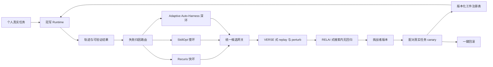

# 个人自用、效果优先的 RSI 系统选型与改造报告

> 分析日期：2026-10-14  
> 默认场景：系统主要由一个真实用户长期使用；允许记录全部个人轨迹；不把隐私、合规、多租户隔离和访问控制列入选型权重。  
> 优化目标：最大化未来真实任务的长期净效果，而不是最小化变更范围或满足企业上线流程。

---

## 0. 最终答案

### 0.1 效果上限优先的 1/2/3 项选择

如果资源足够，且确实要选择效果上限最高、能继续扩展的技术基础，推荐：

1. **只选 1 项：Adaptive Auto-Harness**
   - 使用 [A-Evolve](https://github.com/A-EVO-Lab/a-evolve/tree/release/adaptive-auto-harness) 的开放任务流 release；
   - 它不只改一段 prompt，而是持续构造 prompts、skills、memory、tools 和 workflow 组成的 harness；
   - 用 harness tree 保存不同任务区域的专用能力，再在解题时路由，而不是把所有经验不断塞进一个越来越长的全局上下文；
   - 在时间顺序、分布变化的三个开放任务流上，比 A-Evolve、GEPA、Meta-Harness、Continual Harness、SkillOS 等基线更稳定。
2. **选择 2 项：Adaptive Auto-Harness + Recuris**
   - Adaptive Auto-Harness 负责跨任务、跨阶段的 harness 构造、分支和路由；
   - Recuris 负责一次长任务内部的工作记忆、经验记忆、规则和上下文归因；
   - 两者分别解决“该给当前任务哪套系统能力”和“当前长任务在哪个状态组件出错”。
3. **选择 3 项：Adaptive Auto-Harness + Recuris + SkillOpt**
   - SkillOpt 负责把累积轨迹压缩成经过留出验证的稳定技能文档；
   - 三者形成深度演化环、任务执行环、技能巩固环；
   - A-Evolve 只拥有 harness tree、router、tool/workflow，Recuris 只拥有任务状态与经验组件，SkillOpt 只拥有叶子 skill 文档，避免三个优化器互相覆盖。

这是本报告的默认答案。

### 0.2 为什么与 `rsi_solu_g56_1.markdown` 的结论不同

旧报告把生产爆炸半径、租户隔离、隐私和人工审批作为高权重，因此优先选择 SkillOpt + ACE + Recuris。当前约束改变后：

- 自由修改 harness、工具和代码不再因影响多租户而被大幅降权；
- 2026-06 之后出现了 Adaptive Auto-Harness、Evo-Harness、VERSE 等更强的新工作；
- 目标从“最稳妥的生产有界改进”变成“个人长期效果上限”；
- 因此 A-Evolve 家族从离线借鉴项升为主底座。

但放宽隐私和治理，**并不意味着可以删除评测独立、预算匹配、历史无回归和回滚**。这些约束不是合规要求，而是判断“是否真的改进”的实验条件。

### 0.3 资源有限时的平衡方案

若无法承担 Adaptive Auto-Harness 的大量模型调用，选择：

1. 只选 1 项：**SkillOpt**；
2. 选择 2 项：**SkillOpt + Recuris**；
3. 选择 3 项：**SkillOpt + Recuris + Evo-Harness**。

这组方案牺牲自由修改工具和工作流的上限，换取更低成本、更清楚的归因和更容易复现的更新。

### 0.4 场景替换

| 主要任务 | 推荐替换 |
|---|---|
| 编码 Agent，预算很高 | Adaptive Auto-Harness + VERSE + HGM |
| 一般个人工具 Agent | Adaptive Auto-Harness + Recuris + SkillOpt |
| 主要是深度研究与长上下文 | 用 MemEvolve 替换 Recuris，或先做二者本地赛马 |
| 使用本地开放模型且有 8 卡训练资源 | 用 OpenClaw-RL 或 SkillRL 替换 SkillOpt，进入权重层 |
| 主要学习个人表达偏好 | Reflexio 可替代 Recuris，但它不能替代深层 harness 演化 |
| 几乎没有确定性反馈 | 保留 SkillOpt/ACE 的保守文本层，不启动代码或权重演化 |

---

## 1. 本报告所说的 RSI

### 1.1 操作定义

本报告把 RSI 系统定义为：

> 系统从连续真实任务的轨迹和结果中生成候选修改；候选可以改变记忆、技能、prompt、工具、workflow、代码或模型权重；只有在未来任务上保留可测增益的修改才成为新冠军版本。

这比“只会记住用户事实”的记忆系统更强，但仍不等于理论上的无限递归自我改进。

### 1.2 什么才算改进

必须同时满足：

1. 同一基础模型、同一工具权限和同一资源预算下，新版本优于旧版本；
2. 增益来自被保存并实际使用的工件，而不是额外 token 或更多重试；
3. 新任务到来后有正迁移，或至少不低于冻结基线；
4. 第二阶段继续学习时不会把第一阶段能力洗掉；
5. 延迟一段时间、清空会话上下文后，增益仍存在；
6. 候选更新、运行时读取和最终结果之间存在可追踪因果路径。

只在一个固定 benchmark 上找到更高峰值，不足以称为持续 RSI。

### 1.3 明确忽略的因素

本报告不按以下项目打分：

- 个人数据最小化；
- 跨租户隔离；
- 数据地域和合规；
- 企业角色权限；
- 跨用户公平性；
- 多人审批和组织事故流程。

仍保留以下技术约束：

- 评测器和封存集不能被优化器修改；
- 不可逆动作要 dry-run、备份或确认；
- 每个版本必须可复现和回滚；
- 不同更新环不得同时写同一个工件；
- 资源预算必须进入效果计算；
- 错误记忆必须能被替换和遗忘。

---

## 2. 分析方法和证据等级

### 2.1 分析过程

1. 从既有报告提取 prompt、memory、skill、harness、code、weight 六条路线；
2. 重新核实截至 2026-10-14 的论文、仓库、许可证和维护状态；
3. 补入 Adaptive Auto-Harness、Evo-Harness、VERSE、MemEvolve、SkillRL 等新工作；
4. 区分静态效果、顺序任务效果、迁移、再学习和真实用户证据；
5. 建立效果优先评分矩阵；
6. 先应用硬淘汰门，再考虑总分；
7. 按单项效果和组合互补性分别决策；
8. 对主组合设计工件所有权、快慢深三环和本地验证协议。

### 2.2 证据标签

- **【A：正式会议或严格受控证据】**：同行评审，或协议、任务切分、对照与工件可核对；
- **【B：预印本和开放代码】**：作者实验可核对，但缺少独立复现；
- **【C：项目方或厂商自报】**：README、博客、厂商案例和自述榜单；
- **【D：未核实】**：实现、成本、许可或关键数字无法确认。

“独立证据”专指与方法提出方无关联的复现或评测。会议录用不等于独立复现。

### 2.3 评分维度

每项按 1 至 5 分，换算为 100 分：

| 维度 | 权重 | 5 分标准 |
|---|---:|---|
| 公开任务净效果 | 25% | 在多种高难、可执行任务上明显领先强对照 |
| 多阶段复合能力 | 20% | 在顺序任务、迁移、继续学习中保持提升 |
| 效果上限 | 15% | 能修改高杠杆状态，突破 prompt/记忆天花板 |
| 通用性 | 10% | 可跨任务、模型和运行框架 |
| 因果验证 | 10% | 有留出、重放、消融、配对验证和失败归因 |
| 可改造性 | 10% | 代码完整、接口清楚、许可明确、维护活跃 |
| 生命周期效率 | 10% | 更新和部署成本相对增益合理 |

公式：

`总分 = Σ(单项分 / 5 × 权重)`

分数是“作为个人 RSI 技术基础”的建设评分，不是论文质量排名。

---

## 3. 技术路线地图

| 更新面 | 典型候选 | 能解决什么 | 上限 | 主要失败模式 |
|---|---|---|---|---|
| Prompt | GEPA、TextGrad、ReAnchor | 指令、格式、局部决策 | 中 | 过拟合措辞、样本硬编码 |
| Memory | Recuris、MemEvolve、ACE、Reflexio | 状态、经验、个人偏好 | 中高 | 陈旧、错误召回、膨胀 |
| Skill | SkillOpt、Evo-Harness、SkillRL | 可复用流程和工具策略 | 高 | 技能冲突、噪声固化 |
| Harness | Adaptive Auto-Harness、Meta-Harness、VERSE | 路由、工具、上下文、workflow | 很高 | 搜索成本、交互副作用 |
| Code | HGM、DGM、A-Evolve | 确定性功能和优化器逻辑 | 很高 | benchmark hacking、全局回归 |
| Weight | OpenClaw-RL、SkillRL、SEAL | 隐式策略和长期个性化 | 最高 | 遗忘、成本高、难归因 |

选层原则：

> 使用足以修复问题的最浅层；浅层长期无法修复的稳定残差才升级到更深层。

个人场景允许更激进，但不应让一次格式错误直接触发模型权重训练。

---

## 4. 扩展候选核实

### 4.1 Adaptive Auto-Harness：默认第一项

论文：[Adaptive Auto-Harness](https://arxiv.org/abs/2606.01770)  
代码：[A-Evolve release/adaptive-auto-harness](https://github.com/A-EVO-Lab/a-evolve/tree/release/adaptive-auto-harness)  
许可：该 release 分支包含 MIT LICENSE；主分支 GitHub 元数据未识别许可证。  
证据：预印本、开放代码，无独立复现【B】。

#### 核心机制

- 四阶段多 Agent evolver：Analyze、Research、Build、Verify；
- 跨周期持久 workspace；
- temporal-reveal feedback，标签到达前不偷看未来结果；
- harness tree 为不同任务区域维护独立分支；
- solve-time router 按当前任务选择分支；
- 历史不含必要信号时允许定向人工 steering；
- git 分支保存隔离、谱系和回滚。

#### 关键结果

作者在三个按时间排序的开放任务流上报告：

- PolyBench：97.9% coverage、80.9% accuracy；
- CTF-Dojo：50.2% pass@1；
- FutureX：49.5% pass@1；
- 比较对象包含 A-Evolve、GEPA、Meta-Harness、Continual Harness、SkillOS 和无演化模型【B】。

它还直接展示了一个关键反例：把所有经验持续写入单一 dense harness，会先升后降。PolyBench 多 Agent 运行在 51 个演化周期中的第 22 个周期达到峰值，FutureX 在 26 个周期中的第 10 个达到峰值。说明长期系统必须分支和路由，不能只做全局累加。

#### 成本与边界

公开成本表只统计 solver token，未保存 evolver token：

| 系统 | 任务流 | 输入 token | 输出 token | 墙钟时间 |
|---|---|---:|---:|---:|
| Full System | PolyBench | 233.2M | 12.2M | 59.5h |
| Full System | CTF-Dojo | 169.0M | 2.4M | 21.1h |
| Full System | FutureX | 25.6M | 0.5M | 6.6h |

因此它的效果上限高，但真实总成本被低估。论文只覆盖预测市场、安全竞赛和事件预测，没有真实个人用户长期部署。

#### 为什么仍排第一

它是当前少数直接针对无限任务流、异质任务、分布变化和 harness 膨胀的完整方案；更新对象覆盖 prompt、skill、memory、tool 和 workflow，且 release 可运行。对于不受企业爆炸半径限制的个人系统，它提供了最大的可扩展控制面。

### 4.2 Evo-Harness：最强平衡候选之一

论文：[Evo-Harness](https://arxiv.org/abs/2608.15071)  
代码：[A-Evolve release/evo-harness](https://github.com/A-EVO-Lab/a-evolve/tree/release/evo-harness)  
许可：release 分支 MIT。  
证据：EMNLP 2026，开放代码，尚无独立复现【A/B】。

Evo-Harness 从单次执行上下文编译两类 skill：

- general skill：跨任务的调试、验证和恢复模式；
- topic skill：某类任务的局部操作知识。

在 Claude Opus 4.6 上，作者报告：

| 方法 | CL-Bench | TerminalBench-2 | SWE-bench Lite | τ-bench | WebArena-Infinity |
|---|---:|---:|---:|---:|---:|
| No Evolve | 29.54 | 62.92 | 63.67 | 72.73 | 72.50 |
| ACE | 29.70 | 61.80 | 63.67 | 72.73 | 71.25 |
| XSkill | 31.44 | 66.29 | 64.67 | 73.94 | 73.75 |
| Evo-Harness | **34.02** | **73.03** | **67.00** | **76.97** | **76.25** |

重要反证：

- 仅靠模型自己生成的反馈，会让 CL-Bench 从 29.54 降到 27.96、SWE-bench Lite 从 63.67 降到 61.67；
- harness 对强模型增益更大：Opus 系列约 +3.7 至 +4.5，Kimi-K2.5 和 GPT-OSS 只有 +1.1、+0.8；
- 它只研究自然语言 skill，不覆盖可执行代码 skill 和多 Agent。

它比 ACE 更新、更直接覆盖顺序任务流。如果预算不够上完整 Adaptive Auto-Harness，可用它替代深度环。

### 4.3 Recuris：默认第二项

论文：[Recuris](https://arxiv.org/abs/2608.24876)  
代码：[Gen-Verse/Recuris](https://github.com/Gen-Verse/Recuris)  
许可：Apache-2.0。  
证据：新预印本、开放代码，无独立复现【B】。

Recuris 将长程 Agent 的状态拆为经验、工作记忆、规则/策略和上下文等组件，先定位失败组件，再做单组件局部补丁。候选用确定性配对留出门决定，模型不能给自己的补丁投票。

作者报告：

- 37 个已完成模型-基准组合中 35 个改善；
- τ²-Retail 约 +23.3 个点；
- SkillFlow 约 +16.8 个点；
- 长任务最高约 +32.2 个点；
- 常见长程失败最多下降约 80%【B】。

边界：

- TerminalBench 在匹配四次尝试预算后约 +2.3 个点，置信区间包含零；
- 通用 memory 在一个 GPT-OSS-20B 组合中出现负迁移，专用重训后才恢复；
- 某些组合仍退化；
- 成对长任务 replay 成本高。

它被选为第二项，不是因为单项分数最高，而是因为它与 Adaptive Auto-Harness 的重叠最小：前者管任务间 harness，Recuris 管任务内状态和局部故障。

### 4.4 SkillOpt：默认第三项

论文：[SkillOpt](https://arxiv.org/abs/2605.23904)  
代码：[microsoft/SkillOpt](https://github.com/microsoft/SkillOpt)  
文档：[SkillOpt Guide](https://microsoft.github.io/SkillOpt/docs/guideline.html)  
许可：MIT。  
证据：开放完整训练环，暂无完整独立复现【B】。

SkillOpt 把 `skill.md` 当可训练状态，使用有界增删改、文本学习率、拒绝编辑缓冲和留出验证门。论文自报六个基准、七个模型、三个运行环境共 52 个已评估单元全部最佳或并列最佳；GPT-5.5 平均提升约 19.1 至 24.8 个点【B】。

它的优势：

- skill 很短，部署时几乎没有额外调用；
- 每个候选有明确 diff；
- 留出分不提高就拒绝；
- `SkillOpt-Sleep` 适合批量离线巩固；
- 容易嵌入任意 Agent。

限制：

- 多阶段分布切换证据不如 Adaptive Auto-Harness；
- 公开训练成本可达每基准约 20.8M 至 213.8M token；
- 小留出集被反复搜索后仍会过拟合；
- 验证门不是通用正确性证明。

选择它作为第三项，是为了给 A-Evolve 生成的叶子技能加入更稳定的文本优化和验证，而不是再建立一个并行全局 harness。

### 4.5 MemEvolve：记忆架构路线的最强替换项

论文：[MemEvolve](https://arxiv.org/abs/2512.18746)  
代码：[bingreeky/MemEvolve](https://github.com/bingreeky/MemEvolve)  
许可：Apache-2.0。  
证据：ICML 2026，开放代码【A】。

MemEvolve 不只更新记忆内容，还共同演化：

- Encode；
- Store；
- Retrieve；
- Manage。

作者在 GAIA、xBench、WebWalkerQA、TaskCraft 上报告：

- 最高相对提升 17.06%；
- 跨任务、模型、框架迁移约 +2.0 至 +9.09 个点；
- Flash-Searcher 上三项评测稳定提升约 3.54% 至 5.0%；
- 单任务 API 成本与无记忆基线接近，但延迟有时更高【A】。

示例：GAIA 为 73.33 vs 69.09，xBench 为 74.00 vs 69.00，WebWalkerQA 为 74.71 vs 71.18。

它适合深度研究、长上下文和记忆架构本身明显是瓶颈的系统。默认仍选 Recuris，是因为 Recuris 对执行状态失败的局部归因和确定性配对门更直接；本地任务若以检索研究为主，应让二者赛马。

### 4.6 VERSE：最值得借鉴的优化器自改进工作

论文：[VERSE](https://arxiv.org/abs/2610.02616)  
代码：[wzekai/VERSE](https://github.com/wzekai/VERSE)  
许可：MIT。  
证据：2026-10 新预印本、开放代码，无独立复现【B】。

VERSE 同时修改：

- executor 的 prompt、tool、workflow；
- optimizer 自己的 prompt、skill、tool、hook、notes。

它提供三类执行验证工具：

1. verification：在目标任务上运行草稿；
2. replay：重放失败确认问题可复现；
3. perturbation：替换或删除可疑步骤，测试其因果作用。

核心发现：

- Meta-Harness 只加“自我演化”而没有执行验证时，所有后续轮次都没有超过初始 harness；
- 加入验证后，自我演化才取得该对照中的最佳结果；
- 在 SWE-rebench 上，最佳版本 ID 42.3%、OOD 37.7%，强基线为 39.2%、29.3%；
- 每十个被预期修复的失败中，约只有一个真正在下一轮通过；
- 已提交编辑在验证集上修复 148 个结果的同时也破坏 134 个结果，说明“会提出修改”远不等于“会提出好修改”【B】。

成本很高。Meta-Harness + VERSE 自演化的一次主实验约：

- 1,453 次 agent run；
- 634M executor token；
- 1,126 次 optimizer turn；
- 38 小时；
- 比宿主基线耗时约 1.3 至 2.5 倍。

VERSE 目前主要是软件工程场景，因此不放入通用三项。但它的 replay、perturb、training audit 和“自演化必须配验证”应成为默认组合的强制机制。

### 4.7 OpenClaw-RL：最贴近个人用户的权重更新路线

论文：[OpenClaw-RL](https://arxiv.org/abs/2603.10165)  
代码：[Gen-Verse/OpenClaw-RL](https://github.com/Gen-Verse/OpenClaw-RL)  
许可：Apache-2.0。  
证据：技术报告、开放代码；个人用户是模拟用户【B】。

它把下一状态信号转为：

- evaluative signal：用户是否接受、工具是否成功；
- directive signal：下一状态中隐含的纠正或提示；
- Hybrid RL：GRPO 标量目标 + on-policy distillation token 目标。

论文在模拟学生、助教、教师三种用户上报告，联合优化约 10.3 个 session 达到偏好目标，单独优化约 15.0 个 session；GRPO、OPD、Mem0、Cognee 更慢【B】。

关键限制：

- 用户是 LLM 模拟，不是真实长期个人；
- 只验证偏好模式，不等于复杂任务能力；
- Qwen3-4B 实验使用 8 张 GPU：训练 actor 4、推理 server 2、PRM actor 1、PRM server 1；
- 权重更新使因果归因和回滚更难；
- 2026-05 后仓库未继续 push。

有本地 GPU、长期稳定任务流、上层 skill/harness 已到瓶颈时，它是值得增加的第四层，不应作为首个基础。

### 4.8 SkillRL：技能与权重共同演化

论文：[SkillRL](https://arxiv.org/abs/2602.08234)  
代码：[aiming-lab/SkillRL](https://github.com/aiming-lab/SkillRL)  
许可：MIT。  
证据：预印本、数据与代码开放【B】。

SkillRL 用成功轨迹形成示范、失败轨迹形成教训，维护 general/task-specific SkillBank，并在 RL 期间共同演化 skill 和 policy。

作者报告：

- ALFWorld 89.9%，WebShop 72.7%；
- 相较 GRPO，ALFWorld 绝对提升 12.3 个点；
- 动态 skill 演化消融贡献约 5.5 个点；
- 对原始轨迹约 10 至 20 倍压缩；
- 每个实验约 8×H100 80GB、30 小时【B】。

它更适合本地开放模型和有清晰环境奖励的任务；对 API 模型或稀疏个人任务流，不如 SkillOpt 易用。

### 4.9 HGM / DGM：编码 Agent 的深度代码演化

论文：

- [Huxley-Gödel Machine](https://arxiv.org/abs/2510.21614)
- [Darwin Gödel Machine](https://arxiv.org/abs/2505.22954)

代码：

- [metauto-ai/HGM](https://github.com/metauto-ai/HGM)
- [jennyzzt/dgm](https://github.com/jennyzzt/dgm)

许可：均为 Apache-2.0。

HGM 不只看当前 agent 分数，而是估计一个修改分支后代的长期“clade metaproductivity”。作者报告：

- 800 次评估时，SWE-Verified-60 从 40.0% 提升到 56.7%；
- 8,000 次评估时，完整 SWE-Verified 从 53.2% 提升到 61.4%；
- 迁移到完全未见 SWE-Lite 子集时，从 34.8% 提升到 40.1%【B】。

这条路线的效果上限极高，但：

- 只证明编码 Agent；
- 搜索成本极高；
- DGM 曾出现 objective hacking；
- benchmark 分数与未来可改进性本身就存在错配；
- 任意代码修改需要可靠、可重复的测试。

所以只在编码专用方案中选择。

### 4.10 ACE、GEPA、Meta-Harness、Reflexio、Hermes 和 RSI-Anything

#### ACE

[ACE](https://github.com/ace-agent/ace) 用增量结构化 playbook 学习经验。论文自报 Agent 任务 +10.6%、金融任务 +8.6%；项目方生产案例称 SRE 调查时间缩短约 30%【B/C】。但在 Evo-Harness 的同协议对比中，ACE 在 TerminalBench-2 和 WebArena-Infinity 低于无演化基线。它仍是低成本在线 playbook 方案，不再是效果上限主选。

#### GEPA

[GEPA](https://github.com/gepa-ai/gepa) 是成熟、通用、样本高效的文本优化器，最多比 GRPO 少 35 倍 rollout【A】。但 RELAI-VCL 两阶段实验中，其新任务迁移 54.5%，低于 56.8% 未优化基线，并出现样本特定信息。适合固定任务 prompt 优化，不适合长期主循环。

#### Meta-Harness

[Meta-Harness](https://github.com/stanford-iris-lab/meta-harness) 可自由修改代码、工具和流程，静态上限高。RELAI-VCL 实验中它第一阶段变化较保守、迁移到 68.2%，但第二阶段所有候选更差，最终降到 59.1%。VERSE 也显示它需要执行验证才适合自我演化。默认由 Adaptive Auto-Harness 替代；编码场景作为 VERSE 宿主保留。

#### Reflexio

[Reflexio](https://github.com/ReflexioAI/reflexio) 把用户纠正写入 profile、个人 playbook 和共享 playbook。项目自报筛选后的 GDPVal 任务中 4/5 改善，并减少步骤和 token【C】；但从 50 个任务预筛到 5 个可完成任务，存在明显选择偏差。适合个人偏好层，不适合替代深层 harness。

#### Hermes Agent

[Hermes Agent](https://github.com/NousResearch/hermes-agent) 是成熟的个人 Agent 壳，支持跨会话记忆和技能。它证明产品工程可用性，不证明自改进的因果效果。可作为 runtime，但不占三项算法基础名额。

#### RSI-Anything

[RSI-Anything](https://github.com/Gen-Verse/RSI-Anything) 用世界模型在真实评估前预测候选价值，并做组件与兼容性检查。代码修复主结果有改善，但置信区间下界接近零；作者也未完成同一任务中 policy/world-model 的联合多轮持续改进【B】。借鉴候选排序，不作为主环。

---

## 5. 效果优先评分矩阵

### 5.1 单项评分

| 候选 | 净效果 | 复合 | 上限 | 通用 | 因果 | 可改造 | 效率 | 总分 |
|---|---:|---:|---:|---:|---:|---:|---:|---:|
| Adaptive Auto-Harness | 5 | 5 | 5 | 4 | 4 | 4 | 2 | **88** |
| SkillOpt | 5 | 3 | 3 | 5 | 5 | 5 | 4 | **84** |
| Evo-Harness | 4 | 4 | 4 | 5 | 4 | 4 | 4 | **82** |
| Recuris | 4 | 4 | 4 | 4 | 5 | 4 | 3 | **80** |
| MemEvolve | 4 | 4 | 4 | 4 | 4 | 4 | 3 | **78** |
| ACE | 4 | 3 | 3 | 5 | 3 | 5 | 5 | **77** |
| VERSE | 4 | 4 | 5 | 2 | 5 | 4 | 1 | **75** |
| OpenClaw-RL | 4 | 4 | 5 | 4 | 3 | 4 | 1 | **75** |
| HGM / DGM | 5 | 4 | 5 | 1 | 3 | 4 | 1 | **74** |
| SkillRL | 4 | 4 | 5 | 3 | 3 | 4 | 1 | **73** |
| RSI-Anything | 3 | 3 | 5 | 5 | 4 | 4 | 2 | **72** |
| GEPA | 4 | 2 | 3 | 5 | 3 | 5 | 4 | **71** |
| Meta-Harness | 4 | 2 | 5 | 4 | 3 | 5 | 1 | **69** |
| Reflexio | 3 | 3 | 3 | 4 | 2 | 5 | 5 | **68** |
| Hermes Agent | 3 | 2 | 3 | 4 | 2 | 5 | 4 | **62** |

### 5.2 为什么不是简单选择前三名

若机械取前三，会得到 Adaptive Auto-Harness + SkillOpt + Evo-Harness。但：

- Adaptive Auto-Harness 和 Evo-Harness 同属 A-Evolve 技术族；
- 二者都更新 skill/harness，组合写冲突很大；
- Recuris 虽然单项分数略低，却补上独立的长任务状态和组件归因；
- SkillOpt 与 Adaptive Auto-Harness 有部分重叠，但可限制为叶子技能内容，提供更强留出门；
- 组合选择应最大化互补覆盖，而不是总分相加。

因此最终选择 Adaptive Auto-Harness + Recuris + SkillOpt。

### 5.3 进入本地系统前的硬门槛

公开论文高分只允许候选进入本地赛马。以下任一失败即淘汰：

1. 不能接入目标任务的可执行结果或可靠 verifier；
2. 优化器能读取或修改封存测试集；
3. 无法固定模型、工具、资源预算和初始状态；
4. 无法回滚到冠军版本；
5. P11 完整持久化没有稳定超过 P01 只读持久化；
6. 未见任务迁移低于冻结基线；
7. 第二阶段继续学习时明显破坏第一阶段能力；
8. 优势全部来自更多 token、重试或工具调用；
9. 工件被更新但运行时没有实际读取或遵循；
10. 在不可逆真实任务上产生新的严重失败。

---

## 6. 组合后的系统架构

### 6.1 总体数据流



### 6.2 三个时间尺度

| 环 | 周期 | 所有者 | 可写对象 | 不可写对象 |
|---|---|---|---|---|
| 快环 | 每任务或每天 | Recuris | working state、episodic memory、局部规则候选 | 全局 skill、router、工具代码 |
| 慢环 | 样本累积后 | SkillOpt | 叶子 `skill.md` | 任务状态、harness tree、评测器 |
| 深环 | 周期性或结构失败触发 | Adaptive Auto-Harness | 分支、router、prompt 包、tool/workflow | 封存集、预算规则、发布门 |

三个环不可在同一批实验中同时改同一个主对象。联合版本必须做逐层消融。

### 6.3 工件结构

建议把每个发布版本定义为：

`release_manifest = {model, prompt, harness_branch, router, skills, memory_schema, memory_snapshot, tools, evaluator, budget_profile}`

每项记录：

- 父版本；
- 修改差异；
- 来源任务和轨迹；
- 目标失败；
- 预计修复范围；
- 本地验证、历史回归、时间留出结果；
- token、调用、GPU、墙钟成本；
- 运行时是否实际检索和采用；
- 被替代版本和回滚指针。

### 6.4 失败归因路由

| 失败 | 首选更新层 |
|---|---|
| 个人事实、一次性状态 | 普通 memory，不触发 RSI |
| 长任务忘记状态或重复动作 | Recuris working memory |
| 重复出现的工具 SOP 错误 | SkillOpt skill |
| task-type 经验需要归类 | Evo-Harness 式 general/topic skill compilation |
| 当前任务选错能力组合 | Adaptive Auto-Harness router/tree |
| 工具缺失、流程结构错误 | Adaptive Auto-Harness tool/workflow |
| 优化器反复诊断错误 | VERSE 式 optimizer harness |
| 代码 Agent 设计本身是瓶颈 | HGM 深度代码搜索 |
| 上层工件长期无法修复 | OpenClaw-RL/SkillRL 权重层 |

分类不确定时，先在最浅的两个相邻层各生成候选，通过同预算 replay 选择，而不是一次同时修改所有层。

---

## 7. 对三项基础的具体改造

### 7.1 Adaptive Auto-Harness 改造

1. 实现个人任务 `BenchmarkAdapter`：
   - `get_tasks()` 返回按时间排序的任务流；
   - `evaluate()` 返回成功、质量、成本和不可逆错误；
2. 把 benchmark 的固定答案改为真实任务 outcome adapter：
   - 测试结果；
   - 文件 diff；
   - 工具返回；
   - 用户明确纠正；
   - 延迟结果；
3. 定义 harness tree 分支标准：
   - 按任务机制分支，不按单个样本分支；
   - 分支必须有最小支持任务数；
   - 长期低命中分支合并或淘汰；
4. router 需要记录：
   - 候选分支；
   - 选择理由；
   - 实际读取文件；
   - 路由后收益；
5. 为 evolver token 补完整账本；
6. 把 human steering 改为个人异步问题队列；
7. 设置 harness 容量和分支数量预算；
8. 每次深环先在 clone 中运行，不直接覆盖冠军。

### 7.2 Recuris 改造

1. 把目标 Agent 状态映射到经验、工作记忆、规则、上下文四类；
2. 为每类定义独立 schema 和 replay；
3. 一次候选只改一个组件；
4. 定位器与修补器使用不同上下文；
5. 最终是否接受由确定性结果或独立 judge 决定；
6. 把有效局部规则定期上送 SkillOpt，而不是无限留在 working memory；
7. 为过时记忆增加 `supersedes` 和失效条件；
8. 记录记忆是否被检索、是否改变动作、是否真正修复结果。

### 7.3 SkillOpt 改造

1. 为个人任务实现 env、data loader、scorer；
2. 每个任务族维护独立 skill；
3. 只接收至少在多个独立任务上重复出现的模式；
4. `SkillOpt-Sleep` 默认生成 challenger，不自动覆盖冠军；
5. 开发门、时间留出、封存集三分离；
6. 加入历史已解决任务池；
7. 接受规则从“留出平均分变高”改为：
   - 目标任务改善；
   - 历史任务非劣；
   - 生命周期效用提高；
8. rejected-edit buffer 跨轮保留；
9. skill 长度、检索 top-k 和冲突数进入目标函数。

### 7.4 三者集成改造

统一候选接口：

```text
Candidate {
  owner_layer
  parent_version
  target_failures
  changed_artifacts
  expected_scope
  replay_plan
  budget
}
```

统一接受顺序：

1. 应用和启动检查；
2. VERSE 式目标失败重放；
3. perturb 确认修改与结果有因果关系；
4. 历史已解决任务回归；
5. 未见时间块迁移；
6. 同预算 challenger/champion 配对；
7. 真实任务 canary；
8. 晋升或回滚。

---

## 8. 评测：如何证明真实有效

### 8.1 持久化因果对照

至少运行：

| 组 | 读取状态 | 写入状态 | 目的 |
|---|---:|---:|---|
| P00 | 否 | 否 | 完全无学习基线 |
| P01 | 是 | 否 | 静态已知工件价值 |
| P10 | 否 | 是 | 写入成本和无效更新 |
| P11 | 是 | 是 | 完整 RSI |
| Pshuffle | 读打乱状态 | 否 | 排除“只是上下文更多” |

关键量：

- 持久化总收益：`P11 - P00`；
- 真正更新收益：`P11 - P01`；
- 检索收益：`P01 - P00`；
- 状态相关性：`P11 - Pshuffle`。

若 P11 不超过 P01，系统只有静态记忆价值，没有持续学习证据。

### 8.2 多阶段任务流

1. S0：冻结版本测基线；
2. S1：在 T1 学习，测 T1 留出；
3. S2：不学习直接测未见 T2；
4. S3：用相同预算在 T2 继续学习，再测 T1∪T2；
5. S4：反转偏好、工具或规则，测试能否替换旧状态；
6. S5：清空会话上下文并延迟后复测。

报告：

- 当前任务增益；
- 历史能力保留；
- 前向迁移；
- 再学习增益；
- 过时状态替换；
- 延迟保持；
- 最差任务族；
- 全生命周期净效用。

### 8.3 预算归一化

统一资源账本：

`B = API token + 模型调用 + 工具费用 + GPU 秒 + 墙钟时间 + 个人干预分钟`

同时报告：

1. 等预算结果；
2. 各方法自然最佳成本；
3. B25/B50/B100 效用—预算曲线；
4. 达到目标成功率所需成本；
5. 预计未来 H 个任务上的摊销成本。

不能拿 A-Evolve 的大量离线搜索与 ACE 的一次轻量更新直接比较最终峰值。

### 8.4 封存与防过拟合

- 训练流：优化器可读；
- 开发门：有限次数查询；
- 时间外留出：模拟未来；
- 历史已解决池：检测遗忘；
- 封存集：发布前一次性使用；
- 多基座曲线：至少弱、中、强三档 solver；
- 查询预算耗尽后轮换开发门；
- 最终选择中位运行或置信下界，不选最佳随机种子。

---

## 9. 实施顺序

选择顺序和实施顺序不同。最终系统以 Adaptive Auto-Harness 为顶层，但先从容易归因的局部环开始。

### 阶段 0：冻结冠军和任务合同

工作：

- 固定模型、prompt、工具、预算和初始状态；
- 定义真实任务 outcome；
- 建立时间排序任务流；
- 建立 P00/P01 对照；
- 创建不可变 manifest 和一键回滚。

退出条件：

- 基线可重复；
- 主要结果可自动或可靠评估；
- 同一任务的自然方差已测量；
- 不可逆任务可 dry-run 或确认。

### 阶段 1：Recuris 快环

先接入任务状态、经验和组件级失败定位。

退出条件：

- 长程失败明显下降；
- P11 超过 P01；
- 成对 replay 支持因果归因；
- 没有历史任务显著回退。

若主要任务不是长程工具任务，跳过此阶段，先上 SkillOpt。

### 阶段 2：SkillOpt 慢环

把重复经验巩固为叶子 skill。

退出条件：

- 至少一个时间外任务族受益；
- skill 实际被读取；
- 长度和检索成本受控；
- 第二轮优化仍可改善而不洗掉第一轮。

### 阶段 3：Evo-Harness 过渡实验

在完整 Adaptive Auto-Harness 前，先测试 general/topic skill compilation。

目的：

- 验证当前强模型是否会遵循演化 harness；
- 找出适合分支的任务区域；
- 估计深环成本收益。

若 Evo-Harness 没有稳定超过 SkillOpt + Recuris，不进入更昂贵的深环。

### 阶段 4：Adaptive Auto-Harness 深环

引入 harness tree、router、multi-agent evolver 和异步 steering。

退出条件：

- 分支路由显著超过单一 dense harness；
- 长期曲线没有明显先升后降；
- 每个分支有稳定支持任务；
- evolver 的完整 token 和时间成本可接受；
- 深环增益在未来任务上能摊销。

### 阶段 5：可选的 optimizer/weight 演化

仅当上层已稳定：

- 编码任务：引入 VERSE，再考虑 HGM；
- 本地开放模型：引入 OpenClaw-RL 或 SkillRL；
- 深度研究：引入 MemEvolve 架构搜索；
- 世界模型成本高时：用 RSI-Anything 预筛候选。

每增加一个深层环，都重新建立冻结基线，不与其他新环同时上线。

---

## 10. 场景化最优组合

### 10.1 通用个人 Agent

**Adaptive Auto-Harness + Recuris + SkillOpt**

原因：

- 任务区域和工具链会变化；
- 长任务需要状态；
- 重复流程需要稳定 skill；
- 三项分别拥有不同工件。

### 10.2 编码 Agent

**Adaptive Auto-Harness + VERSE + HGM**

分工：

- Adaptive Auto-Harness：任务类型路由、工具和 workflow；
- VERSE：对 executor 与 optimizer 做执行验证和自演化；
- HGM：搜索长期有生产力的 agent code 分支。

这是效果上限最高、成本也最高的方案。若预算不足，用 SkillOpt 替代 HGM。

### 10.3 深度研究 Agent

**Adaptive Auto-Harness + MemEvolve + SkillOpt**

原因：

- 研究任务的主要瓶颈常是检索、长期证据、来源管理和上下文组织；
- MemEvolve 可演化 encode/store/retrieve/manage；
- SkillOpt 保存可复用研究 SOP。

### 10.4 本地开放模型

**Recuris + SkillOpt + OpenClaw-RL**

先用文本工件快速获得数据和稳定策略，再用真实下一状态信号更新权重。若任务有清晰环境奖励，SkillRL 可替代 SkillOpt，联合演化技能和策略。

### 10.5 低预算 API Agent

**SkillOpt + Recuris + ACE**

关闭 A-Evolve 深环，只在积累足够失败后离线运行 SkillOpt；ACE 处理轻量 playbook；Recuris 仅在长任务启用。

---

## 11. 关键风险和反证

### 11.1 技术上不能忽略的反证

1. Adaptive Auto-Harness 自己证明 dense harness 会先升后降；
2. Evo-Harness 证明自生成反馈可低于无演化基线；
3. VERSE 证明无执行验证的 optimizer 自演化可能完全无效；
4. VERSE 中提交编辑修复 148 个结果同时破坏 134 个结果；
5. RELAI-VCL 显示 GEPA 新任务迁移低于冻结基线；
6. RELAI-VCL 显示 Meta-Harness 能迁移但第二阶段无法继续改善；
7. Recuris 有模型组合负迁移；
8. MemEvolve 明确承认跨根本不同任务族未必迁移；
9. HGM 说明当前分数与未来可改进性不一致；
10. OpenClaw-RL 的“真实用户”实验实际使用模拟用户；
11. A-Evolve 总成本没有记录 evolver token；
12. 几乎所有主结果都缺独立团队完整复现。

### 11.2 停止或降级条件

- 深环连续两个周期没有提高时间外任务；
- router 不超过单一 skill 检索；
- P11 不超过 P01；
- 历史任务持续回退；
- 成本增长快于避免失败的价值；
- 新技能越来越长但检索采用率下降；
- 同一坏方向反复出现；
- 模型升级后 harness 增益消失；
- 任务结果无法可靠验证；
- 深层候选优势只存在于最佳 seed；
- 不可逆任务出现新严重失败。

发生这些情况时，先回到 SkillOpt + Recuris，不继续叠加优化器。

---

## 12. 最终决策表

| 数量 | 效果上限默认选择 | 作用 | 主要代价 |
|---|---|---|---|
| 1 | **Adaptive Auto-Harness** | 开放任务流中的 harness tree、路由与深度演化 | 调用和实验成本极高 |
| 2 | **Adaptive Auto-Harness + Recuris** | 增加长任务状态与组件级局部修补 | 成对 replay 成本 |
| 3 | **Adaptive Auto-Harness + Recuris + SkillOpt** | 增加稳定技能巩固与严格留出门 | 系统集成和写入边界复杂 |

最终建议：

> 以 Adaptive Auto-Harness 为顶层底座，以 Recuris 管任务内状态，以 SkillOpt 管叶子技能；吸收 Evo-Harness 的 general/topic skill compilation、VERSE 的执行验证、RELAI-VCL 的搜索内无回归、MemEvolve 的四段记忆接口和 PAST-Bench 的持久化因果对照。

真正实施时按 Recuris/SkillOpt → Evo-Harness → Adaptive Auto-Harness 的顺序渐进接入。这样既保留效果上限，又能在每一步知道收益来自哪里。

---

## 13. 参考资料

### 13.1 最终三项及 A-Evolve 家族

- Adaptive Auto-Harness 论文：https://arxiv.org/abs/2606.01770
- Adaptive Auto-Harness 代码：https://github.com/A-EVO-Lab/a-evolve/tree/release/adaptive-auto-harness
- A-Evolve 主仓：https://github.com/A-EVO-Lab/a-evolve
- Evo-Harness 论文：https://arxiv.org/abs/2608.15071
- Evo-Harness 代码：https://github.com/A-EVO-Lab/a-evolve/tree/release/evo-harness
- Recuris 论文：https://arxiv.org/abs/2608.24876
- Recuris 代码：https://github.com/Gen-Verse/Recuris
- SkillOpt 论文：https://arxiv.org/abs/2605.23904
- SkillOpt 代码：https://github.com/microsoft/SkillOpt
- SkillOpt 文档：https://microsoft.github.io/SkillOpt/docs/guideline.html

### 13.2 扩展候选

- VERSE 论文：https://arxiv.org/abs/2610.02616
- VERSE 代码：https://github.com/wzekai/VERSE
- MemEvolve 论文：https://arxiv.org/abs/2512.18746
- MemEvolve 代码：https://github.com/bingreeky/MemEvolve
- OpenClaw-RL 论文：https://arxiv.org/abs/2603.10165
- OpenClaw-RL 代码：https://github.com/Gen-Verse/OpenClaw-RL
- SkillRL 论文：https://arxiv.org/abs/2602.08234
- SkillRL 代码：https://github.com/aiming-lab/SkillRL
- HGM 论文：https://arxiv.org/abs/2510.21614
- HGM 代码：https://github.com/metauto-ai/HGM
- DGM 论文：https://arxiv.org/abs/2505.22954
- DGM 代码：https://github.com/jennyzzt/dgm
- ACE 论文：https://arxiv.org/abs/2510.04618
- ACE 代码：https://github.com/ace-agent/ace
- Meta-Harness 论文：https://arxiv.org/abs/2603.28052
- Meta-Harness 代码：https://github.com/stanford-iris-lab/meta-harness
- GEPA 论文：https://arxiv.org/abs/2507.19457
- GEPA 代码：https://github.com/gepa-ai/gepa
- RSI-Anything 论文：https://arxiv.org/abs/2610.13912
- RSI-Anything 代码：https://github.com/Gen-Verse/RSI-Anything
- Reflexio：https://github.com/ReflexioAI/reflexio
- Hermes Agent：https://github.com/NousResearch/hermes-agent

### 13.3 持续学习和验收

- RELAI-VCL 论文：https://arxiv.org/abs/2607.14004
- RELAI-VCL 实验工件：https://github.com/relai-ai/Continual-Learning-Terminal-Bench
- PAST-Bench 论文：https://arxiv.org/abs/2608.04003
- PAST-Bench 代码：https://github.com/Gen-Verse/PAST-Bench

---

## 14. 未核实项

截至 2026-10-14，以下事项不能当作已证实事实：

1. Adaptive Auto-Harness、Evo-Harness、VERSE、Recuris 的主结果均缺少独立完整复现；
2. A-Evolve 主分支没有 LICENSE 文件，只有对应 release 分支明确包含 MIT LICENSE；
3. Adaptive Auto-Harness 成本表遗漏 evolver token，总成本下界不完整；
4. Adaptive Auto-Harness 尚未在真实个人用户日常任务上长期运行；
5. SkillOpt-Sleep 的长期自主循环仍缺真实个人任务流证据；
6. Recuris 的 35/37 改善尚待外部团队验证；
7. VERSE 只在编码任务上证明优化器自演化增益；
8. OpenClaw-RL 的个人用户实验为模拟用户，真实偏好稳定性未证实；
9. HGM 的高分依赖可重复代码测试，不能直接外推到开放式个人任务；
10. MemEvolve 的跨域迁移仍限于相近的研究和工具任务；
11. RELAI-VCL 由参赛方法提供方发布，完整优化器未开源，不是中立复现；
12. 所有公开排名都必须在个人真实任务、实际模型版本和实际预算下重新赛马。

因此本报告给出的是**最值得作为基础的技术组合**，不是已经替你证明收益的成品系统。最终冠军必须由第 8 节的本地持续学习协议决定。
