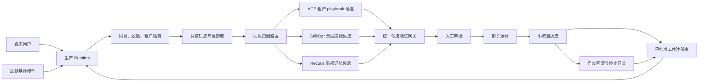

# 面向真实用户的 RSI 系统选型与改造报告

> 分析日期：2026-10-14  
> 默认场景：有多租户、长期使用和真实反馈的通用 Agent/工作流  
> 结论口径：这里的“RSI”指可测量、可保留、可回滚的有界自改进，不声称已经实现可无限递归提升自身改进能力的严格 RSI。

---

## 0. 执行摘要

### 0.1 最终选择

如果只能选择 1 到 3 项工作作为基础，推荐顺序是：

1. **只选 1 项：SkillOpt**
   - 它把人类可读的技能文档当作可训练状态；
   - 更新是有界的增删改；
   - 候选必须通过留出验证门才会被接受；
   - 夜间 `SkillOpt-Sleep` 默认只暂存候选，适合改造成生产环境中的 proposal-only 慢环。
2. **选择 2 项：SkillOpt + ACE**
   - SkillOpt 负责低频、严格验证的全局技能更新；
   - ACE 负责从连续交互中快速形成结构化的租户 playbook；
   - 两者分别承担慢环与快环，但不得写同一工件。
3. **选择 3 项：SkillOpt + ACE + Recuris**
   - Recuris 增加长程任务中的工作记忆、经验记忆、规则与上下文的组件级归因；
   - 它只局部修补被判定出错的组件，并用确定性配对留出门决定是否保留；
   - 适合补足跨会话、长任务和复杂工具链中的状态管理。

这个推荐不是按论文单项分数机械取前三。**RELAI-VCL 的持续学习证据更强，但完整优化器没有作为可直接采用的开源实现发布**；因此应强制吸收它的“搜索循环内无回归”设计，而不是把它列为默认代码基础。

### 0.2 最重要的判断

- 没有任何现成工作同时满足：真实用户规模验证、持续复合增益、独立复现、完整开源、隐私隔离和生产发布治理。
- 真实用户系统的重点不是让线上 Agent 随时改自己，而是把真实反馈转成**受约束候选更新**，经过离线重放、无回归验证、人工审批、影子运行和灰度发布后才生效。
- 默认允许自动变化的对象应限于用户画像、租户 playbook、技能文档和记忆路由；模型权重、核心代码、权限策略和安全规则不得由线上学习环直接修改。
- GEPA 和 Meta-Harness 的新持续学习反例改变了旧选型：GEPA 在新任务迁移时低于未优化基线；Meta-Harness 能迁移，却在第二轮优化中无法继续改善。因此两者不应作为默认生产 RSI 核心。

### 0.3 一句话架构

**冻结基座模型和安全边界，用 ACE 做租户级快环、SkillOpt 做全局技能慢环、Recuris 做长程记忆局部修补，再用 RELAI-VCL 风格的搜索内无回归约束统一门控。**

---

## 1. 分析方法与证据边界

### 1.1 分析路径

本报告采用以下可审计路径，而不是凭名称或 GitHub 热度选型：

1. 先定义真实用户系统必须满足的硬约束；
2. 核实论文、代码、许可证、最新维护状态和生产案例；
3. 区分静态基准提升、持续学习证据和真实用户证据；
4. 用固定权重建立建设导向评分矩阵；
5. 对高分候选检查组合互补性和写冲突；
6. 用负迁移、过拟合、门控失效等反例否决不安全默认项；
7. 最后给出 1/2/3 项三档选择、改造架构和上线退出条件。

### 1.2 证据标签

全文使用以下标签避免把项目方声明误写成独立事实：

- **【A：受控或同行评审证据】**：正式论文，或能核对协议和对照的实验；
- **【B：预印本与开放工件】**：论文、代码或实验工件公开，但尚缺独立复现；
- **【C：项目方或厂商自报】**：生产博客、项目 README、厂商案例；
- **【D：尚未核实】**：无法确认完整实现、协议、样本或第三方复现。

GitHub star、fork 和最近 push 仅用于判断工程活跃度，**不作为效果证据**。

### 1.3 “真实用户”硬约束

| 硬约束 | 最低要求 | 不满足时的处理 |
|---|---|---|
| 持续增益 | 不只在一次固定基准上变好；新任务到来后仍能迁移和继续学习 | 不得宣传为持续 RSI |
| 无回归 | 既有已解决任务、安全策略和关键人群指标不恶化 | 拒绝候选 |
| 隐私与同意 | 明确用途、数据最小化、可删除、敏感信息脱敏 | 不采集或不进入学习池 |
| 用户与租户隔离 | 用户事实不得外泄到其他用户；租户规则不得晋升为全局事实 | 隔离存储并阻断晋升 |
| 可审计与可回滚 | 每次更新都有来源、差异、验证结果、版本和回滚点 | 不得发布 |
| 预算与延迟 | 在线检索和推理在产品预算内；训练环有总成本上限 | 降级或停止学习 |
| 人工控制 | 高风险变更、全局变更和代码变更需责任人批准 | 保持 proposal-only |
| 固定安全边界 | 自改进器不能修改自己的权限、评测器、发布门和停止开关 | 立即停机调查 |

---

## 2. 候选核实与评分

### 2.1 评分维度

每项按 1 到 5 分评分，最后换算为 100 分：

| 维度 | 权重 | 5 分含义 |
|---|---:|---|
| 真实用户证据 | 20% | 有跨组织、可核对、长期真实用户效果和风险数据 |
| 持续学习证据 | 20% | 多阶段任务流中既正迁移又能继续改善 |
| 门控与归因 | 20% | 能定位失败，且更新必须通过独立、严格、留出的验证 |
| 可实现性 | 15% | 开源许可清晰、代码完整、活跃、易拆分 |
| 运维成本 | 10% | 离线化、预算可控、线上延迟小 |
| 可逆性与爆炸半径 | 15% | 更新局部、可读、版本化，失败影响范围小 |

总分公式：

`总分 = Σ(单项分 / 5 × 该项权重)`

这个矩阵面向“拿来建设”的可用性，不等同于对论文科学贡献的排名。

### 2.2 评分结果

| 候选 | 用户证据 | 持续性 | 门控 | 可实现 | 运维 | 可逆性 | 总分 |
|---|---:|---:|---:|---:|---:|---:|---:|
| SkillOpt | 2 | 3 | 5 | 5 | 4 | 5 | **78** |
| RELAI-VCL | 2 | 5 | 5 | 3 | 3 | 4 | **75** |
| ACE | 3 | 3 | 3 | 5 | 5 | 4 | **73** |
| Recuris | 1 | 4 | 5 | 4 | 3 | 5 | **73** |
| Reflexio | 2 | 3 | 2 | 5 | 5 | 4 | **65** |
| Hermes Agent | 3 | 2 | 2 | 5 | 4 | 3 | **60** |
| GEPA | 4 | 1 | 2 | 5 | 4 | 2 | **57** |
| RSI-Anything | 1 | 2 | 4 | 4 | 2 | 3 | **53** |
| Meta-Harness | 1 | 2 | 3 | 5 | 1 | 1 | **44** |

评分的关键含义：

- SkillOpt 的第一名来自“强门控、完整开源、局部可逆”，不是来自生产效果已经被充分证明；
- RELAI-VCL 在持续性上最强，但可直接采用的实现完整度较低；
- ACE 与 Recuris 同分但作用不同：前者更接近快速在线经验积累，后者更擅长长程失败归因；
- GEPA 的用户证据分反映多项生产集成与企业案例【C】，Hermes 的分数反映真实使用信号；两者都不是 RSI 增益的独立因果证据；
- 57 分的 GEPA 仍是优秀的静态提示优化器，只是不适合默认承担持续生产学习；
- 44 分不表示 Meta-Harness 科研价值低，而是其代码搜索空间、成本和变更爆炸半径不适合直接连接通用真实用户。

### 2.3 仓库与证据快照

以下维护时间和许可证在 2026-10-14 通过 GitHub 仓库核实：

| 候选 | 论文/项目 | 仓库 | 许可与维护 | 证据边界 |
|---|---|---|---|---|
| ACE | [论文](https://arxiv.org/abs/2510.04618) | [ace-agent/ace](https://github.com/ace-agent/ace) | Apache-2.0；最近 push 2026-08-24 | ICLR 2026；生产效果主要为项目方自报 |
| SkillOpt | [论文](https://arxiv.org/abs/2605.23904) | [microsoft/SkillOpt](https://github.com/microsoft/SkillOpt) | MIT；最近 push 2026-10-06 | 开放训练环与文档；真实生产证据仍有限 |
| Recuris | [论文](https://arxiv.org/abs/2608.24876) | [Gen-Verse/Recuris](https://github.com/Gen-Verse/Recuris) | Apache-2.0；最近 push 2026-08-30 | 新预印本；无独立生产复现 |
| RELAI-VCL | [论文](https://arxiv.org/abs/2607.14004) | [评测工件](https://github.com/relai-ai/Continual-Learning-Terminal-Bench) | 工件仓库未识别到许可证；SDK 为 Apache-2.0 | 持续学习对照强；完整 VCL 优化器未开放 |
| Meta-Harness | [论文](https://arxiv.org/abs/2603.28052) | [stanford-iris-lab/meta-harness](https://github.com/stanford-iris-lab/meta-harness) | MIT；最近 push 2026-10-02 | 代码完整；成本高且出现二阶段停滞 |
| GEPA | [ICLR 论文](https://proceedings.iclr.cc/paper_files/paper/2026/file/0e9e708b6f48e14fd0ac29e167413f76-Paper-Conference.pdf) | [gepa-ai/gepa](https://github.com/gepa-ai/gepa) | MIT；最近 push 2026-10-13 | 静态优化强；持续评测出现负迁移 |
| RSI-Anything | [论文](https://arxiv.org/abs/2610.13912) | [Gen-Verse/RSI-Anything](https://github.com/Gen-Verse/RSI-Anything) | Apache-2.0；最近 push 2026-10-13 | 刚发布；没有真实用户部署 |
| PAST-Bench | [论文](https://arxiv.org/abs/2608.04003) | [Gen-Verse/PAST-Bench](https://github.com/Gen-Verse/PAST-Bench) | Apache-2.0；最近 push 2026-08-05 | 是评测基准，不是生产基础 |
| Reflexio | [项目](https://github.com/ReflexioAI/reflexio) | [ReflexioAI/reflexio](https://github.com/ReflexioAI/reflexio) | Apache-2.0；最近 push 2026-10-14 | 用户级/共享 playbook 设计好；效果为项目方基准自报 |

---

## 3. 核心候选的逐项判断

### 3.1 SkillOpt：默认第一基础

SkillOpt 的可训练状态是技能文档，而不是模型权重或任意代码。训练环为 rollout、反思、聚合、选择、更新和评估，并提供：

- 有界文本增删改；
- 文本“学习率”预算；
- 留出验证分严格改善才接受；
- 被拒编辑缓冲区，避免重复尝试同一坏方向；
- `SkillOpt-Sleep` 夜间离线循环；
- 默认暂存候选并由人工选择采纳，自动采纳必须显式开启。

论文自报在六个基准、七个模型、三个运行环境的 52 个已评估单元中均达到最佳或并列最佳【B】。这说明技能文档是有效且可移植的优化面，但不能推导出真实用户长期无回归。

为什么只选一项时选它：

1. 生产系统最难补的是可信的接受/拒绝机制，而不是再增加一个生成器；
2. 技能工件人类可读，易于审计、签名、版本化和回滚；
3. 可把任何真实轨迹转成离线 replay 数据，不要求在线热改；
4. 变更面比提示全量重写和 harness 代码搜索小；
5. 可以在其外部逐步补上用户采集、租户隔离和发布控制。

必须承认的限制：

- 留出门不是安全边界，也不证明分布外泛化；
- 小留出集很容易被反复搜索污染；
- 论文和社区试验不是长期真实用户证据；
- 技能文本可能携带提示注入、个人信息或错误规则；
- 多轮优化是否真正复合增长，尚缺 RELAI-VCL 式多阶段测试。

### 3.2 ACE：第二项，补快速结构化经验层

ACE 使用 Generator、Reflector、Curator 维护结构化 playbook，通过 `ADD/UPDATE/REMOVE` 增量更新，而非每次重写整段提示。其优势是：

- 对连续交互反馈响应快；
- 产物是可检索、可解释的条目；
- 更新粒度小，可记录正负效用；
- 冻结基础模型也能积累领域经验；
- 在线与离线模式都已有代码。

ACE 自报在 Agent 任务平均提升 10.6%，领域任务提升 8.6%【B】。项目方的[Anyshift 生产案例](https://ace-agent.github.io/blogs/2026-03-11-ace-in-production/)称其自 2025-10 起用于 SRE 根因分析，调查时间缩短约 30%【C】。这比纯基准更接近真实生产，但仍不是独立随机对照，也不能外推到通用消费者 Agent。

ACE 不适合单独直接上线的原因：

- Curator 不能替代严格留出、跨版本无回归和安全门；
- 在线学习容易把暂时性反馈固化成长期规则；
- 多用户反馈可能相互冲突；
- 项目生产博客不能证明独立、普适的持续增益；
- playbook 变大后会出现检索噪声、陈旧规则和上下文成本。

因此 ACE 在组合中只拥有**用户/租户 playbook 候选**，不得修改全局技能、代码、安全策略或发布门。

### 3.3 Recuris：第三项，补长程记忆与局部归因

Recuris 把失败分配到经验、工作记忆、规则/策略和上下文等组件，再只修补一个被定位的组件。候选由确定性配对留出门判断，模型不能为自己的补丁投票。

论文自报：

- 37 个完成的模型-基准组合中有 35 个改善；
- 长任务最高约提升 32.2 个点；
- 常见长程失败最多下降约 80%【B】。

其价值不在于分数本身，而在于两项适合真实用户系统的结构：

1. **组件级责任边界**：一次补丁只改一个状态组件，便于追责和回滚；
2. **配对确定性门**：同一任务在有/无补丁条件下比较，减少自评偏差。

限制也很明显：

- 2026-08 才发布，缺少独立复现和生产部署；
- 某些模型-任务组合仍出现退化，不能声称“全面无回归”；
- 长程任务 replay 昂贵；
- 组件归因本身可能出错，局部补丁仍会产生全局副作用。

所以 Recuris 是第三项增强，不应先于 SkillOpt 的验证门或 ACE 的真实交互层。

### 3.4 RELAI-VCL：作为强制治理模式，不作为默认代码基础

[RELAI-VCL 持续学习研究](https://arxiv.org/abs/2607.14004)采用两阶段 Terminal-Bench 2.0 协议，对 GEPA、Meta-Harness 和 RELAI-VCL 使用相同预算。论文报告【B】：

| 方法 | 第一阶段 | 新任务迁移 | 第二阶段再优化 | Lifelong Average |
|---|---:|---:|---:|---:|
| 未优化基线 | 62.5% | 56.8% | 56.8% | 58.7% |
| GEPA | 70.8% | 54.5% | 72.7% | 66.0% |
| Meta-Harness | 66.6% | 68.2% | 59.1% | 64.6% |
| RELAI-VCL | 79.2% | 72.7% | 77.3% | **76.4%** |

最重要的机制是：候选若解决新任务却破坏过去已解决任务，**在搜索循环内部立即拒绝**，而不是搜索结束后才做回归测试。

不把 RELAI-VCL 列为三项基础，是因为公开仓库主要是评测工件；[RELAI SDK](https://github.com/relai-ai/relai-sdk)可以连接模拟和评测能力，但完整 VCL 优化器并非可直接审计和自托管的开源基础。

本报告把以下 RELAI-VCL 原则设为不可删减要求：

- 维护历史已解决任务池；
- 候选搜索期间每一步都运行回归约束；
- 优先选择解决问题的最小干预；
- 不允许只提高新任务平均分却牺牲旧能力；
- 用多阶段任务流评估“迁移 + 再优化”，而不是只报一次最终分。

### 3.5 为什么不默认选择其他热门候选

#### GEPA

GEPA 是高样本效率的提示优化器，论文报告相较 GRPO 最多减少 35 倍 rollout【A】。但 RELAI-VCL 的两阶段实验中，GEPA 从第一阶段 70.8% 降到新任务迁移 54.5%，低于 56.8% 未优化基线【B】。它适合离线、低风险、固定任务分布下的提示子模块优化，不适合默认控制持续生产学习。

#### Meta-Harness

Meta-Harness 能修改整个 agent harness 代码，并保留完整候选历史。单次评估可产生约一千万 token 诊断信息；在在线文本分类实验中报告中位 50.0，而 GEPA 为 32.6【B】。但它：

- 成本和运行时长高；
- 修改范围可覆盖代码、工具和控制流；
- 爆炸半径大；
- 在上述持续实验中第二阶段所有候选都更差，最终降到 59.1%。

它更适合编码 Agent 的隔离离线提案器，不能直接连接通用用户流量。

#### Reflexio

Reflexio 的用户画像、用户 playbook、共享 playbook 分层非常适合真实用户。项目自报在 GDPVal 的 4/5 个任务上，相对 warm baseline 减少中位 81% 规划步骤和 72% token，并报告本地 SQLite 检索约 57 ms p50【C】。但它的核心效果仍是项目方基准，没有 RELAI-VCL 式持续无回归证据。应借鉴其产品适配层，或在重视用户纠正的场景作为 ACE 的替代实验项。

#### Hermes Agent

Hermes 有较强产品化和真实用户信号，适合参考技能、记忆和交互壳。但公开证据更能证明“可用的持久化 Agent”，不能充分证明更新长期复合提升。热度不能替代 matched persistence 对照。

#### RSI-Anything

RSI-Anything 的世界模型预测、组件检查和兼容性检查值得借鉴，但它发布太新、没有真实用户部署，部分结果的置信区间下界接近零。应作为研究参考，不应成为首个生产核心。

#### PAST-Bench

PAST-Bench 有 26 个任务族和 204 个 episode，通过同一系统持久化开/关的匹配对照检查保存、检索和更新路径。它是重要验收基准，但本身不是待部署的改进引擎。

---

## 4. 三档推荐的明确答案

### 4.1 只选 1 项：SkillOpt

适合条件：

- 团队第一次建设有界自改进系统；
- 宁可更新慢，也不能让错误经验快速扩散；
- 有能力构建离线 replay 和留出集；
- 目标主要是可读技能，而非复杂跨会话状态。

改造重点：

1. 接入真实反馈采集和隐私处理；
2. 把 `SkillOpt-Sleep` 固定为 proposal-only；
3. 增加历史已解决任务回放和搜索内无回归门；
4. 增加租户级与全局工件隔离；
5. 接入版本注册表、人工审批、影子流量、灰度和回滚。

单项方案的缺点是反馈到改进的周期较长，对用户偏好、临时业务规则和长程记忆支持不足。

### 4.2 选择 2 项：SkillOpt + ACE

这是默认最小可用组合：

| 组件 | 时间尺度 | 唯一写入对象 | 目的 |
|---|---|---|---|
| ACE | 分钟到天 | 用户/租户 playbook 候选 | 快速吸收明确纠正和领域流程 |
| SkillOpt | 天到周 | 全局技能候选 | 在较大证据集上提炼稳定、可迁移的能力 |

关键不是简单叠加，而是划清所有权：

- ACE 条目不能自动提升为全局技能；
- SkillOpt 不能直接改用户事实；
- 同一证据只能有一个主责任工件；
- 若两个循环提出冲突更新，由统一候选仲裁器拒绝合并并要求人工处理；
- 全局技能只能由去标识、跨租户、达到最小支持度的证据触发。

### 4.3 选择 3 项：SkillOpt + ACE + Recuris

这是推荐的完整默认组合：

| 组件 | 负责的问题 | 不负责的问题 |
|---|---|---|
| ACE | 租户流程、工具经验、显式纠正形成的结构化 playbook | 全局技能、核心代码、安全策略 |
| SkillOpt | 跨任务稳定技能和说明文档的离线训练 | 用户画像、实时状态、在线热修 |
| Recuris | 长程任务的经验、工作记忆、规则、上下文组件归因与局部补丁 | 全局发布决策、评测器、安全边界 |

选择第三项的条件：

- 任务跨多个会话或工具调用；
- 失败经常来自状态丢失、重复操作、错误恢复或经验检索；
- 团队能负担成对 replay；
- 已有统一版本和发布控制面。

若主要是单轮问答，Recuris 的成本通常不值得；此时停在两项组合更好。

---

## 5. 组合系统设计

### 5.1 总体架构

### 5.2 四层工件隔离

#### 第一层：用户画像与显式偏好

- 例：语言、时区、无障碍偏好、用户明确要求的格式；
- 默认只对该用户可见；
- 用户可查看、修正和删除；
- 不进入全局学习；
- 不存储推断出的敏感属性，除非有明确合法目的和单独同意。

#### 第二层：租户 playbook

- 例：企业审批顺序、内部工具约定、部署区域；
- 由 ACE 生成候选；
- 仅在租户内检索；
- 需要租户管理员批准；
- 不得把一个客户的内部规则泛化给另一个客户。

#### 第三层：全局技能

- 例：通用故障排查步骤、工具调用前的参数核验；
- 由 SkillOpt 离线训练；
- 数据必须去标识并满足跨租户晋升政策；
- 使用最严格的留出、历史任务和安全门；
- 默认需要产品与安全责任人共同批准。

#### 第四层：固定控制面

- 包括权限、隐私规则、安全策略、评测器、审批规则、发布门、密钥和停止开关；
- 不能被 ACE、SkillOpt、Recuris 或被优化 Agent 修改；
- 只能通过常规软件工程变更流程更新。

### 5.3 失败归因路由

每条反馈先分类，不能把所有失败都交给文本优化器：

| 失败类型 | 示例 | 责任路径 |
|---|---|---|
| 用户事实错误 | 记错时区或格式偏好 | 用户画像更正 |
| 租户流程错误 | 使用了错误审批顺序 | ACE 租户 playbook |
| 通用技能缺陷 | 未在执行前校验输入 | SkillOpt 全局技能 |
| 长程状态错误 | 忘记前一步结果或重复调用工具 | Recuris 局部记忆 |
| 工具/代码缺陷 | API 参数实现错误 | 常规工程 issue/PR |
| 基座能力不足 | 无法完成必要推理 | 模型路由或人工升级 |
| 安全/权限事件 | 越权、泄密、提示注入 | 立即停止；安全响应 |
| 反馈本身不可靠 | 含攻击、情绪性或相互冲突 | 隔离，不进入学习 |

若分类置信度不足，默认不更新，而不是同时让三个循环尝试。

### 5.4 工件版本模型

每个候选至少保存：

- `artifact_id`、作用域和唯一所有者；
- 父版本和内容差异；
- 来源事件的去标识引用；
- 数据使用同意与保留策略；
- 失败分类及置信度；
- 生成器、模型、提示和代码版本；
- 训练、验证、历史回归和安全结果；
- 成本、延迟和资源变化；
- 审批人、发布时间、灰度范围；
- 触发回滚的指标与回滚目标。

工件应采用不可变版本。生产别名只指向一个已批准版本；回滚是移动别名，不是现场改文本。

---

## 6. 必须完成的改造

### 6.1 数据与隐私改造

1. **明确同意**：把“用于完成当前请求”和“用于改进系统”分成不同用途；
2. **最小化采集**：默认不保存完整原始对话，只保存完成归因所需片段；
3. **入库脱敏**：在进入学习池前移除身份、密钥、财务、健康和租户机密；
4. **删除传播**：用户删除数据时，追踪并重训或撤销受影响工件；
5. **保留期限**：原始轨迹、派生标签和已发布工件分别设置期限；
6. **地域与租户隔离**：存储、检索和训练任务都必须携带作用域；
7. **访问审计**：谁读取过什么反馈、生成了什么候选必须可追踪。

### 6.2 反馈改造

不能把点赞直接当真值。反馈分为：

- 显式纠正：较强，但仍需检查是否只适用于该用户；
- 任务结果：优先使用可验证成功/失败；
- 人工专家标注：高价值、高成本；
- 隐式行为：点击、停留、重试，仅作为弱信号；
- 模型评审：只能辅助，不得作为唯一接受门；
- 安全举报：单独进入安全流程，不进入普通优化。

训练时记录反馈来源和可信度，不把不同证据无差别混合。

### 6.3 评测与门控改造

统一候选网关按固定顺序执行：

1. 静态检查：格式、作用域、敏感信息、提示注入和权限；
2. 受影响任务 replay：候选是否修复目标失败；
3. 历史已解决任务：是否破坏此前能力；
4. 邻近任务留出：是否仅记住样本；
5. 安全与政策集：越权、泄密、欺骗和高风险建议；
6. 人群与租户切片：是否产生不均衡退化；
7. 性能门：p95 延迟、token、工具调用和成本；
8. 决定性冲突检查：是否与其他已批准规则矛盾；
9. 人工审批；
10. 影子与 canary。

接受条件应预先注册为：

`修复目标失败 ∧ 历史能力非劣 ∧ 安全零严重回归 ∧ 隐私合规 ∧ 成本/延迟在预算内`

“非劣”必须使用按场景设定的统计非劣界值和置信区间，不能靠一次运行或肉眼比较。候选生成器不得修改门槛，也不得看到最终封存测试集。

### 6.4 防止验证集过拟合

- 训练集、开发门、滚动留出、封存测试集四分离；
- 开发门可多次使用，但定期轮换；
- 封存集仅在发布审批时使用；
- 记录每个样本被查询次数；
- 达到查询预算后替换样本；
- 引入时间外留出和新租户留出；
- 由独立团队维护安全集；
- 对反复被搜索的指标使用校正后的置信边界。

### 6.5 发布控制改造

发布顺序固定为：

`离线 replay → 封存评测 → 人工批准 → 影子流量 → 小 canary → 分阶段扩大 → 稳态监控`

建议的自动回滚触发器包括：

- 严重安全或隐私事件任意一次；
- 任务成功率越过预注册非劣界值；
- 用户纠正率、升级人工率或重复失败率显著上升；
- p95 延迟、token 或工具成本超预算；
- 某个租户或人群切片发生异常；
- 检索命中陈旧、冲突或错误作用域工件；
- 版本无法解释其训练来源或评测结果。

### 6.6 在线学习改造

生产进程不得把本轮反馈直接写入已批准工件。允许的“在线”行为只有：

- 写入隔离的候选区；
- 更新同一会话的临时工作记忆；
- 对用户明确纠正做可撤销的个人偏好候选；
- 触发离线训练任务；
- 在风险阈值命中时降级到冻结版本或人工处理。

全局自更新应始终在离线、可重放环境中完成。

### 6.7 成本与延迟改造

- 给每个候选设置 rollout、token、工具调用和墙钟预算；
- ACE playbook 设置条目数、检索 top-k 和陈旧淘汰预算；
- SkillOpt 只在积累足够新证据后启动，不按固定时间空跑；
- Recuris 仅对长程、可重放失败启用成对评测；
- 缓存稳定评测结果，但代码、数据或模型版本变化后失效；
- 成本收益用“每避免一次真实失败的边际成本”衡量，而非只看训练 token。

---

## 7. 如何证明系统真的在持续改进

### 7.1 三类对照缺一不可

1. **持久化开/关对照**：同一 Agent、同一模型、同一预算，只切换是否使用学习工件；借鉴 PAST-Bench；
2. **旧版/新版配对对照**：同一任务种子分别运行 incumbent 和 candidate；
3. **多阶段持续对照**：先在任务集 T1 学习，再测试未见 T2，最后在 T1∪T2 上继续学习；借鉴 RELAI-VCL。

如果只有“新版比原始系统好”，不能区分收益来自模型更新、更多 token、更多工具还是 RSI 工件。

### 7.2 指标层级

#### 主要效果指标

- 真实任务成功率；
- 首次解决率和重复失败率；
- 用户纠正后同类错误复发率；
- T1 已解决能力保留率；
- T2 未见任务迁移；
- 第二阶段再优化后的联合任务表现。

#### 安全与治理指标

- 严重安全/隐私事件；
- 越权工具调用率；
- 跨租户检索错误率；
- 含个人信息的候选率；
- 人工否决率和否决原因；
- 回滚率、回滚时间和停止开关有效性。

#### 产品与资源指标

- 人工升级率；
- 用户满意度，但不作为唯一奖励；
- p50/p95 延迟；
- 每成功任务 token、工具调用和货币成本；
- playbook 检索命中率、冲突率和陈旧率。

### 7.3 留存增益而非一次峰值

每个发布版本至少报告：

- 发布时增益；
- 一周、一个月或与产品周期匹配的留存增益；
- 新任务迁移；
- 再训练后是否继续改善；
- 各租户和关键人群切片；
- 最坏切片和置信区间。

不能只选择最佳 checkpoint，也不能只报总体平均数。

---

## 8. 分阶段实施路线

### 阶段 0：冻结基线与评测合同

工作：

- 固定基础模型、工具、提示、预算和数据版本；
- 建立任务本体、失败分类和风险等级；
- 构建历史已解决池、时间外留出和封存集；
- 预注册指标、非劣界值、成本预算和停止条件。

退出条件：

- 基线可重复；
- 评测器与训练器权限隔离；
- 高风险任务有确定性或专家验证；
- 所有线上版本可一键回滚。

### 阶段 1：只读采集

工作：

- 获取同意、脱敏并存储轨迹；
- 建立用户/租户/全局作用域；
- 运行失败归因但不生成生产更新；
- 测量反馈覆盖率和 replay 可行率。

退出条件：

- 无跨租户访问；
- 删除请求可传播；
- 主要失败类型有足够可重放样本；
- 安全团队批准数据流。

### 阶段 2：proposal-only

工作：

- 首先接入 SkillOpt；
- ACE 和 Recuris 仅生成候选；
- 所有候选离线评测并由人工审查；
- 统计接受、拒绝和冲突原因。

退出条件：

- 候选可解释、可复现；
- 目标修复在独立 replay 上成立；
- 无严重回归；
- 人工审查负担在预算内。

### 阶段 3：影子运行

工作：

- 候选版本接收生产流量副本但不影响用户；
- 比较输出、工具计划、延迟和成本；
- 验证回滚与停止开关演练。

退出条件：

- 连续观察窗内满足预注册非劣门；
- 没有跨作用域检索；
- 资源预算稳定；
- 告警能准确关联版本。

### 阶段 4：小流量 canary

工作：

- 从低风险、可恢复任务和自愿租户开始；
- 保持冻结版本对照；
- 自动回滚，高风险更新仍需人工批准；
- 不在同一 canary 同时更换模型和 RSI 工件。

退出条件：

- 主要指标置信区间支持改善或非劣；
- 最坏切片不退化；
- 回滚在目标恢复时间内完成；
- 用户申诉和删除机制有效。

### 阶段 5：受控扩大与持续审计

工作：

- 逐级扩大租户、任务和地域；
- 定期刷新留出和安全集；
- 审计工件膨胀、冲突、陈旧和数据来源；
- 每次扩大都保留冻结对照和停止条件。

任何阶段失败都回到上一阶段，不以“再多跑几轮优化”替代根因分析。

---

## 9. 不同场景的替换规则

### 9.1 通用企业助手、客服和个人工作流

使用默认组合：

- 1 项：SkillOpt；
- 2 项：SkillOpt + ACE；
- 3 项：SkillOpt + ACE + Recuris。

若产品核心是用户显式纠正和个人偏好，可把 Reflexio 作为 ACE 的对照候选；在完成相同持续学习测试前，不因其更贴近产品叙事而直接替换。

### 9.2 编码 Agent

可以把 Meta-Harness 作为隔离环境中的离线提案器，因为代码和工具控制流本来就是目标优化面。但必须：

- 在容器和最小权限环境运行；
- 所有修改形成普通 PR；
- 使用确定性测试、隐藏测试和历史回归；
- 采用搜索内无回归；
- 禁止自动合并或直接部署；
- 保留 SkillOpt 的技能门和 Recuris 的长程状态能力。

此时三项可调整为：**SkillOpt + Recuris + Meta-Harness（仅离线）**。

### 9.3 医疗、金融、法律和安全关键领域

不启用自动全局采纳：

- ACE 只维护经专家批准的租户知识；
- SkillOpt 只生成候选；
- Recuris 不得覆盖法规、诊断或权限策略；
- 每个全局变化需领域专家与安全责任人双重审批；
- 用户结果、合规和伤害指标优先于任务成功率。

若没有可靠的专家验证器和事故响应能力，不应部署自改进，只部署冻结 Agent。

### 9.4 儿童教育与心理发展

不能直接使用通用默认组合。应采用本项目 [`rsi_edu_solu1.markdown`](./rsi_edu_solu1.markdown) 中的教育领域方案，并至少满足：

- 家长/教师同意和监督；
- 固定课程目标与独立安全评测器；
- 不以留存、亲密度或情感依赖为奖励；
- 年龄、语言复杂度和心理风险分层；
- 任何跨儿童经验晋升都需专家审查。

通用 ACE/SkillOpt/Recuris 只能作为受控基础设施，不能决定教育目标和心理干预策略。

### 9.5 研究探索和无真实用户实验

可放宽爆炸半径，使用 GEPA、Meta-Harness、RSI-Anything 做并行探索。但实验结论必须经过默认组合的门控协议后，才能进入真实用户系统。

---

## 10. 主要风险、反证与停止条件

### 10.1 关键反证

1. **静态提升不等于持续提升**：GEPA 第一阶段强，但新任务迁移低于基线；
2. **能迁移不等于能继续学习**：Meta-Harness 在第二阶段所有候选都比当前版本差；
3. **留出门不等于安全门**：反复搜索会过拟合留出集；
4. **局部文本不等于局部影响**：一条技能可能改变大量任务的工具路径；
5. **用户反馈不等于用户利益**：短期满意、点击和留存可被讨好行为优化；
6. **持久化不总是有益**：PAST-Bench 显示收益真实但不均匀；
7. **项目生产案例不等于独立验证**：ACE、Reflexio 等效果需外部复现。

### 10.2 不应上线的条件

出现以下任一项，应保持 proposal-only 或完全停止：

- 无法稳定重放主要失败；
- 没有独立评测器或专家真值；
- 训练器能读取或修改封存测试集；
- 训练器能修改权限、安全策略、发布门或停止开关；
- 不能定位一个版本使用了哪些用户数据；
- 用户删除无法传播到派生工件；
- 无租户隔离或作用域检索测试；
- 严重安全事件没有自动回滚；
- 候选收益只来自更大 token、更多工具或更强模型；
- 新任务迁移或第二阶段再优化失败；
- 最坏人群切片退化被总体平均数掩盖；
- 团队无法持续承担人工审核和事故响应。

### 10.3 何时取消第三项

若 Recuris 在目标业务中不能显著降低长程状态失败，或成对 replay 成本高于避免失败的收益，应删除 Recuris，回到 SkillOpt + ACE。组件数量不是能力指标；更少的学习环通常更容易证明安全。

---

## 11. 最终决策

### 11.1 结论表

| 可选数量 | 推荐 | 核心理由 | 最大缺口 |
|---|---|---|---|
| 1 | **SkillOpt** | 最强的可读、有界、留出门控和 proposal-only 基础 | 缺快速个性化与长程记忆 |
| 2 | **SkillOpt + ACE** | 全局技能慢环与租户 playbook 快环互补 | 长程状态归因仍弱 |
| 3 | **SkillOpt + ACE + Recuris** | 加入长程记忆、组件级归因和确定性配对门 | 系统复杂度和 replay 成本上升 |

### 11.2 必须借鉴但不计入三项的设计

- RELAI-VCL：搜索循环内无回归；
- PAST-Bench：持久化开/关匹配对照；
- Reflexio：用户、租户、全局记忆分层和显式纠正入口；
- Meta-Harness：完整候选历史和可检查轨迹；
- RSI-Anything：世界模型预测、兼容性检查和组件检查；
- 常规软件工程：不可变版本、CI、审批、灰度、回滚、事故响应。

### 11.3 对“RSI”的准确表述

上线后应称为：

> “一个由真实反馈驱动、对技能与记忆做有界更新，并通过独立验证保留增益的持续改进 Agent 系统。”

不应称为：

> “已经能够安全地递归改进自身全部能力的通用 RSI。”

前者能被实验验证和治理；后者目前没有足够证据。

---

## 12. 参考资料

### 12.1 核心候选

- ACE 论文：https://arxiv.org/abs/2510.04618
- ACE 代码：https://github.com/ace-agent/ace
- ACE 生产案例：https://ace-agent.github.io/blogs/2026-03-11-ace-in-production/
- Contextual AI 的 ACE 生产经验：https://contextual.ai/blog/optimize-agent-performance-using-self-evolving-context
- SkillOpt 论文：https://arxiv.org/abs/2605.23904
- SkillOpt 代码：https://github.com/microsoft/SkillOpt
- SkillOpt 文档：https://microsoft.github.io/SkillOpt/docs/guideline.html
- SkillOpt 第三方小规模试验：https://github.com/garrytan/gbrain-evals/blob/main/docs/benchmarks/2026-06-03-skillopt.md
- Recuris 论文：https://arxiv.org/abs/2608.24876
- Recuris 代码：https://github.com/Gen-Verse/Recuris
- RELAI-VCL 论文：https://arxiv.org/abs/2607.14004
- RELAI-VCL 评测工件：https://github.com/relai-ai/Continual-Learning-Terminal-Bench
- RELAI SDK：https://github.com/relai-ai/relai-sdk

### 12.2 对照候选与评测

- GEPA ICLR 论文：https://proceedings.iclr.cc/paper_files/paper/2026/file/0e9e708b6f48e14fd0ac29e167413f76-Paper-Conference.pdf
- GEPA 代码：https://github.com/gepa-ai/gepa
- GEPA 文档：https://gepa-ai.github.io/gepa/
- Meta-Harness 论文：https://arxiv.org/abs/2603.28052
- Meta-Harness 代码：https://github.com/stanford-iris-lab/meta-harness
- PAST-Bench 论文：https://arxiv.org/abs/2608.04003
- PAST-Bench 代码：https://github.com/Gen-Verse/PAST-Bench
- RSI-Anything 论文：https://arxiv.org/abs/2610.13912
- RSI-Anything 代码：https://github.com/Gen-Verse/RSI-Anything
- Reflexio 代码与基准：https://github.com/ReflexioAI/reflexio
- Hermes Agent：https://github.com/NousResearch/hermes-agent

### 12.3 生产治理参考

- Governed Capability Evolution：https://arxiv.org/abs/2604.08059
- Next-Generation Agentic RL Control Plane：https://arxiv.org/abs/2607.01120
- 治理式自改进流程：https://www.contractspec.io/docs/agents/self-improvement
- Agent-native CI/CD：https://zylos.ai/research/2026-05-17-agent-native-cicd-deployment-patterns/

---

## 13. 未核实项与后续证据需求

截至 2026-10-14，以下事项仍不能当作已证实事实：

1. ACE 的生产收益主要来自项目方案例，未找到独立、多租户、长期对照；
2. SkillOpt-Sleep 的真实用户长期收益和自动采纳风险尚无充分公开数据；
3. Recuris 的 35/37 改善和长程收益尚缺独立复现；
4. RELAI-VCL 的完整优化器实现、许可和自托管方式未完全公开；
5. Reflexio 的 GDPVal 和检索延迟为项目方自测；
6. Meta-Harness、GEPA 的持续学习反例来自单一 Terminal-Bench 两阶段协议，不能自动外推到所有领域；
7. 治理式发布论文和厂商流程需要在目标组织中重新验证，不能直接视为合规证明；
8. 任何候选在目标产品、目标语言、目标用户和目标工具上的收益，都必须通过本报告第 7 节的本地对照重新建立。

这些未核实项不推翻选型，但决定了系统必须从 proposal-only 开始，而不是直接开放自主线上更新。
